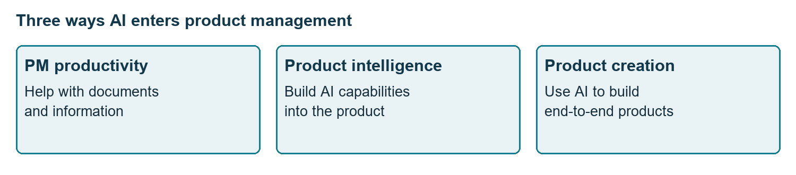
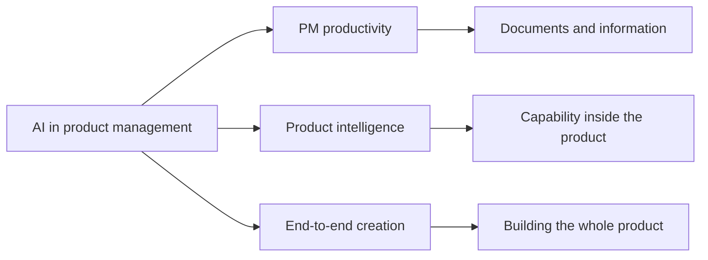
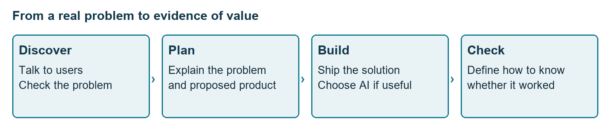
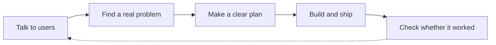
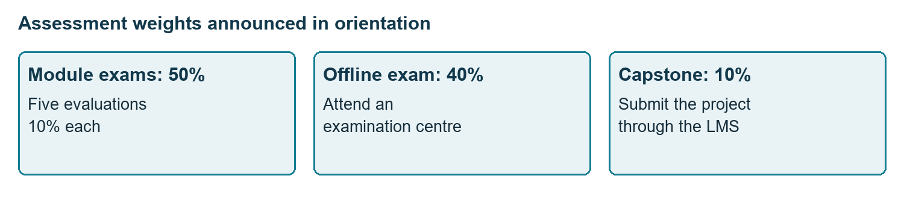
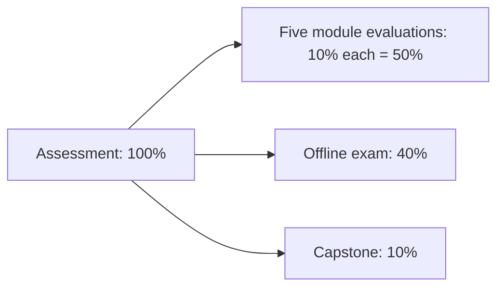
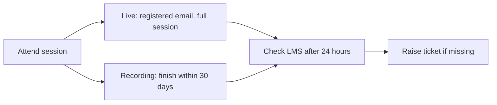
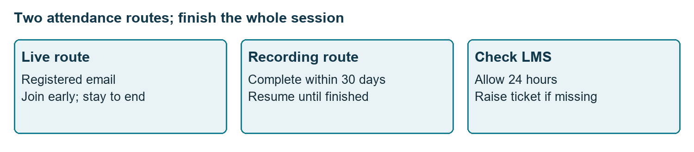

# Class 00: Virtual inaugural session
9 July 2026 · Ankitha B. (as listed in the transcript header; the recording has several unlabelled voices) · Portal title: Virtual Inaugural Session

## The class in one minute
- AI was introduced in three roles: helping the PM work faster, adding intelligence inside a product, and helping build a whole product from start to finish.
- A busy team can ship feature after feature and still build the wrong thing, so a PM must explain the user problem, the proposed solution and how success will be checked.
- The course runs from user discovery and solution design, through delivery and AI foundations, to building applications and a final project.
- Assessment was announced as five module evaluations at 10% each, an offline exam at 40% and a capstone at 10%, with separate thresholds for the certificate and for placement assistance.
- Attend whole sessions, check attendance in the LMS (the course's online learning platform), use the Friday tutorials for doubts and keep a laptop ready for hands-on work.

## Core ideas

### Three layers of AI in product management
The opening argued that AI enters a PM's work in three different places. The first is **productivity**: documents, paperwork and processing information. The second is **product intelligence**: what the product itself can do using AI. The third is **end-to-end creation**: using AI to help build an entire product. This is why the course mixes ordinary product skills with AI practice.

The talk also said that professionals who learn to use AI can take on more responsibility, and that the PM role is changing as building products gets easier. Those were framing claims, not measured predictions about jobs or salaries. No method for any of the three layers was demonstrated in this class.

*The three places AI can enter the work.*

**Remember:** Ask whether AI is helping you work, powering the customer's product, or helping you build it.

### The busy team that builds the wrong thing
The class used a made-up team. They hold meetings, write documents, line up engineers and designers, and ship features. Everyone is working hard, yet users do not stay. Ask why a feature was built and the weak answer is that somebody thought it was a good idea.

The missing work was upstream and downstream of the building: find a real problem, check it is worth solving, make a clear plan, ship, and then prove the result helped. The team was not lazy. It skipped discovery. The same reasoning applies to AI: decide whether the product needs it before adding it.

*Work before building (understand the problem) and after it (check the result).*

**Remember:** A feature delivered and a problem solved are two different outcomes.

### The course roadmap
Six modules were previewed. Their detailed lessons come later, so treat this as a map, not a lesson.

| Module | Focus | Intended outcome |
|---|---|---|
| 1 | PM mindset and user discovery | Understand the role, talk to users, tell wants from needs, set direction with a North Star metric |
| 2 | Solution design | Turn the problem into a solution, align teammates, learn design, write a PRD |
| 3 | Agile, growth and go-to-market | Understand delivery, growth metrics and business models; draft a go-to-market plan |
| 4 | AI foundations and PM workflows | Understand AI well enough to make product decisions |
| 5 | Building applications | Build with the mentor; described as building without code |
| 6 | Project work | Connect the earlier learning and show capability |

A few terms from the roadmap, defined plainly. A **North Star metric** is the one main measure that gives a team direction. A **PRD** (product requirements document) explains what a product needs to do. **Agile** and **Scrum** are ways of organising team delivery. A **go-to-market plan** says how a product will reach its customers. None of these was taught in detail here.

One piece of advice stood out: understanding a user's need is different from accepting the solution the user asks for. Care about the problem, not your attachment to a solution. Building was compared to opening an engine and working on it, because doing the work is how you understand how it runs.

**Remember:** Discover, design, deliver, learn AI, build, then connect it all in a project.

### Hands-on learning and the portfolio
The teaching approach was to explain enough theory to make a concept clear and then move quickly into practice: customer research, design, prototyping and working products. A **prototype** is an early version of an idea that makes it easier to discuss and test. No prototype was shown in orientation.

Learners were encouraged to make something for their **portfolio** (a collection of work that shows what you can do) in every class. The aim is to bring real work into later interviews, particularly for people without directly relevant experience. The journey was described as six-plus months. Three expectations were stated: attend live and work hands-on where possible, explore beyond what the instructor brings, and stay involved for the whole journey. Sharing work on LinkedIn was mentioned. Career hopes were expressed, but no role or salary was promised.

**Remember:** Save what you build and the reasoning behind it. Watching a recording is only part of learning.

### Assessment, eligibility and attendance
Five module-end evaluations (modules 1 to 5) carry 10% each. The end-of-programme offline exam carries 40% and the capstone carries 10%. The module evaluations and capstone run on the LMS. The offline exam needs a physical exam centre and a different platform.

*The five module weights together make up half of the assessment.*

Thresholds as announced: a certificate needs at least 30% overall and 65% attendance. Placement assistance needs 70% or above and 65% attendance. Attendance can come from live classes or from recordings finished within 30 days. The Q&A also used the wording "7 CGPA" for placement, and no conversion between percentage and CGPA was given. Do not treat the two scales as the same until the programme team clarifies.

For live attendance, join with your registered email, finish the authentication step and stay for the whole session. Joining five minutes early was recommended. For recordings, watch the entire thing, in more than one sitting if needed. Partial viewing does not count. Both routes were said to update in the LMS within 24 hours. If a record is missing, raise a ticket.

*Complete the whole session by either route, then allow for the update window.*

**Remember:** Score and attendance are checked separately. A high score does not replace attendance.

### Support, schedule and integrity
The tentative weekly routine is two two-hour academic sessions on Monday and Thursday, then an optional one-hour Friday tutorial that is strongly recommended for clearing doubts. A next-day platform overview was suggested for onboarding problems but was not mandatory. The LMS holds live lectures, recordings, assignments, quizzes, evaluations, schedules and support tickets. A browser is enough; the mobile app mainly sends notifications.

Support tickets were promised a response in 48 hours, with live support Monday to Saturday, 4–7 p.m., through a link in the LMS. Escalation goes coordinator, then programme manager, then senior programme manager. The talk also mentioned escalating after 24 working hours, and the recording does not reconcile that with the 48 hours.

**Plagiarism** (submitting someone else's work as your own) is strictly prohibited. Asked about AI and plagiarism, the answer was that detailed guidelines for use in evaluations would be shared later. They were not explained in this class.

**Remember:** Use the LMS for the real links and calendar. Do not rebuild an address or meeting link from a spoken name.

## Worked example
**Diagnose the busy team.** The scenario: a team has worked for months, written documents and shipped features, yet users are not staying.

1. List the activity. Meetings and shipped features show effort but not user value.
2. Ask why each feature was chosen. "Someone thought it was a good idea" is the weak answer.
3. Check the missing discovery. Did anyone talk to users? Is the problem real? Is it worth solving?
4. Write the problem before picking a solution.
5. Make a clear plan and decide how you will check the result.
6. Ask whether AI belongs in the solution. It needs a reason, not automatic inclusion.

The class did not name a specific user problem, an approved replacement feature or a success target, so this teaches diagnosis only. It is not a finished product spec.

**Applied to car loans.** Imagine a lender whose new-car loan app keeps getting new screens, yet applicants abandon midway. Before adding a feature, ask the credit officer and a dealer why files stall, write that down as the problem, and decide how a faster approval would be measured. Only then ask whether AI (say, reading documents) would help. This is an illustration for study, not something said in class.

## Frameworks to reuse

**Problem, plan, evidence template**

| Question | Blank | Filled from the class example |
|---|---|---|
| What is happening? | Users experience ___ | Users are not staying despite new features |
| What evidence is missing? | Talk to ___ about ___ | Did anyone verify the problem with users? |
| What should we build? | Address the verified problem by ___ | Not chosen; choosing before discovery was the mistake |
| How will we know it worked? | Observe ___ after release | Define proof of success; no target was given |
| Does AI belong here? | AI helps because ___ | Decide whether it is necessary |

**Assessment tracker** (all scores on the same percentage scale)

Overall = 0.10 × (M1 + M2 + M3 + M4 + M5) + 0.40 × Offline exam + 0.10 × Capstone

This is a study calculation from the announced weights, not an official rounding or resit policy.

| Component | Weight | My score |
|---|---|---|
| Modules 1–5 (each) | 10% | ___ |
| Offline exam | 40% | ___ |
| Capstone | 10% | ___ |

## Self-test
1. Name the three AI layers introduced in the class.
2. What three things should a PM be able to explain about a product decision?
3. Which component carries 40%: the capstone, the offline exam, or one module evaluation?
4. How do the certificate and placement-assistance thresholds differ?
5. A team ships features but users do not stay. What question should come before the next feature proposal? And what must you do for a recorded session to count?

**Answers**
1. PM productivity, product intelligence and end-to-end creation.
2. The user problem, what will be built, and how the team will know it works.
3. The offline exam.
4. Certificate: at least 30% overall and 65% attendance. Placement assistance: 70% or above and 65% attendance. The "7 CGPA" wording needs official clarification.
5. Has the user problem been verified, and is it worth solving? For a recording, watch the whole session within 30 days (multiple sittings allowed) and allow time for the LMS to update.

## Homework from this class
Sameer's to do. These are not done for you.

No specific academic homework, submission format or dated deadline was set. The general actions announced were:
- Join the LMS and attend the optional platform overview if you need it.
- Follow the weekly schedule and practise through the lecture assignments.
- Submit the orientation feedback.
- Finish recordings within 30 days, join live classes five minutes early, and allow 24 hours for attendance to update.

The FAQ, the infrastructure slide, the evaluation AI-use guidelines and the confirmed calendar were promised but are not in this folder, so check the LMS or email for them.
