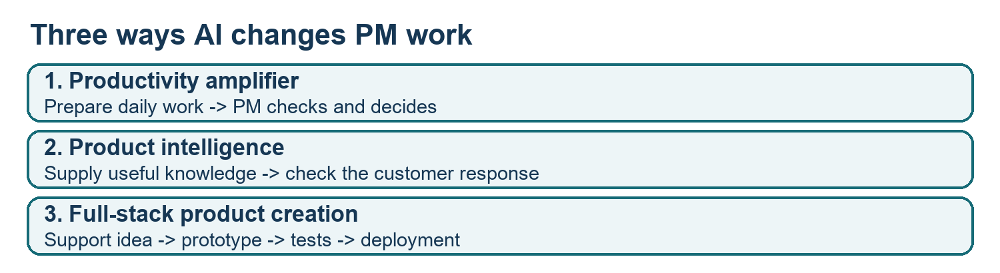
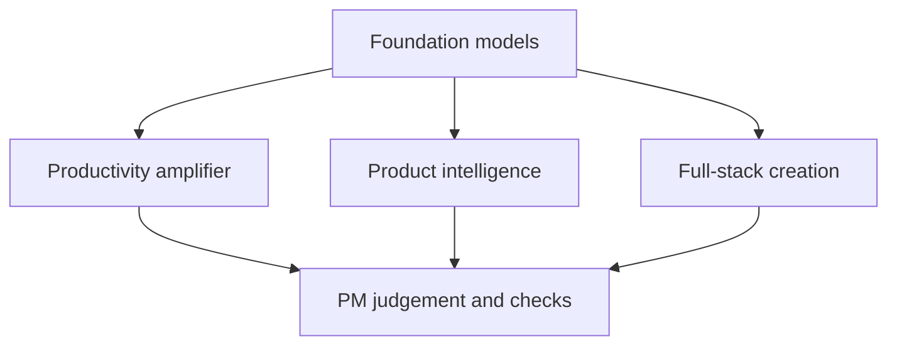
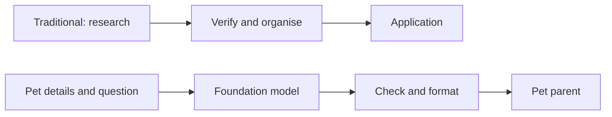
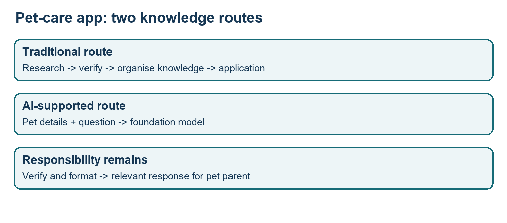
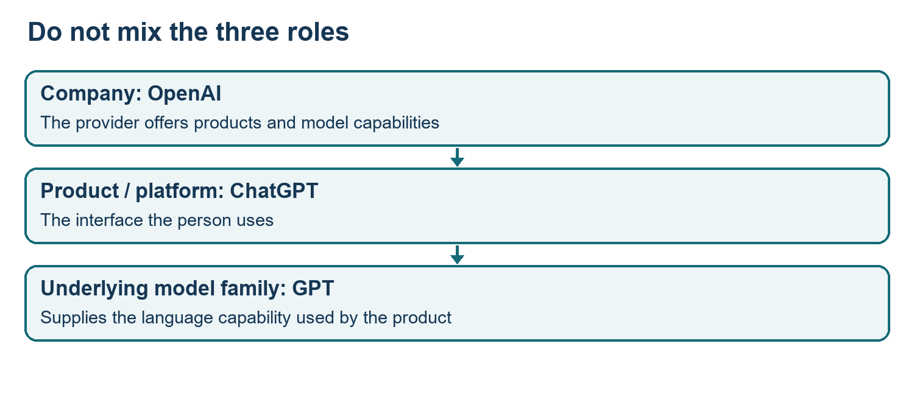
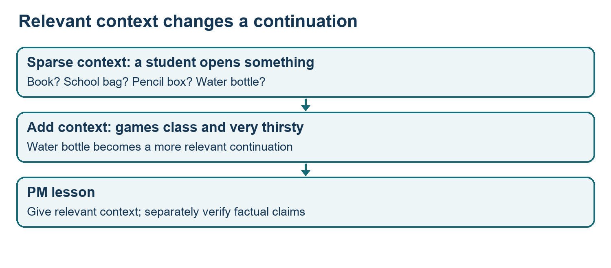
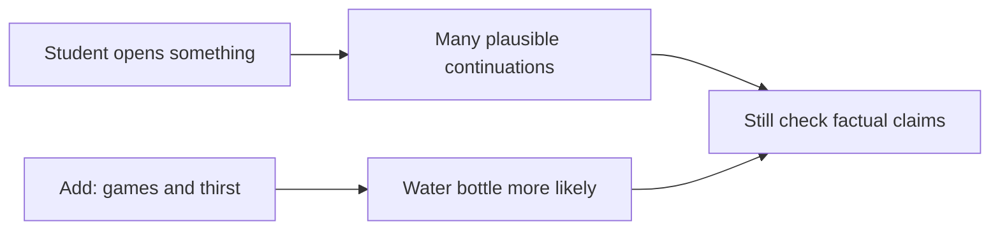

# Class 01: Introduction to product management and the PM ecosystem
13 July 2026 · Prof. Saravana Jaikumar · Portal title: Academic Session 1

## The class in one minute
- AI changes a PM's work in three places: your own productivity, the intelligence inside the product, and the building of the product itself.
- A task-based model is trained for one job. A foundation model is trained broadly first and can then be pointed at many jobs.
- Keep the company, the model and the product apart: OpenAI is the company, GPT is a model family, ChatGPT is the product you open.
- A language model continues text by likelihood, so adding relevant context changes the answer, and a fluent answer is not proof that it is correct.
- When anyone can generate a simple app, PM judgement matters more: domain knowledge, customer understanding, testing models on the real task, and watching cost and risk.

## Core ideas

### Three places AI changes PM work
The class framed AI as three lenses on the PM role, not as three software layers that must be wired together.

A **productivity amplifier** helps you finish your own work faster: documents, paperwork, feature requests, coordination. Rewriting an email in ChatGPT or Claude is the small version. The bigger version is a system that gathers competitor activity, promotions, sales data and customer issues before you sit down, and hands you a pack to check. You still verify it. The "almost 80% of daily work" remark was an illustration, not a measured result.

**Product intelligence** is knowledge or reasoning that lets the product give useful answers to its users. **Full-stack product creation** means using AI across the whole build (design, front end, back end, testing, deployment, updates). "Full stack" simply means everything the user sees plus the systems behind it.

*One foundation model can support all three areas, but each answers a different PM question.*

A student asked what architecture connects the three. The answer: none is prescribed. A single feature request can touch all three, in no required order.

**Remember:** name who benefits first (you, the customer, or the build) and you know which lens applies.

### The pet-care app: what AI changes about knowledge
A pet parent enters a pet's age, breed and measurements, and the app returns feeding, training and health information. Traditionally the hard part was assembling the knowledge underneath: breeds, foods, quantities, life stages, brands. The instructor estimated eight months to a year to compile and verify that base. That was a class estimate for such a project, not a general rule.

With a foundation model, the app can send a question plus the pet's details (the recurring case was a six-month-old Labrador) to the model, then check and format the reply. This does not remove every database, since user records are a separate matter. It removes the manual knowledge-gathering step. Two cautions came with it. Answers must be verified and guarded (a **guardrail** is a boundary or check on what the product may say), and general knowledge stops being a differentiator once every competitor can reach the same model.

*The knowledge route changes. A reliable answer for the pet parent is still the goal.*

**Remember:** AI changes where knowledge comes from, not who is responsible for accuracy.

### Task-based models and foundation models
**Machine learning** is a part of AI where patterns are learned from data. The class used a telecom PM who must retain subscribers. A list at the start of the month of customers likely to cancel lets the PM target retention offers, instead of giving promotions to everyone, including people who would have stayed.

The model learns from history. **Features** are the input characteristics (age, income, occupation were the examples), and a **label** is the known outcome (stayed or cancelled). The instructor compared it to a child learning to tell a dog from a cat through corrections. The numbers used (5,000 predicted cancellations, two lakh customers, 90–95% accuracy) were illustrative, not audited data.

The rule of thumb was one trained task, one model. A retention model does not become a customer-lifetime-value model. A wrong prediction here is also not the same as a hallucination, which is the term for generative AI.

A **foundation model** is **pre-trained** on a very large body of material (a **corpus**) before anyone gives it a task, then reused. The instructor compared a task model's handful of terms with a foundation model's hundreds of billions of **parameters** (learned values inside the model), as an illustration of scale only. Narrow models remain useful, and they are far smaller to run.

| | Task-based model | Foundation model |
|---|---|---|
| Training | For one task | Broad, before any task |
| Reuse | One task only | Many tasks |
| Example | Likely-to-cancel list | Summarise, calculate, explain |
| Size | Small | Very large |

**Remember:** start with the action a prediction would improve, then choose the model.

### Company, model, product and modality
Four words, four different things. The **company** builds models and products. The **model** produces the underlying output. The **product** is what a person opens. A **modality** is a type of content: text, image, audio, video or code.

*The product is what the person uses. A model supplies the capability underneath.*

OpenAI is the company, GPT is a model family, ChatGPT is a product. One product can use different models for text, images and video. Names overlap in places: Gemini is both a Google product and a model family, so read the sentence for which is meant. Copilot is a product, not a foundation model. Hugging Face is a platform for accessing models, not a model. Image and video examples (DALL-E, GPT image, Sora, Whisper) were mentioned, but the captions garbled several version names, so learn the categories, not the spoken list. Calling a product a model signals to an interviewer or a client that you may not understand the system underneath.

**Remember:** ask who the provider is, what the person opens, and what generates the output.

### How a language model answers, and why context matters
The instructor used a simplified, early-style example. A class-five student walks in, sits down and opens something: book, school bag, pencil box, water bottle or tiffin box are all plausible. Add that the student has been playing for two hours and is very thirsty, and "water bottle" becomes the better fit. The spoken probabilities (0.97 and 0.98) were made up for teaching, so do not reuse them or add them up.

The point is that the output is **probabilistic** (based on likelihood), while a **deterministic** rule gives a fixed result under set conditions. That is why generated text is not a database lookup. The model also cannot point to one exact source for a sentence, much as you cannot say which past experience made you think of a book.

*New relevant information changes which continuation makes sense.*

The same idea explains a student question: why does the same model name answer differently in Claude and Copilot? Context and **memory** (information retained or supplied from earlier interactions) can differ, so a model name alone does not describe the full input.

**Remember:** supply relevant context, then separately check the facts.

### Choosing and accessing models
The class's advice on model choice was practical. Test the candidates on your actual task, then weigh accuracy, cost and risk together. Using the strongest, most expensive model at every step can make the product too costly. Broad provider comparisons (for example, which suits empathetic customer support or a professional B2B manual) were offered as dynamic, not as rankings. No prices or benchmark scores were given.

Access is a separate question. An **API** lets software ask a provider-hosted model for output; it gives no ownership of the model and no right to install it. Downloadable open models (Qwen and DeepSeek were named) can be run on your own hardware, which brings hardware and licence questions. Two ways to bring your own information into the picture: **RAG** (retrieval-augmented generation) keeps the data outside the model and fetches it when needed, while **fine-tuning** changes the model through extra training and was described as the costlier route. Amazon's shopping assistant was cited as a fine-tuning example, but the name was garbled in the captions and no architecture was shown. A platform that uses another provider's image model is a commercial arrangement, not automatically RAG or fine-tuning.

**Remember:** calling an API, retrieving information and training a model are three different operations.

## Worked example
**Pet-care knowledge to customer value.**
1. Start from the pet parent's need: information that fits this pet, not pets in general.
2. Note the traditional work: collect, verify and organise breed and care information.
3. Swap the knowledge source: ask a foundation model with the pet's details.
4. Format the reply as part of the app. That is product intelligence.
5. Verify it and add guardrails. Their detailed design was left for later classes.
6. Ask about differentiation. If users can ask a general AI tool the same question, why choose this app? The class raised this but did not settle it.
7. Separately, AI can help design, build and test the app. That is the creation lens, not the knowledge source.

The case gave no care engine, schema, pricing or forecast. It teaches the changing work and the PM's questions.

**Applied to car loans.** Take a new-car loan app. A credit officer's internal pack of overnight applications, bureau flags and dealer queries is productivity. A customer asking "what EMI fits my salary?" and getting an answer is product intelligence. Prototyping the app screens is creation. Because general loan knowledge is free to everyone, the differentiator becomes how well you understand the dealer-to-credit-officer process. This mapping is a study illustration, not something said in class.

## Frameworks to reuse

| Area | Blank form | Class example |
|---|---|---|
| Productivity | Task: __. Prepared output: __. Human check: __. | Morning competitor, sales and issue pack, checked by the PM |
| Intelligence | User question: __. Reference information: __. Response check: __. | Pet details and question to a model, then check and format |
| Creation | Stage: __. AI-supported work: __. Checkpoint: __. | Idea, prototype, build, tests, deployment, changes |

**Task-model planning form:** business objective __ · decision timing (before what happens?) __ · features and known outcome __ · what the model predicts __ · action taken with the prediction __ · how accuracy is checked __.

**Model-selection record:** task __ · relevant context __ · candidate models __ · quality evidence from trying the real task __ · cost __ · missing checks __ · decision and reason __.

These are study aids built from the class, not instructor templates.

## Self-test
1. Name the three areas in the PM-with-AI framework.
2. Which is correct: (A) OpenAI is a model, (B) ChatGPT is a product, (C) GPT is a company?
3. Why is a cancellation prediction useful before the month ends?
4. How do RAG and fine-tuning differ?
5. Two interfaces using the same model name give different answers. What do you check first?

**Answers**
1. Productivity amplifier, product intelligence and full-stack product creation.
2. B. OpenAI is the company and GPT is a model family.
3. It lets the PM make targeted retention offers before customers leave, instead of broad offers to everyone.
4. RAG uses information that stays outside the model and is fetched when needed. Fine-tuning changes the model through extra training.
5. The context and memory around the request. A model name does not prove identical input.

## Homework from this class
Sameer's to do. These are not done for you.

| Task | What to do | Deadline |
|---|---|---|
| In-class research | Compare firms, products and models across text, image, video, audio and code (OpenAI, Anthropic, Google, Perplexity and the Elon Musk-associated company were suggested) | Five-minute activity; no submission format stated |
| Revision | Revisit the terminology and concepts | Before the next discussion; no date stated |
| Shared reading | Read the slides, whiteboards and the three-area framework paper once available | Before the next class; the materials were not in the folder |

No graded assignment, due date, upload destination or rubric was given.
