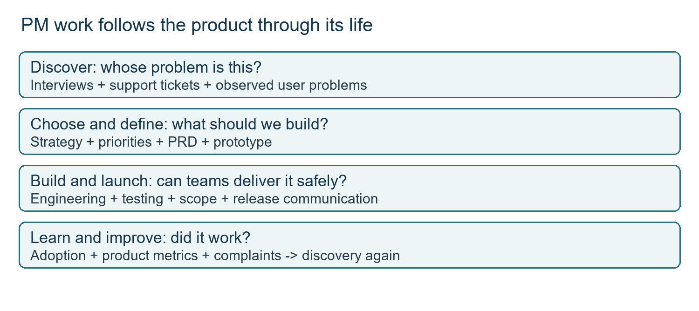
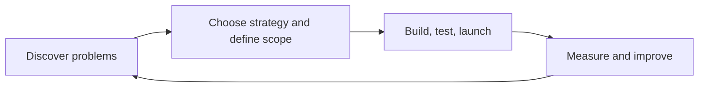
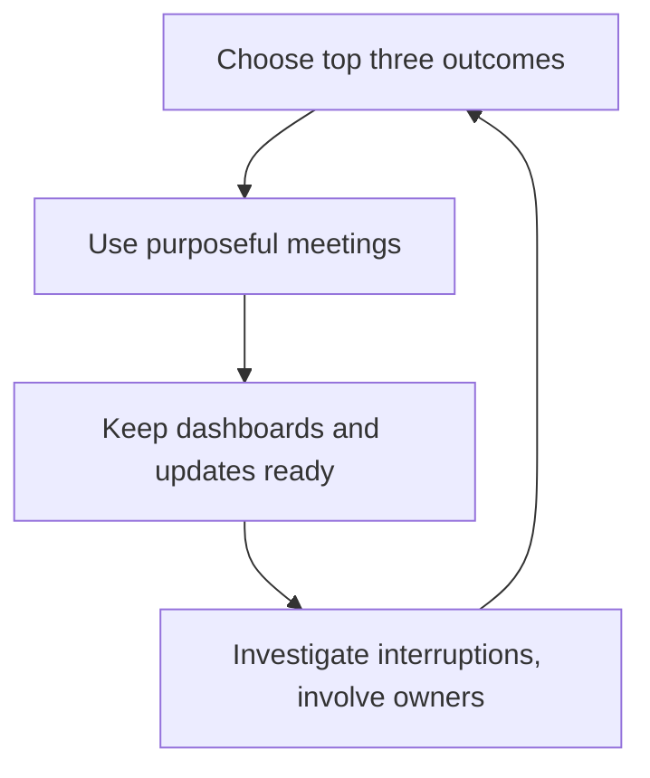
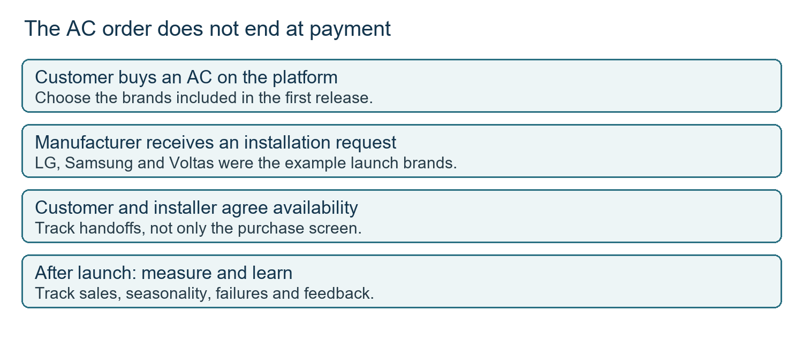

# Class 02: Day in the life of a PM
16 July 2026 · Arun Nandewal, with Rohit Roy teaching the first half · Portal title: Academic Session 2, "A Day in the Life: The PM's Toolkit"

## The class in one minute
- A PM follows a problem from discovery through strategy, requirements, delivery, launch and improvement, and backend work such as document migration counts as product work.
- Interviews, reviews, surveys, support tickets and watching people use the product give the evidence. A complaint is a symptom, so find the cause before choosing a fix.
- A PRD (product requirements document) lists the problem, user, workflow, success measure and scope, so teams agree on what is being built and what is not.
- There is no single PM timetable. A discovery day, a strategy day, a definition day, a launch day and a crisis day each need different attention.
- A good day starts with three chosen outcomes, purposeful meetings, decisions backed by evidence, and risks raised early.

## Core ideas

### The PM cycle, and work users never see
The class showed the PM's work as a loop: discover customer problems, choose a strategy and define scope, build, test and launch, then measure and improve. Measures and complaints after launch send you back to discovery. **Stakeholders** are the people or teams whose needs, work or decisions affect the product, and the PM keeps them aligned.

*Launch feeds learning. It does not end the PM's responsibility.*

Rohit Roy opened with his corporate and investment banking work at J.P. Morgan. **B2B** means business-to-business (the product serves a business or its workers). **B2C** means business-to-consumer. Banking has plenty of B2B work no customer sees: a client submits documents to open an account or get a credit card, and the bank must capture and route that information. A PM may own that internal workflow, not the front screen. His second case was moving documents off an old platform. He used two million documents as an illustration (he began with two to three million), split by geography, business segment and constraint, with China needing a different approach. The work was planned in migration windows.

**Remember:** backend work is product work when it supports a user or business outcome.

### Listening to customers and finding the pain point
Surveys, reviews, interviews and support tickets show where people struggle. **CSAT** is customer satisfaction measured by questionnaire. For a US launch with weak adoption, the team phoned users for fifteen to twenty minutes each and watched where they got stuck. A review suggests a problem; a conversation explains it.

A **pain point** is a difficulty met while trying to finish a task. The PhonePe example separates two failures that could both be filed as "payment doesn't work": the login OTP (one-time password) never arrives, versus the QR scan fails because camera permission was refused. Place each difficulty inside the flow instead of lumping complaints together. Even a B2B internal tool has users who raise tickets.

**Remember:** record where the task stops, then investigate why.

### Strategy, cost and working with design and engineering
**Product strategy** is the direction that decides what to build to serve the business goal. The thought experiment: WhatsApp is told to earn money from its users. That is a goal; a payments feature is only one way to meet it. The arithmetic of one billion users at one rupee each gives one billion rupees, but it assumes everyone pays and ignores cost. It is a teaching number, not a forecast.

Cost is a product decision. A billion-dollar feature may simply not be affordable and stays in the backlog (the list of work waiting to be chosen). The same goes for AI models: a cheaper, faster model that answers the basic questions may be enough. The UPI illustration asked what happens if a free payment suddenly cost two rupees, since price and local availability change behaviour.

The house analogy covered the rest. Describing rooms on an empty plot leaves everyone imagining a different building. A sketch (a **prototype**, an early representation of a feature) makes feedback specific. Engineers are the builders. **Scope** is the agreed boundary of the work, and a **technical tradeoff** is a compromise forced by a constraint, such as an integration that is hard because the other product has no **API** (an interface that lets software systems talk to each other). The contractor example: a four-month promise against an eight-month estimate teaches dependencies and negotiation, not an estimation rule. Success is tracked with **KPIs** (key performance indicators) on a **dashboard**, a shared view of what is happening.

**Remember:** a good feature needs user value, a business purpose and an affordable way to run.

### The PRD, personas and Jobs to Be Done
The class named five essentials of a PRD: problem, persona, pain point, workflow and success metric. Teams read it, ask questions and give **sign-off**, meaning agreement that it explains the work well enough to proceed. A useful test is to hand a draft to someone outside the team. If they cannot say what the idea is, why it matters and who benefits, simplify it.

A **persona** describes the kind of user a product serves. The Myntra contrast was a seventy-two-year-old man in a tier-three town against a twenty-one-year-old working woman in a tier-one city. It is a simplified contrast, and demographic labels alone do not decide needs.

**Jobs to Be Done** (JTBD) asks what outcome the user wants. At Microsoft, invited users show how they use Excel. People do not want formulas for their own sake; they want insight from their data. Pivot tables, formulas and asking AI to analyse the data are different means to the same job. Ask what would count as the job being done.

**Remember:** write the PRD so a stranger can repeat the problem and scope back to you.

### Different kinds of PM day
Which type of day you get follows the product's stage. A **customer discovery day** is for listening and watching (the speaker gave seventy to eighty percent as one example, not a rule). A **strategy and roadmap day** ties budgets and leadership goals to plans; the class used hypothetical budgets of fifty crore for Excel, one hundred crore for Windows and thirty crore for PowerPoint. A **product definition day** turns a known need into a proposal. For the food-subscription case, the current journey is search restaurant, pick a dish, add to cart, pay, and a subscription changes the screens and raises questions such as how to show savings.

Launch days and crisis days also exist. A launch reveals behaviour nobody planned for: users of Microsoft 365 Copilot for Excel asked for an executive's phone number, a recipe and concert bookings. **Happy path** is the expected successful route, and **edge cases** are the unusual conditions that expose gaps. Stories on PhonePe, Paytm, a food-ordering app's payment check and replacement QR codes made the same point: validate the right thing (the correct amount was paid, not just that a payment happened) and ask how a feature might be misused. These stories were told from memory, and the folder holds no incident records for them.

| Stage | Common day type | Focus |
|---|---|---|
| Discovery | Customer discovery | Understand problems, test assumptions |
| Ideation | Strategy and roadmap | Find opportunities, prioritise |
| Planning | PRD and definition | Define requirements |
| Development | Sprint execution | Support engineering, unblock |
| Testing | Analytics and experiments | Check quality and early results |
| Launch | Launch | Smooth rollout, watch adoption |
| Growth | Analytics and experiments | Engagement and retention |
| Production issues | Firefighting | Fix, restore trust |

*Stage table from the Nayan sample portfolio image shown in class.*

**Remember:** the day's emphasis follows the work. No timetable fits every PM.

### Protecting a good day
Reading messages and reacting all day is a warning sign. Start with three outcomes chosen for the customer, the product and the business. Meetings need an agenda and a reason for you to be there. The speaker rejected the "mini-CEO" picture of a PM. You serve customer needs and use **influence without authority**, persuading people who do not report to you, with evidence. When saying no to a request, name the measure you own (an **OKR**, objective and key results, is a goal with outcomes that show progress) and show the data. Do not rely on emotion or fear that a rival will build it.

When an incident hits, find what is broken, bring in engineering and the right owner, and admit what you do not know before promising a fix. Keep a refreshed dashboard for leadership's repeated questions and one central place for updates. Do not rebuild the roadmap overnight because a competitor shipped something or AI is fashionable, and also do not stop learning: the class suggested at least half an hour a day on products, competitors and technology, and reading one favourite app's "What's New" entry each week.

**Remember:** choose the outcome first, then judge each request against it.

## Worked example
**AC purchase through installation.**
1. Frame the task as buying an AC and getting it installed, which is wider than a product listing.
2. Trace the handoffs: the customer buys, the manufacturer receives a request, an installer must visit, and availability must be agreed.
3. Set the first scope in the PRD: Voltas, LG and Samsung only, so nobody assumes every brand in India.
4. Build in sprints (short planned work periods) and launch to production, the live environment customers use.
5. Follow sales, but account for season and region before judging weak numbers.
6. Fix failures, and roll back a bad release if needed.

*The customer's task continues after payment.*

The discovery side of the payments case: imagine five thousand complaints, four thousand nine hundred about payment failure. That shows a theme, not a cause. Split failures by credit card, debit card and UPI, and check whether a provider such as Razorpay is involved. That is **root cause analysis**.

**Applied to car loans.** A new-car loan has the same long tail after the "sign" screen: dealer invoice, insurance, registration, disbursal. A PRD for a first release might cover two OEMs and salaried applicants only, written down so a dealer does not assume everyone is covered. If complaints say "approval is slow", split them by document upload, bureau pull and manual review before touching the form. This illustration is mine, not from class.

## Frameworks to reuse

**Problem-to-release worksheet:** problem __ · evidence __ · affected user __ · desired outcome __ · scope in __ · scope out __ · workflow or prototype __ · engineering constraints __ · dependencies __ · success metric __ · release communication __ · learning after launch __.

**PRD clarity check**

| Prompt | Class example |
|---|---|
| What problem? | Add a subscription to a food-ordering journey |
| Which persona? | People with the food habits discussed |
| Current workflow? | Search restaurant, dish, cart, payment |
| Changed workflow? | Add subscription, explain savings |
| Success measure? | Required, but no target was given |
| Agreement? | Read, clarify, sign-off |

These layouts are study aids built from the class, not instructor handouts.

## Self-test
1. Why is backend document migration product work?
2. Which describes the Excel user's job: (A) type formulas, (B) get useful insights, (C) attend a roadmap meeting?
3. Name the five PRD items from the explanation.
4. True or false: every PM spends the same share of the day on discovery.
5. Your PRD covers three AC brands but a stakeholder expects every brand. What do you do?

**Answers**
1. It supports a user or business outcome and needs constraints, coordination and success measures.
2. B. Formulas are only a means.
3. Problem, persona, pain point, workflow, success metric.
4. False. The product's stage and the type of day change the emphasis.
5. Return to the written launch boundary, reconfirm it, and clarify what expanding it would take.

## Homework from this class
Sameer's to do. These are not done for you.

- Make a "day in the life" image for a favourite company or product. Attach the supplied example images (Zomato, Microsoft, J.P. Morgan Chase) to ChatGPT and ask for a similar one for a PM at your chosen company. Cover company context, PM goals, the work, teams and challenges.
- The recording asks students to post it on LinkedIn and tag Arun, Rohit and Masai. No due date or LMS submission was stated.
- Keep one folder, week by week and class by class, with images, notes and later practical documents, for the future GitHub portfolio. A one- or two-page learning explanation each week was suggested.
- Check the generated image yourself. The Salini sample shown in class has overlapping time slots and a duration that does not match its interval, which is a reminder that generated work needs checking.
