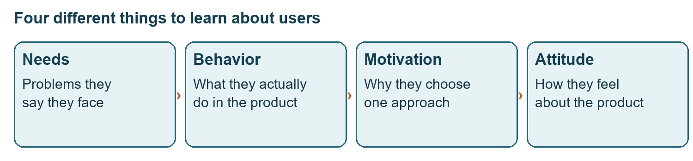
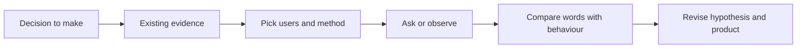
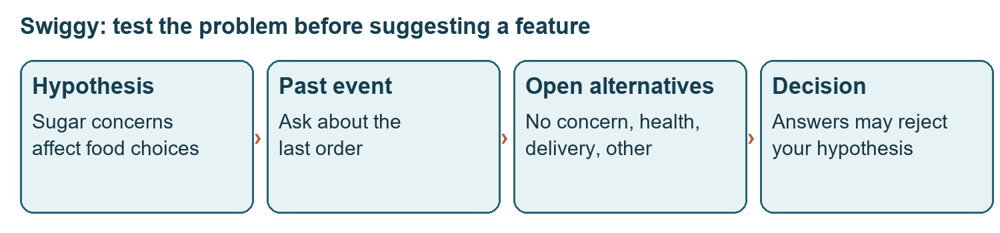
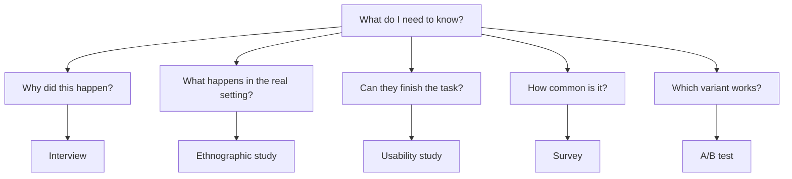

# Class 03: Research methods for a PM
20 July 2026 · Arun Nandewal · Portal title: Academic Session 3, "The Researcher's Toolkit and New Product Development"

## The class in one minute
- Research should feed a decision. Before you ask anything, write down what an answer could confirm or disprove.
- Look at the evidence you already have first, then choose the users and the questions. What people say they want can differ from what they actually use.
- "Primary or secondary" describes where evidence comes from. "Qualitative or quantitative" describes what kind of evidence it is. These are two separate sorting questions.
- Ask people about real events and real concerns. Do not make them approve a feature you have already decided to build.
- Interviews, observation, focus groups, usability tests, surveys, A/B tests and analytics answer different questions, so match the method to the decision and know its weak spot.

## Core ideas

### What research is for, and where evidence comes from
Research gathers evidence about requirements, pain points, buying behaviour, expectations and the market. It can reject an attractive idea before the team spends time on it, and poor questions can make an unwanted feature look useful. The deck (a 37-page slide deck that came with this class) names four things to understand about a user: needs (stated problems), behaviour (actual actions), motivation (reasons) and attitude (perceptions). A stated need is only one of the four.

*A stated need is only one part of understanding a user.*

The class listed many kinds of research: user, market, competitor, customer, technical (can it be built?), product-market fit (does it suit its target market?) and financial viability (can it make money?). **Primary research** collects evidence first-hand through a new interview, observation or survey. **Secondary research** reuses what already exists: reports, reviews, academic work, public data. The class was inconsistent about your own company's analytics, calling it secondary in one list and primary in the live exercise. So describe how the data was collected and whether you are reusing it, instead of trusting the label.

A **hypothesis** is an assumption that evidence could support or reject, and a positive comment is not a result.

**Remember:** write the research question and the decision it informs. A list of methods is not yet a plan.

### Interviews and the Swiggy survey exercise
The interview example was a "product disappearance" question: imagine you wake up and the product is gone from every device, so what do you do? For Zomato, people said they would use Swiggy, cook, hire a cook or try to download the app again. That reveals substitutes and dependence. Questions criticised in discovery: which feature do you like or hate most, is the product good, and what would you build if you were PM. They invite polite approval or hand the design to the user. The "Mom's Test" was named but deferred to the next class.

The Swiggy exercise gave students one survey question to decide whether a feature for people with diabetes was worth building. A **closed question** gives answer options, an **open question** lets people type their own words. The audience was already assumed to have diabetes and to use delivery apps, so there was no need to re-confirm that.

Questions that were rejected, and why:
- Asking for a blood-sugar reading: sensitive, no trust established, and it does not answer the product decision.
- Asking whether Swiggy offers suitable food for "a diabetic like yourself": it labels the person and jumps to judging a feature.
- Asking how often they order: Swiggy already has its order history.
- Asking about reading nutrition information and then whether adding it would help: this is **leading**, because the wording steers the answer. The actor analogy: praise an actor repeatedly, then ask if they are good.

A better student question asked how much people trust labels like Healthy, Diet and Diabetic-Friendly. The main question asked for the biggest concern on the last Swiggy order, with options for no concern, health impact, blood-sugar impact, delivery, packaging or quality, and another concern not listed. A respondent can then disagree with the PM. The "80% have no concern" remark was hypothetical, not a threshold.

*"No concern" and "other concern" leave room for evidence the PM did not expect.*

**Remember:** the answer options must allow your hypothesis to lose.

### Say versus do, and choosing whom to ask
The PhonePe UPI Lite example: a friend asked for a higher transaction limit, yet usage data showed he had never used the existing feature. Praise from someone who rarely uses the product is equally weak evidence. The recommended order is to look at the data, understand behaviour, choose a segment, set the research objective, and only then interview or survey. **Segmentation** means grouping users by a relevant trait or behaviour. For Myntra, commuters browsing may suit an engagement question, while a fast search-to-purchase path raises a conversion question. The narration mixed those two labels, so the safe lesson is to match the segment to the outcome you study.

For a brand-new product with no usage data, build a prototype (a trial version, even a paper sketch) and watch someone try it. Asking for a commitment of time shows whether interest turns into action, though not whether they will stay.

Access to users is scarce, so prepare. The class anecdote about Excel: roughly 1.2 billion monthly users, about 25 PMs, a panel of 20 top users visiting every six months, two questions per PM in a half-hour. These were claims from the anecdote, not checked figures. The Google Maps emergency-routing story was an unverified classroom account of a trip that took 30 minutes instead of a familiar five. The research lesson: rehearse sensitive questions carefully when the user has been through something serious.

**Remember:** choose whom you ask and how before you write a long question list.

### Failure stories and framing
These are the class's readings, not independent company histories. Google Glass showed that enthusiasm among tech fans may not become everyday use (the deck adds privacy fears). Zune showed copying a competitor without enough difference. Microsoft phones and the Amazon Fire Phone were attempts to enter an attractive category without a strong reason to switch. Meta Celebrity AI showed novelty without lasting value. Spoonr, described in the deck as matching users for platonic cuddling, showed niche demand not matching a widely felt need. No revenue or retention figures were given.

Framing changes how a question lands. "Exploring life" after meeting someone suggested marriage, while "something fun" suggested dating. The class proposed leaving the outcome open (professional networking, dating or marriage). Wording must also suit the person's age and knowledge.

**Remember:** enthusiasm, social approval and novelty can all pass for demand in a badly designed study.

### Methods in the field
**Ethnographic research** studies people where they actually work or live. A nurse's real workflow, with its interruptions and pressure, looks different from her description in an interview. The class mentioned observing pilots, delivery work and support calls. This was about method fit, and no consent procedure was taught.

A **focus group** is a moderated discussion with several relevant users. In the MakeMyTrip visa story, ten experienced international travellers were invited. An opening question revealed who dominated and who stayed quiet, so the group was split into five more vocal and five quieter people, each asked the same questions. The deck's own advice is smaller groups of five to eight with a moderator and a co-moderator.

A **usability study** watches whether people can finish a task and where they struggle. The passport-form example: a form an English-fluent user finds easy may confuse an older person. In the Copilot example, users typed into the search bar or an Excel cell while the team expected a click on the Copilot icon. That gap between the design and the user's **mental model** (their expectation of how it works) is a discoverability problem even when the feature works. **UAT** (user acceptance testing) has selected users complete an end-to-end transaction before **GA** (general availability to everyone).

An **A/B test** compares two variants and measures behaviour. The pickle story: same parathas, different pickle, and the group with one pickle ordered more. It was a teaching story, with no sample size or uplift. Examples named: ChatGPT response preferences, MakeMyTrip button colours, Zepto's pass versus free-milk offer. No experiment was set up in class, and the deck warns A/B tests take time and may not explain motivation.

**Remember:** the discussion setting changes the evidence you collect.

## Worked example
**The Swiggy decision.** Nobody collected real responses, so no outcomes are invented.
1. Decision: investigate a food-ordering feature for people with diabetes. A manager's request is not proof of need.
2. Assumption: blood-sugar impact may affect ordering.
3. Check what you already have: Swiggy knows order frequency, so spend the question on what records cannot explain.
4. Reject the blood-sugar-reading question and the feature-approval question.
5. Ask about the biggest concern on the last order, with "no concern" and "other" as real options.
6. Read the possible answers carefully: sugar or health concerns justify more discovery, no concern weakens the assumption, delivery concerns point to a different problem.
7. Record what is still unknown: how common the concerns are, who answered, and whether a change would help.

A concern is a reason to investigate. It does not define the feature or prove demand.

**Applied to car loans.** Suppose a lender wants a "pre-approved EMI" feature for dealer showrooms. The weak question to a dealer is "would a pre-approval screen help?" The stronger one is "think of your last customer who walked away: what held the deal up?" with options such as documents, bureau score, down payment, insurance or something else. Order history and rejection reasons already sit in your system, so do not ask about them. This example is mine, not from class.

## Frameworks to reuse

| Method | Best for | Watch out for |
|---|---|---|
| Interview | Why did this happen? | Time-consuming, interviewer bias |
| Ethnographic study | What happens in the real setting? | Access, observer bias |
| Usability study | Can the person finish the task? | May miss whether the need matters |
| Focus group | Shared opinions and disagreement | Dominant voices, group pressure |
| Survey | How common is it? | Hard to design, low response, biased sample |
| A/B test | Which variant changes behaviour? | Slow, does not explain why |
| Analytics | What do people actually do? | Shows what, not why |

**Research decision brief (blank):** decision __ · hypothesis ("we think __ because __") __ · existing evidence to check first __ · audience __ · method __ · question about the last actual __ · answer that would disprove us __ · evidence, limits and next step __.

**Survey steps from the deck:** define the decision, target the audience, keep it short and logical, mix question types, pilot on a small group first. **Interview flow from the deck:** warm-up 5 minutes, context 10, core exploration 20, wrap-up 5 (about 40 minutes, adjust to the access you get).

## Self-test
1. What is the difference between primary and secondary research, and is it the same as qualitative versus quantitative?
2. Why was "Would adding nutrition information help you?" rejected as a survey question?
3. Why ask about the biggest concern on the last order rather than a feature you plan?
4. What does a usability study show that a survey cannot?
5. A friend asks for a bigger limit on a feature, but data shows he never used it. Which evidence do you trust, and what do you do next?

**Answers**
1. Primary is first-hand collection and secondary is reusing existing material. No, qualitative (words, reasons) versus quantitative (numbers) is a separate distinction.
2. It is leading: the wording nudges the user towards the answer you want.
3. It asks about a real event and allows "no concern" or "other concern", so the hypothesis can lose.
4. Where people actually struggle while attempting a task.
5. Trust the behaviour data. Segment the users, then research the real use before acting on the request.

## Homework from this class
Sameer's to do. These are not done for you.

- Write **three survey questions with response options** about Google Maps emergency routing. An earlier instruction asked for two interview questions on the same incident, and the closing direction refined it to survey questions.
- Use the deck's highway examples for form and sequence, but note that the emergency case is sensitive. Decide the decision and the audience before drafting the options.
- Keep a personal copy of the research document in your own Drive.
- Posting on LinkedIn and tagging was optional. No due date or rubric was stated.
