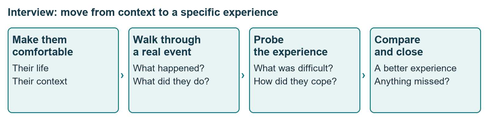
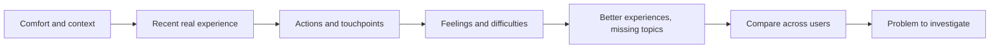
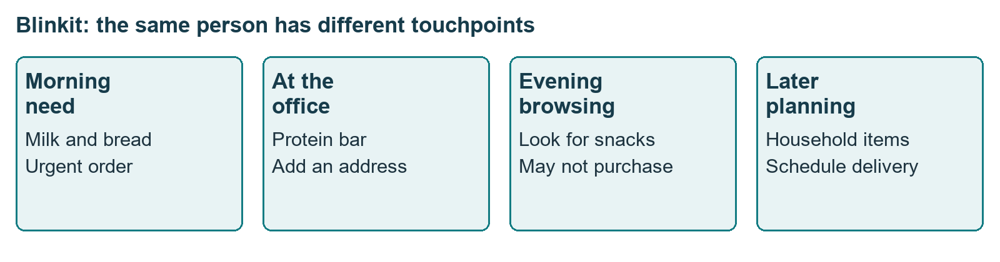
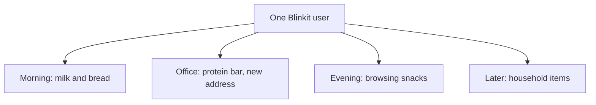
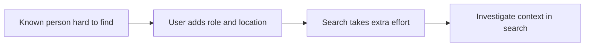
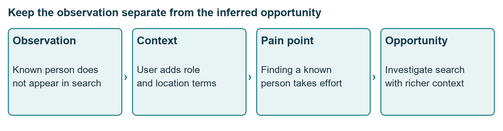
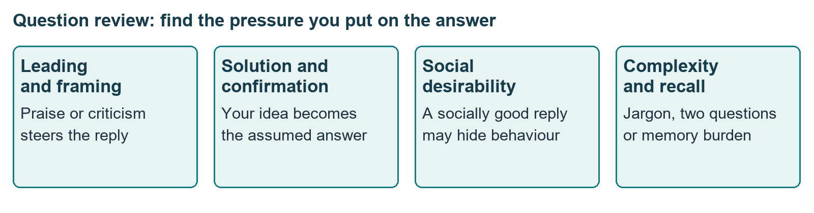
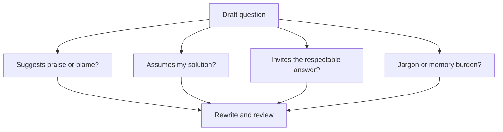

# Class 04: The art of the user interview
23 July 2026 · Arun Nandewal · Portal title: Academic Session 4, "Workshop: The Art of the User Interview"

## The class in one minute
- Interview users about their life and real experiences. The user tells you what happened, and the PM interprets the problem and decides what to build.
- Build the conversation in steps: put the person at ease, reconstruct one specific recent event, follow their own details, probe the difficulties, compare better experiences, and ask what you missed.
- A useful journey has context, touchpoints, actions and feelings. "Uses Blinkit for groceries" hides the urgent order, the new address, the browsing and the planned order.
- AI can draft a research guide and flag biased questions, but you must correct its assumptions about the product and customer first.
- Get recording consent, keep to the agreed time, practise the guide, and compare several real accounts. A convenient answer, a feature request and a repeated problem are three different things.

## Core ideas

### What an interview is meant to uncover
A user saying "search is bad" or "Excel's interface is hard" has not told you what to change. Ask for the actual event and what they were trying to do. The answer might be a search-context problem, a confusing formula, or a crash on a large file. Suggest the feature first and you will mostly hear agreement with your own idea.

The class opened by revisiting the Google Maps exercise from the previous class: a person describing a long ambulance journey during a family emergency. This stayed an unverified classroom scenario. Several proposed questions were rejected. Asking whether they would recommend Maps after the event gets a reaction, not an explanation. Asking what percentage of all trips reached the right destination demands memory and calculation. Questions about point-of-interest categories and hospital gates were feature ideas dressed as questions. **POI** (point of interest) means a named destination, and users should not need product-team jargon to answer.

A few words to keep apart. A **touchpoint** is a point where a person interacts with the product. A **pain point** is a specific difficulty in that experience. An **opportunity** is a problem the company could address. Keep the observed event and the inferred opportunity separate.

*Follow-up questions grow out of what the user says.*

**Remember:** an interview should feel like a respectful conversation, not an interrogation or a memory test.

### Journeys instead of feature lists
Compare two ways of asking. One lists petrol stations, highway options and route features and asks which the person uses. The other asks them to walk through how they use Maps. The second lets them describe their own sequence. A **user journey** covers what triggers use, what happens next, the actions inside and around the product, and how the person feels.

The class demonstrated with Blinkit. The weak version: "orders groceries and quick snacks in the morning and for weekend parties." The strong version separated four contexts: running out of milk and bread in the morning, ordering a protein bar at work and adding an office address, browsing snacks on the way home, and remembering household supplies before sleep. These were illustrations, not a claim that all happen daily.

That detail opens different questions. A browsing session without a purchase could mean suitable snacks are missing, freshness is doubted, or the person simply likes browsing. Those are competing explanations to investigate, not findings.

*One person, several use cases, including a visit that ends without a purchase.*

**Remember:** a broad use-case label hides where the problem occurs. Ask what happened, then check your reading with the person.

### The LinkedIn search interview
The main structured example was improving LinkedIn search. The flow: understand how they use LinkedIn, then ask about the last search, what they wanted and how it went from start to finish. The user should do most of the talking, roughly 70/30 or 80/20.

The participant described searching by names, roles, locations and content topics, and said known people did not appear immediately, so role and location were needed. Location and firm sometimes worked better than other terms. Follow-ups stayed with those details. Other mentions: too many required keywords, weak filters, irrelevant results, slow loading. When someone proposed an algorithm change, it was rejected: the task was to describe the problem. The interviewer then asked where search worked well elsewhere, to learn the person's standard for good, not to copy features. The close, "what haven't we covered?", surfaced premium versus free access, image search, hiring and sales use. The deck also carried a synthetic persona, Job Seeking Jacob, which is a teaching case and not research data.

Some live follow-ups used yes/no choices and suggested causes. The class later advised open questions about past behaviour, so treat those as demonstrations to review, not perfect wording.

*An observed difficulty justifies an investigation. It does not establish a solution.*

**Remember:** follow the user's own terms, compare what good looks like, and leave room for topics you missed.

### The Mom Test and the bias check
The **Mom Test** is a way to avoid polite approval, even from someone kind. Talk about their life, past behaviour and specific stories, and listen more than you speak.

| Rule | Weak | Better |
|---|---|---|
| Their life, not your product | Would you use a grocery-expense app? | Tell me about your last grocery trip |
| Past behaviour, not promises | Would you pay $10 a month? | What do you use now, and do you pay? |
| Specifics, not hypotheticals | Would you use this feature? | How do you solve it today? |
| Stories, not approval | Is the idea good? | Tell me about a time you struggled |

*Check the pressure a question creates, not only whether it sounds open.*

The bias families from the class: **leading** (steers towards praise or blame), **solution** (puts your feature in the question), **confirmation** (assumes your belief is true, such as "older rural users don't use Instagram"), and **social desirability** (answering in a way that looks respectable, as with settling debts promptly). A **double-barrelled question** combines two questions that may need separate answers. **Jargon** means terms the person may not know. Recency and recall bias means treating what you just saw as universal.

One conflict was left open. The deck recommends Five Whys to reach motivations, while the live teaching said to avoid "why" because it can sound accusing and to use "what" and "how". The files do not reconcile this, so ask the instructor how to apply it.

**Remember:** a question starting with "what" or "how" can still hide an assumption.

### AI as the drafting partner
A reusable prompt, pasted into Gemini live, makes the model act as a user-research strategist. It asks what the product is and does, proposes a target customer and journey and asks you to confirm, asks whether you want interviews, a group discussion or a survey, drafts 8–10 questions, reviews them for bias, and produces a guide. The examples were PhonePe (paying on behalf of a friend), iPhone and Excel. For the Excel complaint, the class did not jump to a redesign: students were to find what was actually hard, such as remembering VLOOKUP (a spreadsheet lookup function), organising data for formulas, or crashes with a very large file.

Treat the model's customer summary as a draft. Read its bias fixes rather than trusting its claim of neutrality. AI role-play as a customer is a practice partner, not a real participant and not evidence of demand.

Interview basics: explain who you are, the purpose and how answers are captured; get consent before recording; respect the time and ask for a follow-up rather than overrunning. Practise with a colleague. One interview is not a pattern; the class mentioned 20, 30 or 40 users and a team talking to about 70–80, with no sample-size maths taught. Keep core questions comparable across people.

**Remember:** an AI-drafted guide is a draft. Correct the customer context before you use the questions.

## Worked example
**LinkedIn search to an opportunity.**
1. Fix the focus on search. The interview does not need to cover every LinkedIn feature.
2. Ask about normal use, then the last actual search and what they wanted.
3. Follow their account of names, roles, location and topics. Ask how those terms worked.
4. Note the concrete event: a known person did not appear at once, and adding role or location sometimes helped.
5. Separate observation from interpretation. The person had to supply extra context, which supports looking into finding people by context. It does not prove the cause or the algorithm needed.
6. Ask about search that worked well elsewhere, listening for relevance, speed and filtering.
7. Ask what was missed.
8. Compare with other users before generalising.

**Applied to car loans.** To improve how dealers submit a loan file, ask a dealer sales executive to walk you through the last file they sent: what they gathered, where they waited, who they called, what they did when the credit officer queried it. Follow the details they mention (say, resubmitting an income document) before you ever suggest an upload feature. Ask what other lenders do better, then ask what you haven't covered. This is my illustration, not class content.

## Frameworks to reuse

| Stage | Blank question | LinkedIn example |
|---|---|---|
| Intro and consent | Role, purpose, how captured, permission | Study LinkedIn search, ask to record |
| Context | How does this fit your routine? | Professional use of LinkedIn |
| Recent event | Walk me through the last time you tried to __ | The last search |
| Follow-up | You mentioned __. What happened next? | Names, roles, extra terms |
| Difficulties | What happened when __? | Known person did not appear |
| Better elsewhere | What worked better, and how? | Faster search in other apps |
| Closure | What have we missed? | Free vs premium, hiring, sales use |

**Timing from the deck (LinkedIn guide):** intro 3–5 minutes, current use 7–10, search experience and pain points 10–15, content and technical 7–10, ideal experience 3–5, closing 2–3. That adds up to 32–48 minutes, while the live walkthrough called it a 25-minute example, so do not promise 25 minutes with every block at full length.

**Evidence record:** participant and context __ · intended task __ · action observed __ · difficulty __ · workaround __ · interpretation __ · alternative explanation __ · next question __.

## Self-test
1. What is the difference between a touchpoint and a pain point?
2. Why is "Would you use a scheduling feature?" a weak interview question?
3. Name two kinds of bias and give a one-line example of each.
4. What should you do with an AI-generated interview guide before using it?
5. Why do you interview several users before calling something a problem?

**Answers**
1. A touchpoint is where the person interacts with the product. A pain point is a specific difficulty in that interaction.
2. It is hypothetical and solution-led. Ask how they handle the task today and about the last time it came up.
3. For example, leading: "Maps always gives wrong directions, right?" Social desirability: "Do you always settle debts immediately?" (Solution, confirmation and double-barrelled examples are also acceptable.)
4. Correct its customer and journey assumptions, read its bias fixes, and practise the guide.
5. One interview is not a pattern. Compare several real accounts first.

## Homework from this class
Sameer's to do. These are not done for you.

- Run the supplied prompt, choose a product and a research format (interview, group discussion or survey), generate a guide, and read its questions and biases.
- Write a ChatGPT user journey, and apply the interview structure to the Google Maps exercise.
- Save the prompts and outputs for the portfolio. Sharing a visual or LinkedIn post was encouraged.
- The assignment page was reported as read-only or unclear and clarification was deferred to the tutorial or TA session. No official submission steps, rubric or dated deadline appear in the files.
- Persona and journey synthesis were previewed for the next class.
