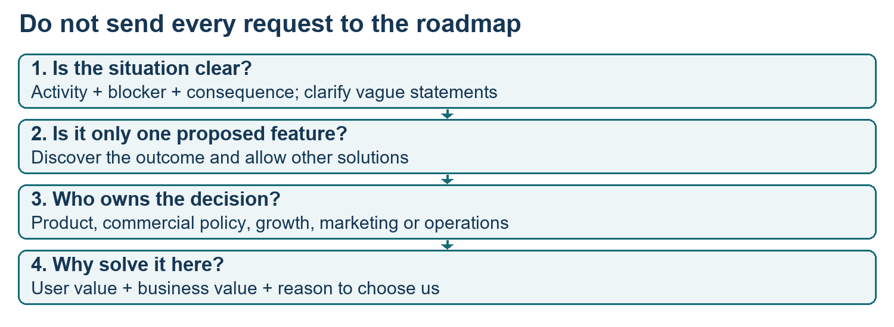
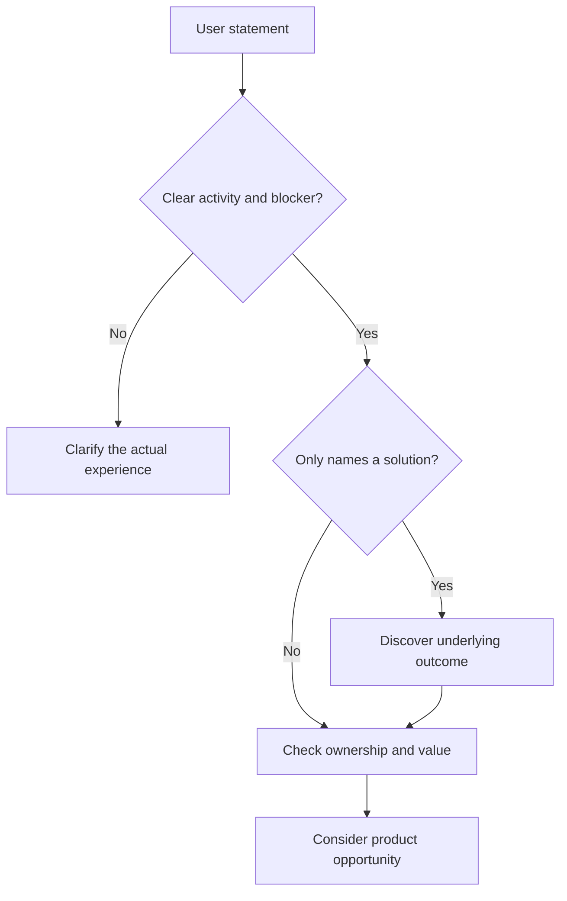
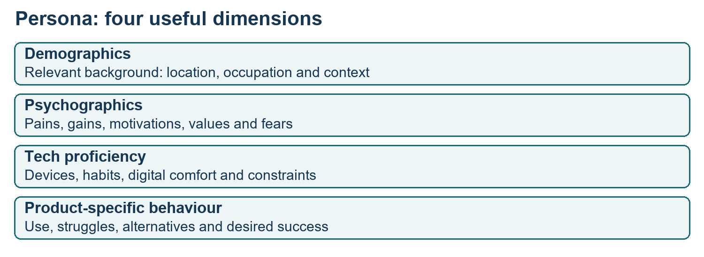
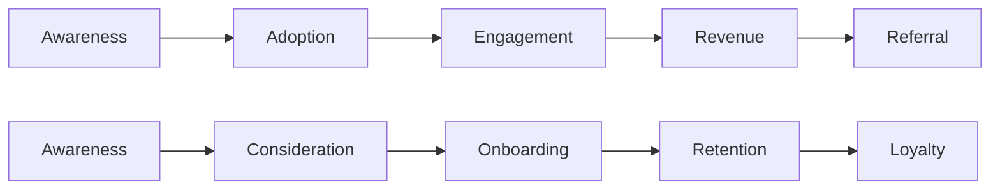

# Class 05: Research synthesis, personas and user journeys
27 July 2026 · Arun Nandewal · Portal title: Academic Session 5, "Workshop: User Research Synthesis - Empathy Mapping, Affinity Clustering and Personas"

## The class in one minute
- Empathy for users must connect to business value. Ask whether the product should solve the problem, why the user would pay or stay, and why they would pick this product over alternatives.
- A requested feature is not the underlying problem. The class turned quick-commerce requests into pain statements, threw out vague ones and grouped related ones into outcomes.
- A persona describes the segment you serve (background, motivations, tech comfort, product behaviour). It represents a group, not one real person, and should rest on data.
- A journey shows what the user does and feels from discovery through to referral, so you can see where they get stuck.
- AI prompts produce draft personas and journeys fast, but the prompts allow assumptions, so treat every output as a hypothesis to validate.

## Core ideas

### Empathy needs a business question
Students first described empathy as understanding goals, emotions and frustrations. The instructor pushed back: where is the business value? He gave three questions. Is this a problem our product should solve? Why would the user pay, or stay, if we solved it? Would our product be the best choice, or would alternatives still win? Understanding a complaint does not show that your team should fix it.

A **latent need** is a hidden need users cannot easily state. The music-player illustration: users asked for more storage, cassette purchases, easier song swapping, but the broader answer was access to music through the cloud. That was a conceptual analogy, not a history of Apple Music. The ChatGPT version contrasted trusted answers and shorter replies with agentic workflows that use your data.

The live class used **needs** for what users explicitly ask for and **wants** for the deeper outcome the PM must find. An **output** is what you deliver (a feature). An **outcome** is what changes for the user. The deck uses "needs" in the broader motivation sense, so check which meaning is in play.

| Product | Stated request or output | Deeper outcome |
|---|---|---|
| Masai course | AI PM learning, certificate, mentorship | AI PM employment or placement support |
| ChatGPT | Read files, update documents, help with assignments | More productivity on the user's tasks |
| Blinkit | ETA, tracking, rider contact, address change | Predictability and control over the order |

**Remember:** a request tells you what a person can say. The PM still has to find the outcome behind it.

### Turning requests into usable pain points
The class brainstormed missing needs for Blinkit or Zepto: delivery estimates, tracking, rider contact, language support, scheduling, ordering for someone else, fewer hidden charges, price comparison, expiry information, organic filters and more. The instructor pointed out that this list was mostly features. The pain-statement form fixes that: *I want to do __, but on the product I cannot because __, so I cannot achieve __.*

The statement that held up best was the stockout: the user cannot complete their regular grocery batch because some items are unavailable, so they must go to another platform. It names a failure and does not dictate the fix. Others were challenged. "Compare prices side by side" and "add products after ordering" were later classed as features. "Choose the best product on many criteria" was too broad. A search complaint lacked what was searched and what happened. The heuristic: a complaint that offers only one solution is often a feature in disguise. It is a way to challenge wording, not a test that proves a problem invalid. (One recap line in the captions reverses the rule. The repeated explanation and the Word document support this reading.)

*Clarify what happened and who should act before choosing a solution.*

Ownership matters too. Lower prices, coupons and removing delivery charges went to finance or strategy. Launching in a new city, marketplace listings and a celebrity ambassador went to growth and marketing. Faster physical returns were operational. These are examples from this class, not a universal org chart. Promising a discount or a new city is not product reasoning.

**Remember:** write the user's blocked activity and its consequence, and keep the solution open.

### Is it worth solving, and bucketing into an outcome
How do you know a problem matters? The instructor's removal test: would users miss it and ask for it if it disappeared? Other signals he named were organic adoption without heavy marketing, repeat transactions, and continued use after a price rise. These are qualitative signals with no thresholds, and the real check is to build a prototype, take it to users and see whether they get value. Asked about rivals with lower prices and more traffic, he said the answer depends on the product and segment: find the distinctive value that makes people stay, not just match the price.

He argued for one accountable outcome per PM. Course certificates, applications, interviews and a job are not the same outcome, and a partial checklist hides what the user wanted. When you join a team, ask which outcome your role must move over the agreed period. One outcome can still be reached by different solutions.

**Bucketing** (affinity clustering) groups related requests into a theme. ETA, tracking and rider contact became delivery visibility. Scheduling and pre-order became planning. Hidden charges, price comparison and cost breakdown became charges. Expiry information and organic filters became product attributes. The aim is a one- or two-line outcome instead of a long disconnected list. Theme labels organise information and do not prove a feature is worth building.

**Remember:** user value should show in behaviour, not only in friendly comments.

### Persona: who are we solving for?
A **persona** is a generalised picture of a target user segment. The instructor said it is not fiction and is based on user findings; the deck recommends interviews, surveys, analytics and regular revision. Four dimensions: **demographics** (age, location, occupation), **psychographics** (motivations, values, pains, gains), **tech proficiency** (devices, app habits, digital comfort) and **product-specific behaviour** (usage, touchpoints, struggles, alternatives).

*A useful profile includes behaviour and outcomes, not only age and city.*

Primary, secondary and tertiary personas mean majority, minority and occasional users. Two, at most three, is enough. The class sketches (Nykaa: women 20–30 primary; Zoom: professionals 25–35 primary) were illustrations, not distributions.

The live demo used a persona prompt in ChatGPT for Microsoft Excel, an image error, a retry in Gemini, and a poster for a primary and a secondary persona. The generated primary persona was Priya, a senior data analyst in Bangalore. The secondary was David, a hardware-store owner in Houston. Their ages, incomes and devices were generated, and the prompt tells the tool to infer plausible details when data is missing. That contradicts the teaching definition of a data-backed persona, so mark the assumptions and validate them.

**Remember:** a persona is the who. It does not yet show the sequence of the experience.

### Journeys, and the deck's JTBD extension
A **user journey** shows the sequence of interactions and feelings across an experience. The live Netflix map ran awareness, adoption, engagement, revenue and referral, and for each stage students filled in the emotion, what works and what fails. The deck and prompt use a different set: awareness, consideration, onboarding, retention and loyalty. Pick the set that suits your question and say which you used.

The Zepto prompt took the product, retention and repeat orders, and tier-one Indian cities. The generated map listed pains such as trust, offer overload, coupon friction, notification fatigue and weak rewards, plus four recommendations with effort labels. These are AI hypotheses, not user quotes, and the effort labels are illustrative.

The deck added material that was not taught live. **Jobs to be Done** (JTBD) asks what outcome a person hires a product for, split into functional, emotional and social jobs, with affordability as a constraint. **Voice of User** means systematically recording pains, gains and unmet needs from interviews, surveys, reviews and support. Its five-step pain generalisation is: collect feedback, cluster similar pains, generalise, quantify frequency and impact, prioritise. Its example turned a failed story upload on a weak connection into a wider low-connectivity problem. No scores or weights were supplied.

**Remember:** a persona gives the user context. A journey shows where they succeed or get stuck.

## Worked example
**Blinkit and Zepto requests into an outcome.**
1. Collect the class requests and keep them apart from claims about current product features.
2. Rewrite one as activity, blocker and consequence. The stockout becomes "cannot complete my regular grocery batch without switching platform."
3. Check whether the wording forces a feature. "Monthly subscription" prescribes a fix, so ask about the recurring shopping job.
4. Group the rest. ETA, tracking and rider contact are delivery visibility. Hidden charges, comparison and breakdown are charges.
5. Name the outcome: predictability and control. It is a direction to test, not a promise of perfect control.
6. Check ownership and value. City expansion is a growth decision. Ask why users would stay or pay.
7. Pick the persona and journey stage to test with.
8. Take a prototype to users and see whether they get value. A generated image or a polite reaction is not validation.

**Applied to car loans.** A dealer says "we need a faster approval screen." Rewrite it: "I want to confirm a customer's loan eligibility while they are still in the showroom, but the approval takes a day, so the customer leaves." Then group other requests (status tracking, document reminders, a call back from the credit officer) into one outcome, say "predictability about my file," and note that a rate cut is a commercial decision, not a product feature. A primary persona is the dealership sales executive, and a secondary one is the salaried first-time car buyer. This is my illustration, not class content.

## Frameworks to reuse

**Business-value questions:** Should our product solve it (who else owns it)? __ · Why would the user pay or stay? __ · Why us over alternatives? __

**Pain statement:** As a user I want to __, but in __ I cannot because __, so I cannot achieve __.

**Persona canvas**

| Dimension | Questions | Evidence status |
|---|---|---|
| Demographics | Where, occupation, background | Source: __ |
| Psychographics | Pains, gains, motivations, values | Source: __ |
| Tech proficiency | Devices, apps, comfort, constraints | Source: __ |
| Product-specific | Use, alternatives, barriers, success | Source: __ |

**Journey map fields (per stage):** action __ · touchpoint __ · feeling __ · pain __ · opportunity __ · evidence __.

**JTBD statement:** When I __, I want to __, so I can __.

## Self-test
1. What are the three business questions that go with empathy?
2. Why is "a monthly subscription" a weak problem statement?
3. What is bucketing, and what should it end with?
4. Name the four persona dimensions.
5. Why shouldn't you present an AI-generated persona as research?

**Answers**
1. Should our product solve it? Why would the user pay or stay? Would we be the best choice over alternatives?
2. It prescribes a solution. It does not say what recurring shopping activity is difficult.
3. Grouping related requests into themes, ending with a clear one- or two-line outcome.
4. Demographics, psychographics, tech proficiency and product-specific behaviour.
5. Its ages, incomes and devices are generated assumptions, not findings from users. Mark and validate them.

## Homework from this class
Sameer's to do. These are not done for you.

- Persona exercise: choose a favourite product, write a persona draft, and generate a primary and a secondary persona image, saved in the named document.
- Journey exercise: complete the emotion, what-works, what-fails grid for a chosen product and share the document link.
- Prompt practice: keep a prompt library and use the persona and journey prompts on your chosen product.
- Read the generated Zepto journey before the next class.
- Optional: post or save the work. The instructor said selected posts would be shared on Thursday.
- Suggested daily practice: pick an unfamiliar product and write fifteen pain observations (five each around breakfast, lunch and dinner).

No separate brief, rubric, submission portal or dated deadline was given.
