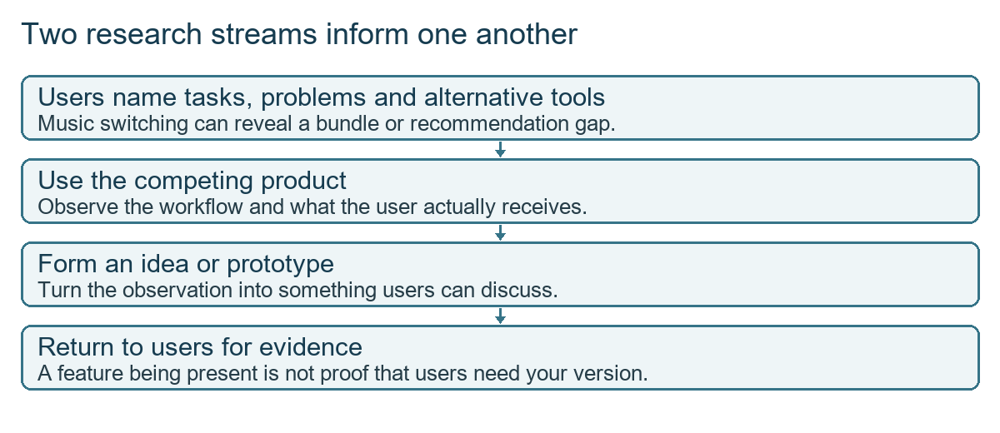
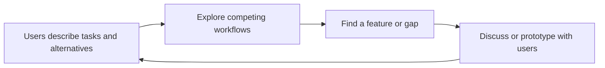
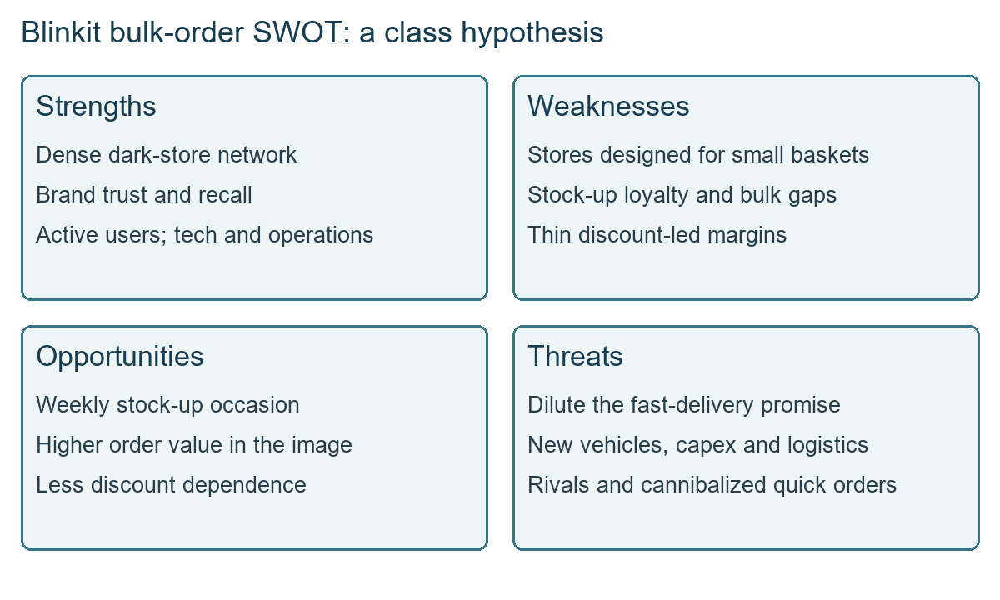
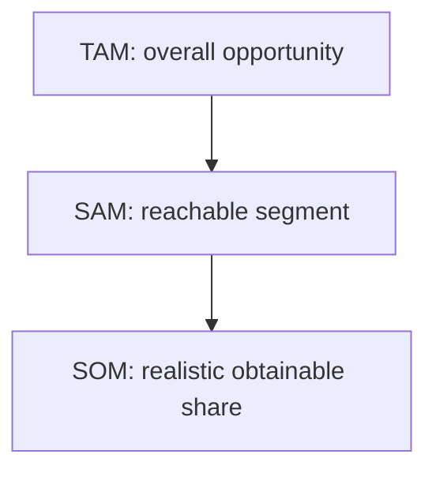
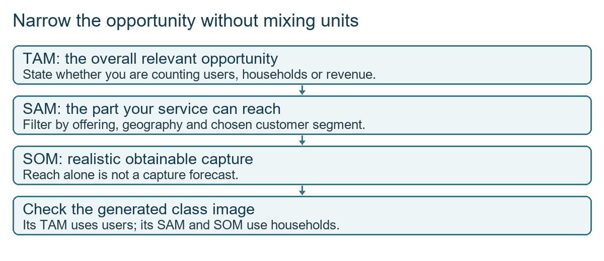

# Class 06: Competitive teardown and opportunity assessment
30 July 2026 · Arun Nandewal, with Rohit reviewing the student exercises · Portal title: Academic Session 6, "Workshop: Competitive Teardown and Opportunity Assessment"

## The class in one minute
- Competitor research looks at features, pricing, business models, why customers leave, market share, investment and failed experiments. It should feed a decision and not stop at collecting facts.
- Do it whenever you plan to add or improve a feature. There is no universal daily, weekly or quarterly schedule.
- Use the product yourself, and read release notes, official pricing and customer feedback. AI gives a first pass, not a replacement for hands-on checking.
- The live chain: compare features, pick one opportunity, run a SWOT on that opportunity, then size it with TAM, SAM and SOM. The Blinkit example picked scheduled or bulk orders and found a risk to the fast-delivery brand.
- Pricing was the item students most often left out of their comparisons. Keep the feature table, SWOT and sizing together as portfolio evidence.

## Core ideas

### What competitor research covers
**Competitor research** is the systematic gathering and interpretation of facts about rival products, pricing, positioning and strategy, to find gaps and opportunities. **Positioning** is how a product is presented to a particular customer relative to alternatives. The class crowdsourced ten things to watch: what competitors are doing, where they spend, who is gaining or losing share, which ideas worked or failed, R&D (research and development) spending, why customers leave, product-market fit (the product meets a market need strongly enough to gain traction), features, growth potential and where industry investment is going.

A **forming market** is a new market still being settled, and quick commerce was the example. Missing a key capability while habits are forming can cost adoption. Legacy businesses do not automatically lose when a market shifts; they are forced to innovate. Amazon Now and Flipkart Minutes illustrate that, though no success forecast was made. Spending patterns hint at direction, such as operational cost work in food delivery versus AI R&D elsewhere. The company-specific claims made in passing (foundries, valuations, partnership terms) are not backed by anything in the folder, so do not repeat them as fact.

Another company's failed idea is evidence, not a ban. If someone is hurt in a swimming pool, nobody concludes that no one should swim. Ask whether the cause was execution, timing, market readiness or capability. A rival's success does not guarantee it will work for you either. JioSaavn, Spotify and YouTube Music showed customers moving for recommendations, podcasts and **bundling** (several benefits sold together): someone may pick YouTube Premium partly because ad-free video and music come in one package.

**Remember:** competitor evidence is a starting point for judgement. It does not replace it.

### How often, how big, and whom to compare with
The instructor rejected a fixed rhythm. Research is needed when you consider adding or improving a feature, and it should influence a decision you can actually make. Waiting until metrics fall can leave you blind to a change, but endless research without capacity to act wastes time. The Word document gave rough illustrative cadences (daily for AI and LLM companies, weekly for the quick-commerce and food apps, monthly for travel and streaming, quarterly for office products, annually for phones). Treat them as examples, not release schedules.

How fast to ship depends on your resources, how often customers can absorb change, and the industry's pattern. **Cognitive feature load** is the effort users spend understanding repeated changes. Picture preparing for an exam while the syllabus keeps changing.

The six measures named were adoption, engagement, repeat rate, revenue per customer, task success and CSAT (customer satisfaction). There is no fixed order. If a new entrant lacks orders, growth is the question; if damaged items and missing items climb, quality is. Start from the real problem.

Do not compare only with companies of your own size. A startup can change a giant's market and a giant can add a feature that threatens a startup, the David and Goliath point. The remark that such startups "closed overnight" was rhetorical and is unsupported. Also, user research and competitor research run in parallel. Customers name other products they use, which points your competitor research. A competitor feature you spot becomes a prototype to show users.

*Neither stream has to finish before the other begins.*

**Remember:** more change is not automatically more value, and size is not a reason to ignore a rival.

### Match the question to the source
For features, use the app yourself, read store descriptions and release notes, and try the capability. The instructor warned against relying only on ChatGPT or Claude. For pricing and **GTM** (go-to-market, how the company reaches customers), read pricing pages, plans and trials, and note the route to the customer (the Masai enrolment call is a sales-led example). For customers moving away, read reviews, forums and social accounts. For funding, read company filings and reports. The word "scraping" was explained simply as visiting and studying a website; no code was shown.

| Research type | Main question | Sources |
|---|---|---|
| Feature | How does the task actually work? | Hands-on use, release notes, blogs |
| Pricing and GTM | What is sold, to whom, at what price? | Pricing page, trial, sales contact |
| Customer movement | Why do users prefer the alternative? | Interviews, reviews, forums |
| Funding | What direction is being funded? | Filings, reports, investor announcements |

**Remember:** pick the source that fits the question, and note the date of the evidence.

### From feature table to SWOT
The live exercise: open the prompt library, copy the feature-analysis prompt, choose Claude, and enter Blinkit with its website and app. It returns positioning, a feature matrix, insights and five candidate features. Students repeat it for their own product. Rohit's review of student work asked for pricing, larger rivals (Apple and Whoop in fitness) and a link between the table and a problem you could solve.

From the five Blinkit candidates (stronger loyalty tiers, partner bundles, deeper private labels, scheduled or bulk ordering, trust badges), the instructor chose bulk ordering for weekly stock-up. The generated **SWOT** (strengths, weaknesses, opportunities, threats) for that feature:

| SWOT | Blinkit bulk-order example |
|---|---|
| Strengths | Dense dark stores, brand trust, active users, operations and tech |
| Weaknesses | Small-basket store format, no stock-up loyalty, untested bulk fulfilment, thin margins |
| Opportunities | Weekly stock-up, higher average order value, less discount dependence |
| Threats | Dilution of the fast brand, rivals owning the occasion, new capex and logistics, cannibalising quick orders |

A **dark store** is a fulfilment location for orders, not for browsing. **Cannibalisation** is one offer taking demand from another of your own. **Capex** is spending on long-lived assets. The conclusion was conditional: a separate "Bazaar" or "Weekly" flow could protect the fast-delivery promise better than mixing big slow orders into the core app. Two conflicts stand: the feature table already marks scheduled orders as present for Blinkit while recommending them as an opportunity, and the image says average order value rises while one spoken line said it would fall. The notes keep both unresolved.

*A redraw of the class's generated analysis. It is not verified company data.*

**Remember:** a feature table finds possibilities. The SWOT checks whether this company can actually deliver one.

### Sizing the opportunity: TAM, SAM, SOM
**TAM** (total addressable market) is the whole potential market. **SAM** (serviceable available market) is the part your product can reach. **SOM** (serviceable obtainable market) is the realistic share you can capture. The deck defines SOM as realistic share, while the live class simplified it to where the company currently operates. Potential customers count even if they have not subscribed yet. Geography, availability, offer and segment narrow the number step by step.

*Whole opportunity, service reach, realistic capture.*

The deck added two methods: **top-down** (start with an industry number and narrow it) and **bottom-up** (users times price), with **triangulation** meaning check with more than one approach. Its Airbnb example worked as 20% of a $300 billion SAM giving $60 billion, a deck figure, with the share applied to the SAM and not the TAM.

The class's Blinkit image gave TAM about ₹61,500 crore, SAM about ₹21,500 crore and SOM about ₹1,450 crore, labelled with about 90 million users, 20 million households and 2 million households. These mix users and households, give no derivation and cite no reports. They are AI-generated illustrations, and "UMC" was spoken as upper middle class but labelled urban households, which needs clearing up before reuse.

**Remember:** reachable people are not revenue, households are not users, and an AI image is not a calculation.

## Worked example
**Blinkit bulk ordering.**
1. Define the company and channel: Blinkit, India, website and app.
2. List alternatives: Zepto, Instamart, BigBasket, Flipkart Minutes and Amazon Now (the last one is in the narrative but not in the matrix).
3. Read the gaps in features and pricing. Pricing still needs checking.
4. Choose one opportunity: weekly stock-up and bulk ordering.
5. Test fit with a SWOT: the fast network helps, but small baskets, bulk logistics, brand expectation and cannibalisation are constraints.
6. Form a conditional proposal: a clearly separate Weekly flow, not a promise of the same speed.
7. Choose the sizing scope: India, B2C, urban upper-middle households, after dropping business customers.
8. Audit the numbers: 90 million users, 20 million households and 2 million households do not form one funnel without a conversion assumption.
9. Save the whole chain so another reader can see the reasoning and the doubts.

This is a repeatable way to make a feature decision explicit, not proof that Blinkit should launch bulk orders.

**Applied to car loans.** A lender asks whether to add a "pre-approved offers for existing customers" feature. Compare how rival lenders and bank apps handle it (use their apps, read their rate pages). Pick that one opportunity and run a SWOT: your customer base and repayment data are strengths, a thin product team is a weakness, risk of cannibalising fresh-lead sourcing is a threat. Size it: all new-car buyers in your states (TAM), those with a loan track record with you (SAM), and the share your branches can realistically convert (SOM). The units must stay the same at each step. This is my illustration, not from class.

## Frameworks to reuse

**Research note:** decision __ · question __ · product or segment __ · source __ · observation __ · date of evidence __ · uncertainty __ · implication __.

**Feature comparison:** rows are user tasks plus price; columns are our product and direct and indirect alternatives; each cell holds observed availability, evidence and uncertainty. A blank or AI-generated claim is not proof that a feature is absent.

**Sizing sheet:** product __ · geography __ · customer __ · unit (users, households or revenue) __ · period __ · sources __ · TAM __ · SAM filters __ · SOM assumptions __ · risks __. Bottom-up: customers __ × spend for the period __ = revenue potential __.

**Market share:** state the measure (revenue, users or transactions), the denominator, geography, period and source. Downloads are not rides or revenue.

## Self-test
1. Why is a competitor's failed feature not proof that yours will fail?
2. Give two sources you would use for feature research and one for pricing.
3. What is the SWOT chain meant to check that a feature table cannot?
4. Define TAM, SAM and SOM in one line each.
5. The Blinkit sizing image shows 90 million users, then 20 million households, then 2 million households. What is wrong with treating it as a funnel?

**Answers**
1. The failure could be execution, timing, market readiness or capability. Check why before drawing a conclusion.
2. Hands-on use of the app and its release notes; for pricing, the pricing page, plans or a trial.
3. Whether this company, with its strengths, weaknesses and brand, is ready and suited to the opportunity.
4. TAM is the overall market, SAM the part you can reach, SOM the realistic share you can capture.
5. It mixes users and households, has no conversion assumption and no source, so the steps are not consistent.

## Homework from this class
Sameer's to do. These are not done for you.

- Create your own competitor and feature analysis for a product of your choice, select one opportunity, add a SWOT, and run TAM, SAM and SOM for that feature.
- Keep a named copy in your weekly or class portfolio folder.
- Use an LLM to quiz yourself on the taught topics.
- LinkedIn sharing is encouraged. No explicit due date or submission format was saved. The review noted that practice and understanding matter more than merely posting that it is done.
