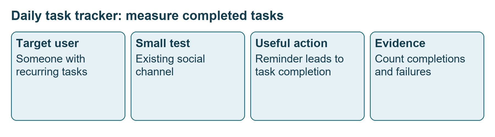
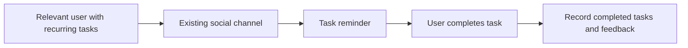
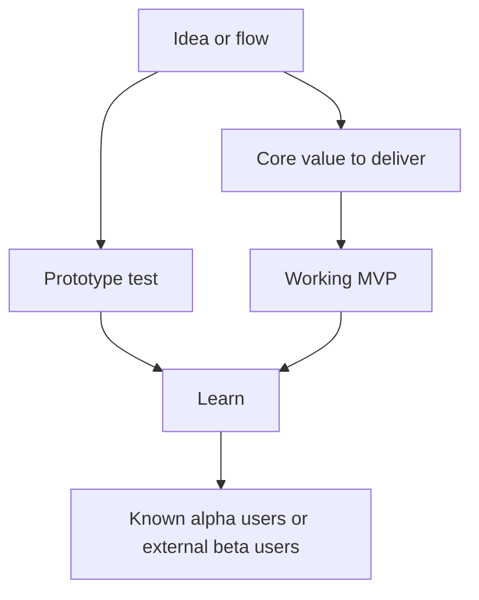
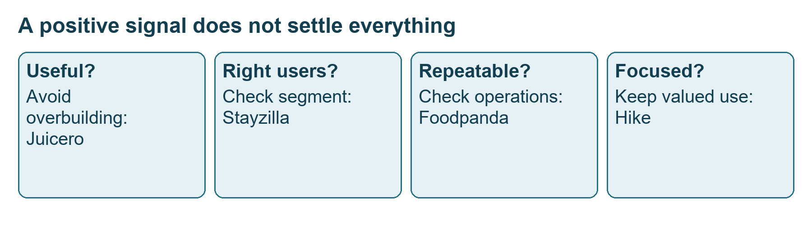
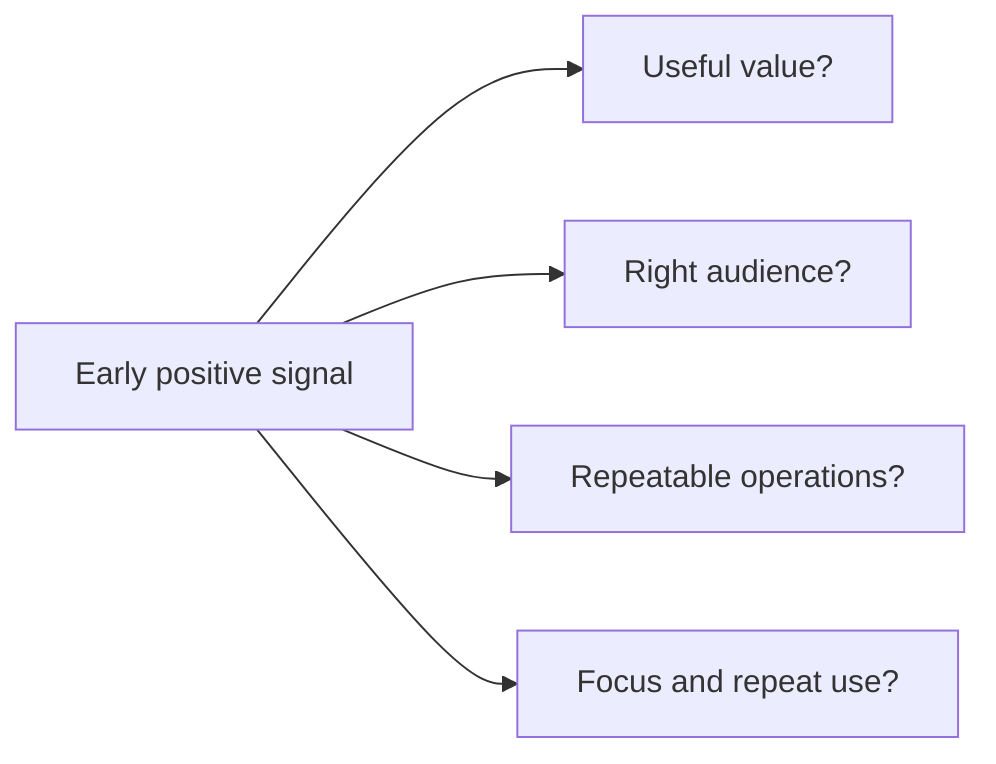
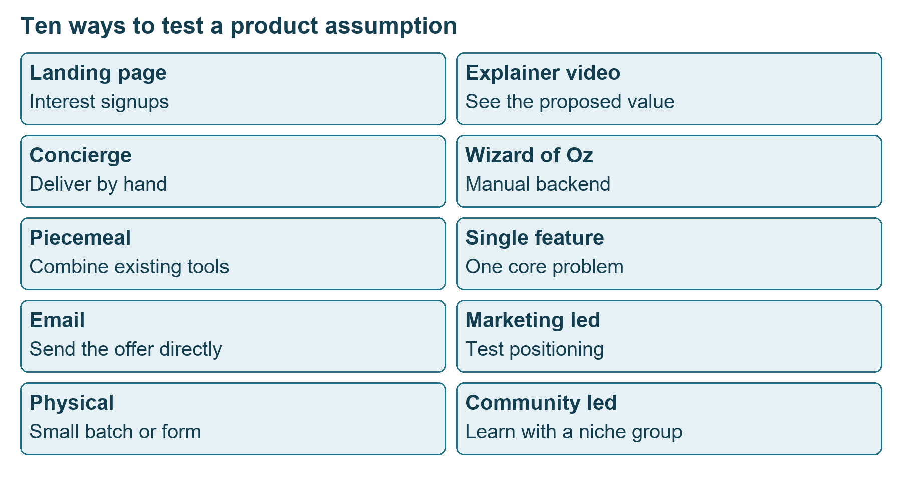

# Class 07: Case study, the MVP
3 August 2026 · Arun Nandewal · Portal title: Academic Session 7, "Case Study: The MVP"

## The class in one minute
- Start with a real user problem and decide what a successful test would measure. A working product can still fail if the wrong audience tries it.
- An MVP (minimum viable product) in the live definition is a working version that lets the user finish the core useful action. A prototype can simply show an idea or a flow.
- Alpha testing uses known or internal users. Beta extends to interested outsiders in a controlled release, and it is still a test that may be unstable.
- Early value can be delivered by hand: a menu PDF, manually phoned cabs, a narrow website, an email, a demo video. A signup tests interest and does not prove completion or repeat use.
- Avoid too many features and too much engineering, and keep testing the audience, the operations and the risk of harmful use, because a good first result settles none of those.

## Core ideas

### Start with the problem, and decide what "working" means
The opening scenario was zero-to-one: an unlaunched product, a founder who believes in it, a first PM and ten other staff. How do you find out if it will work? Students suggested team trial and error, free samples, launching to a small group, studying similar products, testing prototypes, watching use, collecting feedback and taking pre-bookings. Prepayment was called a stronger signal than a promise. The chain the class wanted: identify the problem, validate interest, build the minimum, test with relevant users, then measure and collect feedback. Decide what "working" means before reading the results.

The second scenario removed the team. A solo founder has an AI daily-task tracker usable through Instagram, WhatsApp or LinkedIn (tasks like assignments, bookings, reminders and emails). The goal was the number of tasks successfully completed with the app. Not downloads, not followers, not nice comments. Students offered gym members, friends, local communities, influencers, a landing page and short demos. The instructor kept asking who the users are and where the founder would find them. The sharpest suggestion was vegetable or milk sellers who already send bills and chase payments on WhatsApp, because it ties the channel to a recurring task. It was not tested in class.

*Reaching people is different from learning whether the intended task was completed.*

The first-use exercise asked why students began using Maps, payments, cabs, food delivery, Excel, Drive and quick commerce. The answers were mostly a real problem plus immediate usefulness (a need to navigate, a friend asking for money, refused auto rides, speed), with incentives like cashback helping but rarely the lasting reason. The instructor separated convenience from comfort: losing app cabs brings back haggling, losing quick commerce leaves the nearby shop.

**Remember:** describe the audience and their task before you choose the channel.

### Prototype, MVP, alpha and beta
A **prototype** represents an idea. It can be a sketch, a linked interface or a detailed working version. **Fidelity** is how much detail it has: low means rough, high may include colour, buttons and animation. In the live definition an MVP must let the user finish the core action, so a beautiful click-through is not automatically a usable service. The instructor said every MVP is a working high-fidelity prototype but not every prototype is an MVP. The deck, though, calls a landing page or explainer video an MVP even with no working product. These usages conflict, so state which assumption you are testing: interest, or completed value.

Prototype and MVP describe the artefact. Alpha and beta describe who is testing and at what stage.

| | Alpha | Beta |
|---|---|---|
| People | Internal, known or friendly users | Broader external users, still controlled |
| Product | Early, functional, possibly unstable | Nearer release, bugs may remain |
| Focus | Major functions, bugs, performance, usability | Edge cases, scale, readiness |

The live illustration: on Android, open Google Play, search Uber, open the listing and look for "Join the beta program." Benefits raised were early features, a view of the PM team's direction and sometimes rewards. The instructor corrected the idea that every bug earns money, since a bug bounty depends on the programme's terms, and joining does not guarantee a job. Programmes may be full, so read the actual terms. The programme names recorded (Google Spark in the Word document, "Gemini Sparks" in the transcript, and Truecaller) were not resolved.

**Remember:** beta is a learning activity with programme-specific terms, not a safe or guaranteed release.

### Success stories: small scope, manual delivery
These are classroom accounts, not verified company histories.

- **Zomato:** restaurant menu photos collected into a PDF for office workers with lunch queues, ordered by phone (a twenty-rupee charge was floated). The deck says scanned menus on a site called Foodiebay. The accounts differ, and the order of PDF, site and app is not established.
- **Ola:** airport travellers wanting a predictable cab without bargaining, served by manually calling partner drivers before any app or GPS. The class said it started in Delhi and Bangalore, which is not verified. The Meru comparison warned that a good early service needs repeatable operations.
- **Razorpay:** startups struggling with slow payment integration, served with a light three-step API and direct help rather than a full dashboard. It is a lesson on integration friction, not permission to skip financial rules.
- **Amazon:** early scope was books with manual fulfilment, a narrow category and a completed purchase.
- **Dropbox:** an explainer video showed setup, a synced folder, edits across machines, version history and share links. The deck says 75,000-plus overnight signups, and signups show interest, not completed syncing.
- **Airbnb:** a sold-out conference created a shortage, and the deck says the founders' site found three paying users.
- **Zappos:** shoe photos from local shops, with the founder buying and shipping after each order.
- **Facebook:** a Harvard-only network with institutional email, with no feed, pages or ads.

A campus delivery story had a student forward a delivery one-time password, a guard collect the parcel, and a new password issued for the student's pickup. No code or artefact was provided, and it is not advice to forward sensitive codes.

**Remember:** separate a case's teaching point from its unverified history.

### Failure stories and the ten MVP formats
Juicero showed over-engineering: if a person can squeeze the packet by hand, the machine's extra value needs proof. Yik Yak showed harm and missing moderation at scale. Facebook Deals showed weak adoption (the deck) or confusion with Marketplace (the live talk). Hike lost focus after stickers drew interest. Foodpanda struggled with logistics, vendors and per-order economics. Stayzilla targeted smaller cities where hotels were not full, unlike the Airbnb shortage. Shorter comparisons (Justdial, Orkut, Yahoo, Paytm) were opinions, not failure histories.

*Demand alone does not prove good operations, the right segment or lasting value.*

The deck listed ten MVP formats, and they overlap, so classify by the assumption you are testing.

| Format | How it works | Source example |
|---|---|---|
| Landing page | Explain the value, invite signup | Robinhood waitlist |
| Explainer video | Show the experience, invite next step | Dropbox |
| Concierge | Deliver the service by hand | Airbnb founders hosting |
| Wizard of Oz | Normal-looking front, manual backend | Zappos |
| Piecemeal | Combine existing tools | Groupon with WordPress and email |
| Single feature | Solve one core problem | Early Instagram filters |
| Email | Send the offer directly | Product Hunt's daily links |
| Marketing-led | Test positioning and demand | Superhuman queue |
| Physical | Small batch or form | Paperboat |
| Community-led | Learn with a niche community | Notion |

*Some formats measure interest, others deliver the outcome.*

Dos and don'ts: one core problem and persona, early real feedback, low-cost or manual learning, enough to finish the useful action, measures set before launch. Avoid every feature in the first release, treating assumptions as facts, months of build before validation, polishing first, and launching without a feedback plan. Formal prioritisation was deferred. MoSCoW was named, but no scoring was taught.

**Remember:** judge useful value, right users, repeatability and focus as four separate questions.

## Worked example
**The daily AI task tracker.**
1. State the value: help a person complete daily tasks (study, sport, bookings, email).
2. Pick a concrete group, not everyone on social media. WhatsApp-billing sellers are one candidate, not a finding.
3. Understand the existing task and where reminders fail.
4. Keep the test small: a familiar channel and a limited reminder and task flow. This is a proposed design from the discussion, not a completed experiment.
5. Make the useful action observable. A reminder is an input, and the completed task is the goal.
6. Collect feedback on obstacles, because downloads and praise do not show tasks done.
7. Decide what to revise (segment, problem, reminder or delivery). Define success in advance, as no threshold was taught.
8. Keep the conclusion bounded. A small test does not prove long-term retention, earnings or privacy readiness.

**Applied to car loans.** To test a "document checklist on WhatsApp" for dealer staff, do not build an app. Pick three dealerships, send each applicant's missing-document list by WhatsApp by hand for two weeks, and count files completed without a second visit. That is a concierge-style test: the measure is files completed first time, not messages sent. This illustration is mine, not from class.

## Frameworks to reuse

| Field | Blank | Task-tracker example |
|---|---|---|
| User and problem | [user] struggles to [task] in [context] | People need to remember and complete daily tasks |
| Assumption | We think [change] will help [action] | Reminders in a familiar channel may help |
| First audience | Recruit [specific people] because [reason] | Sellers already using WhatsApp for bills |
| Smallest test | Deliver [core action] using [format] | A reminder and task flow |
| Measure | Count [behaviour] | Tasks successfully completed |
| Feedback | Ask what prevented [action] | Where reminders or handling fail |
| Decision | Continue, change or stop if [evidence] | Threshold to be set beforehand |

**Scope check:** core user __ · useful action __ · in scope __ · deferred __ · manual work __ · outcome measure __ · feedback __ · operations risk __.

**Conflict-to-value:** [user] is blocked by [conflict]; today they [workaround]; we test [small change]; evidence of value is [observable action]; unresolved question is [gap].

## Self-test
1. In the live definition, what must an MVP let the user do?
2. Why is the task tracker's goal "tasks completed" and not "downloads"?
3. How do alpha and beta differ?
4. A landing page collects a large number of signups. What does that prove, and what does it not?
5. Name two failure checks that remain after an encouraging early signal.

**Answers**
1. Finish the core useful action.
2. Downloads show reach. Completed tasks show whether the product delivered its value.
3. Alpha uses internal or known users on an early product. Beta uses wider external users in a controlled release, nearer to launch.
4. It shows interest. It does not show completed use, willingness to pay or repeat use.
5. Any two of: right audience, repeatable operations, focused value and repeat use, useful value.

## Homework from this class
Sameer's to do. These are not done for you.

- Try to find a relevant beta programme using the class prompt and note what you learned. Students who joined one were asked for a short presentation or outline of their experience in about a month (revised from an initial two weeks), with no exact due date or rubric.
- Keep the working document (copy it to your own Drive) and reflect on why you first used familiar products.
- Portfolio and LinkedIn sharing was invited, with no compulsory deadline.
- Fill in the class and course feedback forms, giving reasons alongside ratings. The form links were not saved.
