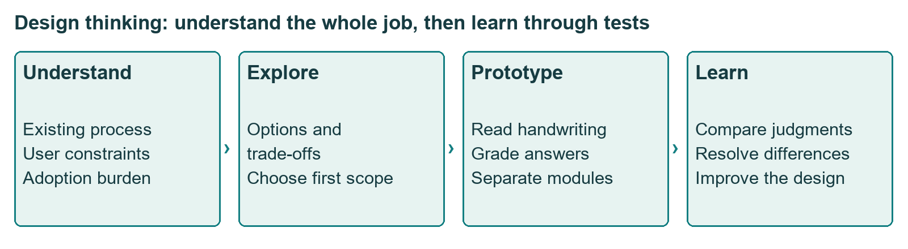
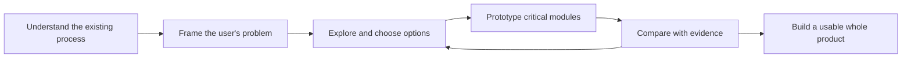
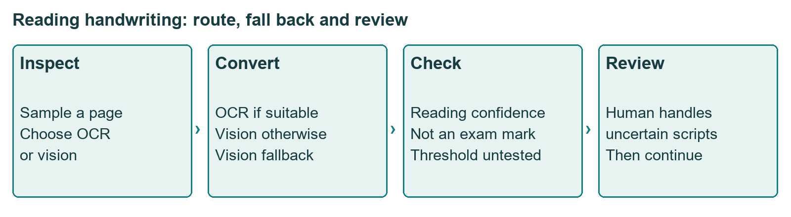
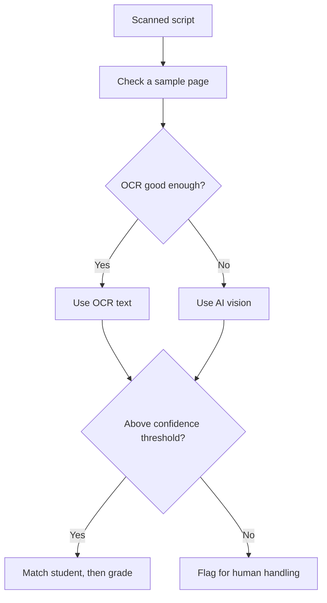
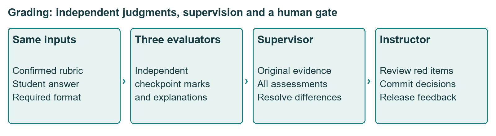

# Class 08: Design thinking for PMs
6 August 2026 · Prof. Saravana Jaikumar (spelled "Sarvana" in the transcript header) · Portal title: Academic Session 8

## The class in one minute
- Start with the user's whole process. An exam-grading product begins with the exam and the answer sheets, not with a prompt that asks a model to award marks.
- Adoption depends on how much work you ask people to change. QR labels, fixed booklets and page-by-page preparation can cancel the benefit of automation.
- Break the journey into stages: create the evaluation, structure the questions, confirm a rubric, read handwriting, match students, grade, resolve exceptions, report.
- Prototype the two assumptions that can break the product (reading handwriting and grading reliably) before building the whole portal, and compare grading with independent human evaluators.
- Check three lenses before trusting a good demo: do people want it, can we build it, and can it sustain and scale?

## Core ideas

### Start with the user's whole job
The class worked backwards from a real product idea into design-thinking principles, and the framework came last. The pain: one MBA section of about 80 students, each writing roughly ten pages, makes about 800 handwritten pages. The instructor said manual evaluation across several sections can take months. These are his examples, not data from the folder.

Pasting a question paper and an answer sheet into a chat box might produce marks, but different prompts, users and replies give inconsistent judgements. The process starts earlier: prepare course content, set the paper, run a handwritten exam, collect the scripts, and only then evaluate and give feedback. A tool for the last step alone leaves the most inconvenient work untouched.

*Evaluation is one stage inside a larger user journey.*

**Remember:** define the complete job, including the work before and after the obvious AI task.

### Fit into the process, and do not add manual work
Scanning showed this best. Staff can scan each script separately (about 80 PDFs) or put the whole batch through a fast scanner into one 800-page PDF, which then needs separating. The class designed the simpler separate-PDF route first and kept bulk separation as an open problem.

Students proposed ways to tell scripts apart, and each had a hidden cost.
- QR or barcodes: a student who asks for an extra sheet needs a matching label, and that could mean a printer in every exam room.
- Fixed booklets or pre-printed question layouts: every institute must change how it runs exams.
- A colour for each of 80 students: impractical.

The proposed lighter change was to have students write their name and roll number on every page. It needs no new hardware or format. The transcript does not show that it handles every missing, wrong or unreadable identifier. A fixed "last page" idea fails because scripts differ in length, and a missing roll number is an exception the system must handle, not a reason to demand perfect student behaviour.

**Remember:** do not automate one activity by adding difficult manual work somewhere else.

### The product as a chain of stages
The stages the class designed, each with a human check where it counts:

1. **Create an evaluation.** The instructor logs in and enters the course and exam. Nothing is graded yet.
2. **Structure the paper.** The instructor uploads the typed question paper. The model returns each question's number, type, text and maximum marks, and the instructor edits and confirms. For a longer case, the model may propose a split (three issues of ten marks in a thirty-mark case), which still needs approval. Handwriting OCR is not needed for this typed document.
3. **Build the rubric.** A **grading rubric** is the set of criteria used to judge an answer and allocate marks. A two-mark question might become checkpoints of 1, 0.5 and 0.5. Inputs can be a model answer, notes, slides, a class transcript or free-text pointers. The model proposes checkpoints, and the instructor edits and confirms. The model should test whether a concept is expressed, not hunt for an exact keyword.
4. **Read the handwriting.** **OCR** (optical character recognition) turns writing in an image into text. **AI vision** uses a model to interpret the page image and was described as better for hard or cursive handwriting at a higher cost. An **orchestration** layer (coordinating which component runs next) tries OCR first and falls back to vision. A confidence threshold of 90%, which the user can raise to 95%, flags unreadable scripts for a person. That confidence is about reading the handwriting, not about the student's score. The percentages were illustrative, and the class did not show how confidence is checked against real errors.
5. **Match students.** Extract names and roll numbers and map them to the official list. Show ambiguities for the instructor to resolve. A plausible match is not a confirmed identity.
6. **Grade independently.** Three evaluators each get the same rubric and answer text and score by question and checkpoint, with awarded marks and a reason. A supervisor then sees everything and reconciles the differences. A simple average was rejected, because one mistaken zero drags it down. The class called this an **LLM council** (several model evaluations plus a supervisor). Its reliability is untested in the folder.
7. **Resolve and report.** The instructor must clear flagged checkpoints before the system lets reporting proceed. Reports include student feedback with reasons, class marks and dashboards. Feedback that explains the question, marks and reasoning is expected to reduce re-evaluation requests, though no before-and-after count was supplied.

*Easy pages take the cheap route. Uncertain ones go to a stronger route or to a person.*

**Remember:** reading confidence is a routing signal. It is not a mark and not proof of correct transcription.

### Prototype what can break, and compare with humans
Design thinking in this class: **empathy** is understanding the user's situation (exam hall, variable script lengths, scanners, preparation work). **Problem framing** is stating the job precisely, which here is dependable end-to-end evaluation with manageable work. **Diverge** means consider many options and **converge** means choose, as the class did with identification methods and upload routes. **Prototyping** means building enough to learn whether a key assumption holds.

Two modules could sink the product. For handwriting, test varied writing through the OCR and vision routing. If it cannot beat a hypothetical 70% level, the instructor suggested starting with digital exams and working on handwriting separately. For grading, prepare the structured paper and rubric by hand and use already-digital answers, which separates grading from handwriting errors. Have the instructor and a teaching assistant grade ten or fifty scripts independently, compare with the AI, study where and why they differ, change the system and repeat. The instructor does not require fine-tuning before testing whether the foundation-model workflow works.

*Three independent evaluations are reconciled by a supervisor, and unresolved checkpoints go to the instructor.*

**Remember:** test the assumption that can break the product before polishing the rest.

### Three lenses and adoption
A good decision passes three tests: **desirability** (do people want it), **feasibility** (can we build it) and **viability** (can it sustain and scale). A tool can be possible but too burdensome to adopt, or wanted but too costly. Questions on cost got the answer that automated work can run in parallel or overnight, compared with months of faculty effort. Runtimes of a few hours were illustrative, not guarantees, and token optimisation was deferred.

On trust, the instructor separated people who are willing but unaware from people who are sceptical. Start with willing users, collect results, and let evidence persuade the rest. He argued for bottom-up adoption grounded in a real process. He described a prototype tested on courses and then built into a product used at some institutions, but the folder holds no deployment record or independent check.

**Remember:** a useful claim should lead to a testable result and a clear account of whom it helps.

## Worked example
**One exam batch, step by step.** The numbers are the class's illustrations.
1. Define the batch: 80 students at about ten pages each is 800 pages, although real scripts vary in length.
2. Choose the first route: one PDF per student, about 80 PDFs.
3. Create the assessment, upload the paper, correct the extracted question types and marks, and confirm.
4. Prepare the grading basis and review checkpoints (for example 1, 0.5 and 0.5 for a two-mark question).
5. Inspect a handwriting sample, choose OCR or vision, and apply the confidence threshold.
6. In one illustration 75 scripts are readable and five are held for manual handling (75 + 5 = 80). The five are not marked low because they were hard to read.
7. Compare names and roll numbers with the official list, and have the instructor resolve gaps before attaching grades.
8. Each of three evaluators scores the readable scripts against the confirmed rubric. The supervisor reconciles.
9. The instructor reviews flagged checkpoints and commits the marks.
10. Produce checkpoint-level reasons and reports. Faster turnaround and fewer appeals are expected benefits to test.

**Applied to car loans.** The same pattern fits reading a customer's salary slips and bank statements for a new-car loan. Do not start with "AI reads the file." Map the whole path first: how the dealer collects documents, how scans arrive, how files are matched to applications, where the credit officer reviews. Run the cheap reader first and send low-confidence pages to a person. Test reading and judging separately, and compare the tool's output with two officers working independently. This is my illustration, not class content.

## Frameworks to reuse

| Check | Question | Class example |
|---|---|---|
| Journey and adoption | What work does my feature push onto the user? | QR labels and fixed booklets in exams |
| Human gate | Where must a person confirm before moving on? | Question breakdown, rubric, identity mapping, flagged marks |
| Confidence routing | Which pages are cheap, which need more, which need a person? | OCR, then vision, then manual |
| Independent evaluation | Who else judges, and who reconciles? | Three evaluators and a supervisor |
| Prototype list | Which assumptions can break the product? | Reading handwriting, grading reliably |
| Evidence loop | How do I compare with humans and improve? | Instructor and TA grade independently, compare, change, repeat |
| Three lenses | Wanted? Buildable? Sustainable? | Desirability, feasibility, viability |

**Practice template:** process __ · users __ · stages of the journey __ · what each stage asks users to change __ · simplest option __ · riskiest assumption __ · prototype and human comparison __.

## Self-test
1. Why was putting a QR code on every page rejected?
2. What does the confidence threshold measure, and what happens below it?
3. Why does the supervisor reconcile three evaluations instead of averaging them?
4. Which two modules did the instructor say to prototype first, and why those?
5. Name the three lenses.

**Answers**
1. Extra sheets would need matching labels, perhaps requiring a printer in every exam room, which swaps one manual process for another.
2. Confidence in reading the handwriting, not the student's score. Below it the script is flagged for human handling.
3. A mistaken score, such as an erroneous zero, drags an average down. The supervisor looks at why they differ and highlights unresolved checkpoints.
4. Handwriting conversion and grading, because either failing makes the whole product unreliable.
5. Desirability, feasibility and viability.

## Homework from this class
Sameer's to do. These are not done for you.

- Read the promised material and relate each design-thinking stage to the exam-evaluation case. The reading, the design-thinking image and the whiteboards were promised but are not in the folder.
- Practice task: pick another process, understand its users and journey, document it, ideate at each stage and simplify it.
- No submission format, rubric or deadline was given. A later demonstration of the prototype and final product was promised without a date.
