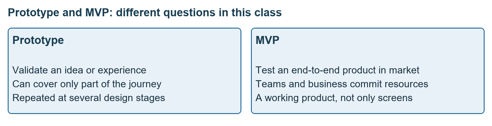
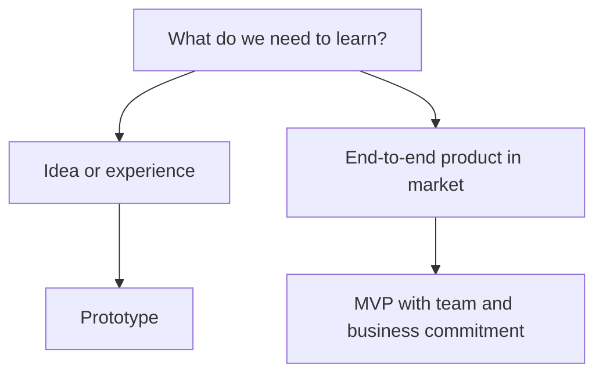
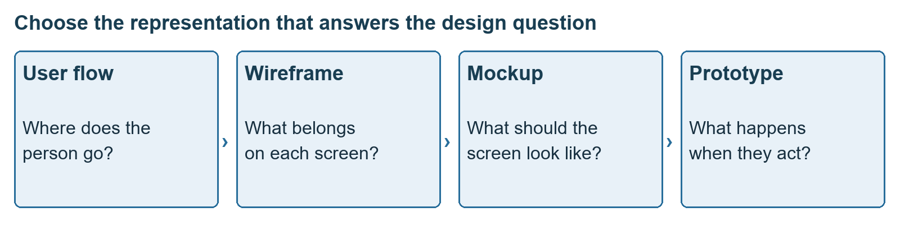
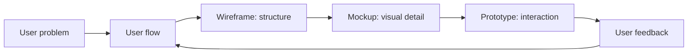
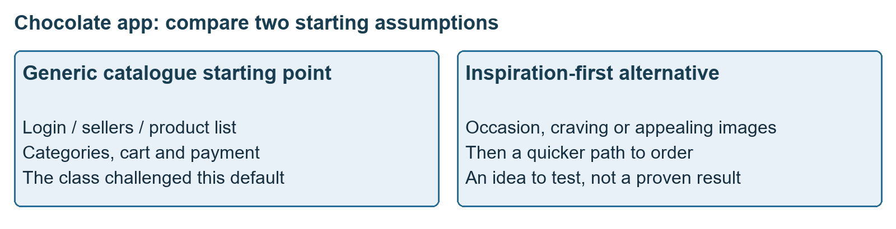
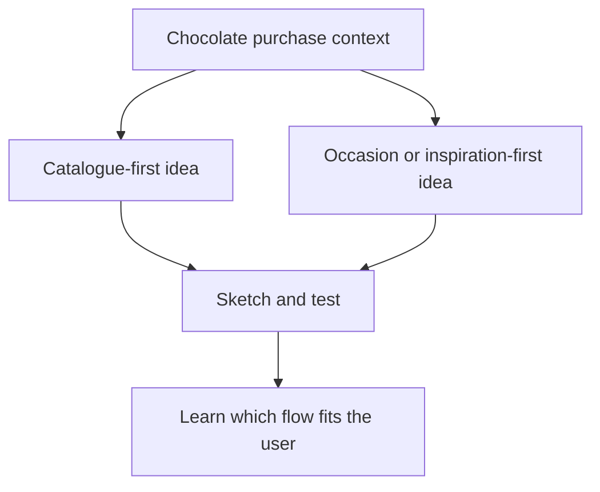
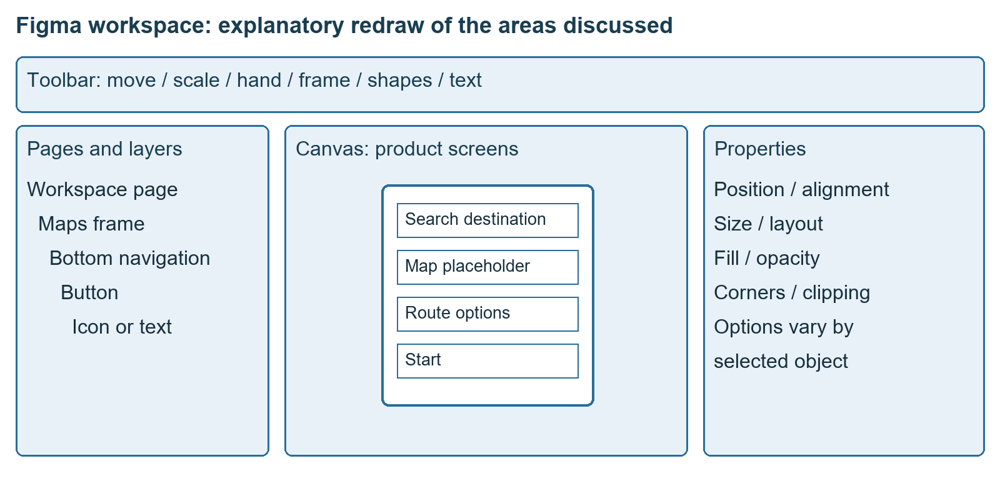

# Class 09: Figma essentials, wireframing to prototyping
10 August 2026 · Arun Nandewal · Portal title: Academic Session 9, "Workshop: Figma Essentials - Wireframing to Prototyping"

## The class in one minute
- A user flow shows where the person goes. A wireframe shows a screen's structure. A mockup adds visual detail. A prototype lets someone try the interactions.
- In this class a prototype explores an idea or experience, while an MVP tests a working end-to-end product in the market. Some wording conflicts are kept below.
- Fidelity means how closely a design resembles the final product. Use only as much detail as the question needs, and add more as the design matures.
- The chocolate-app exercise exposed a trap: sketching a familiar e-commerce catalogue before asking why a child would want chocolate at all.
- In Figma, learn the workspace (pages and layers, frames, canvas, toolbar, properties), work in your own practice copy, and learn by editing.

## Core ideas

### Prototype versus MVP, and the design-thinking recap
A learner asked how a prototype differs from an MVP (minimum viable product). The class answer: a prototype tests whether an idea or experience makes sense. An MVP tests whether a product can work in the market, with the core end-to-end experience, team alignment and business backing. A prototype can cover only part of the experience and can be rebuilt many times. The phrase used was that all MVPs are prototypes but not every prototype is an MVP, and later the MVP was described as the phase after the prototype is turned into working code. Both wordings stay visible: the practical question is what you need to learn and whether the artefact really delivers the whole service.

The design-thinking recap was simple. Talk to users, define the pain point, consider options, build the most workable one, let users try it, then continue, change or discard. The image used empathise, define, ideate, prototype and test, and the Word table used "build" and "try" for the last two. The home-help example began with unreliable arrival, trouble finding help, trust over keys and inconsistent work. The need was reframed as availability when required for specified tasks. The business illustrations (laundry, childcare) were the instructor's, not verified claims about markets.

*The distinction is about what you are testing and how much of the product must work.*

**Remember:** do not call a set of attractive screens a working market product without checking what actually works.

### Flow, wireframe, mockup, prototype
The deck's house analogy: a wireframe is the floor plan, a mockup is the interior-design view, a prototype is a walk-through model, and the product is the house.

| Representation | Question it answers | What it contains | Maps example |
|---|---|---|---|
| User flow | Where does the person go? | Steps, order, decisions | Search, destination, routes, navigation |
| Wireframe | What belongs on a screen? | Boxes, labels, hierarchy, layout | Destination field, map placeholder, route options |
| Mockup | What does it look like? | Colour, type, icons, imagery (static) | A realistic route screen |
| Prototype | What happens when I act? | Connected screens and behaviour | Tapping Start opens navigation |

A **mockup** can look real and still not respond to a tap. A prototype shows an experience without proving that real routing or payments are connected. The lecture rejected the idea that these terms mean HTML and CSS: the representation is not defined by technology.

*Notice the question each representation is meant to answer.*

**Fidelity** is the resemblance to the final product. Low fidelity uses boxes, lines and placeholder text and tests whether the structure is sensible. High fidelity uses real content, colour, spacing and brand detail. The class argued that low-fidelity work stays useful even when AI can make polished screens quickly, because you can discuss and change it cheaply on paper. The deck's spectrum runs: user flow, sketch, low-fidelity wireframe, mid-fidelity wireframe, high-fidelity mockup, interactive prototype, production product. One conflict stayed open. The lecture said interactive prototypes are high fidelity, while the deck's exercise accepts a low-fidelity wireframe for an early interaction question.

Team practice: companies have design systems with approved colours, type, icons and components. Talk with engineering while the design develops. The anecdote about a heart animation that turned into rose petals showed that a high-fidelity picture is not proof that an animation will be built.

**Remember:** structure, appearance and behaviour are three separate things to explain and judge.

### The chocolate-app exercise
The task: a mobile experience for ordering chocolates for schoolchildren. Learners drew four screens on paper. The typed working document records the common answers: login and sellers, categories and product lists, cart and checkout, then coupons, payment, previous orders, tracking and map. Nearly everyone had reproduced a familiar e-commerce pattern.

The class then asked what matters for chocolate: flavour, cocoa or sugar, allergens, brand, price, packaging, occasions, gifts, melting. These were possible considerations, not research findings. A user flow begins before the purchase screen: an occasion, craving, gift or appealing picture may create the wish to buy. An inspiration-led opening, compared with Pinterest, was offered as an alternative to a seller catalogue, with images leading to purchase options and a quick order path. The class did not prove it better. It also asked whether children would want such an app at all, and no test results were supplied.

*The inspiration-led option was an idea from class, not a tested winner.*

**Remember:** drawing the standard catalogue quickly does not show that it suits this user and occasion.

### Working in Figma
Learners were asked to create an account and use Figma in the browser, with no installation. The session focused on Figma Design. Figma Make, FigJam (a collaborative board, promised for a later session) and other product areas were mentioned briefly.

The workspace has the toolbar, the pages and layers panel, the canvas (the main work area) and a properties panel on the right. A **frame** is a container that often stands for a screen. A **layer** is an object or organised part of the design, shown in a hierarchy. The class used a simplified nesting of pages, frames, groups and shapes. The class said the free tier allowed three pages (a spoken limit, not a verified current plan), while one page can hold many screens, and the deck suggested four pages: Research, User Flow, Wireframes and Prototype.

Editing basics from the demo:
- **Move** changes position, **Scale** changes size, **Hand** pans the view without editing. Accidental moves while navigating were the common error.
- Select the right low-level object (button, then its icon or text) before changing detail. Expand and collapse layers to find it.
- Frames use device presets. The demo copied an existing bottom navigation into a new frame and resized it.
- Shapes, text, pen, show/hide, lock/unlock and comments were introduced. Properties include alignment, rotation, fill, opacity, rounded corners, padding (space inside a container) and clipping.
- The deck added seven building blocks: frame, shape, text, image, component, group and auto layout. A **component** is a reusable element. **Auto layout** lets elements rearrange as content changes. A deck example changed ten buttons from 48 to 52 pixels (a 4-pixel change) once through a shared component instead of ten edits.
- A prototype link follows trigger, action, destination: tap Start, navigate, reach the navigation screen.

*Select the intended object in the hierarchy before changing its properties.*

Slice and Motion were shown only briefly and not as complete workflows, and exact shortcut keys in the captions are unreliable.

**Remember:** know what you selected, reuse components where you can, and keep navigation tools apart from editing tools.

## Worked example
**Chocolate-app reasoning.**
1. Start with the task and record what is unknown: who chooses, wants and buys. The class supplied no measured answers.
2. Sketch the initial four-screen catalogue flow.
3. Challenge the default. What creates the desire: occasion, gifting, craving, appealing pictures?
4. Sketch the inspiration-led opening and a quicker route from an image to purchase choices. It is an option to test.
5. Make low-fidelity screens to inspect structure, and add styling for a mockup when appearance is the question.
6. Connect the screens for the interaction you want a participant to try, and state what works and what is simulated.
7. Observe feedback and decide what to change. No findings were supplied.

**Applied to car loans.** The deck's PhonePe flow (Home, Send Money, Search or Enter Number, Select Recipient, Enter Amount, Confirm, Success) maps neatly onto a loan journey: Dealer picks the car, applicant details, document upload, EMI and tenure, offer, accept. Before drawing screens, write the flow and ask which step is uncertain. If the question is "do dealers want EMI shown before or after the offer?", a low-fidelity wireframe is enough. If it is "can an applicant find the document upload?", you need a clickable prototype. This is my illustration, not class content.

## Frameworks to reuse

**Which representation do I need?** Is the uncertainty about sequence, screen contents, appearance or interaction? The deck's five scenarios and answers:

| Question to test | Answer in the deck |
|---|---|
| Payment confirmation before or after the UPI PIN? | Low-fidelity wireframe or prototype |
| Can users find the fastest route in Maps? | Interactive prototype |
| Four or six primary actions on the PhonePe home? | Low-fidelity wireframe |
| Final colour, type and hierarchy? | High-fidelity mockup |
| Destination search to starting navigation? | User flow plus prototype |

**Decision template:** learning question __ · target user __ · task __ · minimum representation __ · what actually works __ · what is simulated __ · evidence to observe __.

**Requirement to screens:** requirement __ · user goal __ · flow __ · screen __ · essential content __ · primary action __ · next state __ · uncertainty to test __.

**Interaction record:** element __ · trigger __ · action __ · destination __ · expected response __.

## Self-test
1. What question does a wireframe answer that a mockup does not?
2. Why can a realistic mockup still fail to be a prototype?
3. What is a frame in Figma, and why does one page not equal one screen?
4. In the chocolate exercise, what was the trap, and what alternative was floated?
5. Which representation would you use to decide whether the UPI PIN comes before or after the payment confirmation?

**Answers**
1. What information and elements belong on the screen, its structure and hierarchy, regardless of colour.
2. A mockup is static. A prototype lets someone tap, move between screens and experience transitions.
3. A frame is a container that often represents a screen. A page can hold many frames.
4. Drawing a familiar e-commerce catalogue first. An occasion or inspiration-led opening was floated as an alternative to test.
5. A low-fidelity wireframe or prototype, as in the deck's exercise.

## Homework from this class
Sameer's to do. These are not done for you.

- Practise Figma by recreating a favourite app or developing the chocolate experience. The live example made three PhonePe frames named Scan QR, Select Bank and Payment Completion.
- Try different shapes, colours, components and settings, and aim for three to four screens to discuss in the next class.
- Use the tutorial or doubt session for difficulties. Sharing on LinkedIn was encouraged.
- The recording mentions practising over four days and a Thursday and Friday arrangement after a schedule swap. No dated deadline or rubric exists in the files, so follow the LMS calendar.
- The next class was previewed as usability testing and AI-assisted screen design (Google Stitch, Uizard and Visily were named). Neither was demonstrated.
