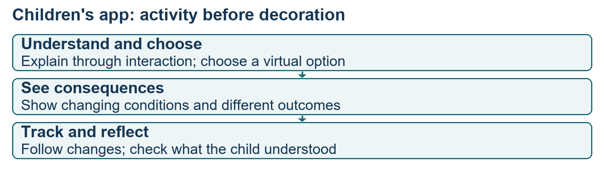
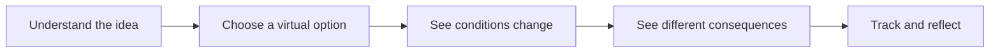
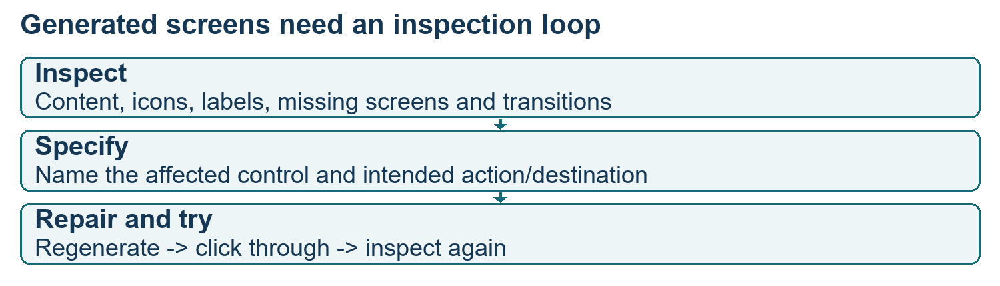
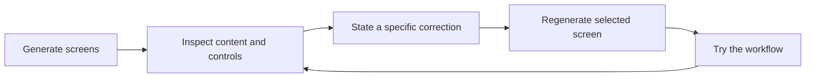
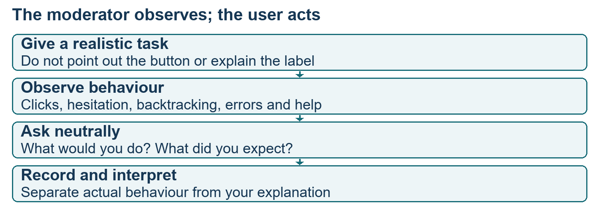
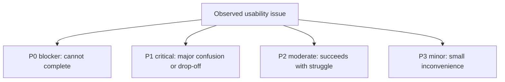
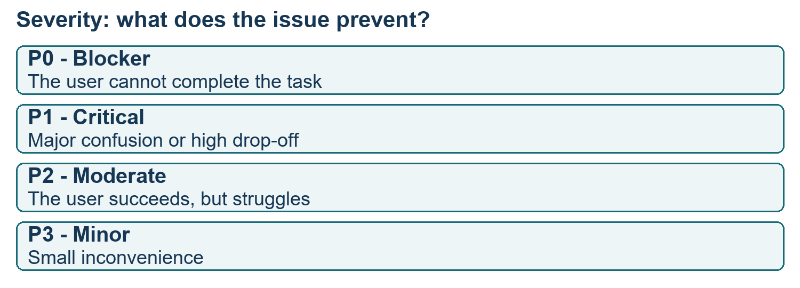

# Class 10: Usability testing and concept validation
14 August 2026 · Arun Nandewal · Portal title: Academic Session 10, "Workshop: Usability Testing and Concept Validation"

## The class in one minute
- State what users should be able to do before generating screens. The class used an educational app for eight-year-olds with 5,000 virtual coins to expose fuzzy thinking.
- Describe each screen from the user's side: what they see, choose and achieve. Login, parent access and decoration do not replace the core learning action in this exercise.
- AI-generated screens are a first draft. Check text, icons, missing screens and navigation, then name the transition you want. A screen preview is not automatically a working prototype.
- Usability testing asks representative users to attempt realistic tasks while you observe. Do not coach them to success, because the aim is to find out whether the interface works without your help.
- Measure completion, time, errors, drop-off, assistance and satisfaction, add observations about why people struggled, then prioritise and retest.

## Core ideas

### Hypothesis first, then screens
The brief: a free educational product where eight-year-old children get 5,000 virtual coins, invest or manage them, see the value change and learn basic money concepts. Parent monitoring was mentioned, but the exercise stayed on the child's core experience. Choose the target age on purpose.

Here a **hypothesis** means the PM's expectation of what users should be able to do with the product, and it is not yet a statistical hypothesis. The Amazon examples showed the right level. "Buy a product" is too narrow. A long flow with comparison, discounts, delivery tracking and reviews is too prescriptive. In between, "search, validate and buy" is workable. Uber was framed as finding destination and fare options and booking a ride. Words like "fast" or "cheap" do not describe the user's activity. For the coin app, the accepted core was that the child invests virtual coins, sees the value change and understands saving and investing. Aspirations such as "feel rewarded" or "make it fun" are not enough to show the interaction.

Next, define five screens, each by what the user can do. The Uber illustration: enter source and destination, inspect prices and vehicles, track and contact the driver, give the trip code and follow the trip, pay and rate. For children, text alone will not explain investing, so the discussion used animation, familiar sweets and treats, and visible consequences. Several student proposals were reviewed (toys and a limited wallet, an animal video and investment categories, puzzles to earn coins). The selected one used sweets and water parks to show seasonal demand, then tracked changes. The coin-loss story in one sample prompt was a classroom device and not validated financial education.

*The screens serve the learning activity. Adding screens does not by itself show learning.*

**Remember:** the hypothesis should make the core activity imaginable while leaving room for design choices.

### From prompt to prototype, and repairing it
The workflow had two stages. First, use Claude (or ChatGPT or Gemini) to refine your hypothesis and screen list into a design brief. Then paste the brief into Google Stitch, choose mobile app, and let it generate a logo, design theme and screens. The instructor warned against reusing a famous cartoon character in a commercial product (class advice, not legal analysis).

The first generation was not accepted. The instructor looked at the content, broken icons, long button labels, too much text, whitespace, arrows and a missing final screen. He picked the affected screen, gave its context, described the fault, attached a screenshot as a reference and regenerated. Examples of precise fixes: limit navigation labels to two lines, make illustrations render cleanly, cut reading load for children, add the missing completion screen. An "eight-edit limit" was mentioned but is not verified.

Export to Figma worked through the Export control, with advice to try one screen when selecting all failed. Preview shows desktop, tablet and mobile and offers a QR code for a phone. A 404 was fixed by enabling project sharing. If buttons do nothing, you may be looking at a static preview. Then select the right screens, right-click, choose Generate, then Instant prototype, and click through it. Animations and back or forward transitions can be wrong, so the PM states what should happen after each click and which screen follows. The instructor admitted several screens were still broken and asked learners to perfect the prototype and take its QR code to intended users. A working mock-up is not a production app or a validated MVP.

*Name the broken action and its intended result, then regenerate and try again.*

**Remember:** polish is not only visual. Missing transitions and unreadable content decide whether the user can do the task.

### Running a usability test
**Usability testing** has representative users attempt realistic tasks while the researcher watches for confusion, mistakes, comprehension and blockers. Interviews ask about needs, motivation and past behaviour. Usability observes navigation, comprehension, completion, errors and friction in the proposed experience. They answer different questions.

Objective: "users like the app" cannot guide a task. The deck improved a vague objective into first-time users independently discovering, choosing and scheduling a grocery delivery within three minutes, using the shape **User + Behaviour + Context + Outcome**. The instructor admitted the class's own hypothesis lacked a time condition. The three, five and eight minute windows were examples, not benchmarks, and fast tapping is not understanding.

Participants: recruit people who fit the question. The food-delivery example needed recent use within thirty days in the target geography, and heavy users were not necessary. The deck excludes employees, UX experts (when testing novices) and beta users (when testing a first-time experience). For early qualitative work it gave five to eight users per flow or segment as examples and warned not to apply "five" blindly. Keep going while important new problems appear. This is not a statistical sample-size calculation.

Formats: **moderated** (researcher present) and **unmoderated** (user alone), **remote** or **in person**, plus **guerrilla testing** (quick tests with readily available users). These overlap. Testing can happen before development, during design, before launch and after launch, with limited rollouts of 0.5% or 1% given as examples. Recordings need clear consent, and payment alone is not consent.

Moderating: do not point at the blue button or say which menu to click. Ask "What would you do next?" or "What does this mean?" When the participant asks what to do, ask what they would do if you were not there. **Moderator bias** is the researcher's behaviour changing what is observed, and **confirmation bias** is favouring evidence that supports your idea. Watch for clicks on non-interactive things, backtracking, hesitation and errors, and note feelings (confusion then relief is different from confident completion). Keep observation apart from interpretation.

*The moderator's job is to find out whether independent success happens, and where it breaks.*

| Avoid coaching | Ask instead | Tests |
|---|---|---|
| Point out the blue button | What would you do next? | Discovery |
| Explain what recurring investment means | What does this mean? | Comprehension |
| Tell them to click the menu | Show me what you would do | Navigation |
| Tell them to enter an email | What information is needed here? | Form understanding |
| Explain what a chart means | What does this chart tell you? | Interpretation |

**Remember:** do not teach the interface during the test and then call it unaided success.

### Measuring and prioritising
The live list: completion, time, error incidence, drop-off, assistance and satisfaction. The deck's completion formula is completed task attempts over total assigned attempts, times 100 (8 of 10 gives 80%). In the live closing example, 60 of 100 participants completing a single assigned task is 60% success. With several tasks per person, state the denominator. The deck separates quantitative evidence (how much) from qualitative evidence (why). A failed reorder task becomes useful when you learn the user read "Orders" as history, not as a place to reorder.

The deck added a severity scale. Group issues by theme as well (navigation, comprehension, interaction), because severity and theme describe different aspects of the same issue.

*Classify by what the problem prevents, then tie it to observed evidence.*

**Remember:** collect measurable task outcomes plus an explanation grounded in what you saw.

## Worked example
**The children's money-learning prototype.**
1. Brief: an educational product for eight-year-olds with 5,000 virtual coins. The aim is learning, not real investing.
2. Hypothesis: the child allocates coins, sees changes and understands basic concepts. Keep one coherent interaction.
3. Screen actions: explain through a suitable interaction, choose an option, see conditions change, examine consequences, track results.
4. Generate: refine the brief and send it to Stitch's mobile generation, then review the first output.
5. Repair: shorten navigation text, fix unclear icons, cut text, add the missing completion screen. The five screens grow to a longer sequence.
6. Connect: make the instant prototype and define next and back destinations. Clicking through exposes broken actions.
7. Test: pick suitable users, give realistic tasks without coaching, and watch independent action and understanding.
8. Analyse: completion, time, errors, help and feelings plus explanations. Classify barriers and iterate. No child-study results exist, so no success claim is made.

The real uncertainty is whether the interaction teaches the concept. A clickable animation is not evidence of learning, and a good next study would define an understanding check as well as completion. That last point is my application, not a test already run.

**Applied to car loans.** For a dealer-facing "quote an EMI" prototype, write the hypothesis first: a dealer sales executive can enter a car price, down payment and tenure and read the monthly EMI within two minutes without help. Recruit people who actually sell cars (not your colleagues), ask them to do it without explaining the screens, and count how many finish unaided. If they stall on "tenure", ask what they thought it meant, then log it as a comprehension issue and rate its severity. The two-minute figure is mine for illustration. The class set no loan-app numbers.

## Frameworks to reuse

**Hypothesis form:** target users __ should be able to __ and understand __ in context __, with a completion condition __ added before testing.

**Eight-step usability plan**

| Step | Blank | Children's app example |
|---|---|---|
| Objective | Learn whether __ | Can children use the learning activity? |
| Hypothesis | We expect __ | They manage coins and see consequences |
| Participant | Include __, exclude __ | Chosen age, not unrelated older users |
| Task | Ask the user to __, success is __ | Do the virtual activity, with a still-needed understanding check |
| Prototype | Version __, supported actions __ | Repaired Stitch flow |
| Observe | Capture __ | Confusion, clicks, navigation, help |
| Analyse | Look for __ | Repeated barriers vs one-off defects |
| Iterate | Change __, retest __ | Repair and try again |

**Session row:** participant __ · prototype version __ · task __ · actions __ · errors __ · help requested __ · time __ · their explanation __ · feeling __ · issue __ · confidence in my reading __.

## Self-test
1. What does "hypothesis" mean in this class, and why is "make it fun" not enough?
2. Why can tapping a preview button do nothing even when the screens look right?
3. A participant asks "which button do I press?" What should the moderator do?
4. Sixty of 100 participants complete the one task assigned. What is the success rate, and what must you state when each person has several tasks?
5. Name the four severity levels with one example each.

**Answers**
1. The PM's expectation of what users should be able to do. "Fun" does not show the interaction or the learning.
2. A preview can be a static screen. The transitions must be connected through an instant prototype and checked.
3. Ask what they would do if the moderator were not there, and avoid pointing or explaining.
4. 60%. With several tasks, state the denominator: attempts or participants.
5. P0 blocker (payment button does not work), P1 critical (cannot find checkout), P2 moderate (several tries to find filters), P3 minor (slightly unclear label).

## Homework from this class
Sameer's to do. These are not done for you.

- Repair your prototype end to end, try every workflow, and fix the buttons. The next class was the requested time, with no exact upload deadline.
- Let suitable users try the prototype, and watch where they struggle and what they say. No formal rubric was given.
- Store PNG exports, Figma files and notes by class alongside the deck, for the portfolio.
- Portfolio or LinkedIn sharing was encouraged, with no formal publication deadline.
- Next subject: concept notes and PRDs, announced for the Monday after this Friday session, with no explicit date stated.
