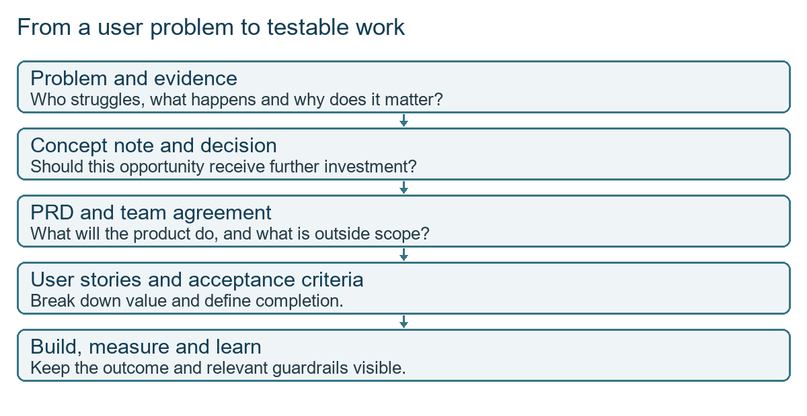
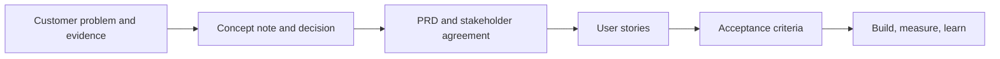
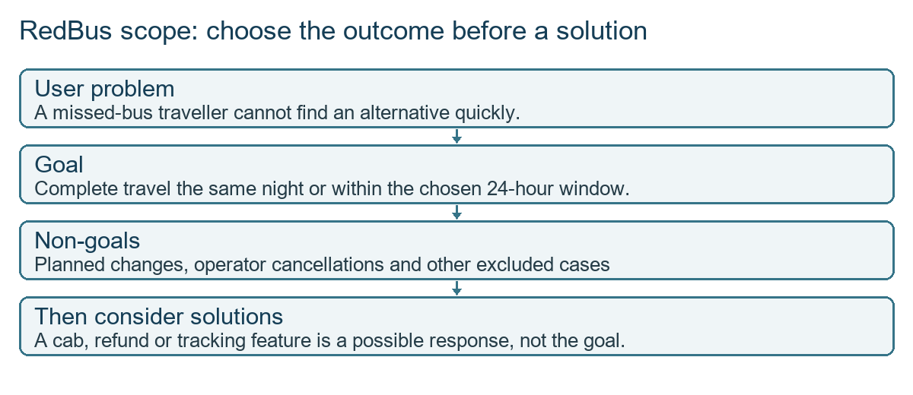
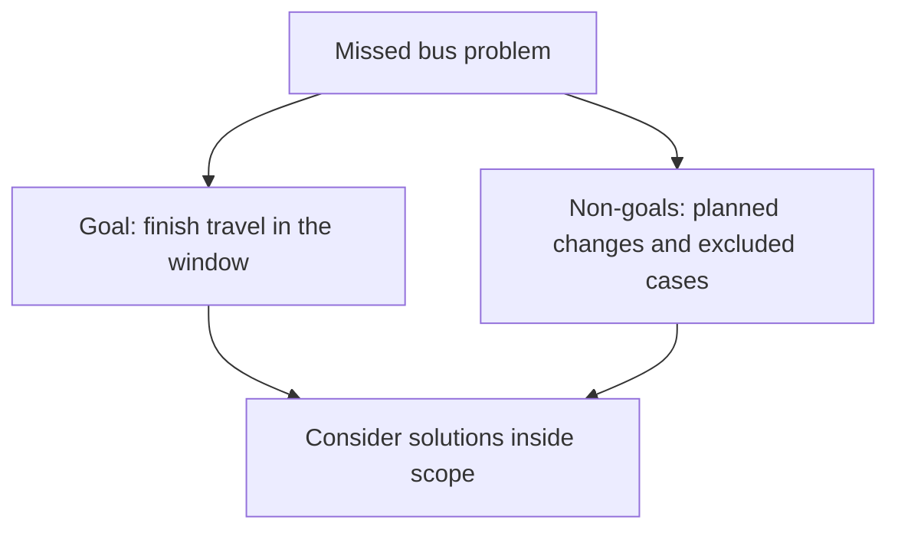
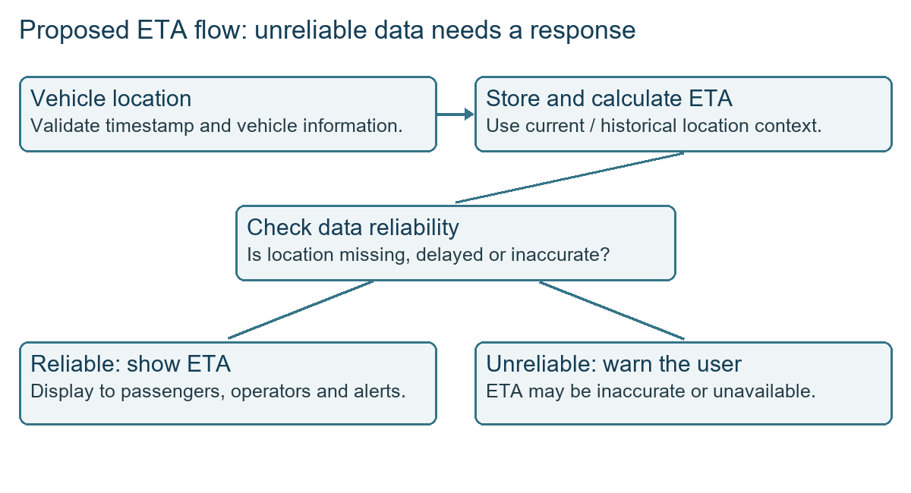
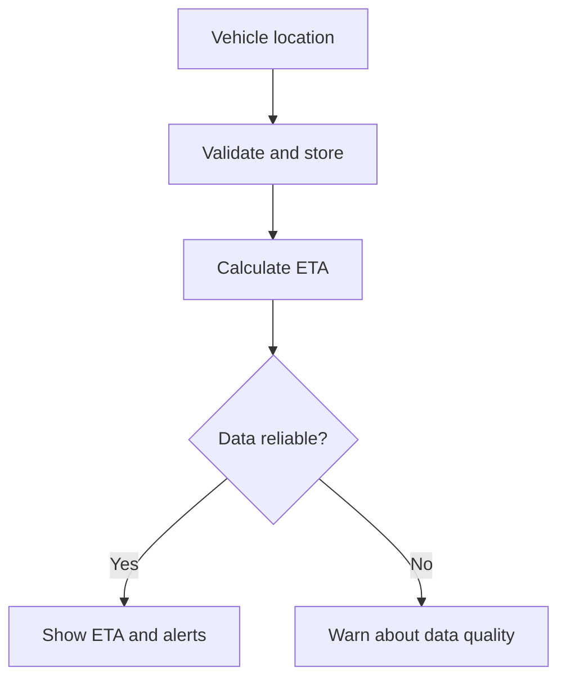
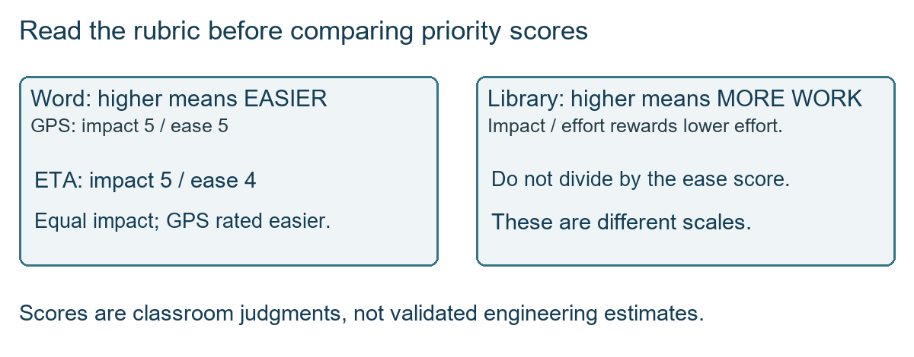

# Class 11: From research to requirements, PRD and user stories

17 August 2026 · Arun Nandewal · portal title "Academic Session 11"; the long notes file calls it Class 9

## The class in one minute

- A PRD (product requirements document) explains what to build, for whom, why, and how success will be measured. It is written for many teams, not only for developers.
- Every team reads it for a different reason: business wants the investment case, design wants the user problem, QA wants testable cases, data wants the measures.
- You start with a user's difficulty, its consequence for the user and its impact on the business. Goals say what outcome you want; non-goals say what this work will not solve.
- The class built a RedBus case live: a traveller misses a booked bus and wants to finish the trip the same night or within 24 hours. The live writing reached the problem statement, goals, non-goals and a persona. It stopped there and Class 12 continues it.
- AI can draft personas and documents, but invented details are not research. Check what it gives you and understand the reasoning yourself.

## Core ideas

### Who reads a PRD, and what each reader needs

The first exercise asked the class to name the teams and say what each needs from the document. A stakeholder is anyone with a role in making the product succeed. A shareholder owns company shares. The instructor corrected students who mixed the two up: a PRD is not written for shareholders just because they hold shares.

Developers need behaviour and integrations. Design needs the user problem. QA (quality assurance, the people who check that the product behaves as expected) needs conditions to test. Marketing needs messages and collateral (the material used to explain or sell the product). Leadership checks fit with business goals. Legal checks risk. Operations prepares fulfilment, support learns how to help users, sales needs the value story, and data needs measures. Sign-off means those people agree the work is clear enough to start.

*The document chain: problem and evidence first, then concept note, PRD, stories and acceptance criteria.*

**Remember:** a PRD is signed off by every team that has to act on it, not just design and engineering.

### Business alignment: the offline-viewing story

The instructor told a story about a streaming service deciding on offline downloads. He first asked what new users want, then changed the question to how they watch now and where it hurts. The answers moved from content to data cost, buffering and interruptions while travelling.

Leadership in the story argued that cheaper data and public connectivity made downloads less important, since most viewing sessions finish. The PM's job is to bring the missing user context: moving between home, transport and office networks, calls and power cuts can end a session against the viewer's will, and completed sessions do not count the interrupted ones. A rare situation can matter if it affects most users or most revenue, so ask what the percentage counts before choosing the bigger one.

Two more cautions came from sponsorship. Sponsorship is leadership support and resources, so a proposal must show how it advances the company's current goal. The Myntra try-and-buy story showed that users liking a feature is not enough: handling and return costs can sink it.

**Remember:** leadership may hold valid data from another angle, so bring the user context and tie it to the business outcome.

### Controlled change, and why not start with Jira

When requirements change after sign-off, earlier reviewers must review the new scope. The instructor discouraged uncontrolled changes but accepted genuine security or legal showstoppers: explain the cost of not acting and get renewed agreement. The slides also mention versioning and review, so a PRD can change, but only in a controlled way.

The sequence he taught is: idea and business approval, cross-functional review, refinement, agreement, then Jira stories and epics. Jira is the tracking tool and an epic groups related work. Isolated tickets written first can leave the real problem unresolved.

**Remember:** agree the problem and scope first, then split the work into tickets.

### Beyond the happy path: engineering, design, marketing and testing

The class ran through examples of what goes wrong when a team looks only at the first happy path.

- Engineering: a ride-pooling feature looks good until routing and traffic combinations are considered.
- Design: in the Myntra app you press and hold a product to see similar items or colours. Many classmates did not know. A useful feature fails on discoverability if people cannot find it, so write how the user reaches the feature, not just what it does.
- Marketing: a good offering (the Zomato Legends example) is wasted if potential customers have never heard of it.
- Testing: a credit-card checkout feature missed one card and phone combination. The loss figure quoted in class has no incident report behind it. The lesson is to test the relevant payment, card and platform combinations and watch post-launch signals. Quality is not only QA's problem.

Internal products can be introduced through demos, roadshows, trials and internal beta use, which is called dogfooding. Telemetry means recorded product interactions used for measurement. Decide before building what evidence you need and what you will measure after launch, but do not track everything.

**Remember:** write for the whole journey: how it is found, how it fails, and how it is tested.

### BRD, PRD and FRD

A BRD (business requirements document) states the business outcome, such as revenue or retention. A PRD turns that into users, problems, journeys, choices and measures. An FRD (functional requirements document) spells out workflows and edge cases for the build. Each is detailed in a different area, so the question is not which has more pages. In the class's description, business or business-analysis roles own the BRD, product owns the PRD, and product with engineering owns the FRD. The slide shows the FRD as part of the PRD. Real companies differ.

An interview example made the point: if you claim to own a product, know where its data comes from, how it refreshes and what happens end to end.

**Remember:** BRD is the why for the business, PRD is the what for the product, FRD is the how each function behaves.

### Problem, goals, non-goals and persona

The problem template links three things: what the user cannot do, what that costs the user, and what that costs the business. For RedBus: a traveller misses a booked bus, cannot find an alternative quickly, feels stressed, switches platforms and may not come back. That risks repeat purchases and customer lifetime value (the value of a customer over time; no formula was calculated). Cashback, refunds, cabs and selling empty seats are possible responses, not the problem. The instructor kept pushing the class not to jump to solutions.

Goals state the outcome. Non-goals are problems deliberately left out so design, engineering and operations do not wander into side branches. The RedBus goal was finishing travel the same night or within 24 hours. Excluded: planned rescheduling, operator cancellations, travel on later dates, and shared arrangements such as cab-sharing with strangers. Non-goals are neutral boundaries, not a place to blame users.

*Goals and non-goals together limit which solutions are worth considering.*

The persona has four columns: demographics (who they are), psychographics (feelings and values), technographics (how they use technology) and motivations or needs. The live persona was a constructed 23-year-old associate PM from Delhi who travels often, compares apps and prices, prefers notifications and wants safe, predictable travel. The instructor showed how to strengthen it with a claim such as "23% of users match this, 2–4 trips a month over two years", but those numbers were illustrations with no data attached. ChatGPT also produced a different image persona, Arjun Sharma, aged 28–35, with assumptions labelled. The two are separate personas, not one real customer.

**Remember:** a polished persona is a hypothesis until real data backs it.

## Worked example

RedBus, step by step, with what the class actually did and what it did not.

1. Start with the task: the user misses the bus and wants to finish the trip quickly and safely.
2. Connect the consequence to value: stress and switching hurt trust and repeat bookings. No lost-revenue figure was given.
3. Bound the problem: same night or 24 hours, with the exclusions above.
4. Describe the user with the constructed persona, and mark it for validation.
5. Review with each team: business for value, design for entry and clarity, engineering for dependencies, QA for failures, data for measures, operations and support for readiness.
6. The recording stops here. The saved Word file goes further (a journey map, a GPS and ETA data flow, and a North Star of the share of tracking users who catch the bus), but that was prepared material, not taught live, and it shifts the focus from recovering after a miss to preventing the miss. That conflict was left open.

*From the saved file, not the live class: location is validated, stored, turned into an ETA, and checked for reliability.*

Applied to car loans: picture a credit officer whose approval screen is slow when a dealer's documents are incomplete. The problem is "the officer cannot decide a file quickly, so the dealer sends the customer to another lender, and we lose repeat business". A discount or an extra document checklist is a solution. A non-goal might be "used-car loans" or "top-ups". The reviewers would be credit, the dealer network, operations, IT and compliance, and each would ask the PRD a different question.

## Frameworks to reuse

| Item | Blank template |
|---|---|
| Problem statement | As a [user] I cannot [task], which causes [user consequence]; as a result the company [business impact]. |
| Scope | Outcome [ ]; user [ ]; included situation [ ]; excluded situation [ ]; reason for boundary [ ]; assumption to test [ ] |
| Persona | Demographics [ ] · Psychographics [ ] · Technographics [ ] · Motivations/needs [ ] |
| User story | As a [user], I want [action], so that [benefit]. |
| Acceptance criteria | Condition [ ]; expected behaviour [ ]; failure and recovery [ ]; how to test [ ] |

The PRD checklist in the slides asks six questions: what problem, which user, why it matters, what to build, how success is measured, what is excluded. A concept note is an early proposal for a new product or major feature; a one-pager is a short decision document used for alignment and investment. A small UI change or routine bug fix may need neither.

User stories are checked with INVEST: Independent, Negotiable, Valuable, Estimable, Small. The slide's visible table omits the final T, so it was not shown. The slide's example for offline music listing needs an active Premium account, a download button on supported content, offline availability, sync when back online, and an error when storage is full. This is an illustration, not how the real service works.

*In the Word exercise a higher number means easier; on an effort scale a higher number means more work.*

Do not mix the two scales when ranking features. The saved file scored GPS tracking and an ETA calculator highest and chose them.

## Self-test

1. Who is the audience of a PRD: engineering only, every shareholder, or the relevant teams that make the product succeed?
2. Which three links belong in a problem statement?
3. Why are a cab or a refund not the RedBus goal?
4. What is missing behind the 23% persona claim used in class?
5. In the Word prioritisation table, a score of 5 means easy. Can you divide impact by that score as if it were effort?

**Answers**

1. The relevant teams that make the product succeed.
2. What the user cannot do, the consequence for the user, and the impact on the business.
3. They are possible solutions. The goal is the outcome, finishing travel inside the scope.
4. A real sample, the source analysis, the period and a definition of the segment. It was only an illustration.
5. No. Ease and effort run in opposite directions, so read the rubric first.

## Homework from this class

Sameer's to do. These are not done for you.

Write along with the class for a product and problem of your choice: a problem statement, goals and non-goals, and a persona. Keep the reasoning and the output in your portfolio folder. The instructor wants you to understand each part before using the full-document prompt, and said he will continue from here. No calendar deadline was stated for this exercise. A mock evaluation was also announced for around 22 August, but the wording about the exact date is inconsistent, so check the LMS announcement.
