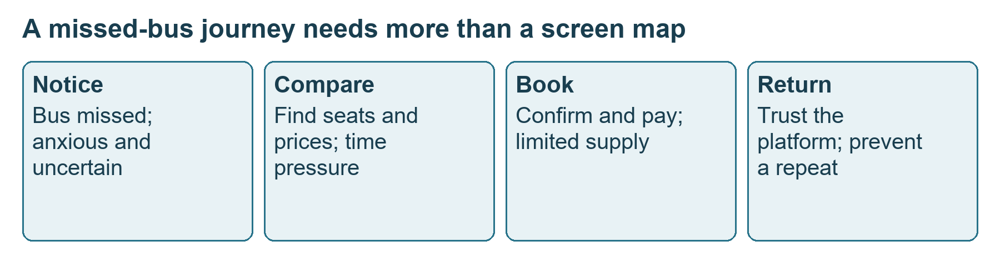
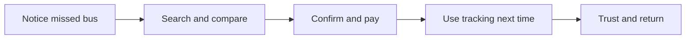
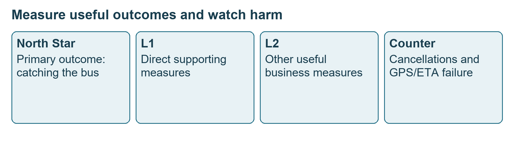
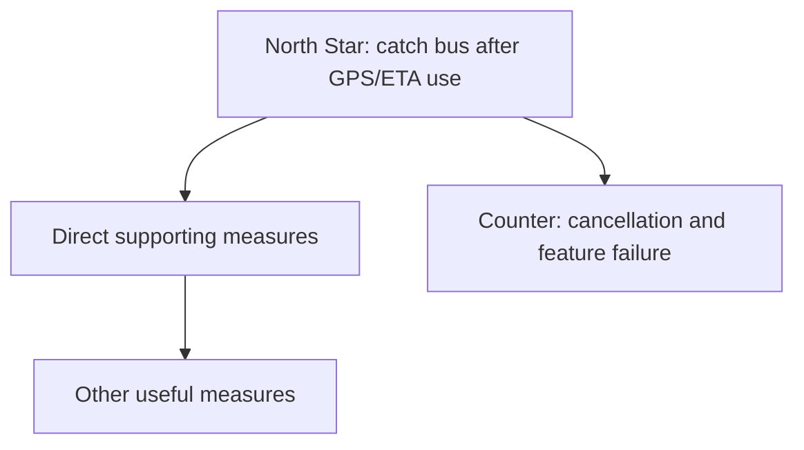
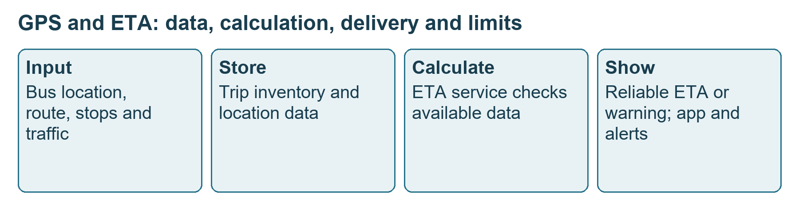
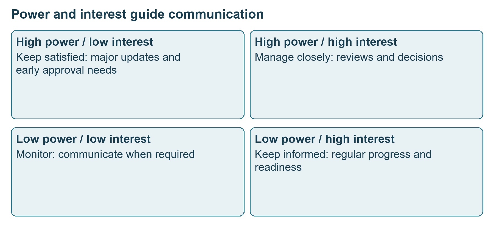
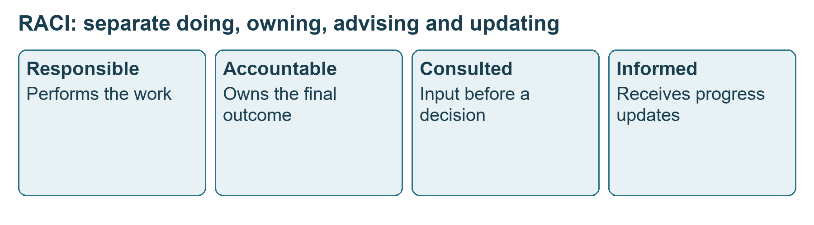
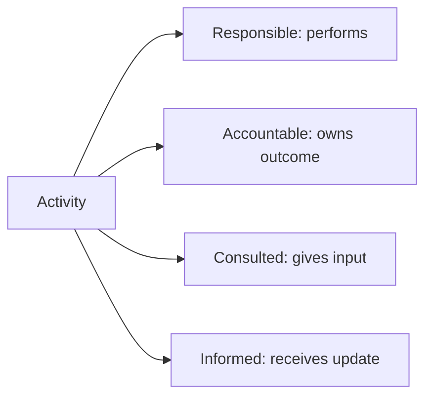

# Class 12: Stakeholder management and finishing the PRD

21 August 2026 · Arun Nandewal · portal title "Academic Session 12 - Stakeholder Management: Communication, Alignment & Case Study"; the long notes file calls it Class 10

## The class in one minute

- This class continues the RedBus PRD from Class 11 and adds the journey, priorities, features, measures, data flow and risks.
- The exercise moved the case from recovering after a missed bus to preventing the miss. The class picked GPS and ETA (estimated time of arrival) as the features.
- Measures come in layers: one North Star (the main measure of success), direct supporting measures, other useful ones, and counter metrics that watch for harm.
- Stakeholder management means matching how often and how much you tell people to how much power and interest they have in the product.
- RACI is the framework for ownership: who does the work, who owns the result, who gives input and who is kept informed.

## Core ideas

### The journey and the scope change

The starting problem is the same: a traveller misses a booked bus and cannot find a quick alternative. The journey table puts each stage next to an action, a touchpoint (a place or channel where the user meets the product), a feeling, a pain and an opportunity. It is not a list of screens.

*The useful opportunity comes from the pain at each step.*

The class then collected four pain areas: finding urgent alternatives, high last-minute fares with few seats, not knowing whether you will catch the bus, and the experience after taking an alternative (the narration for this fourth one is incomplete). A class vote put accurate tracking, meaning prevention, first, labelled P0, and recovery second. The instructor warned against calling everything P0. The vote was an exercise, because there were no real customers or business stakeholders in the room. Real choices come from customer evidence, data and business priorities.

Someone asked why you cannot just add every useful non-goal. The answer was limited people, time and decision capacity. His example assumed four engineers at fifty lakh rupees a year each, which is two crore. Losing four of twelve months to scope debate burns about a third of that, roughly sixty-six lakh. These are hypothetical teaching inputs, not real salary data.

**Remember:** a PRD must say which problem and which boundaries are current, so write the scope change down instead of letting it slip in.

### Choosing features and measuring them

The brainstorm gave GPS tracking, a "Bus Catcher" score, a Journey Mapper, a chatbot called Redbot, and an ETA calculator. The Bus Catcher idea used values like 100 for "will catch", below 50 for "may miss" and 10 for "already gone". Those were illustrative, not a calibrated model. Features were rated on customer impact (1 low, 5 high) and a second axis the class called effort but defined as ease: 1 difficult, 5 easy. A high number on that axis means easy, not more effort. GPS (ease 5) and ETA (ease 4) were selected. The instructor challenged the idea that a chatbot is simple, since it must handle unexpected questions. No engineering estimate was made.

The North Star for the feature was the percentage of people who used GPS/ETA and caught the bus. The wording switched between people and trips, so a real plan must pick one unit and denominator first. L1 measures contribute directly (the shape of usage, misses despite use, trips where tracking was unavailable). L2 measures still matter but contribute less directly. A counter metric watches for a harmful side effect. For RedBus the class named booking cancellations and GPS/ETA failure.

The other examples were teaching choices, not official company metrics: Amazon revenue as orders times average order value, Meta engagement, a course's placement outcome, and an airline's on-time arrival. The point on education was that the promised result is getting the intended job, not joining a class or leaving a rating. Ratings are subjective, so they explain problems but should not be the only primary measure.

*A good primary result needs supporting evidence and a counter measure beside it.*

**Remember:** measure the promised result, then watch whether improving it damages something else.

### Data flow and risks

The first ChatGPT data-flow request stalled, so the instructor used DiagramGPT. He described what to draw, picked the participants (bus operators, GPS-equipped buses, location input, the ETA service and passengers) and the tool asked follow-up questions. Inputs were current location, route and stops, distance, historical travel, traffic and scheduled departures. Outputs went to the passenger app, an operator dashboard and notifications. If location data is missing, late or wrong, the user should be warned that the estimate may be unreliable.

*A reliability question sits between calculating an ETA and showing it.*

The case risks were dependence on a Google maps and GPS service, and users refusing location permission. The proposed fixes were storing offline maps and a banner explaining that location needs to be on. Neither was demonstrated, and offline maps alone cannot replace live vehicle location. User stories, epics and acceptance criteria were left for later sprint classes.

A concept note explores whether an idea is worth pursuing, and a one-pager is a short proposal for discussion and approval. The class allowed about one to two pages for each and five to twenty for a detailed PRD. That is the class's guidance, not a universal standard.

**Remember:** show what happens when data is unreliable, not just the successful path.

### Stakeholders, power and interest

A stakeholder is anyone who can affect the product or be affected by it. Internal ones include engineering, design, QA, leadership, marketing, sales, support, analytics, finance and legal. External ones include customers, partners, vendors, regulators and investors. The deck used the PhonePe UPI Lite launch as an illustration of how many parties must see the same plan. These are slide summaries, not verified project histories.

Misalignment is a chain: product defines something, engineering reads it differently, design builds a second version, marketing promises extra and support knows nothing. Delay, rework and lost trust follow.

Power is influence over the outcome; interest is involvement in this product. High power and high interest means manage closely. High power and low interest means keep satisfied. Low power and high interest means keep informed. Low power and low interest means monitor. These are communication choices, not a ranking of people, and a job title does not fix the position. The live discussion rated compliance interest low and designer power low where the slide said medium, so map each project afresh.

*Low day-to-day interest can sit next to a power to block a release.*

The instructor warned against managing every detail yourself: set expected outcomes and dates, agree owners and ask for early warnings when work slips. He still recommended daily contact with engineering and regular design and marketing reviews.

**Remember:** pick the information and the rhythm to fit the dependency and the decision.

### RACI and launch readiness

Responsible does the work. Accountable owns the final outcome. Consulted gives input before a decision. Informed gets updates. The point is that the PM does not own every specialist task.

*Doing the work and owning its result are different roles.*

The live narration briefly swapped doing and owning (calling the manager responsible and the coder accountable), then corrected itself. The deck's AutoPay example table also leaves some rows without a clear doer or owner. Treat it as a teaching sketch and confirm real assignments for a real project. In the class's reading, the PM is responsible and accountable for requirements, consulted on design, and accountable for the launch with engineering and marketing doing the work.

**Remember:** name the task, then agree the owner and contributors, because a RACI letter does not do the work.

## Worked example

The AutoPay case from the deck shows what a missing alignment costs. It is a teaching case, not a verified PhonePe incident.

| Stage | What went wrong | Preventive action |
|---|---|---|
| Product defines scope | Scope not explained the same way to everyone | Walk through the PRD and agree the boundary |
| Engineering builds | Monthly payments only, while product expected weekly and monthly | Review requirements and acceptance criteria together first |
| Design | Pause and cancel not clearly explained | Product and design review before final UX |
| Marketing | "Never miss a bill" message though some billers unsupported | Share final MVP scope and approve the message |
| Support | No training on setup, cancellation or failure | Train and write FAQs before release |
| Customers | Conflicting answers reduce trust | Make sure every customer-facing team is ready |

Applied to car loans: say your team adds a new instant-approval check for new-car loans. Credit writes the rule, IT builds it, the dealer team promises "same-day approval for every file", and branch staff are never trained on what happens when the bureau check fails. That is the AutoPay chain with different names. Prevent it by agreeing scope, reviewing acceptance conditions with IT, approving the dealer message against the actual scope, and training branches before the day it goes live.

## Frameworks to reuse

Power and interest plan, one row per stakeholder:

| Stakeholder | Role | Power / interest | PM action |
|---|---|---|---|
| (example from slide) VP Product | Roadmap approval | High / high | Weekly review |
| Engineering manager | Deliver feature | High / high | Daily collaboration |
| Compliance | Approval | High / medium | Consult early |
| Support | Customer readiness | Low / high | Product training |

Communication plan from the deck: leadership weekly through an executive summary, engineering daily by stand-up or Slack, design twice a week in a design review, marketing weekly in planning, support before launch with a training session, analytics at sprint planning by dashboard review.

Blank RACI: Activity [ ] · Deliverable [ ] · R [ ] · A [ ] · C [ ] · I [ ] · open gap [ ].

Launch readiness checklist from the deck: product (PRD approved, requirements final, acceptance criteria complete); engineering (development done, critical bugs fixed, performance validated); leadership (risks communicated, approval received, success measures agreed); business (campaign ready, support trained, FAQs written, dashboards set up). Passing it does not guarantee success.

Data-flow template: actors, inputs, storage, processing, output, failure path, open technical design. The GPS/ETA example fills it in as above.

## Self-test

1. What scope change happened in the RedBus exercise?
2. Why is not every pain point P0?
3. On the second feature axis a score of 5 means: greatest effort, easiest, or strongest proof?
4. How does a North Star differ from a counter metric?
5. Compliance has little daily involvement but can block the release. Which matrix approach fits, and what would be the mistake?

**Answers**

1. Recovery after a missed bus became prevention through GPS and ETA. Update the boundaries instead of quietly merging both.
2. Capacity is limited, so choices must come from customer evidence and business value.
3. Easiest. The axis runs from 1 difficult to 5 easy.
4. The North Star is the main intended result; a counter metric watches for harm or failure.
5. Keep satisfied and consult early. The mistake is ignoring them because their interest is low.

## Homework from this class

Sameer's to do. These are not done for you.

Create customer journeys, PRDs and data-flow diagrams for portfolio and LinkedIn practice. The strongest instruction was to complete at least two PRDs, one written yourself and one generated with the shared prompt, for any product or feature. The instructor also suggested practising journeys across five or six products and sharing them regularly. His named examples were Spotify, Swiggy and JioHotstar. Give diagrams clear names. No submission deadline or grading rubric was given. An evaluation was mentioned for the following day, but the instructor did not know the rules, so ask the programme coordinator. A readiness checklist was previewed for the next class.
