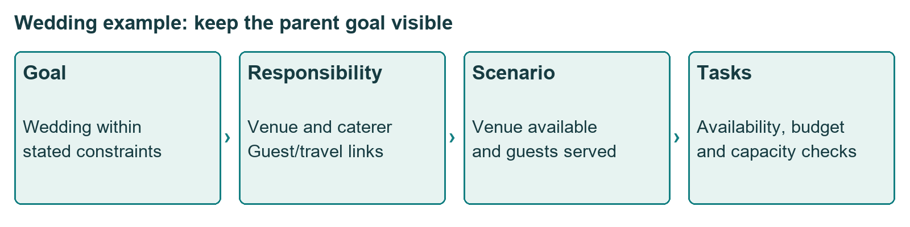
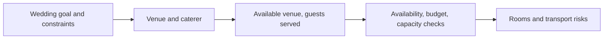
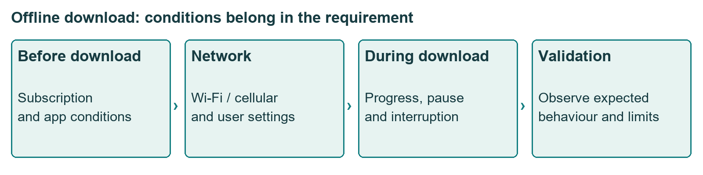
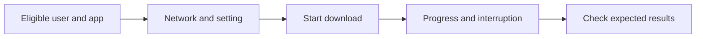
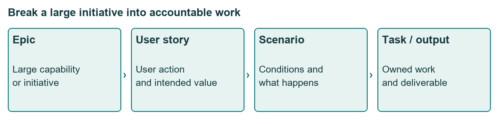
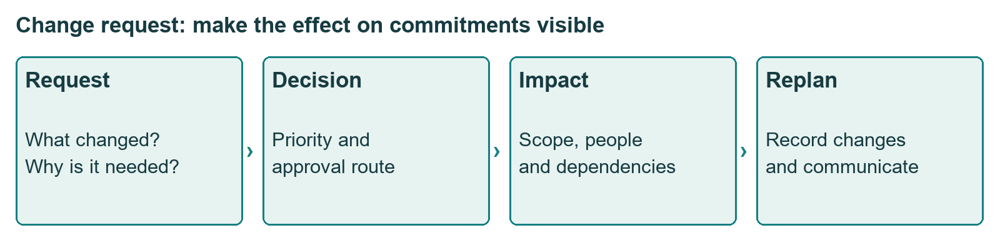
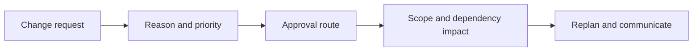
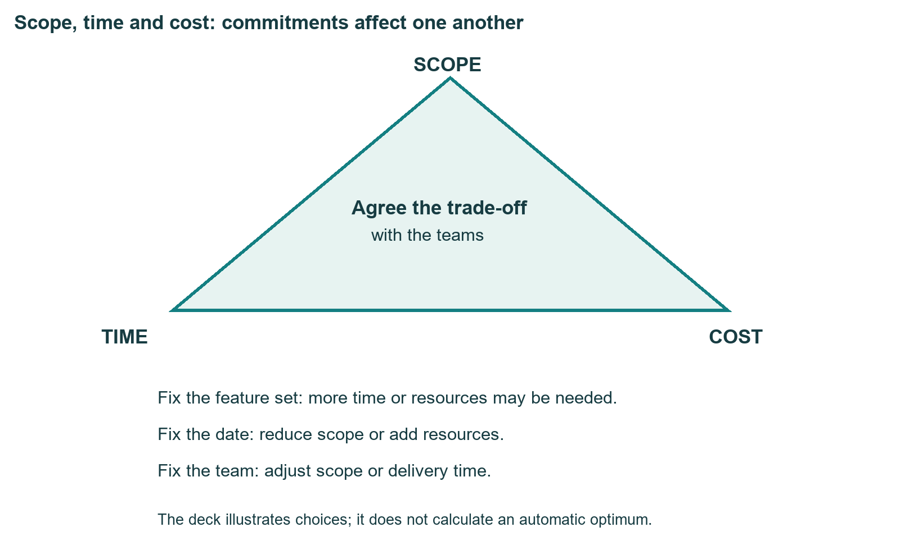
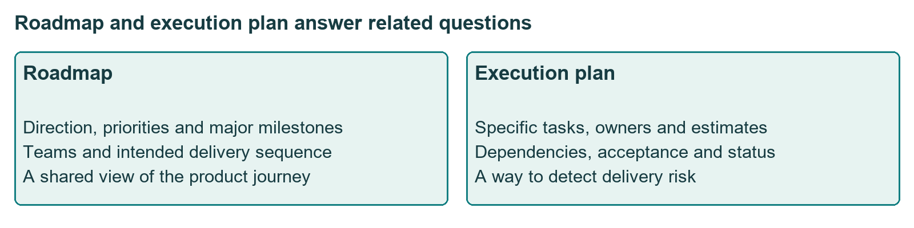

# Class 13: End-to-end sprint planning and roadmaps

24 August 2026 · Arun Nandewal · portal "Academic Session 13", transcript titled "Workshop: End-to-End Design Sprint". Despite the title, the class is about delivery planning, not the five-day design sprint method. The long notes file calls it Class 11.

## The class in one minute

- A big initiative is broken into user needs, scenarios, tasks and deliverables, and every level stays tied to the goal above it.
- A scenario describes the situation; acceptance criteria say what must be observed for the work to count as done, including what must not happen.
- The PM states the outcome and constraints and works with specialists on the "how". Do not invent an encryption method just to sound technical.
- Scope, time and cost pull against each other. Show dependencies, buffers and changes openly instead of quietly adding work.
- A roadmap shows direction and sequence; an execution plan holds the near-term tasks, owners and estimates.

## Core ideas

### Planning starts as familiar life planning

The class opened with a wedding. The goal: a wedding on 24 February 2024, six hours long, 150 guests, planned over six months with a budget of 20 lakh rupees (an example, not advice). It split into three responsibilities: venue and caterer, guest list and travel, shopping and decoration. Under the venue came scenarios (two meals and a snack, date available, guests served) and tasks (check availability, check budget, merge the two families' guest lists, check venue capacity). Unknown room needs and transport created a dependency on the guest and travel work. A dependency is work or a condition another task needs before it can go ahead.

*The venue-capacity task exists because it supports the guest and event requirements.*

Sprint planning was introduced as breaking large goals into executable, accountable work under time and budget limits. The purpose is to expose risks early and make clear who does what.

**Remember:** naming the overall goal is only step one; someone still needs a task and an owner.

### From goal to stories: the offline-music case

The main case was offline listening in a music app (Spotify as the example). The business aim was premium retention where connectivity is poor; the user aim was listening without a connection or data. The epic, meaning a substantial body of work that may span several teams or sprints, was "offline downloads and listening". User stories under it covered downloading, playing downloaded music and deleting it, with download quality (bitrate, the amount of audio data per second) as another. All figures in the deck are a teaching specification, not what the real product does.

The deck's goals were a 30% rise in offline session starts and a 15% fall in premium churn. The live talk instead said success could be 30% of users starting to download. Those are different metrics (a count of sessions versus a share of users), and no baseline or period was given.

**Remember:** write down the metric's definition and its denominator, and do not swap user share for session growth.

### Scenarios, acceptance and Given/When/Then

Scenarios for downloading included Wi-Fi, mobile data, switching networks, flight mode and a manual pause. Engineering tasks were the download API, on-device storage and preventing stored files from being copied out. Design needed mock-ups and marketing a campaign.

*A feature needs conditions and failure behaviour, not just a Download button.*

A learner asked how far a PM must go on encryption. The answer: specify the outcome (stored files cannot be pirated or moved outside the app) and ask engineering for options. Acceptance criteria are the conditions checked before work is accepted. The live ideas were to download five songs, pause and resume several times, and switch to flight mode mid-download.

Given/When/Then splits a case into a starting condition, an event and an expected result. The first example: an eligible premium user on Wi-Fi or cellular requests a song through the app. The next added high-quality downloads for a top plan, using "Platinum" as a placeholder because the instructor did not know the real tier names. Do not treat those as real plan facts. The class also showed that a generic AI request produces poor stories unless you paste in the detailed PRD first.

**Remember:** specify the behaviour and the evidence that it works; a tidy Given/When/Then can still hide an unsettled product rule.

### Terms, hierarchy and the PRD

The house exercise (five bedrooms on 1,500 square feet, three master bedrooms) confused people because labels changed as the talk went on. The later clarification used three Amazon-style initiatives of different sizes: wishlisting, AI-enabled shopping (a hypothetical 2028 goal) and transaction security. Each can be an epic in its own context. A task such as "get material" means nothing until you know its parent; "improve load time by five seconds" must say whether that is screen, tap, API or database time.

*Every low-level task needs a visible link to the larger user outcome.*

The class wants a PRD clear enough that a colleague can follow the plan if the PM is absent. A sprint is a time-boxed set of work, two weeks in most examples (one caption said four months, likely a transcription error). A backlog is work waiting to be scheduled. Story points were once described as person-days; no shared estimation method was taught, so do not assume a conversion.

**Remember:** every task needs a parent and an outcome; a precise number on an undefined operation is still unclear.

### Estimates, change requests and buffer

The task owner estimates the work, not the PM alone. The PM agrees tasks with the engineering lead, who assigns people in most organisations. A change request (CR) goes through the company's approval process. The class's advice: keep the sprint timebox, adjust what is inside it, and make the reason and impact visible to affected teams. Repeatedly adding work after a commitment destroys trust.

*The changed commitment and its reason should be visible to affected teams.*

A buffer is a reasoned allowance for risk and testing, not padding. One clean example: three weeks of work plus one week of buffer is four weeks. Another example mixed months and weeks and is not usable as a calculation.

**Remember:** a buffer is a justified allowance, not a way to avoid understanding the work.

### Scope, time and cost, then roadmaps

Cost covers people's time, maintenance and the opportunity cost, the value of the work you give up. Build versus buy asks whether to create a capability or obtain one. Scope creep was shown with a washing analogy: you agree to wash clothes, then ironing and putting them in the wardrobe are added without a decision. Overpromising loses trust, and a needlessly long estimate hides poor understanding.

*Holding one commitment fixed can force a change in the others.*

A roadmap communicates direction, priorities and major milestones across teams. An execution plan records tasks, owners, estimates, dependencies and status.

*Roadmap and execution tracking answer different questions.*

The class ended with a sequencing exercise (interviews, competitor research, goals and metrics, concept note, PRD, prototype, samples to users, sprint planning, build, test plan, support documents, sales training, launch, measurement) and said there is no single right order.

**Remember:** a sensible plan respects real dependencies, and a neat roadmap can still contradict itself.

## Worked example

Taking offline downloads from idea to owned work:

1. State the user outcome (listen with no signal) and the business hypothesis (better retention).
2. Agree the metric, session growth or share of users, before judging results.
3. Split the capability into download, playback, deletion and quality choice.
4. For download, decide who is eligible and which app, website and network conditions are in scope.
5. Write scenarios: Wi-Fi, cellular, interruption, pause, low storage, expired subscription. Partial download and app crash were named in the deck but left without an expected result.
6. Link tasks to teams, using the deck's table below.
7. Agree estimates with the people doing the work and note dependencies.

| Task in deck | Team | Output | Estimate |
|---|---|---|---|
| Download button and progress design | Design | Figma component | 2 days |
| Download queue API | Engineering | REST endpoint | 4 days |
| Local storage manager | Engineering | Storage module | 3 days |
| Tests for download states | QA | Test suite | 2 days |
| Onboarding copy | Product | Revised copy | 1 day |
| Analytics events | Engineering and data | Event schema | 1 day |

The six estimates sum to 13 days of effort, but that is not a 13-day schedule because teams work in parallel. The deck's scenario cases include 200 MB free storage as the low-storage trigger and a proposed limit of 10,000 songs per device. These are proposed targets, not real product figures.

Costing arithmetic from the class, in rupees: team cost of 30 lakh a year times 2/12 for two months is 5 lakh; adding 0.5 lakh of marketing effort gives 5.5 lakh. The build-versus-buy illustration put 72 lakh of salary for six months of building against a service at 2 lakh a month, so 6 × 2 = 12 lakh for six months. That compares only the quoted amounts and leaves out integration, maintenance and fit.

Applied to car loans: a "digital loan application" epic would break into stories such as "dealer uploads customer documents". A scenario is a file uploaded with a blurred PAN. The acceptance criterion says the credit officer sees a clear rejection reason and the file does not move to bureau check. The task owners are IT for the upload, design for the screen, and operations for the dealer help note.

## Frameworks to reuse

| Level | Blank template |
|---|---|
| Epic | Deliver [capability] for [outcome] |
| User story | As a [user], I want [action], so that [benefit] |
| Scenario | Given [condition], when [event], then [expected behaviour] |
| Task | [Team or owner] produces [output]; depends on [predecessor] |
| Deliverable | Checkable output [ ] |
| Acceptance | Observe [ ] under [condition]; pass if [ ] |

Scope, time and cost trade-off (from the deck):

| Held fixed | What gives |
|---|---|
| Full scope | More time or more people |
| Launch date | Less scope or more people |
| Fixed team | Less scope or more time |

Task estimate row: parent scenario [ ], work [ ], team [ ], output [ ], estimate and unit [ ], predecessor [ ], risk or buffer [ ].

The deck also proposes gates before launch: story approval, design and engineering sign-off, passing unit tests and QA, zero top-priority bugs, approved creative and a metric baseline. Its eight-week team map conflicts with its own rules in places, so use it as a prompt, not a verified schedule.

## Self-test

1. What is the difference between a scenario and acceptance criteria?
2. Why is "improve load time by five seconds" an incomplete task?
3. Who should estimate the duration of a task?
4. What do you do when a change request arrives mid-sprint?
5. Six estimates add to 13 days. Is the delivery date 13 days away?

**Answers**

1. A scenario describes the situation; acceptance criteria say what must be observed for the work to be accepted, including restrictions.
2. It does not say which operation, which user outcome or which parent goal it serves.
3. The person or team who will do the work, in discussion with the PM.
4. Keep the timebox, adjust what is inside it through the approval process, and tell the affected teams the reason and impact.
5. No. Teams work in parallel and dependencies matter, so effort is not elapsed time.

## Homework from this class

Sameer's to do. These are not done for you.

- Pick a familiar product or capability and break it into an epic, user needs, scenarios, tasks, deliverables and acceptance criteria. Sharing for review and building portfolio material was encouraged.
- Do the sequencing exercise: order the items listed above (prototyping, competitor research, user interviews, test plan, product measurement, sprint planning, PRD creation, launch, goals and metrics, concept note, support documents, sales pitch training, showing samples to users, building with engineers and designers) and explain the dependencies behind your order. The walkthrough was deferred and different answers are allowed.
- Supporting exercise from the deck: write functional and non-functional requirements for a shopping app's personalised homepage (ShopEase).

No graded rubric or dated deadline was given. A holiday-related change to the next session's schedule was announced with mixed date wording, so check the LMS.
