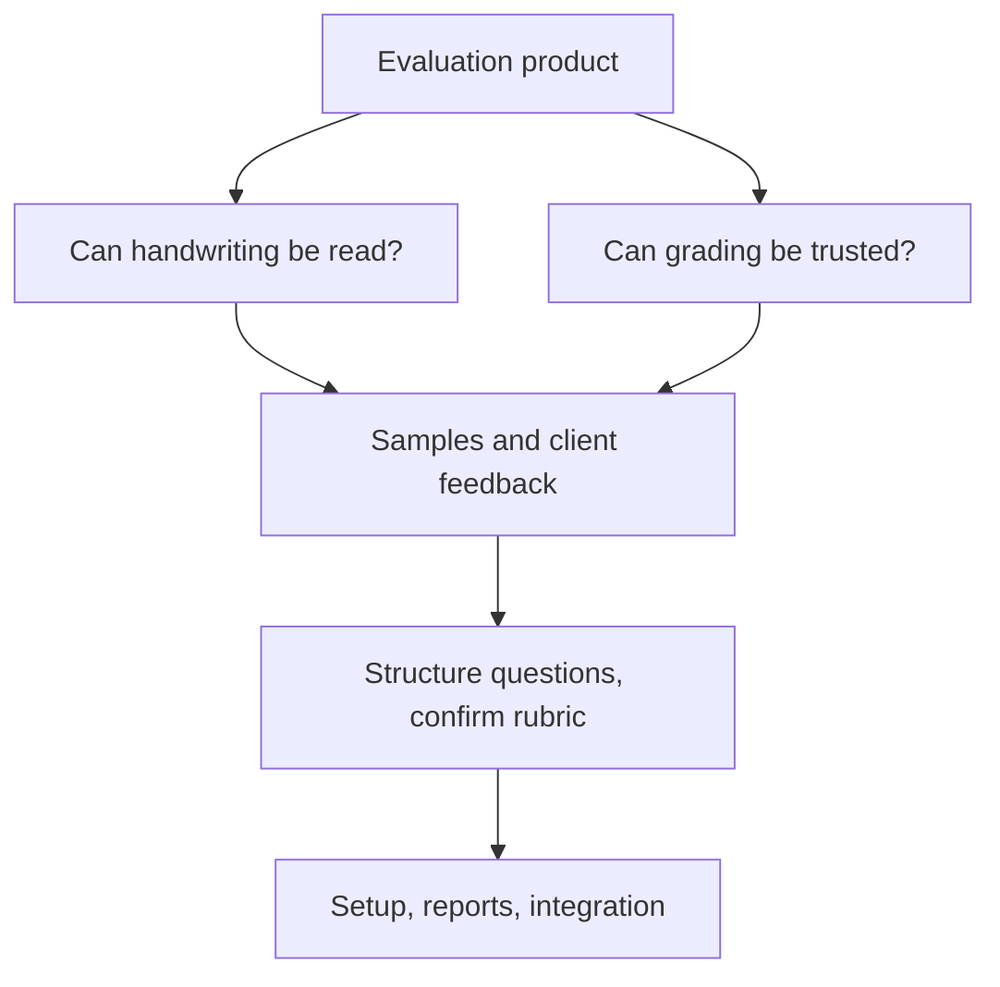
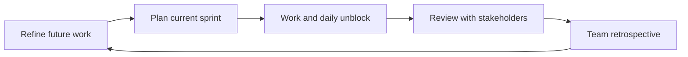
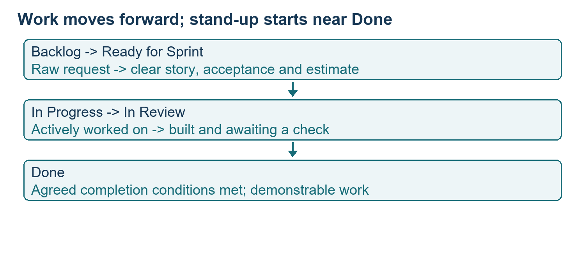
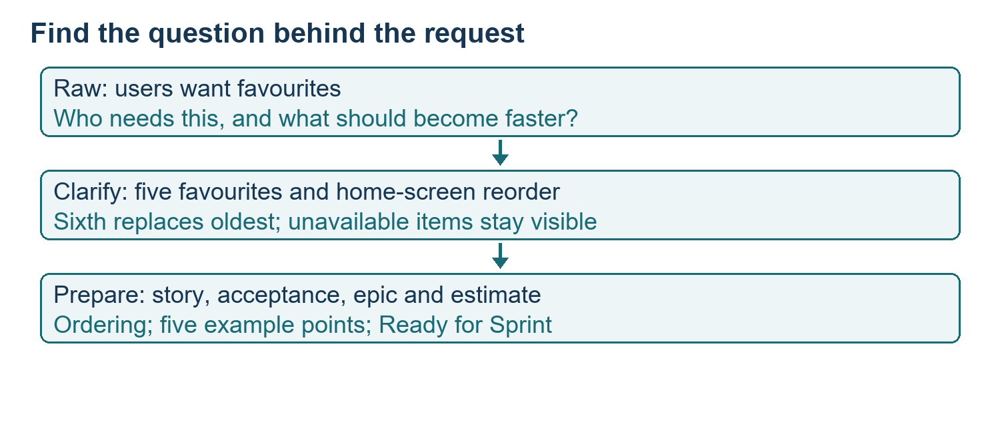
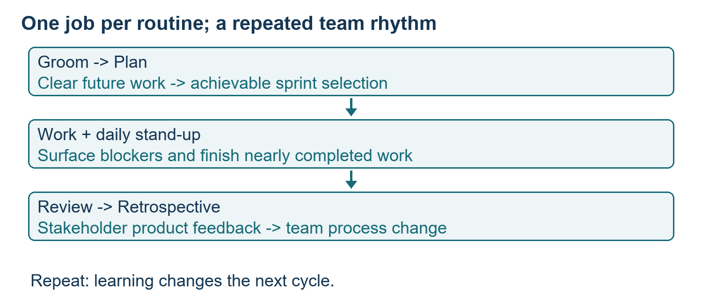

# Class 14: Agile in practice, Jira ceremonies and execution

27 August 2026 · Sarvana Jaikumar (as written in the transcript header) · portal "Academic Session 14"; the long notes file is called Session 14

## The class in one minute

- Agile means bringing customer feedback in early, on small pieces of work, instead of building everything and finding out at the end.
- Five routines (called ceremonies) keep a team in step: backlog grooming, sprint planning, daily stand-up, sprint review and retrospective. Each has one job.
- Jira is the shared record of the work. Its board, backlog and timeline are views of it, and it does not replace conversation.
- A vague request becomes ready work only after it gets context, acceptance criteria, an epic and a team estimate. AI can polish the wording after the team decides what it means.
- Story points compare the size of work inside one team, and velocity records what that team really finishes. Use the history to push back on unrealistic plans.

The three supporting documents the instructor mentioned (a ceremony deck, a Jira screenshot deck and a handout) were not saved with this class. The notes below follow the spoken account only.

## Core ideas

### Waterfall versus Agile, using an exam-marking product

The running case was a product that marks exam answer sheets. An instructor creates a course and exam, uploads the question paper, confirms a rubric (the criteria used to judge an answer), and uploads answers. Handwritten answers must be turned into text with OCR (software that reads text from an image). Several AI models then grade each answer as a "council", a supervisor combines their marks and confidence, low-confidence cases go to a human, and reports are produced.

In the waterfall comparison you write the whole requirements document, build the product, test it, and only then let the customer see it. If the customer wants something different, the document, build and tests all repeat. Organisations still use waterfall, so it is not extinct. The lesson is the cost of discovering a misunderstanding late.

Agile starts by asking which parts could make or break the product. Here that is reading handwriting and grading reliably. If handwriting cannot be read, a handwritten-exam product fails. If a human must recheck almost everything (the 95% figure was a hypothetical), it delivers no benefit. So build and test those two parts first with varied handwriting samples and a confirmed rubric, show the client early, then do question structuring, setup and reports. Integration is still real work, and early feedback plus fixed-price contracts can lead to scope disputes, so boundaries need attention.

**Remember:** test the uncertainty that could sink the product first, and keep integration and scope visible.

### Measurable acceptance and spikes

"OCR the answer sheets" is too vague. Break the PDF into pages, map content to question numbers, extract a block per question and flag low-confidence text for human reading. "Grades correctly" is also too vague. The class suggested a gold set (reference examples with agreed answers), for instance thirty scripts marked by the instructor, and agreement within one mark. The rule for larger differences was cut off in the transcript. Scores should cite the rubric point and record the model and prompt version used, so every result can be traced.

A spike is a time-boxed investigation whose output is a decision. Examples: can an open model read the sample handwriting well enough, do three grading models beat one on the gold set, and what does an eighty-script exam cost in tokens (the units AI models charge by). No duration, result or price was given.

Two human decisions are required: approving the rubric, and reviewing low-confidence grading. Unclear handwriting is flagged separately. Confidence in reading the text is not the same as confidence in the grade. Invisible platform work (login permissions, storage, audit records, logging, cost controls) belongs in the backlog too.

**Remember:** specify the sample, the measurement and the acceptable evidence, and use a spike when the answer is unknown.

### Sprints and the five ceremonies

A sprint is a fixed block of time, two weeks in the examples. If work is unfinished, the period still ends. The list is agreed at the start; if urgent work arrives, something else leaves. Something working that you can show a customer should exist at the end.

With a few people in one room everyone knows what is happening. With many people or sites, two engineers duplicate work, an almost-done ticket sits for weeks and a dependency goes unspoken. The routines fix that, and each has one question.

| Routine | Question it answers | Audience and length (class example) |
|---|---|---|
| Grooming | Is the work clear enough to start? | Team, during the current sprint |
| Planning | Can we finish this selection? | People doing the work, 1–2 hours on day one |
| Stand-up | Who is stuck, and what dependency needs help? | Team, 15 minutes daily |
| Review | Did we build the right thing? | Stakeholders and team, about 1 hour |
| Retrospective | How can we work better together? | Team only, about 45 minutes |

**Remember:** ask what each routine decides or changes, not whether a meeting took place.

### Jira vocabulary and the Tiffin Track case

An issue is any unit of work in Jira (feature, bug, chore). A story is work written from the user's view. An epic groups related stories. The backlog holds possible future work, not yet committed. A blocker is an obstacle that stops work, such as waiting on an outside party; it is not a person.

The case was Tiffin Track: students pre-order campus lunch the night before, pick a 15-minute pickup slot and pay in the app. It started with four engineers and one canteen, then grew to forty campuses and five squads (the transcript gives conflicting headcounts). Four epics: Ordering, Payments and Refunds, Notifications and Vendor Console.

Jira was described as a database of work with board, backlog and timeline views. If a meeting reaches a decision and the ticket does not change, the next person cannot act on it. The demo used a free account, the Scrum template, a team-managed space (less admin than company-managed), project key TFN, story points instead of hours, and five statuses: Backlog, Ready for Sprint, In Progress, In Review, Done.

*Work moves left to right; stand-up attention starts near the right to help items finish.*

**Remember:** learn the hierarchy and the customer workflow before treating a board as a delivery system.

### Grooming a vague request

The raw backlog held lines like "users want to save favourites", "make search better" and "can we do dinner too?". Grooming means asking what the user needs, writing a title and story, adding observable acceptance criteria, choosing the epic, estimating and keeping the request's origin. Only then does the ticket go to Ready for Sprint.

*AI improves the wording after people decide the behaviour and edge cases.*

The "make search better" example used meaning-based search (semantic search), where "bhindi" and "lady's fingers" find the same item. The pointers were: the wanted item in the first three results, results in two to three seconds, and accurate multilingual input. A student asked whether multilingual support is feasible. The instructor agreed the demo assumed it. If it does not exist, create separate work to decide the languages, translation service and how input reaches the search. Writing a criterion does not create a capability.

**Remember:** a polished story helps only when the requirement is understood and its dependencies are real.

### Planning, points, velocity, stand-up and review

Story points size work relative to a small known task called one, using steps like 1, 2, 3, 5, 8, and counting effort, complexity and uncertainty. The same task is the same size for a senior and a newcomer. Points are not hours and not a measure of a person. Velocity is the points one team actually finishes per sprint, so do not compare teams by it.

In planning, create the sprint, drag in prepared items, assign owners, check the point total against history, and start. The example history was 26, 29, 32 and 36 points over sprints 11 to 14. The instructor said 38 was a fair next discussion and 50 was not, since a team that keeps committing fifty and finishing thirty is making an unreal plan. The 38 is a judgement, not a forecast.

At stand-up, the board is the agenda, walked from right to left so nearly finished work is completed first. A weak update lists tickets. A good one says that TFN-43 has waited since Tuesday for payment-gateway test credentials, the vendor has not replied, and a named person with vendor access will chase it by a deadline. Two blocked days in a ten-day sprint is one fifth, or 20%, of the period. The review shows working Done items to stakeholders and collects reactions. The retrospective, held with the team only, covers what helped, what did not, and what to change.

**Remember:** completed work is evidence, a desired number is not; name the blocked work, the action owner and the next step.

## Worked example

The favourites request, TFN-51, from raw line to ready work.

1. Capture the line "users want to save favourites" in the backlog, uncommitted.
2. Clarify the benefit: reorder a usual meal without browsing the menu.
3. Settle the product decisions: a past order can be saved; at most five favourites; adding a sixth drops the oldest; favourites appear on the home screen with one-tap reorder; an item not on today's menu shows as unavailable rather than hidden.
4. Title it "Save up to five favourite meals and reorder them from the home screen", link it to Ordering, give it five points, move it to Ready for Sprint, and keep a note of where the request came from.
5. Try Jira's AI writing help to expand the story, then check it kept the team's criteria. The assistant's name was garbled in the captions.
6. Compare the planned sprint with recent completed work, then take the item through In Progress, In Review and Done, surfacing blockers early.

Applied to car loans: a request such as "make dealer payout faster" is the same kind of raw line. Grooming asks which dealers, which step is slow, what counts as paid, and what happens if the bank account check fails. The ticket also gets an owner for the bank-integration dependency. If an AI step suggests dealer risk flags, run a spike on a set of past files first instead of promising the feature.

## Frameworks to reuse

Refine a raw request:

| Field | Blank |
|---|---|
| Origin | Where did the request come from? |
| User and need | Who wants what, and why? |
| Title | A clear outcome |
| Acceptance | Observable behaviour and edge cases |
| Parent | Which epic? |
| Estimate | Team-relative points |
| State | Ready only once clear |

Board status meanings: Backlog (possible, may be raw), Ready for Sprint (clear enough to start), In Progress (ideally one item per person), In Review (built, awaiting a check), Done (meets the agreed definition of done and can be shown).

*Prepare future work during the current cycle; product feedback and process learning feed the next one.*

## Self-test

1. Why test handwriting recognition early in the exam-marking product?
2. Name four things "users want favourites" needs before it can go to Ready for Sprint.
3. Are five story points five hours?
4. What is the difference between an issue and a blocker?
5. A team finished 26, 29, 32 and 36 points. A stakeholder asks for 50 next sprint. What do you do?

**Answers**

1. Failure there would invalidate the product, so the risk comes first.
2. Any four of: user and context, a clear title, acceptance criteria with edge cases, an epic, an estimate, and the origin of the request.
3. No. Points are relative size within one team, covering effort and uncertainty, with no fixed hours conversion.
4. An issue is a Jira work record; a blocker is the obstacle stopping work, which can be flagged on an issue.
5. Use actual completion as evidence and discuss availability and uncertainty. The class discussed about 38, not 50.

## Homework from this class

Sameer's to do. These are not done for you.

- Create a free Jira account and reach the workspace.
- Recreate the Tiffin Track setup: team-managed Scrum project with key TFN, epics, the five statuses, backlog, story-point estimation and a sprint workflow.
- Practise refining stories, planning a sprint, flagging blockers and recording what changes after a retrospective.
- Repeat the setup for a second, hypothetical project so the tool feels familiar.

No deadline, submission format or rubric was given. The instructor said the three reference documents would be shared in chat.
