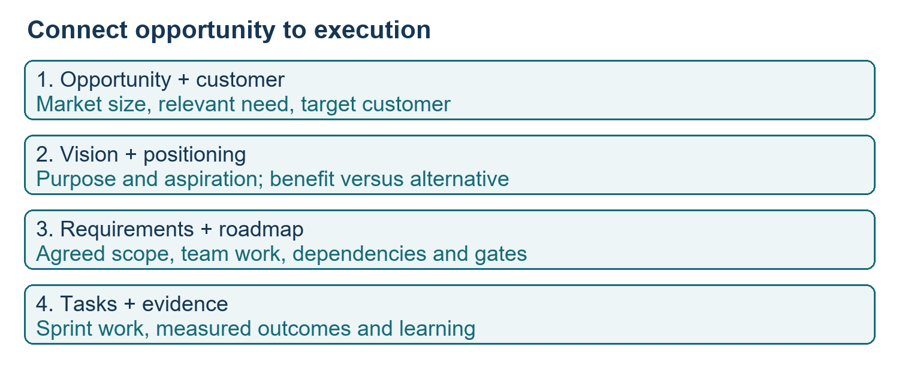
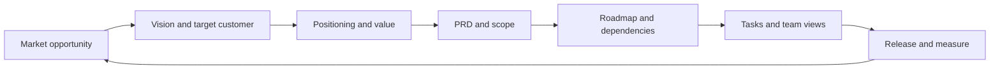
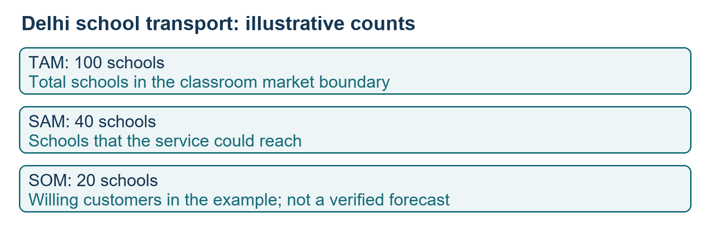
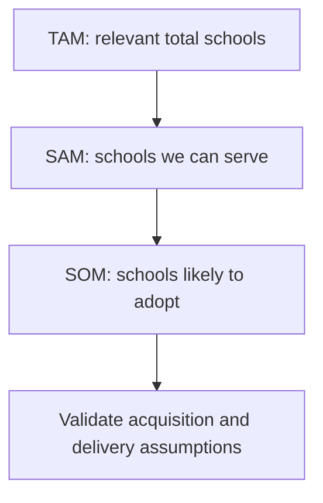
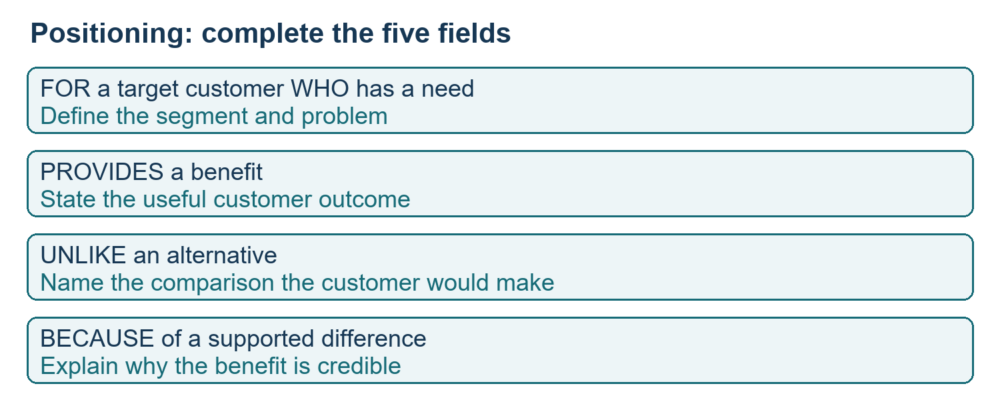
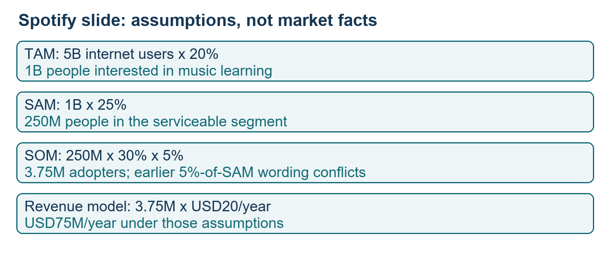
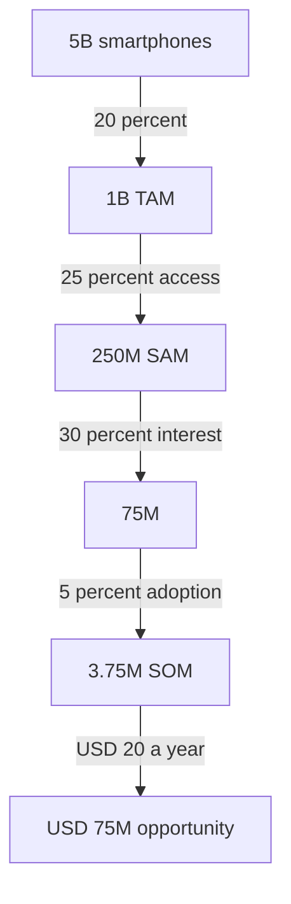

# Class 15: Roadmaps, vision, market sizing and positioning

31 August 2026 · Arun Nandewal · portal "Academic Session 15 - Market Analysis & Product Positioning"; the long notes file calls it Class 12

## The class in one minute

- A roadmap links an outcome to teams, work, dependencies, milestones and dates. A junior PM plans one feature; a leader sets the wider product direction.
- AI can draft a roadmap from a PRD, but the instructor said plainly not to trust it. Check the work and dates with the teams who will do it.
- Product vision says why the product exists, whom it serves, how it differs and what it aims to become.
- TAM, SAM and SOM size a market in three filters: everyone relevant, those you can serve, and those you can realistically win.
- Positioning tells a customer who the product is for, what it solves and why to choose it over an alternative. This part came from the slide deck and was not taught live.

## Core ideas

### Roadmaps at different levels

A roadmap is a plan that shows direction, priorities and work over time. The class used the RedBus feature "Next Best Option" (help a traveller find the next feasible option after missing a bus) as a three-month delivery roadmap with weekly work and a 1 December go-live. That date belongs to a fictional plan, not a homework deadline. The slides add a higher-level strategic roadmap: what is being built, why, and roughly when. A swimlane separates work by team so overlaps and dependencies are visible, and an epic is a large theme of related work.

Scope grows with seniority, as the instructor sketched it (not a hiring policy):

| Experience sketch | Role | Planning horizon |
|---|---|---|
| 15+ years | VP and above | Vision and financial goals over 18–24 months |
| 8–15 years | Director, group or principal PM | Six to twelve months |
| 4–8 years | Senior PM | Three to six months |
| 1–4 years | PM, APM | One or two features, one to three months each |

Roadmap planning comes before sprint planning, and a sprint is a short work cycle, not a synonym for the whole roadmap.

*Market and customer value guide direction; the roadmap turns a chosen outcome into coordinated delivery.*

**Remember:** decide the audience, the horizon and the decision before deciding how detailed the roadmap is.

### Generating a roadmap with AI, then checking it

The instructor attached the RedBus PRD to ChatGPT with a reusable planning prompt. The inputs are the product or feature, total duration, the time scale and any fixed dates. The output gave gates, team swimlanes, weekly tasks, dependencies, risks, metrics and release checks. The gates were alpha (internal testing), beta (limited external test), UAT (user acceptance testing) and GA (general availability).

When asked whether to trust it, the answer was no. It is a starting point to validate with the teams. The saved output proves the point: its gate table puts alpha at week 4 on 28 September while the weekly plan puts week 4 on 21–27 September, and UAT is week 10 in one place and week 11 in another. The week 6 and 7 tasks also add alternative-bus features beyond the GPS and ETA scope the class had chosen. The quality bars (crash-free above 97%, zero open top-priority bugs) were prompt suggestions, not industry standards, and the retention target was left blank.

A volunteer then pasted the plan into Notion AI and asked for tasks, dashboards and a database. Some views came out empty, so a third prompt asked it to fill every team view. They reviewed an all-tasks list, a Kanban board (cards grouped by status) and timeline and milestone views. Daily alerts and a move to Jira were discussed but not set up.

**Remember:** use AI to draft the plan, then get owners to confirm scope, estimates and dependencies. An empty view is not a plan.

### Product vision

Product vision is the product's purpose and longer-term impact. The class checks four parts: why it exists, whom it serves, how it is different and what it aspires to become. The slides add that it should be clear, customer-focused, guiding, future-focused and motivating. A slogan that cannot help you prioritise is not a vision.

Examples were classroom readings, not official statements. Google: organising information for wide access. Airbnb: hosts and guests, trusted local travel, belonging. A food-delivery company was described as aiming to cover a wider chain from producers to waste, which the instructor used as an example of ambition, not as the company's verified vision.

Vision changes when the market, business strategy, customer learning or technology changes. The slides tracked Meta's direction from sharing and connection to community (2017) and the metaverse (2021), and Myntra from custom merchandise (2007–2010) to broader fashion, technology-led fashion and wider accessibility. These are teaching narratives. The instructor's horizon advice was mixed: he asked about five to ten years, warned against detailed ten-year plans, and came back to 18–24 months for leaders. A workable reading is a broad customer aspiration with detailed commitments kept short.

**Remember:** keep the customer value coherent while you revisit assumptions and plans.

### Market sizing with TAM, SAM and SOM

Before detailed execution, ask whether the problem is worth solving, how many relevant buyers exist and what you could capture. The live case: should Uber enter school pickup and drop-off in Delhi?

- TAM, total addressable market: the relevant total opportunity.
- SAM, serviceable available market: the part your business can actually serve.
- SOM, serviceable obtainable market: the portion you expect to win in a stated period.

The made-up counts were 100 Delhi schools, 40 reachable and 20 willing to use the service. The unit is schools, so multiplying by a per-student price needs a conversion to students first. Reach and willingness to buy are different filters. A safety feature does not tell you how many customers exist.

*The market boundary, ability to serve and expected acquisition are three separate statements.*

The instructor urged PMs to widen reach toward SAM instead of assuming today's obtainable group is the limit. Analogies repeated the filtering: all PM job openings, the ones you can be considered for, the interviews you actually get; or all exam topics, the syllabus, the topics likely tested. He also tied TAM to broad awareness, SAM to advertising to segments and SOM to direct, targeted contact. That is a classroom distinction, not a rule.

For the Spotify AI music tutor exercise the class picked India, consumer sales, and asked an AI for a research pass. The AI's definition drifted from music learners to listeners, which changes the market boundary, so keep the two apart. The instructor's "eight out of ten" confidence was a personal guess, and no source shows Spotify building the feature.

**Remember:** define the unit, the place and the customer before you estimate, because changing any of them changes the answer.

### Positioning

Product positioning is how the customer should understand the product relative to alternatives. It answers who it is for, what problem or benefit it addresses and why choose it. The deck's formula: For [target customer] who [need], our product provides [primary benefit], unlike [alternative], because [differentiator]. Examples: Flipkart against traditional retail, INDmoney's single view against separate investment apps, Airbnb's local homes against hotels. These are teaching descriptions, not recommendations or checked product specs.

*Say why a relevant customer should choose the product over an actual alternative.*

Positioning moves as segments, features and competitors change, for example from an early bookstore to a wide marketplace. The deck's Groww exercise asked for a young first-time investor who is confused about starting, a benefit, a chosen alternative (another app, a bank or a savings account) and a defensible difference. No final answer was given.

**Remember:** the alternative belongs in the statement; a benefit alone gives no reason to choose.

## Worked example

The Spotify AI tutor numbers come from the deck, not the live India exercise, and every input is an assumption.

1. 5 billion smartphone users × 20% with music or learning interest = 1 billion TAM.
2. 1 billion × 25% with access = 250 million SAM.
3. 250 million × 30% likely to try AI learning = 75 million.
4. 75 million × 5% adoption = 3.75 million SOM.
5. 3.75 million × USD 20 a year = USD 75 million annual opportunity.

The slides are inconsistent here: an earlier table says adoption is 5% of SAM, which would give 250 million × 5% = 12.5 million, not 3.75 million. The worked slide adds the extra 30% filter. State the intended funnel and denominator before using the figure.

*Every multiplication needs a named denominator.*

The deck's other sketches: PhonePe gold with 250 million potential adults, 80 million meeting the filters and 8 million over three years; Airbnb with about USD 3.6 trillion accommodation, USD 300 billion online short-term rentals and 20% of that, or USD 60 billion. These are deck illustrations, not current market facts.

Applied to car loans: for a new-car finance product in one city, TAM is every new passenger car buyer, SAM is buyers at dealers where your lender is empanelled and who qualify on income, and SOM is the share you can win this year given your approval speed and rate. Units matter: cars, customers and rupees of disbursement are different counts.

## Frameworks to reuse

Roadmap input form: outcome [ ], source PRD version [ ], duration [ ], period scale [ ], fixed dates [ ], teams and owners [ ], dependencies [ ], gates [ ], risks [ ], buffer [ ], metrics [ ], review cadence [ ].

Market sizing form: product [ ], geography [ ], customer [ ], unit [ ], period [ ], TAM boundary [ ], service filters [ ], acquisition limits [ ], price basis [ ], source and date [ ], assumptions [ ]. Top-down starts from a broad market and filters; bottom-up builds from users, transactions and price; triangulation checks both.

Vision canvas:

| Field | Blank |
|---|---|
| Why | [ ] |
| Who | [ ] |
| Difference | [ ] |
| Aspiration | [ ] |
| What might change it | market, strategy, user learning, technology |

Release gates from the generated plan: alpha (internal), beta (limited external), UAT (acceptance), GA (release), each with agreed criteria and evidence, not just a date.

## Self-test

1. Name TAM, SAM and SOM in your own words.
2. In the Delhi example, why can you not multiply 20 schools by a price per student?
3. The generated roadmap gives two different dates for the same gate. What do you do?
4. What does a positioning statement need besides a benefit?
5. 250 million × 5% is how much, and why does the deck show 3.75 million instead?

**Answers**

1. TAM is the relevant total, SAM the part you can serve, SOM the part you can realistically win in a stated period.
2. The unit is schools; you first need a conversion to students or accounts.
3. Do not pick one silently; the owners reconcile it and the plan is validated with the teams.
4. An alternative and a reason to choose the product over it (the differentiator).
5. 12.5 million. The worked slide applies a further 30% interest filter first, then 5% adoption.

## Homework from this class

Sameer's to do. These are not done for you.

- Roadmap practice: use a PRD, the planning prompt and task or database views, as in class. This was an in-class exercise with no dated submission.
- Spotify exercise: define TAM, SAM and SOM with your assumptions written out, and users or revenue if you choose.
- Groww positioning: complete the deck's statement with target, need, benefit, alternative and difference.
- Portfolio: save and show completed work and what you learned.

No formal due dates were stated. The Mentimeter quiz could not be launched, so it was deferred.
