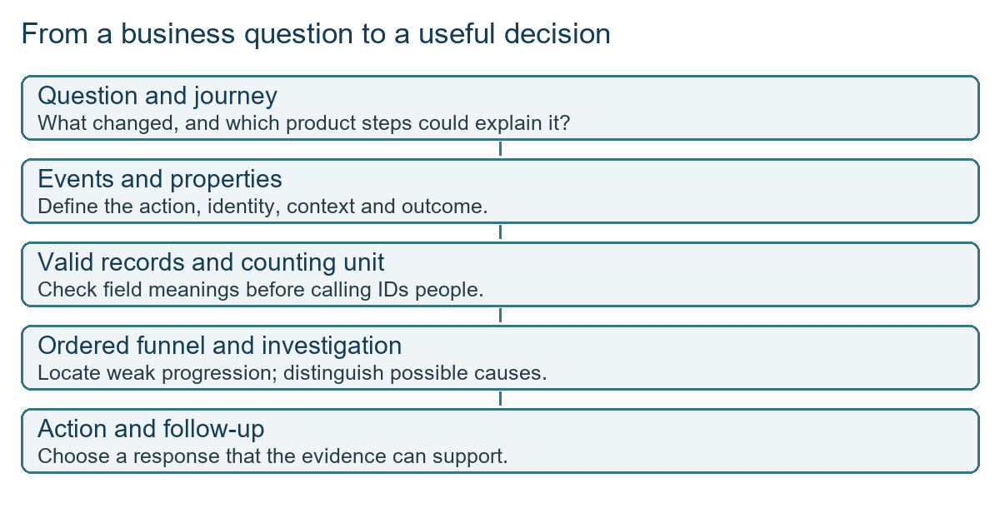
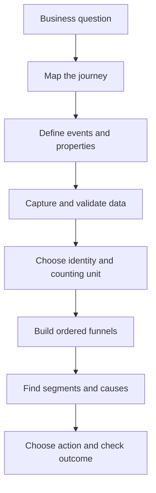
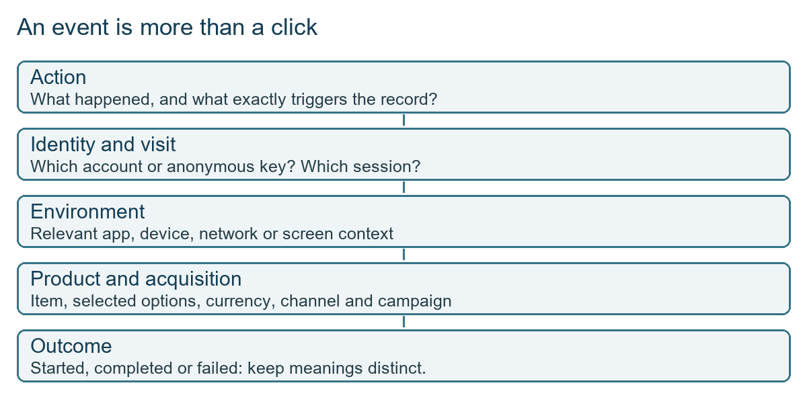
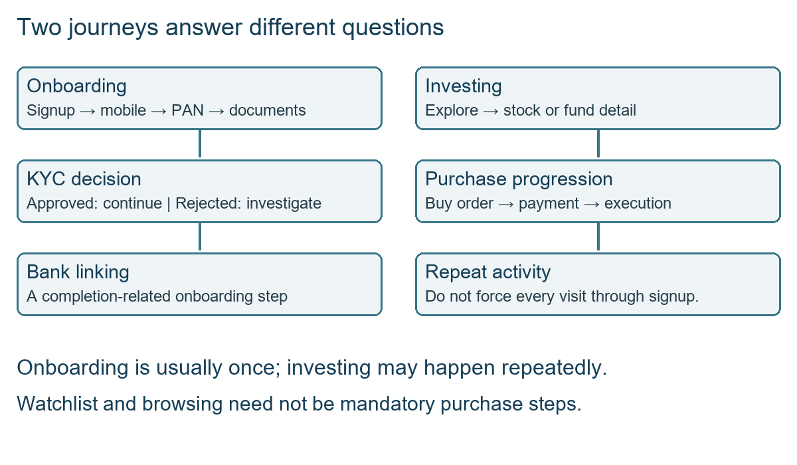
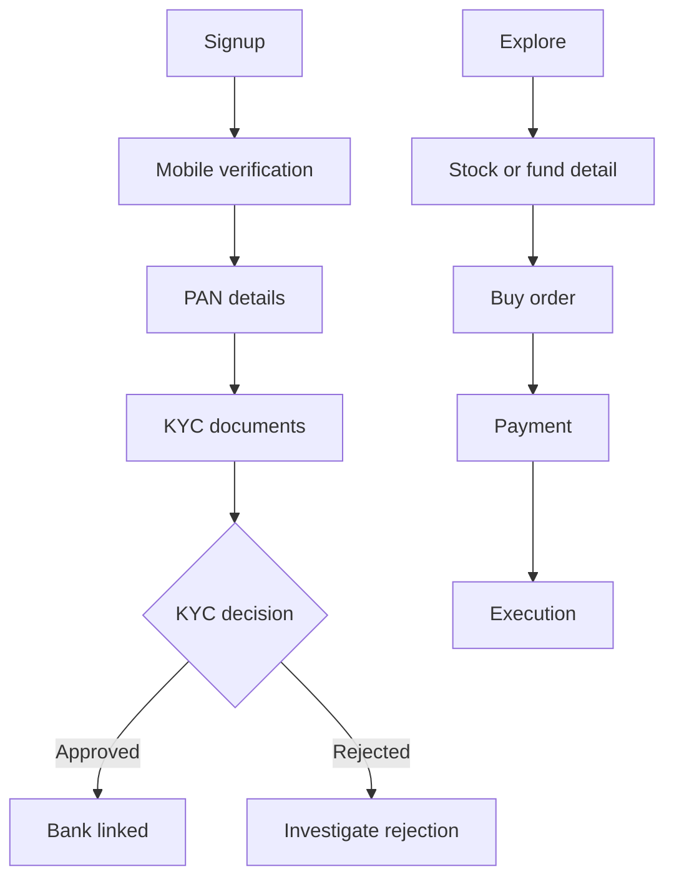
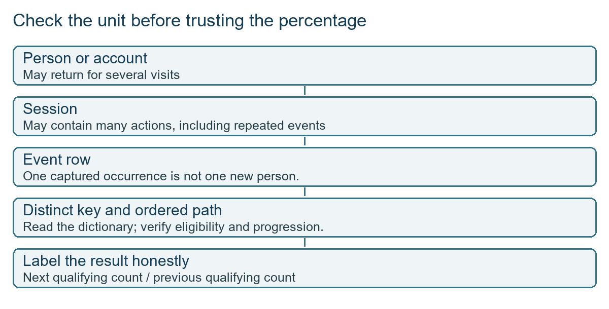
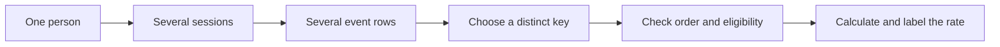

# Class 16: Mixpanel mastery, events, funnels and retention

4 September 2026 · Arun Nandewal · portal "Academic Session 16 - Workshop: Mixpanel Mastery, Funnels and Retention". The title mentions retention, but this recording does not show a retention report or calculate a retention rate. Mixpanel itself was only previewed; setup was left for later sessions.

## The class in one minute

- A product journey becomes measurable when important actions are recorded as named events, with extra details called properties. A tool can only analyse what someone captured.
- Decide what you are counting before you count: an event row, a session (one visit) and a person are three different units.
- A funnel lists events in the order of the real journey. Sorting alphabetically or by biggest count does not give you that order.
- Keep onboarding (done once) apart from repeat investing, because they answer different questions about different people.
- AI can draft an analysis, but the PM must explain the fields, reproduce the numbers and defend the conclusion.

## Core ideas

### Start from a business question, not a column

The class opened with a practical interview case: Titan, a watch and accessories retailer, had redesigned its product listing page. Discovery improved, yet July revenue was below expectations. A delivery-date experiment had begun in July and support tickets were another thing to check. Saying "page views went up" does not answer why revenue fell. More people may reach the product page while fewer go on to the cart, and the PM has to find which step, which people and which conditions.

The assignment asked for a short deck covering data-quality checks, a before-and-after funnel, conversion, average order value, availability, errors and speed, three to five segments, acquisition and first-session cohorts (a cohort is a group with a shared starting condition), an experiment assessment, three priority actions, a mini-PRD and a roadmap. The instructor said a team of three spent about two and a half days on his own version, using Claude. The advice was to judge the scope honestly and say so if you need more time. The actual brief and data files are not saved here.

A preview from his submission gave June figures read aloud: roughly 6,918 sessions, 4,900 reaching a listing, 1,700 a product page, 484 add-to-cart and 313 checkout, with July showing more product-page arrivals but a smaller share going on to the cart. These came from a presentation, not a spreadsheet we can check.

*A decision comes after definitions and validation, not straight after receiving a file.*

**Remember:** more discovery can hide leakage later in the journey, so follow the steps all the way down.

### Events, properties and the data dictionary

The Titan journey runs home page, listing page (PLP, a collection of products), product page (PDP, one selected product), cart, checkout, payment. The class kept "started", "submitted", "failed" and "completed" apart, since reaching checkout is not an order and a cart addition is not a payment.

An event is one recorded action. Properties are details attached to it. The instructor split them into app or device context (device type, operating system, app version, network, logged-in or anonymous) and product data (which screen, which button, product, price and currency, size, stock status, campaign). "Anonymous" does not mean "new customer": a returning customer may simply not be logged in. Names must be consistent, because two platforms calling the same thing by different field names make reconciliation hard.

*Action, identity, context and product details are separate parts of one event.*

A payload is the structured data sent for an event, often in JSON (named fields and values). ChatGPT produced sample payloads in the style of Google Analytics and CleverTap, and the class used a T-shirt selection to practise. The full output was not saved. A data dictionary explains what each column and event means, so you do not guess that every ID is a customer or every checkout flag means a finished checkout. The instructor also warned that an LLM reading a spreadsheet has not observed user behaviour: if an event was never recorded, the data cannot answer the question. His claims about automatic tracking, device IDs and personal data were broad, so treat them as questions to check for each app.

**Remember:** write the event name, its trigger, the unit and the properties down before anyone builds anything.

### Sessions, identity and data quality

A session groups activity into a visit under the tool's rule. A user identity groups activity believed to belong to one person or account. An event is a single action. One person can have several sessions and each session many events. The instructor said a background app continues and a closed-then-reopened app starts a new session, but that is his classroom explanation, so check your tool's setting.

Data quality checks come before insight. Look for empty, null and unexpected values. Zero can be a real value, so do not delete all zeroes. An email can look valid and still belong to the wrong person. Logs help trace a failure because what the user saw, what was sent and what the payment system reported can differ. A second journey (Groww mutual fund SIP: home, fund, start SIP, details, mandate set-up, bank authorisation) showed the same point, since a request being sent is not the same as a successful outcome.

**Remember:** read the dictionary and settle what one ID means before you trust a ratio.

### Funnels and signs of struggle

A funnel measures progress through chosen, ordered steps. Struggle also shows up as repeated searches, switching between screens, failed clicks, payment or link failures, network problems and more support requests. A long time on a page is a signal to investigate, not proof the page is bad: the person could be reading, comparing or interrupted. The instructor challenged the answer "the description is not appealing". That is a hypothesis. Useful signals to test it include whether the page finished loading, scroll depth, review use, a postcode check and payment-option clicks.

Mixpanel was previewed as a way to keep funnel views updated as events arrive, instead of recounting every extract by hand. He pointed to a simpler Groww events dataset for practice, with 21 event types and fields like city, city tier, app version and SIP amount. The file itself was not saved.

**Remember:** time on page is a clue, and a hypothesis is not something recorded in the data.

### Two funnels, not one

The onboarding path is signup, mobile verification, PAN details (the Indian tax ID), KYC documents (know-your-customer checks), a KYC decision, then bank linking. KYC rejection is a branch to inspect, not a step every user passes. The investing path covers explore, stock or fund detail, buy order, payment and execution. People can browse before finishing KYC, so a single long funnel mixes populations and questions.

*Notice the rejection branch and the difference between onboarding and repeat activity.*

**Remember:** choose the required steps for the question you are asking, not every event that exists.

## Worked example

The Excel pivot exercise on the Groww events file. A pivot table groups rows and summarises them. The instructor saved an Excel copy, put event name in rows and set the value to a distinct count of IDs (not a plain row count, since repeated actions inflate the total). The class then put the onboarding events into journey order.

| Stage | Spoken count |
|---|---:|
| Signup started | 1,000 |
| Mobile number verified | 900 |
| PAN details | 793 |
| KYC documents uploaded | 675 |
| KYC approved or rejected | not stated clearly |
| Bank linked | 552 |

Step rates are the next count divided by the previous one: 900 ÷ 1,000 = 90%, 793 ÷ 900 ≈ 88.1%, 675 ÷ 793 ≈ 85.1%. Bank linked over signup is 552 ÷ 1,000 = 55.2%. These are my calculations from numbers read aloud, and the file is not here to check them.

Then came the catch. The instructor corrected himself: the distinct IDs may be sessions, not people. So the right label for these numbers is "distinct IDs as described", until the dictionary says what the ID means. Sorting by count or alphabetically does not give the path either, since repeats and branches break a simple descending order. Also, a simple pivot does not prove the same people were followed from step to step.

*Repeated actions and repeated visits change the denominator, so check the unit first.*

Applied to car loans: picture the loan journey as application started, PAN and income documents uploaded, bureau pulled, credit decision, dealer invoice, disbursement. If a dashboard shows 1,000 applications and 552 disbursed, first ask whether a row is an application, a customer or a login session. A customer who applied twice at two dealers would count twice. Then ask whether "rejected at bureau" belongs inside the path or is a branch, and whether you are comparing the same people at each step.

## Frameworks to reuse

Event definition:

| Field | Fill in |
|---|---|
| Product question | What decision needs evidence? |
| Event name and exact trigger | Action, and when it fires |
| Counting unit | Person, session, order or event |
| Identity fields | Account or session keys, and their meaning |
| Properties | Screen, item, context, status |
| Allowed and missing values | Dictionary rules |
| Success and failure | What each outcome means |
| Validation and owner | How capture is checked, who is responsible |

Funnel contract: business question, eligible population, counting unit and identity, required events in order, optional events and branches, conversion window, filters, definition of completion and drop-off, and a check of the counts.

Root-cause canvas: observed symptom, evidence available, hypotheses, signals that tell them apart, segments to compare, unknowns, next action.

Assignment checklist: quality, funnel, segments, cohorts, experiment, priorities, mini-PRD, roadmap. For each, write the question, field definitions, evidence, uncertainty and next decision.

## Self-test

1. What is the difference between an event and a property?
2. Why can you not build a funnel by sorting events by count?
3. The pivot shows 1,000 signups and 552 bank-linked. What must you check before calling it 55% conversion?
4. Why keep onboarding and investing as separate funnels?
5. A user spends a long time on a product page and leaves. What can you conclude?

**Answers**

1. An event is a named recorded action; a property is a detail attached to it, such as product, price or device.
2. Repeats, branches and people entering at different points make counts out of line with the real path. Use the journey and the dictionary.
3. What an ID represents (person or session), whether the same eligible people are followed through, the time window and whether step order was checked.
4. Onboarding happens once, investing repeats, and people can browse before KYC, so mixing them blurs the question.
5. Nothing certain. It is a signal to test: loading, reviews, delivery, payment concerns or an interruption.

## Homework from this class

Sameer's to do. These are not done for you.

- Practise with the shared events data until you are comfortable with the fields and funnels, and leave class feedback.
- A study sequence that follows the class (a suggestion, not a graded task): get the dataset and dictionary, reproduce the pivot, explain what each count means, separate the two journeys, and write a short diagnosis with evidence and unknowns.
- For the Titan exercise, read the written brief first. Do not invent experiment results, support-ticket categories or revenue impact from the verbal overview.

No deadline or marking rubric was stated. Later sessions will cover Mixpanel setup and more views. The dataset links were shared in the live chat but are not saved with these notes.
