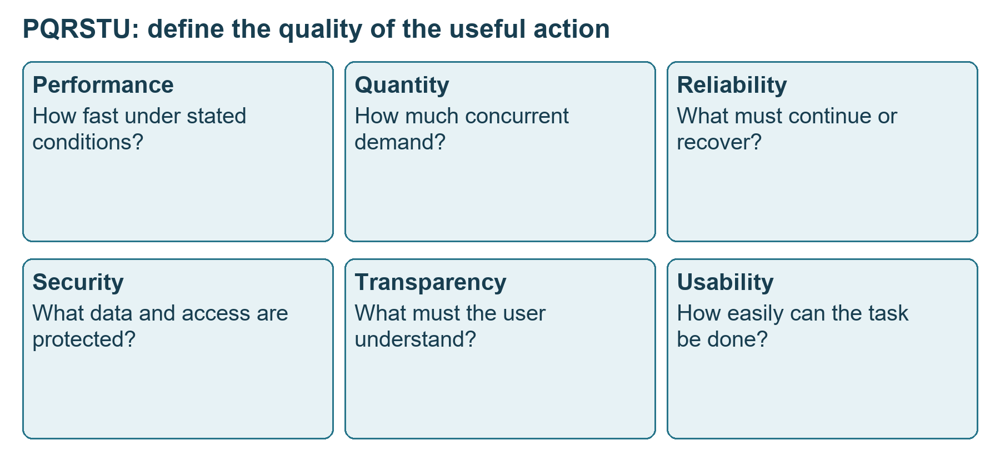
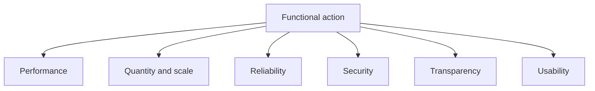
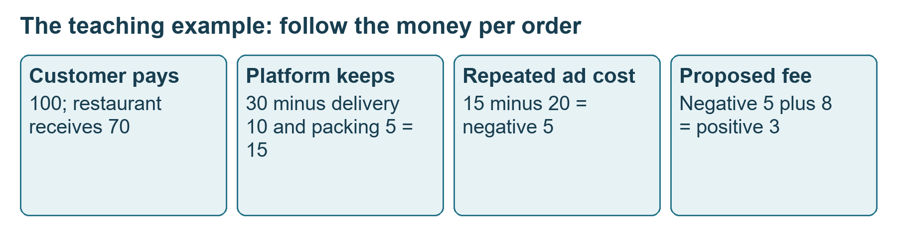
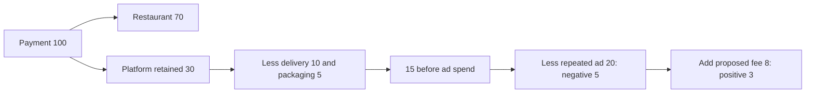
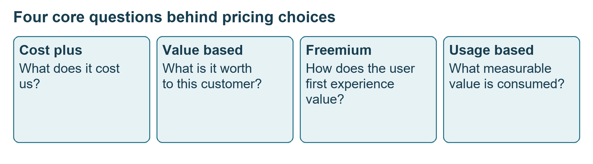
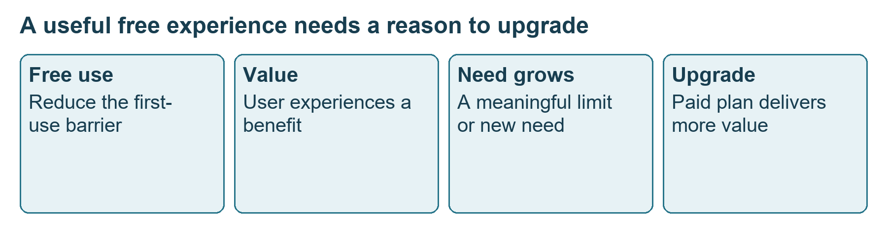

# Class 17: Pricing, packaging and business models

7 September 2026 · Arun Nandewal · portal "Academic Session 17 - Pricing, Packaging & Business Model Analysis"; the long notes file calls it Class 13

## The class in one minute

- A functional requirement says what a user or system can do. A non-functional requirement says how well it must work, with a measurable condition. The instructor's PQRSTU checklist covers performance, quantity, reliability, security, transparency and usability.
- Words like "fast" or "smooth" are not requirements until they carry a number, a scope and a condition.
- Pricing shapes who adopts, how the product is positioned, when people upgrade and whether they stay. Follow the money from the customer's payment to the costs before calling anything profitable.
- Cost-plus, value-based, freemium and usage-based pricing answer four different questions. Subscriptions, tiers and hybrids combine them.
- The business-model case studies (Netflix, Slack, Zoom, Razorpay) were in the slides but not taught live. The instructor deferred them to the next lesson.

## Core ideas

### Functional and non-functional requirements, and PQRSTU

A functional requirement is a feature or behaviour, for example "a user sends a one-to-one message to a contact". A non-functional requirement (NFR) states the quality conditions around it. PQRSTU gives six questions to ask of any action.

*PQRSTU surrounds the useful action rather than adding unrelated features.*

Performance is speed. Quantity is how much demand at once. Reliability is dependable operation and recovery. Security protects data and access. Transparency means showing the user the information they need. Usability means the task is easy to complete. The messaging example used one-second delivery, restore after reinstall, end-to-end encryption and one or two taps. These are teaching targets, not measured WhatsApp guarantees. The scale is a good example of a conflict: the live talk said one million concurrent users while the slide said over one billion, so do not quote either as fact. The ride example moved from a five-second to a thirty-second driver assignment.

The class then rewrote Amazon's vague requirements. For finding and buying an item: search results within three seconds and cart to payment within sixty seconds; one million simultaneous users across fifty thousand listings; ninety-five percent of deliveries arriving as promised and no duplicate charges; backups every twenty-four hours and logout that ends the session; a clear display of product, warranty, extra charges, delivery and total cost; and a new user finding and buying in four clicks. Availability was quoted at 99%, 99.9% and 99.99% by different people, so the agreed figure and its measurement window must be written down.

How do you pick the number? Look at existing peaks, sale events or the biggest streaming audience, then add a buffer you can defend. Compare competitors and check against a beta. A twenty-second search in a beta does not meet a three-second target, so fix the product or revisit the target rather than hide it behind "fast". A resume that confused 20,000 and 2 million transactions per second shows how a magnitude error ruins credibility.

**Remember:** a requirement needs a scope, a unit and a condition, and a big number with no basis is not a good one.

### Money flow in an order, and why acquisition cost matters

The live example used a 100-rupee food order. Seventy goes to the restaurant and thirty stays with the platform. Delivery (10) and packaging (5) leave 15 before advertising. The final slide uses these figures; an earlier spoken version used 18 in costs and 12 left, so use one version consistently.

*The platform fee changes one assumed contribution calculation. It does not show any real firm's profit.*

At ten orders a month, a customer places 120 orders a year. That is 100 × 120 = 12,000 rupees paid in the year (ARPU, average revenue per user), and 15 × 120 = 1,800 rupees of annual remainder. The class called that LTV, customer lifetime value, but it covers one year only. If an ad costing 20 is spent on every order, 15 − 20 = −5 each time. A proposed platform fee of 8 turns that into −5 + 8 = +3, with everything else held fixed. The instructor warned against offsetting a repeated per-order ad cost with the annual total as if ads ran once. The class called the whole 100 "revenue", which is a simplification, and overheads and tax are not modelled.

**Remember:** say whether acquisition spend happens once or on every purchase, and over what period, before comparing value with cost.

### Four pricing approaches

Cost-plus starts from cost and adds an increment. It is easy to explain and works when cost is predictable, but it ignores willingness to pay. The deck's example: cost 500, add 20% of cost (100), price 600. That is a markup on cost. As a share of the selling price, 100 ÷ 600 is about 16.7%, so check which base the word "margin" refers to.

Value-based pricing asks what the outcome is worth to the customer. It needs customer research, and value differs by segment. The live enterprise example: an internal cost baseline of 2 lakh, a customer saying 6 lakh, and a proposed price of 5 lakh. That was a hypothetical, not a valuation.

Freemium gives a useful basic version free and charges for upgrades or limits. It must give a reason to upgrade, and the narration sometimes mixed it up with a free trial, which is time-limited. Usage-based charges by measured consumption such as transactions, API calls (requests between software), storage or compute. The slide said "X rupees per thousand API calls" with no X, so the lesson is to choose a unit that tracks customer value and can be measured.

*Cost, value, entry and consumption are four different decisions.*

**Remember:** each approach answers a different question, and none is best just because a famous company uses it.

### Free to paid, licences, subscription and tiers

The free-to-paid path runs from a free product to adoption, habit and then a premium upgrade. The slide examples were Canva assets, longer Zoom meetings and Notion collaboration features. Low marginal cost means serving one more user is cheap, not that the whole product was cheap to build. Ad-supported apps such as YouTube have a different payer: an advertiser, not the viewer.

*Charging before the benefit is experienced can break the path.*

Buying access, using the product and renewing are three different observations. The class gave forty Figma licences, unplayed games and unused gym memberships as examples of paying without using. A flat rate (one plan, one price) is simple. Tiers let customers pick a package, and good tiers reflect different needs with a clear upgrade path, not random feature differences. Price endings such as 299 versus 300 were discussed for perceived choice, but no test showed which converts better.

B2C (selling to consumers) usually means one decision-maker and a quick purchase. B2B (selling to businesses) means several stakeholders, procurement, longer cycles and explicit ROI. These are patterns, not rules.

**Remember:** the model must fit the customer, the value unit and the economics, not a competitor's price sheet.

## Worked example

Choosing a model for four products, using the class and deck answers:

| Product | Model chosen | Reason |
|---|---|---|
| AI writing assistant | Freemium plus subscription | Customer experiences value before paying for a plan |
| Cloud compute | Usage-based | Payment tracks consumption |
| Enterprise cybersecurity | Value-based plus an enterprise tier | Avoiding a large loss is the value |
| Predictable manufacturing cost | Cost-plus (the PDF also says market-based) | Cost gives a sensible floor |

The answers choose models, not prices. No price test, conversion study or elasticity calculation was run in class.

Applied to car loans: a lender sets a new-car loan rate and a processing fee. Pure cost-plus is "our funding cost plus a spread", which is easy but ignores what a customer will accept against the dealer's offer. Value-based thinking asks what a quick same-day approval is worth to a buyer standing in the showroom. A per-case fee paid to a dealer channel is closer to usage-based. Then follow the money as the class did: rate income, less funding cost, dealer commission, credit loss and acquisition cost per booked loan, and say whether that acquisition cost is paid once or on every approved file.

## Frameworks to reuse

PQRSTU blank: Function [who can do what]. For each of P, Q, R, S, T, U write a condition, a measurable target, the evidence for that target, and how it will be checked.

Money ledger: order value [ ], partner share [ ], retained amount [ ], delivery or service cost [ ], other costs modelled [ ], advertising cost once or per purchase [ ], period and order frequency [ ], remainder [ ], unknown costs [ ].

Pricing plan row:

| Approach | Blank plan |
|---|---|
| Cost-plus | Cost [ ], increment [ ], price [ ], percentage basis [ ] |
| Value-based | User [ ], problem [ ], economic impact [ ], willingness evidence [ ], price to test [ ] |
| Freemium | Free action [ ], paid benefit or limit [ ], upgrade moment [ ] |
| Usage-based | Value unit [ ], metering [ ], unit rate [ ], billing period [ ] |

Six-question decision sheet: who buys, what value they get, how it is measured, what they pay for, what the economics are, and what behaviour you want. The deck's idea is customer value plus behaviour plus business economics gives the pricing strategy, as a checklist, not arithmetic.

Business model in three questions, from the PDF: what value you create, how you deliver it (discover, buy, use, renew), and how you capture it. The slides illustrated this with Slack and Zoom, where people using the product bring in colleagues until a company pays (product-led growth), and with Netflix and Razorpay. These were not taught live.

## Self-test

1. What do the letters in PQRSTU stand for?
2. Why is "the page loads fast" a weak requirement?
3. A 100-rupee order leaves the platform 15 before ads. A 20-rupee ad runs on every order. What is the per-order result, and what changes with an 8-rupee fee?
4. Cost 500 plus 20% of cost gives 600. What percentage of the selling price is the 100?
5. What is the difference between buying a licence and using a product?

**Answers**

1. Performance, quantity, reliability, security, transparency, usability.
2. It has no measurable target, scope or condition, so different people read it differently.
3. 15 − 20 = −5 per order. With the fee, −5 + 8 = +3.
4. About 16.7% (100 ÷ 600).
5. A licence only shows access was bought; usage and renewal must be observed separately.

## Homework from this class

Sameer's to do. These are not done for you.

- Explore familiar products across six categories: cost-based, value-based, freemium, usage-based, subscription and tiers. Explain what pricing strategy you would defend as the PM and why it fits the customer, the value and the economics. No due date, number of products or rubric was given.
- Extra exercise from the PDF, unanswered in class: an AI Career Coach for professionals aged 22–35 (resume review, mock interviews, feedback, application tracking, learning resources). Choose the model and the pricing unit, define Free, Pro and Premium plans, explain the upgrade triggers and defend the fit. Do not invent prices as an official class answer.
- PQRSTU can also be used to improve your earlier PRD work.

A later holiday session was tentatively moved, so watch for the coordinator's confirmation.
