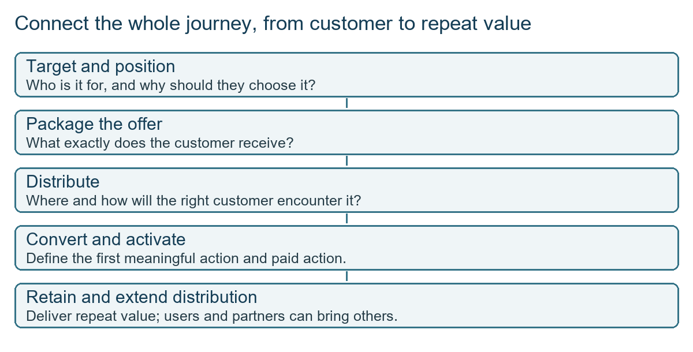
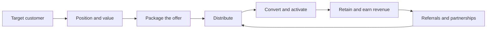
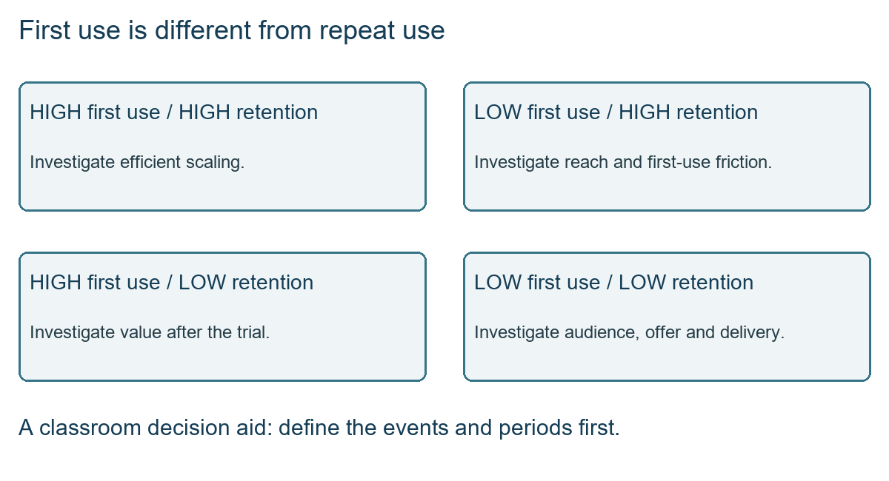
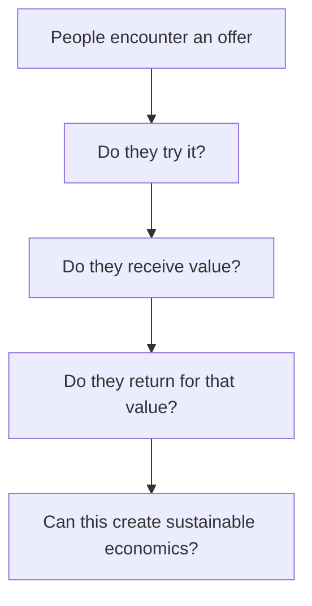
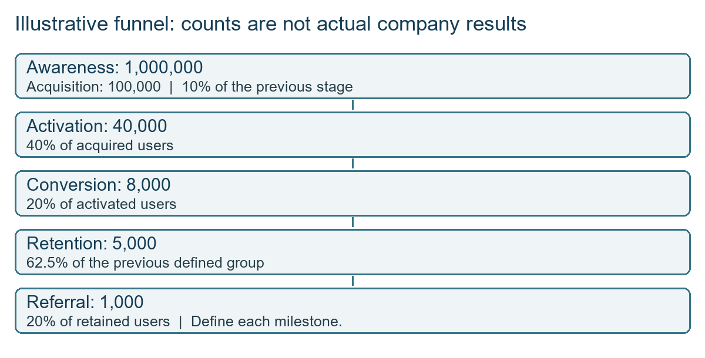
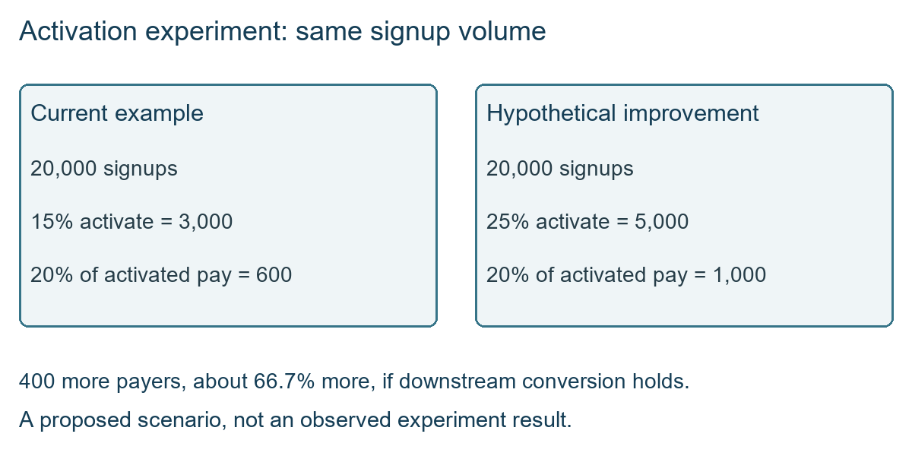

# Class 18: Go-to-market strategy

11 September 2026 · Arun Nandewal · portal "Academic Session 18 - GTM Strategy"; the long notes file calls it Class 15

## The class in one minute

- GTM (go-to-market) is how a product reaches the right customer, helps them experience its value and keeps them using it. A list of advertisements is not a GTM plan.
- The chain is target, position, package, distribute, convert, retain. Students usually handle the first three and skip the last three, so the class concentrated there.
- Distribution includes the product itself, direct help, referrals and partners, not just paid media. Say who does what, where the customer acts and why both sides benefit.
- A launch also needs a working core journey, simple onboarding, operational readiness and measurement. A partnership cannot cover for a broken experience.
- CAC (customer acquisition cost) and LTV (customer lifetime value) are separate measures. Improving one does not automatically improve the other.

## Core ideas

### Three decisions, made executable

The opening challenge: you are the PM for a short on-demand house-help service (Pronto, Urban Company or Snabbit were the examples). You have time, money and resources but may make only three decisions. The service was illustrated as quick household help with limits, for instance laundry using the customer's washing machine, with no promise of hand-washing. These are classroom assumptions, not real offerings.

Students proposed advertising, introductory prices, referrals, influencers, picking a city, working with housing societies and employer partnerships. The instructor kept asking for specifics. Which city? Which service? Which partner? What does "collaborate" actually look like? A good decision can be carried out by someone who was not in the room. Sameer's answer, preserved in the Word notes, was: start with Delhi and laundry in 60 minutes, aim for 500 targeted adoptions, and send a sales agent to demonstrate door to door. Another answer combined a pamphlet in a delivery bag, a live-match ad and five trials for 150 rupees. These were exercise proposals, not proven choices.

His concern was not that awareness is worthless, but that an answer made only of discounts and publicity stops before sustained use. A complete plan also says how the first customer gets value, how quality holds up and why they return when the offer ends.

*Discovery connects to repeat value and feeds distribution again.*

The deck's five questions are WHO, WHY, WHAT, WHERE and HOW. He also separated convenience (easy booking) from comfort (a pleasant delivered service). Booking a cab is easy, but a poor ride still disappoints.

**Remember:** a decision is executable only if it names the customer, the scope, the action and the mechanism.

### Distribution beyond advertising

Excel Copilot was the example of direct help: a representative sits with a corporate user, watches their real workflow and shows what the new feature does. The instructor linked this to forward-deployed engineers, technical staff who work closely with customers. A trained person then helps colleagues, and ambassadors and internal champions spread it further. Myntra employees trying a feature and sharing it with family was another example. Creators showing what a product does add user-generated content (UGC). The instructor called much of this "organic", but referral rewards, staff time and partner agreements all cost something, so record the real mechanism and cost.

Product-led growth means the product's value pulls in more users; sales-led growth means people help sell or introduce it. The Copilot case mixes both, so do not force it into one box. Match the motion to how the customer learns about the product. The Windows example showed one licence reaching buyers by direct purchase, device-maker bundles and retail, which raises the question of what the middleman gets out of it.

For channels, the deck lists paid attention, organic discovery, social and influencer, referrals and partnerships. The class debated a Zomato subscription promoted through paid creators versus partnerships with gyms offering suitable meals. The instructor favoured partnerships but offered no controlled comparison. The deck's 4C test asks about Customer (where they pay attention), Context (urgent need or discovery), Cost and Conversion (real customers, not just traffic). Do not judge a channel on CAC alone. A celebrity can create awareness without retention.

**Remember:** pick a channel for the job it does, then judge it on the quality of customers it brings.

### First use is not repeat use

A classroom table for a payments app showed how conversion (trying the feature once) and retention can differ.

| Use case | First-use conversion | Retention |
|---|---|---|
| Mutual funds or stocks | High | Low |
| Bill payments | High | High |
| Recharges | High | High |
| Gold investment | Low | Low |

This is a qualitative illustration, not data about PhonePe. Define the event before comparing rates, since the class used "conversion" both for first trial and for purchase.

*High initial interest can sit beside weak return behaviour.*

The deck splits a launch into pre-launch (target, value, beta learning, onboarding, analytics, support), launch, adoption (shorten time-to-value, meaning how long before the customer gets the benefit) and scale. For a service, a completed useful booking may be a better "activation" than a new account.

The instructor insisted that the experience itself is part of GTM. "Make the app smooth" is too vague. Replace it with checks: the core journey works end to end, critical defects are fixed, onboarding is understandable, edge cases are covered and users get the promised benefit.

**Remember:** a high trial rate proves nothing about retention or profit.

### Metrics, and why CAC and LTV are not opposites

CAC is acquisition spend divided by new customers: 1 lakh spent for 10,000 customers is 10 rupees each. Activation is a defined meaningful first action, conversion a defined paid or transactional action, and retention returning activity from a starting group (a cohort). Retention needs a stated window: with 100 people to start and 30, 20 and 10 still active at successive monthly checkpoints, retention is 30%, 20% and 10% of the original group. ARPU (average revenue per user) is revenue divided by customers: 100,000 over 100 customers is 1,000 each.

The spoken LTV was ARPU times customer lifetime. The deck includes margin: ARPU × margin × lifetime. Say whether you mean revenue value or contribution value. A student asked if LTV is inversely proportional to CAC. The instructor said no: they are separate measures, and a high-cost customer can have high lifetime value. CAC does not always start high and fall; products that spread through users are a counterexample.

**Remember:** define every metric's event, window and denominator before quoting a rate.

## Worked example

The illustrative Zomato funnel from the Word file and workbook (teaching figures, not Zomato data):

| Stage | Count | Rate from previous | Left out |
|---|---:|---:|---:|
| Awareness | 1,000,000 | none | none |
| Acquisition | 100,000 | 10% | 900,000 |
| Activation | 40,000 | 40% | 60,000 |
| Conversion | 8,000 | 20% | 32,000 |
| Retention | 5,000 | 62.5% | 3,000 |
| Referral | 1,000 | 20% | 4,000 |

40,000 ÷ 100,000 = 40% is progression, while 100,000 − 40,000 = 60,000 is the number who did not move on. The labels overlap (activation is first order, conversion is payment, and repeat behaviour appears too), so reconcile them before building such a model.

*These counts are teaching figures. A low percentage alone does not tell you where to invest.*

A second exercise (a productivity app, from the deck) shows the bottleneck idea. 100,000 visitors lead to 20,000 signups (20%), 3,000 activated (15%) and 600 paying (20%). Marketing spend of 300,000 rupees gives CAC of 300,000 ÷ 600 = 500. With estimated LTV of 2,400, LTV:CAC is 2,400 ÷ 500 = 4.8, although the slide labelled it 4:1. If a simpler onboarding lifted activation from 15% to 25% on the same 20,000 signups, activated users would be 5,000 and, with paid conversion held at 20%, payers would be 1,000 instead of 600. That is a hypothetical, not a result. The deck's point was to fix the activation bottleneck before spending another 10 lakh on marketing.

*The improved counts hold signup volume and paid conversion constant.*

The workbook's retargeting sheet has a trap. It applies the same 10% buy rate to every left-out group, and it costs 10 rupees per targeted person, which is a campaign cost per target, not CAC per paying customer. Its LTV figures also differ (350, 720 and 700 appear in separate places), so it supports no single winning segment.

Applied to car loans: your funnel might be dealer enquiries, applications started, applications completed with documents, approved, disbursed, and repeat or referral customers. If the drop is biggest between "started" and "documents complete", a bigger dealer incentive (more top-of-funnel) won't help. First fix the document step. Partnering with a dealer group is a distribution choice, but it still needs a working approval journey behind it, and the commission is a real acquisition cost.

## Frameworks to reuse

Six-step canvas, with the house-help direction as the filled example:

| Step | Question | House-help direction |
|---|---|---|
| Target | Who first, and where? | Working households in one dense part of Delhi |
| Position | Why choose this? | Timely help with a clearly specified chore |
| Package | What is in and out? | Laundry using the customer's washing machine |
| Distribute | Which exact route and partner? | A housing-society or employer introduction |
| Convert | What action shows first value? | A completed relevant service |
| Retain | Why return, and how measured? | Repeat need plus reliable service, with a defined window |

Partnership canvas: partner, shared customer context, exact offer, customer action, benefit to each side, operational dependencies, success measure, failure risk.

Launch readiness: customer understood, product ready, GTM ready, measurement ready. Under each write evidence, risk, owner and next check.

Funnel symptoms (hypotheses, not proof): high awareness but low acquisition points to message or channel; acquisition without activation to onboarding or product; activation without conversion to price or value; conversion without retention to weak delivered value; retention without referral to a weak sharing mechanism.

Conversion and retention grid: high/high, can we scale and protect quality; high/low, does the promise fail after first use; low/high, is discovery weak; low/low, is the offer mismatched.

## Self-test

1. Name the six steps of the GTM chain.
2. Why is "partner with an app" an incomplete decision?
3. A group of 100 users has 30, 20 and 10 still active at months 1, 2 and 3. What are the retention rates?
4. Does lowering CAC force LTV to rise?
5. 20,000 signups, 15% activate, 20% of those pay. What happens if activation reaches 25%?

**Answers**

1. Target, position, package, distribute, convert, retain.
2. It does not say which app, what mechanism, what the customer does, or what each party gains.
3. 30%, 20% and 10% of the original group.
4. No. They are separate measures and must each be checked.
5. Activated users go from 3,000 to 5,000 and payers from 600 to 1,000, if the 20% holds.

## Homework from this class

Sameer's to do. These are not done for you.

- Choose a product, or use QuickFix if needed. Define its distribution channels, how customers will activate through them and what you will measure. Explain how the plan lowers acquisition cost and raises customer value instead of only adding advertisements or discounts.
- QuickFix case from the deck: a 30-day launch of a new home-services product (electrician, plumber, AC, cleaning, appliance repair) with no customers yet. Pick one starting segment, write a value proposition, choose three channels, define the activation event, choose acquisition, activation and retention measures, and defend your first focus. The four-week worksheet covers preparation, launch, first use and optimisation.
- The transcript also invited a LinkedIn walkthrough and feedback.

The AI branding material in the deck (brand guidelines, logo, flyer, pitch and lead-generation prompts) was not demonstrated live and is optional practice. Do not send outreach just because an automation screenshot includes an email step. No submission date or rubric was given.
