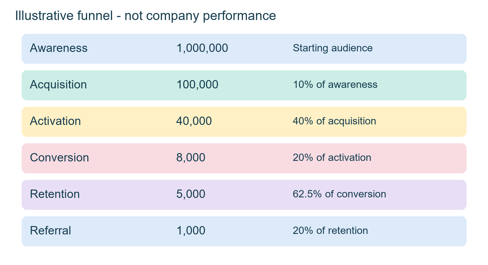
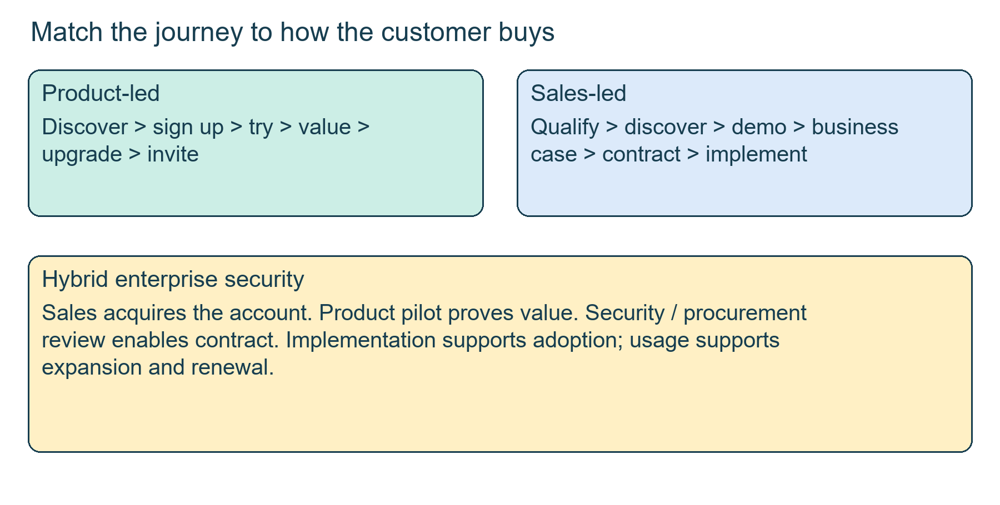
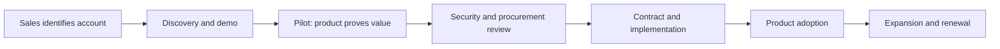
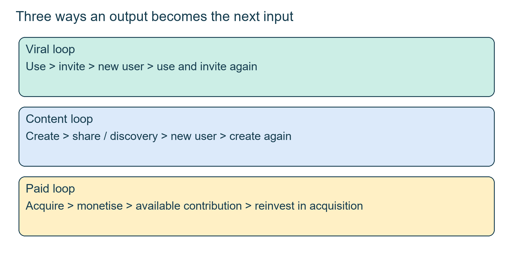
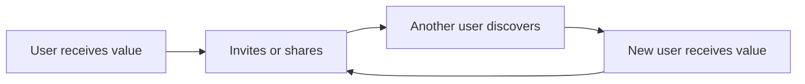
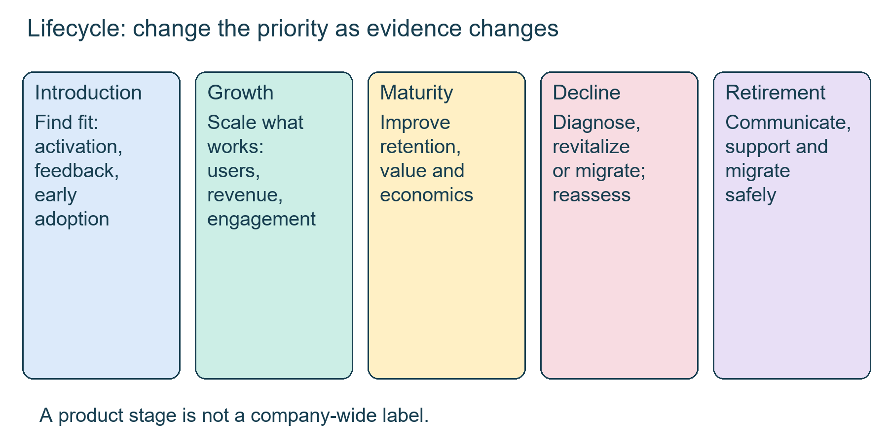
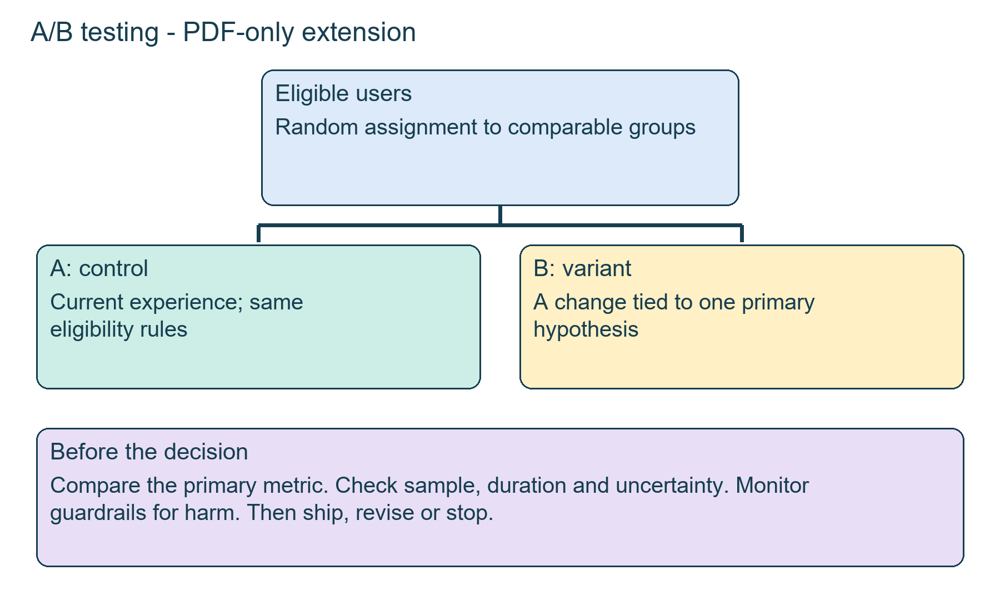
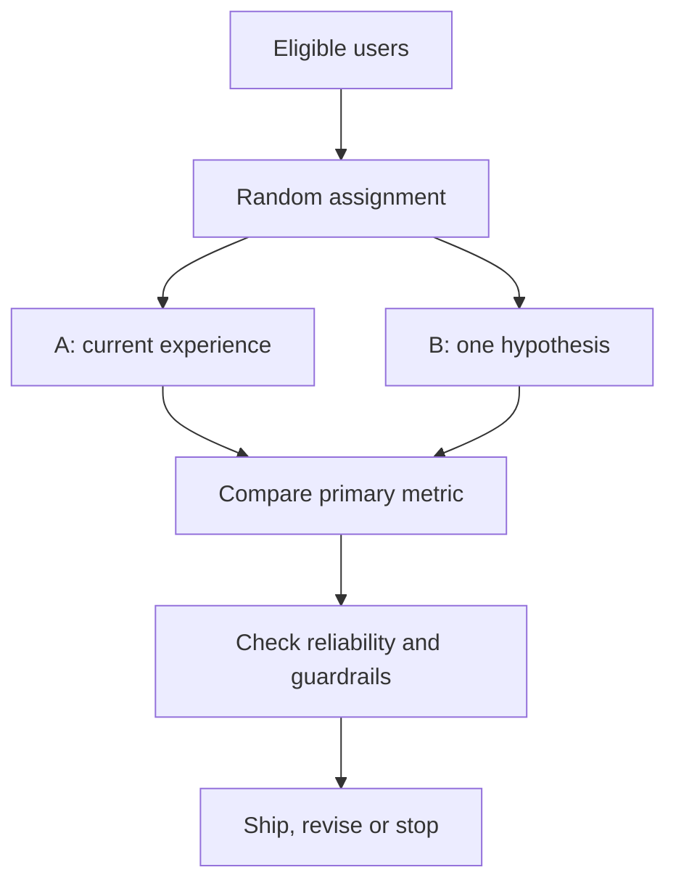

# Class 19: Growth loops, product lifecycle and A/B testing

12 September 2026 · Arun Nandewal · portal "Academic Session 19"; the long notes file calls it Class 16. The folder name mentions A/B testing, but the live class ended before reaching it. That material comes from the slide deck only and was not taught live.

## The class in one minute

- A funnel shows where users leave. Choose the problem to fix by looking at downstream value, the cost of winning people back and the reason they left, not just the biggest raw drop.
- Product-led growth lets people try the product and see its value themselves. Sales-led growth helps buyers evaluate a complex, costly or risky purchase. Many products use both.
- A growth loop feeds its output back in as the next input: users invite users, content attracts creators, or contribution pays for more acquisition.
- Launch, growth, maturity, decline and retirement call for different priorities, and one company has products in several stages at once.
- An A/B test compares a control with a variant using random assignment, one hypothesis and a guardrail. A higher percentage alone does not prove a reliable win. This part was deck-only.

## Core ideas

### Reading the funnel, and what retargeting really costs

The class reused the illustrative Zomato funnel: 1,000,000 aware, 100,000 acquired (10%), 40,000 activated (40%), 8,000 converted (20%), 5,000 retained (62.5%) and 1,000 referring (20%). Each rate uses the previous stage as its base. The slide calls these figures illustrative, and it defines activation as first order and conversion as becoming a paying customer, which could overlap in a real system. Students first picked awareness because its loss is biggest, or conversion because it is closest to revenue. Neither is enough alone. A drop-off tells you where to investigate, not what to build.

*Every percentage uses the stage immediately before it as the denominator.*

Retargeting means contacting people who have already met the product. The class assumed 10 rupees per person contacted. Reaching the 900,000 who never became users costs 9,000,000 rupees (90 lakh), and the 60,000 who were acquired but never activated cost 6 lakh. These are contact costs, not the cost of acquiring each recovered customer. The first discussion used an LTV (customer lifetime value) of 350 rupees. Later homework changed that to 720 and also mentioned about 700 over a year with an average order of 200. Those are sensitivity cases, not one customer profile.

In the long poll, the instructor asked how many of the 60,000 would move forward and used 60,000 × 10% × 40% = 2,400. That applies the acquisition and activation rates again. An already acquired user may not need to pass through acquisition again, and the source does not settle that, so 2,400 is his stated re-entry assumption, not a general formula. For real work, specify the re-entry stage and measure the conditional rates. Finally, an offer that brings back people who would have returned anyway has little incremental value, so compare with a control group where you can.

**Remember:** compare the extra value you recover with the full cost of the intervention, and keep each assumption beside its result.

### Product-led, sales-led and hybrid growth

Product-led growth (PLG) runs: discover, sign up, try, experience value, upgrade, invite others. It fits products that are easy to understand, give value fast and cost little to serve one more user. Time to value is how long before the user gets a useful result. Removing an onboarding step helps only if users reach value sooner and no needed check disappears.

Sales-led growth (SLG) runs: lead, qualification (is this a fit?), discovery (what is the need?), demo, business case, negotiation, contract, implementation. It fits complex systems, high contract values, several decision-makers and human set-up. The deck's example was enterprise cybersecurity software with an annual contract of 25 lakh to 1 crore rupees, bought by the CISO, CTO, IT security, procurement and legal. Claims that all large companies are sales-led, or that sales salaries are several times another role's, were generalisations with no data.

A hybrid combines the two on purpose. For the security case, sales finds the account, a limited pilot proves value to the security team, and product use then spreads to more teams and supports renewal. Track qualified opportunities, closed-won over eligible opportunities, and pilots completed successfully, separately, since a customer can sign without adopting.

*Sales can win the account while the product proves value and drives expansion.*

**Remember:** choose the amount of human help from the customer's complexity and risk, not from the prestige of a model name.

### Growth loops

A funnel asks how users progress. A growth loop asks how one user's activity helps create the next user or cycle. Three loops were covered.

- Viral: a user gets value, invites someone, and that person gets value and invites more. Examples were WhatsApp, Zoom, Dropbox and Slack.
- Content: content attracts people, some of whom create more content. The Spotify illustration: listen, create a playlist, share it, a friend joins, the friend makes and shares another. Not every reader becomes a creator, so the conversion at each step matters.
- Paid: acquire a user, earn from them, reinvest the available contribution in acquisition. Revenue is not automatically free cash, because service and other costs come out first. If acquisition destroys contribution, spending more cannot make the loop work.

Marketplaces add a twist: you need both supply and demand, and a low commission does not help if restaurants, customers or reliable delivery are missing.

*Every loop needs an output that creates the next input.*

**Remember:** draw the return arrow and name exactly what travels along it. A one-off campaign is not a loop.

### Product lifecycle and portfolio matrices

The five stages and what a PM does in each:

| Stage | Main question | What to do and watch |
|---|---|---|
| Introduction | Do people want it? | Research, experiments, activation, early feedback |
| Growth | Can adoption scale? | Distribution, onboarding, user and revenue growth, CAC, LTV |
| Maturity | Can each customer be worth more? | Retention, pricing, efficiency, profit |
| Decline | Can value be extended or users moved? | Diagnose, refresh, serve a niche or migrate |
| Retirement | How do users exit safely? | Communicate, support, migrate, track satisfaction |

Product-market fit means the product meets a real need strongly enough to support continued use. Retirement is product work too, because paying users and customers with stored data cannot simply be abandoned.

*The same growth tactic is not right at every stage.*

The deck placed products in stages (for example Google Lens in introduction, YouTube in maturity, Stadia in retirement, and Indian examples such as Zepto, Paytm and Snapdeal). These are illustrations, and some are awkward, so use them for the priority lesson, not as status reports. The BCG matrix compares market growth with relative share: star (high, high), question mark (high growth, low share), cash cow (low growth, high share), dog (low, low). The instructor then drew a separate customer lens on excitement and innovation potential. The placements (AI models as stars, the metaverse as a dog) were opinion with no share data. A quadrant label is a discussion aid, not a measured diagnosis.

**Remember:** name the product, customer, market and evidence first, then choose the stage and the action.

## Worked example

Foodie+, from the deck (PDF-only): a five-year-old food delivery platform with 10 million registered users, 1 million monthly active users, 3% year-on-year growth, rising CAC, falling retention, heavy discount competition and improving contribution margin (what is left after variable costs).

The solution calls it maturity moving towards early decline. The priority is retention, not more acquisition, a long feature list or retirement. Falling retention shrinks LTV while rising CAC hurts LTV:CAC. So investigate why users leave (price, delivery, restaurant choice, competitor offers or experience) and split cohorts by city, order frequency, segment and acquisition channel. Candidate experiments are better recommendations, easier reordering, loyalty and relevant offers, none proven. The Zomato and Swiggy comparison: ask whether an existing monthly customer can place one more order, rather than chasing another million downloads. The sequence is revitalise, improve retention, improve economics, reassess. Foodie+ is still large, active and contributing, so it is recoverable.

Applied to car loans: a lender's "dealer finance desk" for new cars might be in maturity: stable volume, rising cost per booked loan, and repeat dealers leaving for a competitor's rates. Per this class, you would not buy more dealer leads first. You would find why existing dealers' share is dropping, by dealer, brand and ticket size, and test one retention offer against a control.

## Frameworks to reuse

Growth-loop canvas (Spotify filled in): starting user (person listening), value action (creates a playlist), output (shareable playlist), distribution path (shares with a friend), new input (friend joins and creates), return-arrow constraint (friend must discover, use and choose to share).

Lifecycle card: product, market and segment, usage trend, retention, CAC and LTV basis, contribution, strategic importance, likely stage, evidence for and against, action, metric, reassessment condition.

Choose PLG, SLG or hybrid by asking: easy to understand unaided? how fast is value felt? contract value? how many decision-makers? is a demo important? is human set-up needed? does wider use drive expansion?

The A/B experiment brief below comes from the deck only.

| Step | Blank | PhonePe exercise |
|---|---|---|
| Problem and baseline | [ ] | 72,000 of 100,000 complete payment = 72% |
| Hypothesis | If [change], then [behaviour] improves because [reason] | Simpler screen information raises completion because friction falls |
| Primary metric | [ ] | Completed payments over eligible payment-screen entrants |
| Control and variant | [ ] | Current screen versus simplified screen |
| Assignment | [ ] | Random, comparable groups |
| Guardrails | [ ] | Failures, refunds, complaints, transaction value |

*A difference in results starts the analysis. Reliability and side effects still matter.*

The deck's sample: group A 10,000 users with 1,000 conversions (10%), group B 10,000 with 1,100 (11%). That is a 1 percentage point gain, or a 10% relative increase. It does not prove statistical significance, so check sample size, normal behaviour over the test period and uncertainty. Change one thing at a time. The deck's brand cases (MakeMyTrip, Amazon, Teams) came with no sample sizes or sources.

## Self-test

1. Why not simply fix the stage with the biggest drop-off?
2. Which growth motion suits a 25 lakh to 1 crore rupee security contract, and why?
3. What is the difference between a funnel and a growth loop?
4. In an A/B test, 10% convert in A and 11% in B. What are the absolute and relative changes, and is it proven?
5. Foodie+ has slowing growth, falling retention and rising CAC. What is the priority?

**Answers**

1. A big drop tells you where to look; recovery cost, later value and the reason for leaving decide the priority.
2. Sales-led with product-assisted adoption (hybrid): many decision-makers, trust and set-up, plus a pilot to prove value.
3. A funnel shows progression; a loop shows how output becomes the next input.
4. 1 percentage point absolute, 10% relative. Not proven without sample size, duration and guardrail checks.
5. Retention first. Find out why users leave and split cohorts before spending on acquisition.

## Homework from this class

Sameer's to do. These are not done for you.

- Build a funnel for a familiar product such as Spotify or Netflix. Hypothetical numbers are allowed but label them as assumptions. Change the acquisition or contact cost, the LTV and the returning-user journey. Use ChatGPT or Claude to explain how the result changes, then check the arithmetic and reasoning yourself.
- Extra practice from the deck: the productivity-app bottleneck exercise, choose a growth motion and three metrics for the security platform, diagnose Foodie+, and design the PhonePe A/B test.

The instructor offered an Indigo case for later discussion if students attempt the funnel exercise. An evaluation on the 19th, a TA session on Thursday and capstone work were mentioned, but the format and deadlines were not given, so confirm in the course system.
