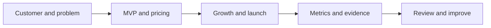
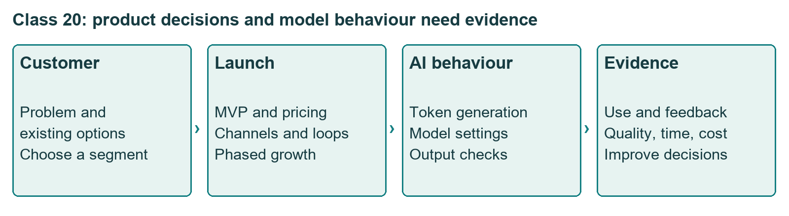
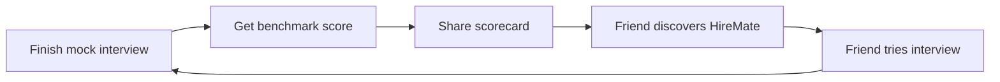
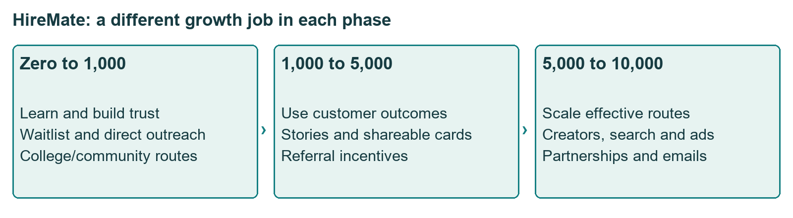
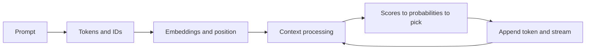
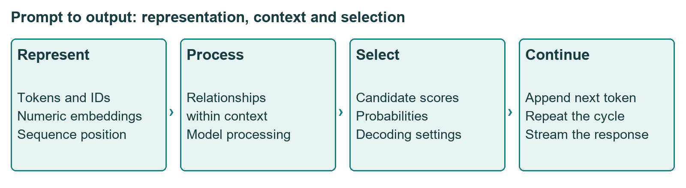
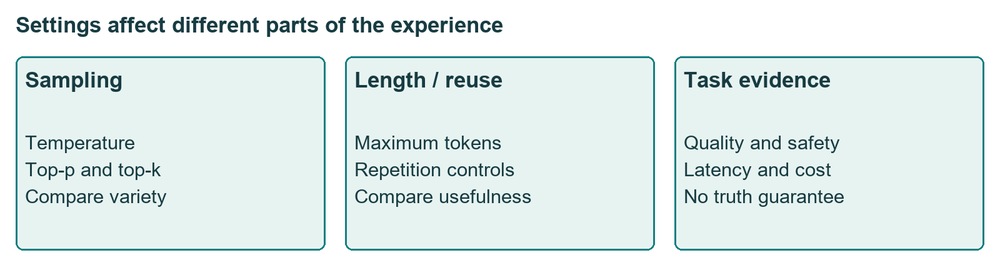

# Class 20: Capstone briefing and how an LLM writes text

18 September 2026 · Arun Nandewal · transcript title "S1 Capstone Project Briefing"

## The class in one minute

- The capstone is an individual PDF launch strategy for HireMate, an AI mock-interview product: customer, pricing, growth, MVP and six to eight success metrics.
- Pick one primary customer and say why. Do not start with "a subscription for every job seeker".
- Plan growth in three phases (0–1,000, 1,000–5,000, 5,000–10,000 users) and explain the mechanism that brings the next user, not just the channel name.
- An LLM writes by turning your prompt into tokens, numbers and context, scoring candidate next tokens, picking one, and repeating.
- Settings such as temperature change variety, length, speed and cost. They do not make an answer true.

## Core ideas

### The HireMate capstone

You play the PM of a bootstrapped startup, meaning one working with very little money. HireMate is described as an AI mock-interview platform with role-based practice for PMs, software engineers and analysts, personalised feedback, a benchmark score and an improvement plan. The job is to design pricing and growth for the first six months, aiming at 10,000 users.

The required PDF covers an executive summary (two or three sentences), pricing, growth, MVP, and six to eight metrics. Launch and go-to-market (GTM, how a product reaches its market) is also assessed, so cover it too. A wireframe, two or three promotional posts, or a working app are optional extras. An app is not required. The brief says the work is individual, and it also says it is ungraded with no course weight, even though it lists quality weights: pricing 25%, growth 25%, GTM 20%, metrics 20%, structure 10%.

The instructor offered to review shortlisted submissions and recommend two students for an external fintech learning programme. He wanted work in before 30 September for that. The official portal deadline was not stated, so confirm it with the programme team.

*The launch plan needs business decisions, and an AI feature also needs tested behaviour.*

**Remember:** Understand who the product helps and what its feedback means before promising interview success.

### Customer, MVP and pricing

Three segments were discussed: new graduates, experienced professionals and career switchers. The deck guesses low, medium and high willingness to pay for them. Those are assumptions, not interview findings. The instructor wants a clear primary target, though it is the PM's call whether to serve more than one.

MVP means minimum viable product: the smallest thing that tests your key assumptions. Decide what you will not build.

Pricing options named: free trial, subscription, freemium (a free tier plus paid value), pay-per-interview, cohort. Students kept saying "subscription", so the instructor pushed them to ask who pays and through which route. Colleges might introduce the product, companies might fund staff preparation, individuals might pay per interview, or the fee could be a share of salary after a role change. Brainstormed numbers (three free interviews then ₹100 each, a $500 company package) were ideas only, not validated prices. He also questioned giving the core interview away free and suggested a lighter free hook such as resume readiness.

The benchmark score also needs a defined meaning. A percentile against other users and a company's hiring standard are different reference points, so say which one HireMate uses and how you would check it.

**Remember:** Ask who pays, for which value, through which route. A price label alone is not a strategy.

### Growth: channels versus loops

Organic growth means growth without paid ads. Paid growth means ads on Instagram, Facebook or Google. A referral loop means people recommend the product because they got value. An incentive loop adds a reward. A network effect means the product gets more useful as more relevant people join, as with riders and drivers on a ride-hailing app.

A channel says where people find you. A loop says how one user's activity brings the next one. The class example: finish an interview, get a benchmark score, share a scorecard, a friend discovers HireMate, the friend finishes an interview and shares in turn.

*Each phase has a different aim, so one repeated channel list is not enough.*

**Remember:** Growth should explain how value and user behaviour create the next step, not just list LinkedIn, ads and referrals.

### Metrics at three levels

The brief asks for L0, L1 and L2 measures. L0 is business health (monthly recurring revenue or MRR, paid conversion, churn). L1 is product performance (active practice, session completion, NPS, a recommendation score). L2 is leading behaviour, such as sessions in a user's first week. The instructor also asked for counter metrics: measures that catch harm while the main number improves.

**Remember:** A proposed link between early practice and revenue is something to test, not proof that one causes the other.

### What happens when you prompt an LLM

The instructor compared this to the classic interview question "what happens when you search on Google?". He used the Transformer Explainer simulator, where a story about a deserted planet is extended one token at a time.

1. The prompt is split into **tokens**: words, word pieces or punctuation, each with an ID.
2. IDs become **embeddings**: lists of numbers representing each token. The deck's example was a made-up vector for "Goa" with 1,024 dimensions.
3. **Positional encoding** adds information about word order.
4. **Self-attention** weighs how tokens relate to each other in context. "Desert" is ambiguous, but "desert land of Rajasthan" is clear. The **context window** is the maximum number of tokens the model considers at once.
5. The model produces raw scores called **logits**, **softmax** turns them into probabilities, and **decoding** picks a token.
6. The chosen token is appended, the loop repeats, and the answer is **streamed** to the user as it builds.

The live analogies (shopping sites for attention, RAM for the context window) were simplified. The slides were more careful: attention is about relationships between tokens, not searching the internet, and the context window is measured in tokens.

*Generating a response repeats the selection step many times.*

**Remember:** Token IDs identify chunks, embeddings represent them as numbers, and position records their order. They are three different things.

### Settings that change the output

**Temperature** controls randomness when a token is picked. The instructor likened low settings to a careful gear and high settings to a freer one, suggesting low for finance or healthcare and high for branding or design. He often said low temperature means "factual". That goes too far: low temperature gives more predictable text, not checked text. **Top-k** limits the choice to the k most likely tokens. **Top-p** limits it to the smallest set whose probabilities add up to p.

*In the slides, not taught live:* hyperparameters are settings chosen before training or running a model. Training ones are learning rate, batch size and epochs. Run-time ones (inference, meaning using the trained model) are temperature, top-p, top-k, maximum tokens and repetition, presence and frequency penalties. Deck presets: conservative p = 0.7 and k = 20, creative p = 0.95 and k = 100 or more. A Spotify-style playlist example changed both a repetition penalty and the token limit at once, so it cannot show which setting helped.

*Compare settings on your own task. None of them certifies facts.*

**Remember:** A plausible continuation and a fact-checked answer are different product outcomes.

## Worked example

The slides carried a reference HireMate plan. Its tiers were Free (₹0, five mock interviews a month), Pro (₹499 a month) and Premium (₹699 a month). Its targets for 5,000–10,000 users included 25% free-to-paid conversion and MRR above ₹45,00,000. Check that against its own numbers: 10,000 users at 25% paid is 2,500 paying users. Even if all paid ₹699, that is 2,500 × ₹699 = ₹17,47,500 a month. The target does not reconcile, so the reference is a format to study, not a plan to copy. Its prices, partner names and results were unverified.

**Applied to car loans.** Suppose a lender plans a new-car loan app and claims "40% of dealers will refer customers". A good reviewer does what you just did with MRR: multiply the stated dealer count, conversion and average loan, and see whether the result supports the claim. Then ask who the first customer is (a salaried buyer, a dealer, a credit officer), who pays, and which loop brings the next dealer.

## Frameworks to reuse

| Decision | Blank template | Quick check |
|---|---|---|
| Primary customer | ___ because ___ | Problem and current alternative named? |
| MVP | Include ___; exclude ___ | Which assumption does each feature test? |
| Pricing | Who pays ___ for ___ via ___ | Why that price? |
| Growth loop | Trigger ___ → action ___ → shared asset ___ → next user ___ | Does it repeat? |
| Metrics | L2 ___ → L1 ___ → L0 ___ + counter metric ___ | Why does each matter? |
| Settings test | Task ___; baseline ___; variant ___ | Only one control changed? |

## Self-test

1. What must the HireMate PDF contain, and is an app compulsory?
2. What is the difference between a channel and a growth loop?
3. Positional encoding mainly concerns: A) the order of tokens, B) company revenue, C) live search ranking.
4. Distinguish logits, softmax and decoding.
5. A slide changes the model, maximum tokens and repetition penalty together and shows one better answer. Can you credit one setting?

### Answers

1. Executive summary, pricing, growth, MVP and six to eight metrics, with launch reasoning, as an individual PDF. An app is optional.
2. A channel is a route for discovery. A loop is a repeating chain in which a user's action brings another user.
3. A, the order of tokens.
4. Logits are raw scores, softmax converts them to probabilities, and decoding picks the next token.
5. No. Several controls changed, so the example is not a controlled test.

## Homework from this class

Sameer's to do. These are not done for you.

- HireMate mini-project: an individual PDF launch strategy with the core sections and six to eight metrics. The brief says ungraded. No official date was given; the class working target was before 30 September.
- Optional: a simple landing-page wireframe and two or three promotional posts. Interviews with real users and a working app are encouraged as extra evidence.
- Explain how a transformer produces text to four or five people.
- Read the paper "Attention Is All You Need" and the Financial Times visual article on generative AI.
- Revisit the AI knowledge-check self-score after later AI sessions.
- Slides extension: explore Google AI Studio (model information, structured output, grounding, safety settings) and the OpenAI Playground, and compare model settings.
