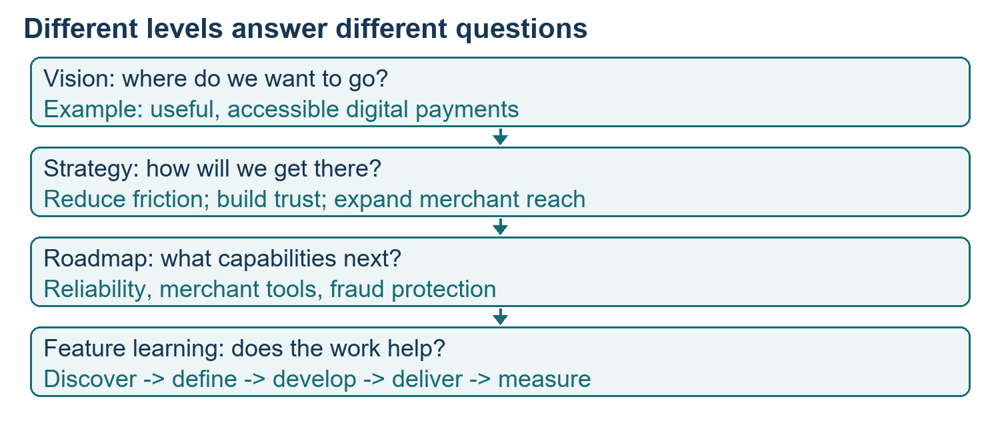
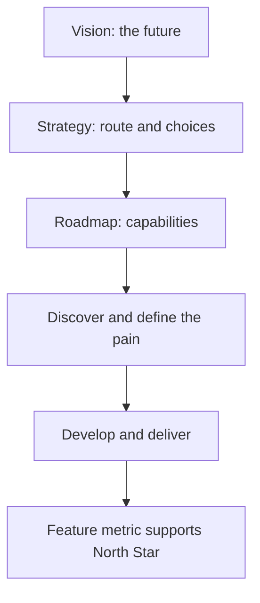
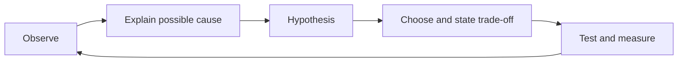
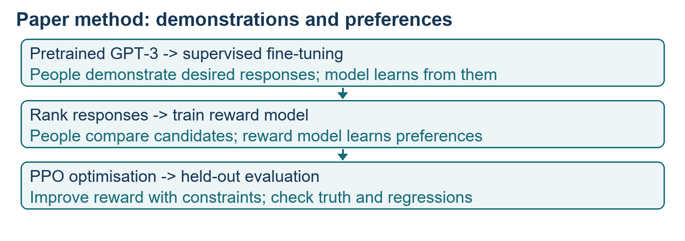
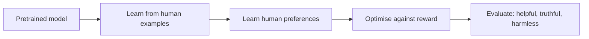

# Class 21: Product strategy and types of language models

21 September 2026 · Arun Nandewal · portal title "What Makes a Great Strategy?"

## The class in one minute

- Strategy is a set of choices about where to compete and how to win, including what you decide not to do.
- Vision is the destination, strategy is the route, and the roadmap is the list of capabilities built along the way.
- A good strategy moves from observation to insight to hypothesis to choice to measurement, and keeps facts apart from assumptions.
- You critique a strategy (Spotify, PhonePe, Razorpay) by testing its logic and trade-offs, then forming your own judgement before asking AI to polish it.
- Models can be compared by size, access and task, but the class examples were loose. The supporting paper gives a cleaner story of how a model is taught to follow instructions.

## Core ideas

### What strategy is

Students offered definitions such as lowering acquisition cost, raising customer lifetime value, or knowing the customer. The instructor accepted that each can contribute, but said "strategy" is often used vaguely. His six organising questions: who are we solving for, what are we solving, why is it worth solving, how will we solve it differently, where will we operate, and how will we be known? The slide deck replaced the last one with "how will we know it is working?", which adds measurement. Keep both.

Classroom examples of a chosen difference: Nykaa and The Man Company (a specific customer), Bumble (a women-focused experience), Namma Yatri (driver commissions), BluSmart (ride reliability), Apple (design), Meesho (geography and channel). These were the instructor's interpretations, not verified company policy.

A strategy that claims every advantage confuses the team. "We make food available at people's fingertips" gives no direction. "Increase order frequency among existing urban users by making discovery and repeat ordering easier" does. It points to features: personalised recommendations, search, past orders, favourite restaurants, timely notifications. It also tells you what to defer, called **non-goals**.

**Remember:** a useful strategy explains what to build and what to reject or delay.

### Vision, strategy, roadmap

**Vision** says where the product wants to go. **Strategy** says how it gets there. **Roadmap** says which capabilities come next. For PhonePe, the class framed it like this: the vision is accessible, useful digital payments; the strategy is lower friction, trust, wider merchant acceptance and adjacent finance; the roadmap is reliability, merchant tools and fraud protection. The role split (CPO sets vision, senior roles set strategy, PMs handle roadmap) is a simplification. The instructor said PMs can propose strategy and may need to in order to grow. Time horizons (vision three to five years, strategy two to three, roadmap six to eighteen months) were examples, not rules.

Strategy also sits above single features. For each feature: find the pain, define the problem, build an MVP or prototype, deliver. Link it upward: feature metric to roadmap metric to North Star, the main outcome the product wants to move. In the Excel example, a user has roll numbers, marks and interests on three sheets and wants to match them. A cross-sheet natural-language feature solves that pain and supports a vision of a trusted productivity assistant.

*A roadmap is easier to judge when the strategy and vision stay visible above it.*

**Remember:** a clear feature can serve a strategy without being the whole strategy.

### Evidence before commitment

The deck lists six traits of a strong strategy: specific, evidence-backed, choice-driven, differentiated, measurable and actionable. The evidence chain is: **observation** (what is happening), **insight** (why it may be happening), **hypothesis** (a testable belief), strategic choice, measurement. Saying "it will work because I feel it will" skips the chain.

The deck ranked evidence from customer behaviour and usage data, through customer research and market evidence, down to expert opinion and assumptions. Ask what evidence would change your mind. Stories like the cab app with cancellations, or PhonePe contrasting a parked-money wallet with direct UPI payment, were used to practise the chain. The instructor's market figures were stated assumptions, not researched sizes, and the company chronology was loose, so learn the method and not the dates.

**Remember:** make known facts, interpretation and remaining uncertainty visible.

### Where to play and how to win

Where to play can be a customer, segment, geography, use case, category or channel. Examples: Nykaa for a customer, Meesho for geography, early Rapido for a use case (two-wheelers), Instagram-only sellers for a channel. How to win can come from differentiated value, product capability, distribution (Windows on partner PCs), cost (Meesho affordability), a **network effect** (more drivers attract more riders), brand (Disney) or operations (Amazon delivery). Urban Company showed that a service marketplace needs trust, verified professionals, matching and quality, not just an app.

The deck also compared consumer (B2C), business (B2B) and service products. Consumers choose on convenience, businesses on economic value and renewal, and service marketplaces must deliver a trusted outcome to both customer and provider. Retention matters in all three.

**Remember:** picking a market does not explain why you can win in it.

### Critiquing a strategy

The Spotify exercise became homework. The deck's logic: free access brings users, listening data improves personalisation, engagement drives paid conversion, and revenue funds improvement. Challenge points: more audio verticals add complexity, heavier monetisation can hurt the experience, personalisation is less distinctive as rivals improve AI, and new features should strengthen the core habit. A good critique acknowledges the strongest logic, names an assumption, states a trade-off and proposes a test. It does not just list faults. Do your own thinking first, then ask AI to challenge it. The instructor also encouraged teardown posts and original PRDs built from public observation only.

**Remember:** a critique ends with what you would proceed with, change or defer, and why.

### Types of models, and how instruction-following is taught

The live portion compared models along three axes. **Size** by parameters (learned numerical settings): the instructor's bins were small (up to 20 billion), medium (20–500 billion) and large (above 500 billion), his own rough bins. **Access**: downloadable models (the class named DeepSeek, Qwen, Kimi) versus API-only ones (Claude, OpenAI, Gemini). **Task**: text, image, video, coding, classification, domain-specific and **multimodal** (more than one kind of input, such as text and images). The examples mixed apps, companies and models, so do not memorise the lists. The release-rate graph the instructor showed had no preserved method.

The closing analogy (newborn as base model, school as pretraining, specialisation as fine-tuning) was only an introduction. The deeper explanation comes in the supporting paper, "Training language models to follow instructions with human feedback" (the InstructGPT paper, 68 pages). Its method starts from pretrained GPT-3 and has three steps: (1) humans write example answers and the model learns from them (supervised fine-tuning); (2) humans rank several answers and a reward model learns their preferences; (3) the model is optimised against that reward model using a reinforcement-learning method called PPO, with a penalty to stop it drifting too far.

*Three steps: demonstrate, rank, optimise.*

Reported results: labelers preferred the 175B InstructGPT answers to 175B GPT-3 answers in 85% of cases (±3), and a 1.3B instruction-tuned model beat the 175B base model on that test. Closed-domain hallucination fell from 41% to 21%, a drop of 20 percentage points or about 49% relative. But bias did not clearly improve, harmful instructions could still be followed, and some abilities regressed (the paper calls this an alignment tax). These are results on specific data, about 40 contractors and mostly English prompts, not a guarantee of truth or safety.

Page 37 of the paper, which the instructor pointed to, holds instructions given to human evaluators. They judge helpful, truthful and harmless answers, and for final evaluation truthfulness and harmlessness generally win. It is not a hidden system prompt inside GPT-3.

*In the deck, not taught live:* fine-tuning adapts a trained model with task examples. Options listed were supervised fine-tuning, LoRA and QLoRA (small adaptation layers), DPO and RLHF (preference learning), and full fine-tuning. RAG (retrieval-augmented generation) fetches documents at run time and does not change the model. Training changes weights; prompts, retrieved text and temperature change a single response only. The deck also covered hyperparameters such as temperature, top-p and top-k, and one table row on top-p was inconsistent, so do not copy it.

**Remember:** better preference scores are not the same as accuracy, and fine-tuning does not guarantee safe answers.

## Worked example

The class used a food-ordering app to show a full strategy chain.

- Observation: customers order less often than the business wants.
- Hypothesis: if discovery and reordering get easier, frequency will rise.
- Strategy: focus on existing urban customers, defer new-city expansion and loyalty schemes.
- Roadmap: vernacular search (search in the user's local language), past and friends' orders, an evening snack notification.
- Measure: repeat-order frequency. The lecture gave no baseline or target, so none is invented here.

**Applied to car loans.** A lender could say "we finance every new-car buyer". A sharper strategy: "increase approvals through existing dealer partners for salaried first-time buyers, by cutting document back-and-forth for the credit officer". Non-goals might be used cars and self-employed buyers for now. The roadmap follows: dealer-side document upload, auto-fill of known details, an EMI quote at the showroom. The measure is time from application to sanction, not the number of features shipped.

## Frameworks to reuse

| Tool | Blank form |
|---|---|
| Strategy statement | Prioritise [customer and problem] because [evidence]; win through [advantage]; defer [non-goal]; measure [outcome]. |
| Evidence chain | Observe ___ → Insight ___ → Hypothesis ___ → Choice and trade-off ___ → Measure ___ |
| Strategy canvas (8 fields) | Vision · target customer · problem · evidence · value proposition · differentiation · choices and non-goals · metrics |
| Defence | Claim → evidence → logic → trade-off → risk → test |
| Model card | Publisher and model ___; size ___; access and licence ___; modalities ___; task test ___; quality, latency, cost ___; date of evidence ___ |

## Self-test

1. What is the difference between vision, strategy and roadmap?
2. Put in order: hypothesis, observation, measurement, insight.
3. What are non-goals, and why do they matter?
4. In the InstructGPT method, what does the reward model learn from?
5. A model is preferred by human raters. Does that prove it is more accurate?

### Answers

1. Vision is the destination, strategy is the route and choices, roadmap is the capabilities planned along it.
2. Observation, insight, hypothesis, measurement.
3. Areas deliberately left out for now. They make the strategy specific and show real choices.
4. Humans' rankings of several candidate answers.
5. No. Preference is a different measure from factual accuracy, and the paper shows truthfulness and bias results differed.

## Homework from this class

Sameer's to do. These are not done for you.

- Explain the previous LLM concepts to an AI tool, ask it to challenge gaps, using the course material as context.
- Fill in vision, strategy and roadmap for a favourite product.
- Critique one of Spotify, PhonePe or Razorpay, answering the challenge questions with your own judgement. Posting on LinkedIn was suggested, not required.
- Fill the eight-field strategy canvas for a favourite product and explain your choices and evidence.
- Spend two or three days studying the model-analysis resource and comparisons.
- Read the supplied paper, especially the page-37 labeler instructions, before the next class.
- Deck extension: compare models and settings, and inspect model details, structured output, search grounding and safety behaviour.
- Fintech cohort: the form was due 21 September 2026, with an assignment tentatively on 23 or 24 September. Capstone: continue the project from Class 20.
