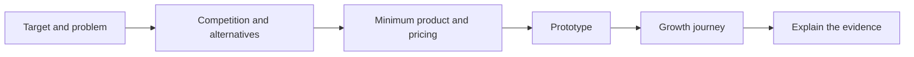
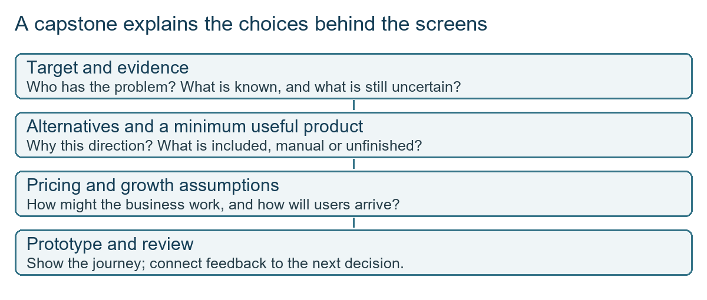
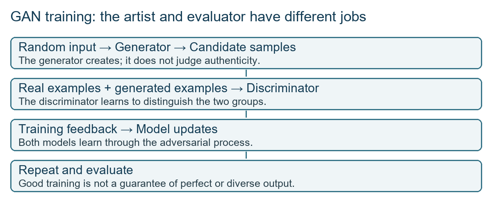
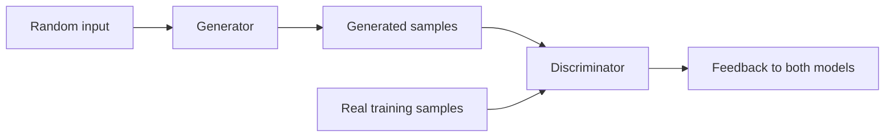
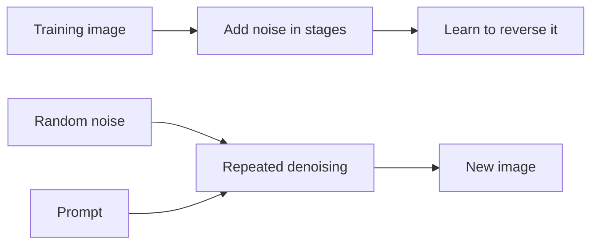
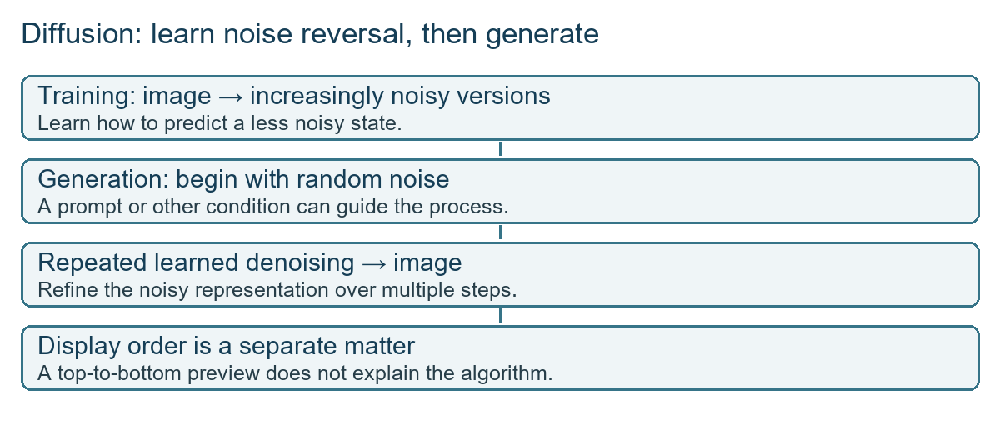
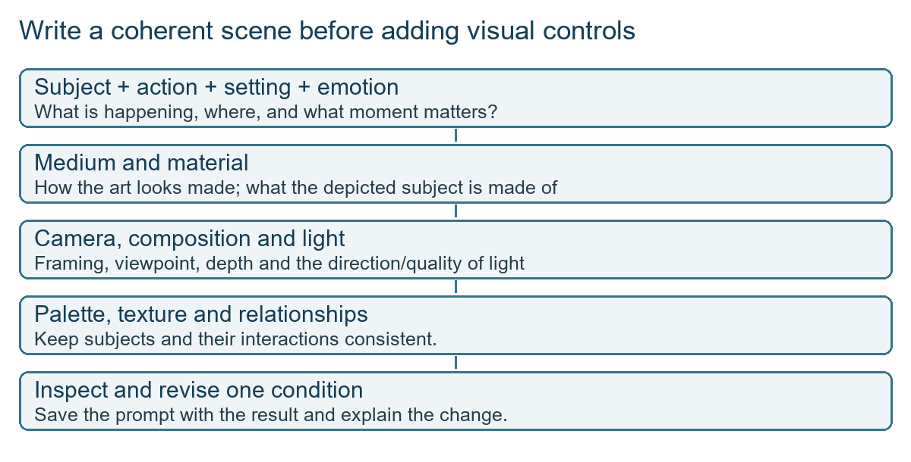

# Class 22: Capstone mentoring and image models

25 September 2026 · Arun Nandewal · portal title "S1 Project Workshop: Comprehensive Mentoring"

## The class in one minute

- A capstone needs more than a good-looking prototype: show the target segment and its size, the competition, pricing, the minimum product and a documented growth journey.
- Research counts when it changes your plan. Small surveys are fine if you state their limits and keep planned interviews apart from completed ones.
- Image classification labels a picture, captioning describes it, and generation creates a new one. They are different tasks.
- A GAN trains two models against each other; a diffusion model learns to reverse added noise.
- A good image prompt names the subject, action, setting and emotion, then adds medium, material, camera, lighting and palette.

## Core ideas

### What the capstone reviews asked for

Three students presented work in progress, and the instructor's feedback was consistent. Sameer's idea was a focused interview-preparation product for early-career BFSI roles (banking, financial services and insurance), such as credit analysis, field sales and collections. He called it 30–40% complete and had only about 15–20 survey responses. The instructor praised the segmentation and depth.

Hamza presented Hiremate, aimed at institutions and bootcamps instead of individual candidates. A learner records a video answer to a role-and-company question, a mentor dashboard receives it, and Hamza manually runs the transcript through an LLM and sends back a score. That is a **concierge MVP** (a person delivers key parts by hand) or a **Wizard-of-Oz MVP** (it looks automated, but a person works behind the scenes). The pricing tiers were free for up to 50 students, a standard tier for up to 150, and a negotiated enterprise tier with white-labelling (selling under the customer's brand). A third student showed a wireframe linking students at less-recruited colleges, placement officers and employers.

The same gaps came up each time: target size and segment, competition, and a written growth path. A screen alone does not explain why the screen should exist. The submission is a short recorded walkthrough of about three minutes plus a structured document, with shareable access. Deadline statements in the recording conflicted (no fixed date, then 30 September), so check the course system.

*A prototype needs the reasoning before it and a plan after it.*

**Remember:** show the thinking behind the screens as clearly as the screens.

### Research that changes the plan

Sameer's survey did something useful: it challenged his assumptions. Many respondents preferred English to regional-language practice, so he revised that idea. Payment tied to a job raised distrust, so he dropped that direction. One question had 13 usable answers: eight chose monthly unlimited, four chose free only, one chose per-session payment. That is a small-sample reading, not a market forecast. He also said two HR interviews were planned but not yet done. Record those as planned.

**Remember:** a small survey is evidence of what to test next, not proof of demand.

### Understanding an image versus generating one

**Classification** picks a label for an image. The deck's toy example scored Cat 0.92, Dog 0.05 and Car 0.03: the scores add to 1.00 and the top one wins. **Captioning** produces a text description. **Generation** creates new image content. One product can combine all three, so the task type does not tell you the architecture.

A **multimodal** model works with more than one kind of input or output, such as text and images.

**Remember:** ask what the system does, what it was tested on and where it fails.

### Two ways to generate images

A **GAN** (generative adversarial network, introduced in 2014) has a generator that makes candidate images and a discriminator that learns to tell real training images from generated ones. The generator improves from the discriminator's feedback. The classroom analogy used an artist and an evaluator, and at one point the transcript swapped the two roles, so keep this straight: the artist is the generator and the evaluator is the discriminator. A GAN does not need a person to approve each pixel. Weak training data limits the output. **Mode collapse** is when the generator produces too little variety. Deck extras: conditional GANs, Pix2Pix (learns from paired examples) and CycleGAN (translates between two image sets without pairs).

*Real and generated examples both feed the discriminator.*

A **diffusion** model is trained by adding more and more noise to example images and learning how to undo it. To generate, it starts from random noise and removes noise step by step, steered by the prompt (a text condition). In class an image appeared gradually on screen and was described as how diffusion works, but a preview on screen is not the algorithm. Diffusion is not filling pixels top to bottom. The deck said GANs are often faster after training and diffusion usually takes more refinement steps, but these are tendencies. The claim "GANs for faces, diffusion for art" is too rigid. Choose by task, inputs, quality, control, speed, cost and failure modes.

*Training adds noise; generation removes it.*

**Remember:** the GAN is a contest between two models, and diffusion is a learned clean-up of noise.

### Real or generated, and why it matters to a PM

The class played a real-versus-generated game with frogs, ships, schoolchildren and Mount Fuji. Clues included simplified textures, odd hands and arms, lighting and reflections. These are reasons to look closer, not proof. Real photos can be edited or oddly lit, and generated ones can avoid obvious flaws. The instructor gave examples of faked food-support and civic evidence. These were classroom stories, not verified incidents. For a product that accepts photo evidence, a **false positive** (flagging a genuine photo) and a **false negative** (missing a fake) both hurt people, and the class gave no detector accuracy figures.

**Remember:** a realistic image is not evidence on its own, so gather other evidence and keep your uncertainty.

### Writing a visual prompt

"Make a nice image" is not a brief. State the subject, what it is doing, where it is and the emotion. The class example was a village girl seeing the ocean for the first time, with stance, expression, shoreline, clothing and warm evening light. Keep to two or three main elements and describe how they relate.

Then add five controls. **Medium** is how the picture looks made (watercolour, papercraft, oil paint). **Material** is what the subject is made of (porcelain, noodles, light). **Photography style** covers angle, framing and **bokeh** (blurred background). **Lighting** covers golden hour, dramatic shadow or volumetric beams (light showing in haze). **Palette** covers warm, cool, pastel or earth tones. A camera name in a prompt is a visual cue, not proof of a real camera. For preset prompts, read the wording before uploading anything, and change one detail at a time.

*Subject and moment stay central; style controls sharpen the request.*

*In the slides, not taught live:* a long video section covered tools such as Sora, Runway, Pika and Veo. Video adds **temporal consistency**, meaning the subject and scene stay coherent across frames, so the brief must also describe motion, camera movement and sequence. The instructor said video was not reached, and the live video attempt hit paid-plan limits.

**Remember:** specify what happens, how it looks, how it is framed and lit, and what must hold, then review.

## Worked example

Take Hamza's Hiremate and review it the way the instructor did.

1. Customer: institutions and bootcamps, not individuals. Good.
2. Product: manual scoring behind a dashboard. Fine for an MVP if users know a person is involved.
3. Differentiator: a cross-institution benchmark such as "top 15%". Needs comparable tasks, a defined comparison group and reliable scoring. Not shown.
4. Missing: how many institutions exist, who competes, and the order of acquisition (proxy users, friends and cohort, mid-sized academies, university placement cells).

The instructor's verdict was that the prototype and pricing direction were good, and the written market, competition and growth material was what to add.

**Applied to car loans.** Imagine a "dealer finance desk" tool for car showrooms, built by hand first. A credit officer reads the uploaded documents and replies with a pre-approval. That is a concierge MVP. Before expanding, write down how many dealers you can reach, who else serves them, and whether a "better than 80% of dealers" score has a fair comparison group. Likewise, if a loan applicant uploads a salary slip image, treat it as something to cross-check, not trust on sight.

## Frameworks to reuse

| Tool | Blank form |
|---|---|
| Capstone completeness | Target and problem ___ · evidence and limits ___ · alternatives ___ · minimum experience ___ · pricing hypothesis ___ · growth sequence ___ · what is manual or unfinished ___ |
| Research-to-decision | Hypothesis → question → responses → sample limit → what changed → next validation |
| Visual prompt | Subject + action · setting and moment · emotion · medium · material · camera · light · palette · relationships · preserve or avoid |
| Task selection | Recognise, caption, generate, edit or animate? Inputs? Quality check? Cost, speed, failures that matter? |
| Image review | Subject right? Action coherent? Anatomy intact? Light consistent? Text accurate? Source and uncertainty noted? |

## Self-test

1. Which three things did every capstone review ask students to add or clarify?
2. What is a concierge MVP?
3. What is the difference between classification, captioning and generation?
4. In a GAN, which model produces candidates and which judges them?
5. A user uploads a photo that looks "too perfect". Should you reject it automatically?

### Answers

1. Target size and segment, competition, and a documented growth journey (plus pricing and MVP reasoning).
2. A product where a person delivers key parts of the service by hand, so the full automation is not yet built.
3. Classification labels an image, captioning describes it in text, generation creates new image content.
4. The generator produces candidates, the discriminator judges real versus generated.
5. No. Looks are only a reason to investigate. Seek other evidence and keep the uncertainty.

## Homework from this class

Sameer's to do. These are not done for you.

- Complete the capstone's reasoning as well as the prototype: audience and size, competition, pricing and MVP, and a documented growth journey. Keep completed research, planned interviews and target metrics separate.
- Prepare a short recorded walkthrough (about three minutes) and a readable submission with shareable access. Upload through the LMS assignment (a Drive or GitHub/portfolio link), and check the exact details with the Masai team.
- Practise image prompting across several deliberate variations, save each prompt with its output, and explain what changed. The recording gave different counts (around 20, and 30–40), so there is no firm quota.
- Later topics announced: model selection, video generation, fine-tuning, and a PRD workshop.
