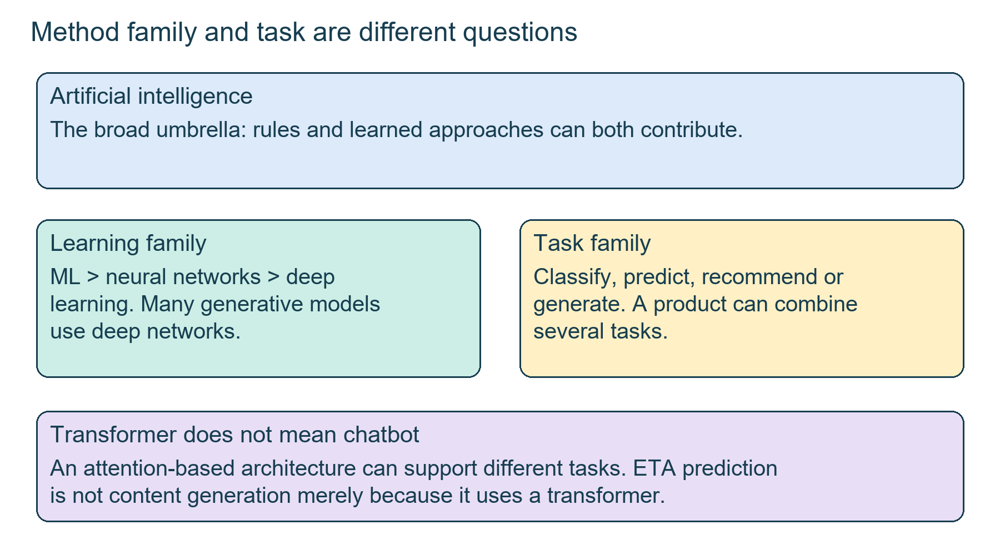
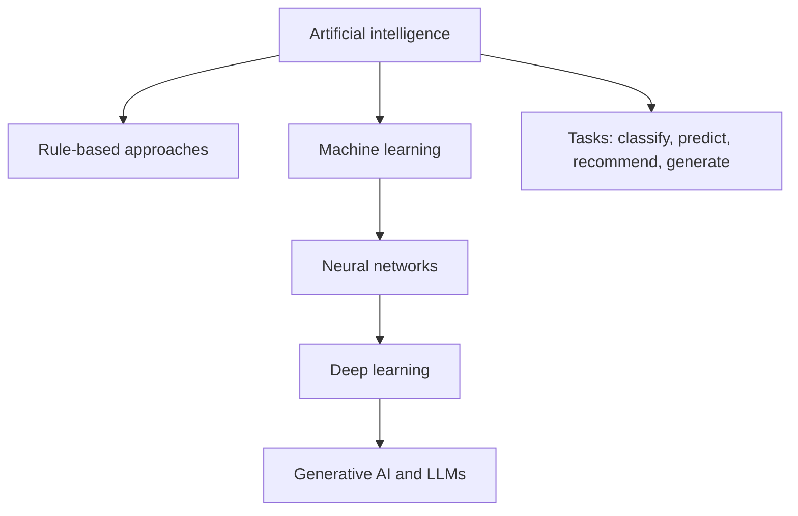
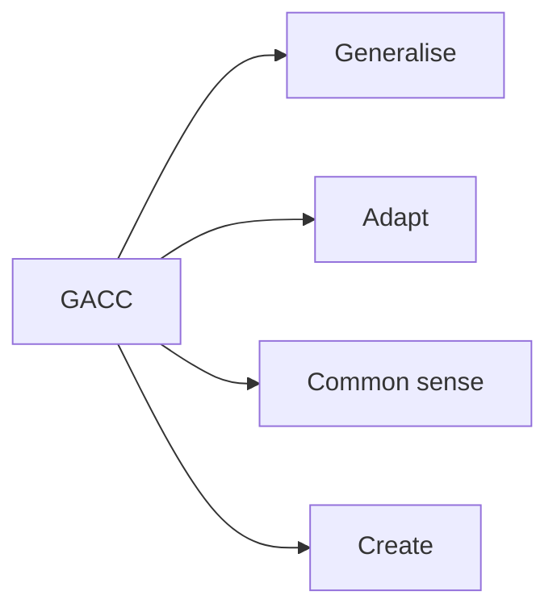
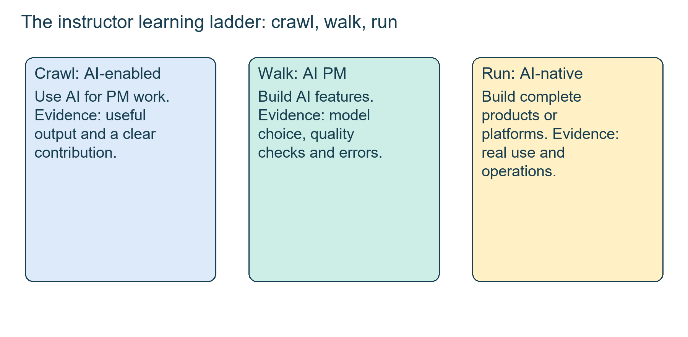
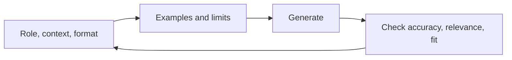
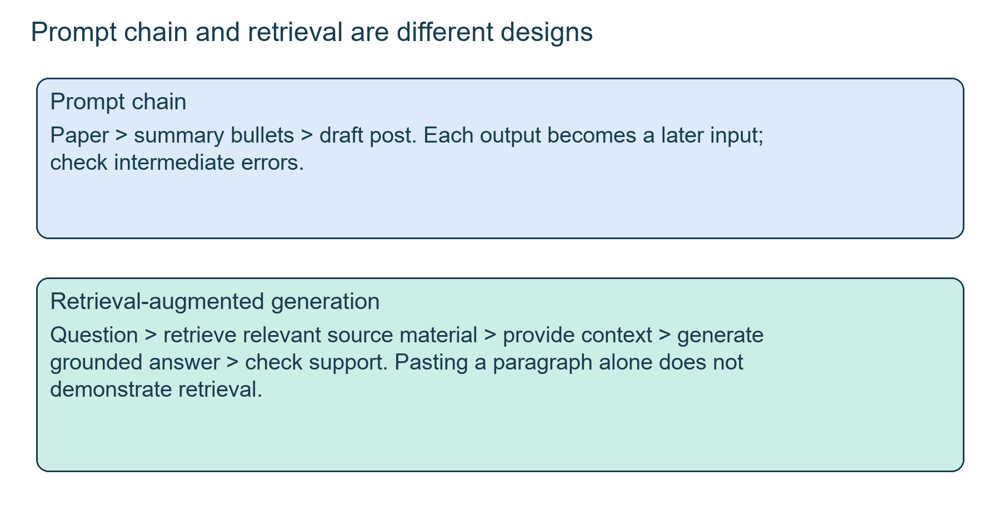

# Class 23: AI foundations for product managers

28 September 2026 · Arun Nandewal · replacement lecture, the PDF in the folder is named "Class 24 - Re-imagining products with an AI Lens"

This class is on the Module 4 exam (31 Oct 2026). Material marked "in the slides, not taught live" is still in the exam syllabus.

## The class in one minute

- Start with the user problem and compare simpler options before choosing a large model. Quality, cost and effort go together.
- AI is a broad umbrella: rules, machine learning, deep learning and generative AI are different things, and many useful AI features do not generate anything.
- Using AI for PM work, building an AI feature and building a whole AI product are three different levels of experience, and each needs its own evidence.
- AI features need evaluation: expected answers, traces and error analysis, not just a fluent output.
- In the slides, not taught live: structured prompts (including Role, Context, Format), prompt chaining, retrieval and a quality gate before you trust an answer.

## Core ideas

### Problem first, then the method (Uber ETA and the milk analogy)

The case was Uber's ETA, the estimated time of arrival for a ride or delivery. A small error breaks the promise made to the customer. The class said Uber compared several model architectures and picked a transformer (an architecture built on attention, covered in Class 20). The article was not in the folder, and the transcript wavered between seven and ten options, so treat it as a classroom case with no accuracy figures.

The lesson: a PM compares options against the problem and does not name the fashionable model. The instructor's analogy: you give someone ₹50 to buy milk. Buying milk solves the agreed problem. Buying snacks or an iPhone goes far past it. In AI terms, ask in order: can plain rules solve this? If not, can a learned model? Is deeper learning needed? Is generation actually required? Building a foundation model from scratch is a very different effort from calling an existing model through an API. The instructor also suggested reading one official company engineering blog a week (Uber, Meta, Netflix, Google and others) to see how teams reason.

**Remember:** a PM needs a reason for extra complexity, not just access to it.

### AI, machine learning, deep learning and LLMs

This is a core exam point, so keep the nesting clear.

- **Artificial intelligence (AI):** the broad field of machines doing tasks that normally need human intelligence. It includes simple rule-based systems, such as a phone menu that says "press 1 for balance".
- **Machine learning (ML):** a part of AI where a system learns patterns from data instead of following only hand-written rules.
- **Neural network:** an ML model made of connected units.
- **Deep learning:** neural networks with many layers.
- **Generative AI:** models that create new content (text, images, audio, code). Most use deep learning.
- **Large language model (LLM):** a deep-learning model trained on huge amounts of text to predict and produce language. ChatGPT, Claude, Gemini and Llama are LLMs. An LLM is generative AI for text; not every image or video model is an LLM.

The class's rough timeline gave rule-based AI as prominent in the 1970s–90s, ML in the 1990s–2004, deep learning in 2004–2018 and generative AI from 2019. That is about which idea was most prominent, not strict start dates, and old methods did not disappear.

*Method family and task type are related questions, but they are not the same label.*

The instructor corrected a common mistake: Uber using a transformer does not make ETA generative AI. ETA is a prediction task. Transformers can also classify, predict and recommend. Other task families in class: spam or not-spam (classification), product recommendations, fraud detection and e-KYC (recognition), reading a number plate with OCR (optical character recognition, which pulls text out of an image), and chat or image generation. One product often mixes rules, learned models and generation.

Two learning styles came up. **Supervised learning** uses examples with correct labels, such as a picture tagged "bird". **Unsupervised learning** finds patterns without labels. A movie-review exercise labelled reviews negative, positive or neutral, and a question about sarcasm showed why you test hard examples. The live description of sentiment as both "generative" and "unsupervised" was loose: the task, the training method and the architecture are three separate questions.

**Remember:** name the input, the task and the required output before attaching a technology label.

### Human-like answers versus general intelligence

The Turing test idea (Alan Turing, 1950): if an examiner talking in plain language cannot tell the machine from a person, the machine shows human-like performance. The exam-room version in class was only an analogy. **Artificial general intelligence (AGI)** is a hypothetical, broadly human-level capability. The instructor grouped its qualities as **GACC**: generalisation, adaptability, common-sense reasoning and creativity. Being good at physics does not guarantee being good at chemistry, which is the point about generalisation.

A **benchmark** is a fixed set of tasks plus a scoring method. A high score on translation does not show a model is best at coding or at your business task. The class tried an ARC puzzle (a grid game that tests inferring unfamiliar rules). The group did not solve it, and that proves nothing about intelligence.

**Remember:** doing well on one narrow task and having broad, adaptable ability are different claims.

### Three levels of AI product work

The instructor read AI PM job descriptions on LinkedIn and pulled out keywords: fine-tuning, LLMs, multi-agent systems, proofs of concept, requirements, prototypes. Many "AI PM" roles still contained ordinary PM duties. His learning ladder:

- **Crawl, AI-enabled PM:** uses AI for normal PM work, such as prototypes in Lovable or Replit, meeting summaries, personas, planning.
- **Walk, AI PM:** builds AI features, picks a suitable model, understands guardrails and evaluation, and can explain why generative AI was used. A **golden set** is a curated list of typical inputs with acceptable answers. A **trace** records what happened in an AI run so failures can be investigated.
- **Run, AI-native PM:** works on foundation models, platforms or full deployed AI products.

This is an informal learning model, not a hiring standard. Deploying an app does not mean you trained its model. Salary and productivity claims in class were motivational anecdotes. Fintech teams can experiment freely, but a production launch needs additional checks, and an experiment is not permission to deploy.

*Using a tool, building a feature and building a platform are different work.*

On the engineer-versus-PM split: the PM owns what to build and why, engineering owns how, including pipelines, tuning and deployment (MLOps). The PM still needs enough technical understanding to judge trade-offs. Evaluations got a separate promise: golden sets, metrics and evals will have their own class.

**Remember:** explain what you built, why AI helped, who used it and how you checked quality.

### Writing a prompt (in the slides, not taught live)

**Prompt writing** asks for one response. **Prompt engineering** designs reusable instructions with inputs, limits and fallbacks, and tests them. The deck's stack TCEPFT lists Task, Context, Exemplar, Persona, Format and Tone, where only Task is mandatory. A simpler shape for exam answers is **Role, Context, Format**: tell the model who it should act as, give the background it needs, and say what the output should look like.

A fair example: "You are a credit analyst (role). The applicant is salaried, income ₹60,000 a month, existing EMIs ₹12,000 (context). Give three bullet points on repayment risk, then a one-line recommendation (format)." Without the context and format, you get a generic essay.

The deck also listed another checklist called CLARITY (Context, Language, Action, Rules, Input, Target output, Yield iterations). It attributed that to OpenAI with no source, so do not claim that origin.

More deck ideas. **Zero-shot** gives the task with no examples and **few-shot** gives two to five examples of the pattern. **Prompt chaining** feeds one output into the next prompt (summarise a paper into five bullets, then write a post from them), so check the middle step. **ReAct** mixes reasoning with a tool call. **RAG** (retrieval-augmented generation) brings in outside documents to ground the answer; pasting text into the prompt is context, but a full RAG system also has to find the right content. **RLHF** is a training method, not a prompting trick. The closing quality gate: check accuracy, relevance and fitness for the audience.

*A chain links outputs. Retrieval finds source text first.*

**Remember:** pick the technique that fixes a specific failure, and still review the output.

## Worked example

Take the Uber ETA case through the approach-selection card.

1. User problem: the rider needs an arrival time that matches reality.
2. Current failure: ETAs are sometimes wrong (the class gave no baseline number).
3. Simple option: could rules or averages by route and hour do it? Test this first.
4. Learned options: several neural architectures; the class said a transformer won, but gave no result table.
5. Is generation needed? No. ETA is a prediction, so the transformer does not make it generative AI.
6. Trade-offs: accuracy, latency, cost, effort.

**Applied to car loans.** A lender wants to speed up credit approvals. Document check: rules and OCR may be enough. Estimating default risk: a learned scoring model on past loans. Drafting the credit appraisal memo: generative AI with a credit officer reviewing. Each uses a different method, and only the last one generates text. Before any of them goes live, a golden set of past cases with known correct outcomes lets you measure errors instead of trusting a fluent answer.

## Frameworks to reuse

| Tool | Blank form |
|---|---|
| Approach card | User problem ___ · current failure ___ · simple option ___ · learned options ___ · generation needed? ___ · trade-offs ___ · evidence and decision ___ |
| AI task map | Example ___ · input ___ · task (classify, predict, recommend, generate) ___ · method family ___ · what to check ___ |
| Prompt brief | Role ___ · Context ___ · Format ___ (+ Task, Example, Tone if needed) |
| Golden set | Typical request ___ · expected answer or rule ___ · unacceptable behaviour ___ · trace ___ · change to test ___ |
| Crawl/walk/run | Crawl evidence ___ → Walk evidence ___ → Run evidence ___ |

## Self-test

1. Put these in order from widest to narrowest: deep learning, AI, machine learning, LLM.
2. Does Uber using a transformer for ETA make ETA generative AI?
3. What do the letters in Role, Context, Format ask you to supply?
4. What is a golden set used for?
5. What is the difference between prompt chaining and RAG?

### Answers

1. AI, machine learning, deep learning, LLM.
2. No. ETA is a prediction task. Transformers can classify, predict or recommend as well as generate.
3. Who the model should act as, the background it needs, and the shape of the output.
4. To test an AI feature against representative inputs and acceptable answers, so errors can be counted and inspected.
5. A chain passes one prompt's output to the next. RAG retrieves outside source text to ground the answer.

## Homework from this class

Sameer's to do. These are not done for you.

- Expand the AI-industry table with more fields, such as healthcare or ecommerce. Identify familiar applications and map each to its task family. Build your own mind map, using an assistant to help but checking the categories.
- Collect job descriptions from companies you want to work for. Pull out AI skill keywords, compare them with the course roadmap, and raise missing topics with the instructors.
- Create a personal crawl, walk, run plan and update it as you build skills. Suggested evidence: a small public prompt or skill library, prototypes, GitHub work and a useful end-to-end project.
- Play the ARC task, find the solution and share a screenshot. Tagging the instructor on LinkedIn was a suggestion only.
- Read at least one official company blog each week.
- Slides extension: practise prompts across the eight content types and six methods. No deadline was given.
