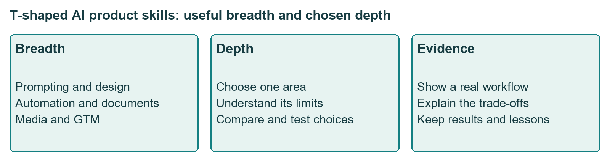
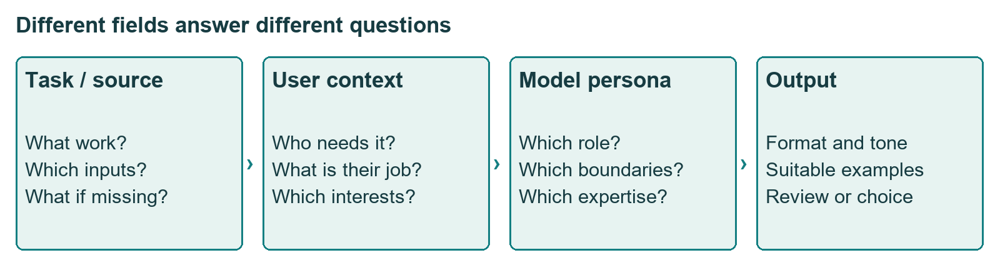
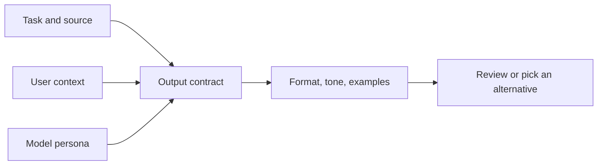
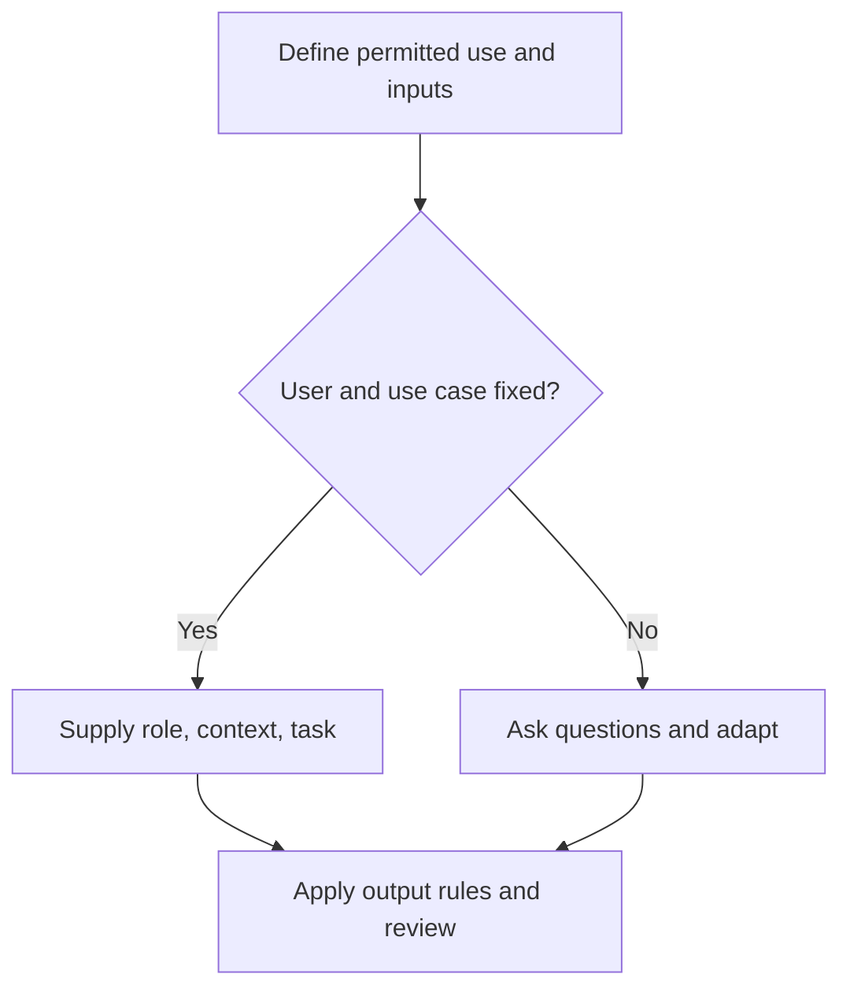

# Class 24: Re-imagining products with an AI lens (prompt engineering)

2 October 2026 · Arun Nandewal · workshop "Re-imagining Products with an AI Lens". The teaching was mostly about reusable prompts.

This class is on the Module 4 exam (31 Oct 2026). Some exam points were only touched here or sit in the slides. They are marked, and the gaps are named honestly.

## The class in one minute

- Build breadth across useful AI work (prompting, design, automation, documentation, media, go-to-market) and depth in one area.
- A reusable prompt names the task, the user's context, the model's persona, the output format and the tone. Examples are optional.
- Fixed prompting suits a known user and use case under admin control. Dynamic prompting asks about the user and adapts within allowed limits.
- The TechCrunch exercise turned a vague request into a checkable one: a named source, a stop rule if the source cannot be read, "new since my last read", relevance, and three output sections.
- Text inside a document can carry hidden instructions. Read the source and check the output instead of passing it blindly to AI.

## Core ideas

### Breadth plus depth (the T-shape)

Breadth means knowing a useful method and one or two tools in each area: prompting, design and prototyping, automation (n8n, Make, Zapier), documentation, image, video and audio, go-to-market, and model basics such as tokens and cost. Depth means understanding one area well enough to discuss its limits, alternatives and evidence. The instructor's own depth is evaluations, model cost, token optimisation and speed. Other options he gave: end-to-end AI development environments, or model foundations. This is a dated teaching opinion, not a ranking of job demand.

He also told the story of a selection exercise whose documents contained three hidden prompt-injection checks. Submitting the AI's output without reading the document led to rejection. That is his account, and the documents are not in the folder.

*The bar is practical breadth, and the stem is depth in one area.*

**Remember:** breadth helps you spot opportunities, and depth lets you defend a product decision.

### The prompt canvas: task, context, example, persona, format, tone

Prompt writing solves one request. Prompt engineering designs something reusable, aiming at reliability, use across people and tools, fit with the business job and review as models change. The class built one prompt in fields.

- **Task:** read TechCrunch. If the latest material cannot be accessed, stop and say so. Select items new since the user's last read.
- **Context:** who the end user is. The example was a PM working on Microsoft M365 Excel with about ten years of experience who wants daily AI news.
- **Persona:** the role the model plays, here an AI and PM trainer.
- **Format:** per article, what is happening (two to four lines), why you should care (two or three bullets), where to learn more (at most two links).
- **Tone:** formal, professional, witty, or playful.
- **Example:** a sample of a preferred summary. The class put in placeholders only, and advice on examples conflicted (one claim said newer models discourage them, then the session added them). Treat examples as a design choice to test.
- **Yield iteration:** ask for alternatives, such as a senior-PM version and an aspiring-PM version, and choose.

Context and persona are different. Context says who needs the work. Persona says which role the model takes. The instructor caught a mix-up where material was pasted in the wrong place. A prompt cannot create inputs that do not exist: a "last read" marker or browsing history must actually be available or be asked for.

*Persona describes the model's role, and context describes the user.*

Frameworks named in class included TCEPFT, CO-STAR and CLARITY. The simple exam form Role, Context, Format maps onto three of these fields: Persona, Context and Format. Do not assume who invented CLARITY; the slide attribution was unsourced. Also read each provider's own prompting guide when you use a new model.

**Remember:** a framework is a checklist for thinking, not proof that a prompt suits every model.

### Fixed versus dynamic prompting

**Fixed** prompting defines the user, use case, role and task up front, and suits a protected setting with admin rules, for example a campus or company policy. **Dynamic** prompting asks who the user is and how the output will help, then adapts, and suits exploration such as a designer making a social campaign. Adaptation never overrides organisational controls, and it cannot read history or data that the tool does not have.

The class sketched where a prompt sits in a product: user prompt plus admin guardrails go to the model, the output is checked, and evaluations run before the user sees it. This was a simplified map, and fuller lessons on guardrails, tuning and evals were promised. Four evaluation methods were named: rule-based, model-as-judge, human and metric-based.

**Remember:** a good prompt is one part of the workflow and does not replace guardrails or evaluation.

### Hidden instructions in documents

A question about prompt length led to a demonstration. The instructor added a line telling the model to ignore the task and reply with something irrelevant. He tried it in Claude, which flagged the embedded instruction. He also turned the text white to make it hard to see, and mentioned headers, footers and hyperlinks as other hiding places. One run does not prove every model is safe. The point: text in a source is material to analyse, not an order to follow. Check the source for odd instructions and check the output against the original task.

**Remember:** treat document text as data and review the result before relying on it.

### Competitor and industry research with AI (and checking it)

The class showed how to specify a research prompt. Ask for comparisons, trends, opportunities, risks, technology changes, regions, consumer behaviour, SWOT (strengths, weaknesses, opportunities, threats) and differentiators. The class also pointed out that naming a framework does not supply evidence for the claims in it.

Your accuracy checks come from the TechCrunch lesson. Name the sources you want used. Tell the model to stop and say so if it cannot read them, so it does not fill the gap from old knowledge. Ask for links, then open them and confirm they support each statement. Mark every figure as sourced or unsourced. Keep your own judgement in the final write-up.

**Remember:** a model's competitor summary is a lead list to verify, not a finished analysis.

### Finding AI opportunities in a product you already have

This class gave the method in practice. The instructor asked students to list three real, specific tasks that would help themselves and others if automated. "Reports" was too vague. "Meeting minutes", "a long email thread", "a monthly store action plan from MIS data" were specific. To judge whether an idea is realistic, borrow the Class 23 approach card:

1. Is the task specific enough to tell if it was done?
2. Could simple rules solve it?
3. Is generation really needed, or is it classification or prediction?
4. Do the required inputs (data, history, permissions) exist?
5. What happens when the input is missing? (the stop rule)
6. Who reviews the output, and how will you measure it?

I built this checklist from Class 24 and Class 23. The folder does not contain a separate lesson on "opportunity finding", so compare it with your slides.

**Remember:** an idea is realistic only if the inputs exist, the failure case is handled and someone can check the output.

### Build, buy or fine-tune (what the folder gives)

Class 24 did not teach this. For the exam, the earlier material is: fine-tuning adapts an existing model with task examples (Class 21 deck); RAG adds your documents at run time without changing the model; prompts and settings steer one response only. Class 25 covers the cost side, so use it for the comparison.

## Worked example

The TechCrunch prompt, consolidated from the class fields (a reconstruction, not a tested finished prompt):

"Read the latest material at TechCrunch. If you cannot access it, stop and say so. Select items new since my last read and skip those already read. Establish who I am and how this helps me, or use the context I give. Act as an AI and PM trainer within company guidelines. For each article give: what is happening (2–4 lines), why I should care (2–3 bullets), at most two resources to learn more. Use a professional tone. Offer a senior-PM and an aspiring-PM version so I can choose."

Open checks remain: the source must be readable, the last-read point must be known, and each cited resource must support the summary.

**Applied to car loans.** A branch team wants a weekly note on competitor car-loan offers. The vague ask is "summarise competitor rates". The better version names the lender sites to read, stops if any page cannot be opened, lists only changes since last week, gives rate, tenure and processing fee with a link for each, and flags anything unsourced. A person then checks three links before the note is circulated.

## Frameworks to reuse

| Tool | Blank form |
|---|---|
| Prompt canvas | Task ___ (+ stop rule ___) · Context ___ · Example ___ · Persona ___ · Format ___ · Tone ___ · Alternatives ___ |
| Fixed or dynamic | User known? ___ · what stays fixed ___ · what may adapt ___ · inputs available ___ · question to ask first ___ |
| Source check | Task ___ · suspicious content ___ · output matches task? ___ |
| Opportunity check | Specific task ___ · rules enough? ___ · generation needed? ___ · inputs exist? ___ · missing-input behaviour ___ · reviewer and measure ___ |
| Research check | Sources named ___ · links opened ___ · each claim supported? ___ · unsourced figures marked ___ |

## Self-test

1. What is the difference between context and persona in a prompt?
2. Why does the TechCrunch prompt include "if you cannot access it, stop"?
3. When would you choose fixed over dynamic prompting?
4. Why might a competitor summary from an AI tool be wrong, and what do you do about it?
5. What are two checks for whether an AI idea in an existing product is realistic?

### Answers

1. Context describes the end user and situation. Persona is the role the model plays.
2. It stops the model producing a plausible summary from old knowledge while implying live access.
3. When the user, use case and rules are known and controlled by an admin, such as a company or campus policy.
4. It may rely on old or unsourced information. Name the sources, ask for links, open them, and mark figures as sourced or not.
5. Any two of: the task is specific, the inputs exist, simple rules would not do, there is a stop rule for missing input, someone reviews the output.

## Homework from this class

Sameer's to do. These are not done for you.

- Pick three useful recurring tasks and build prompts for them (a library by the end; no graded deadline).
- Read the prompting guides shared in chat (a model guide, a basic prompting guide, a Gemini guide) and post your top five learnings. The exact URLs were not in the files, so get them from the class chat.
- Try the content categories, keep one or two outputs for each, and write an eight-to-ten-page account of your prompt-engineering experience. Include PM work such as a PRD and data analysis.
- Try ElevenLabs (or Murf AI if free access is not available) to make a voiceover from a story prompt and share what you learned.
- Repeat the Class 23 task: find examples of rule-based AI, ML, deep learning and generative AI.
- For the practical follow-up session, prepare the account the instructor asked for. The tool name and timing were unclear, so confirm them with the programme team.
