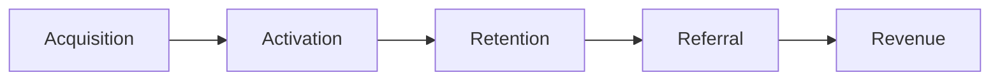
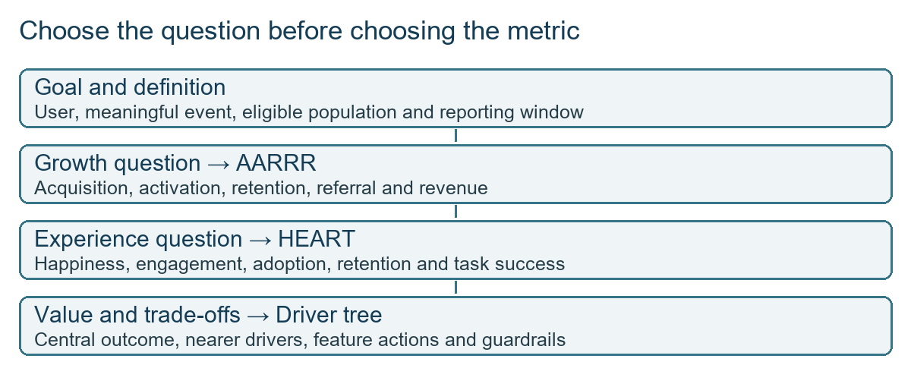
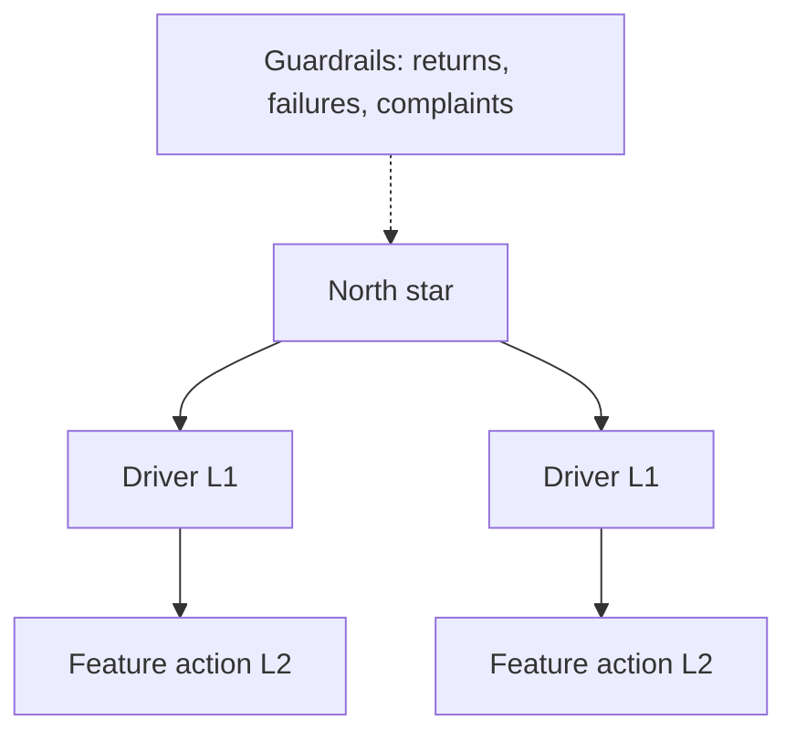
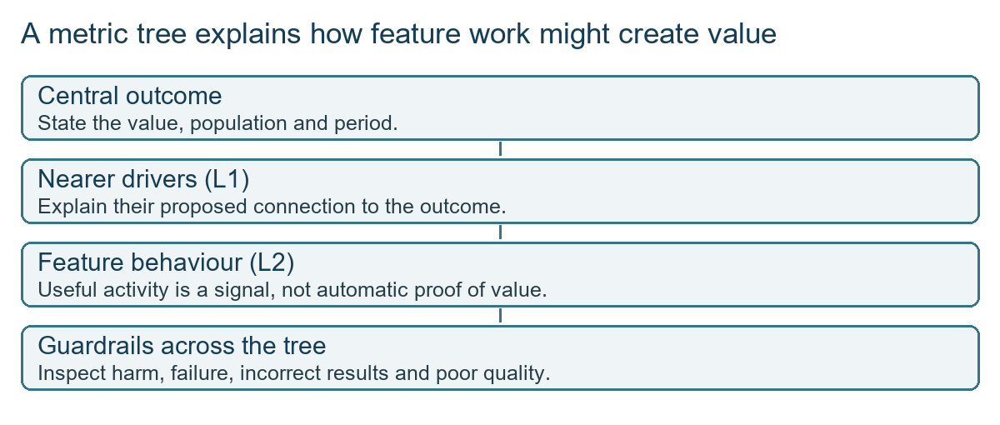
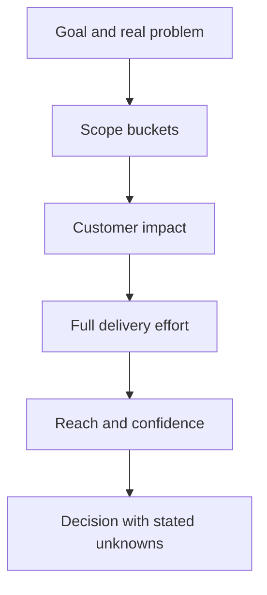
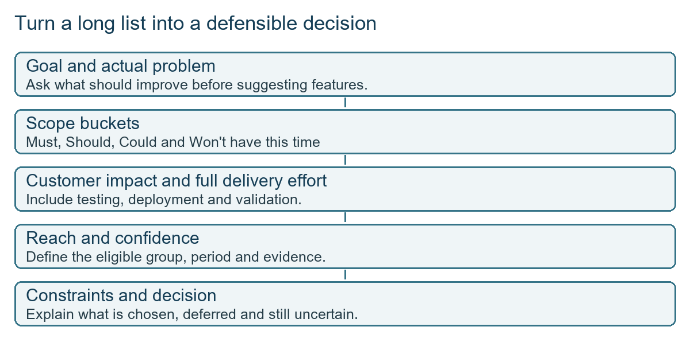
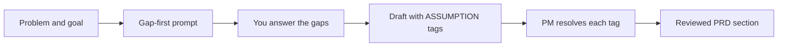

# Class 26: Metrics and prioritisation

9 Oct 2026 · Arun Nandewal · Portal title: "AI-Powered Ideation & PRD Drafting" (the class actually taught metrics and prioritisation; a short syllabus section on the portal topic is added near the end)

## The class in one minute

- Pick the business goal and the user behaviour first, then the metric. The same feature ranks differently under an adoption goal and a revenue goal.
- AARRR walks through growth (acquisition, activation, retention, referral, revenue). HEART looks at the experience (happiness, engagement, adoption, retention, task success).
- "Active" means a useful action inside a stated window. A visit, a purchase and a repeat customer are three different things.
- One main outcome (the north star) is linked to nearer drivers, feature-level measures and guardrails that catch harm.
- Prioritising gets sharper in steps: scope buckets, then impact against effort, then reach and confidence (RICE). Estimates stay assumptions, even inside a framework.

## Core ideas

### AARRR: the growth journey

AARRR (called Pirate Metrics) stands for acquisition, activation, retention, referral and revenue. The class applied it to Zepto. Acquisition is how people arrive: social campaigns, paid ads, word of mouth. Activation is the first action that shows real value, such as a first purchase, an add-to-cart or saving an item. Retention is coming back for a relevant action within a window (daily, weekly, monthly). Referral is one user bringing another, and revenue is order value, pass payments and renewals.

The activation examples were alternatives, not one combined event. Pick one, write down its trigger, then measure. Likewise a referral count and a referral conversion rate answer different questions.

*The framework organises your thinking. It does not hand you the business goal.*

**Remember:** write the exact event, population and window before you calculate anything.

### Active users and stickiness

DAU, WAU and MAU count distinct people with a qualifying event on a day, in a week and in a month. Someone active on a Tuesday is counted in Tuesday's DAU, that week's WAU and that month's MAU. They do not need to show up every day. One person placing four orders in a day is still one active user that day, so orders measure volume, not people.

Stickiness relates a short window to a longer one. The class example: 60 monthly users, 30 weekly users, 5 daily users. DAU/WAU is 5/30, about 16.7%, and WAU/MAU is 30/60, 50%. The 90% figure (27/30) was a hypothetical to show what a higher ratio looks like, not measured data. High stickiness does not prove revenue: free trials and short bursts of interest also bring people back.

**Remember:** count unique people per window, and keep return use separate from payment.

### HEART: measuring the experience

HEART is Happiness, Engagement, Adoption, Retention and Task success. Happiness covers satisfaction (NPS, CSAT). Engagement is frequency and depth of use. Adoption is new users or new feature use. Retention is continued use. Task success is finishing the intended job correctly.

The Google Pay example made it concrete: rate a completed payment (happiness), transactions per user per week and the mix of payment types (engagement), new users trying a feature (adoption), repeat rent or bill payments (retention), and attempted versus successful versus confirmed-received payments (task success). A sent request is not a completed payment. The feature names in class were examples, not a verified product list.

Two satisfaction measures were on the slide. NPS (Net Promoter Score) is the percentage of promoters minus the percentage of detractors. The pictured counts were 212 promoters, 93 passives and 40 detractors out of 345, which gives about 50. Passives stay in the denominator. CSAT is satisfied responses divided by total responses, where the example counted scores of 4 and 5 as satisfied.

**Remember:** a longer session is not automatically better. For a task meant to be fast, shorter can be the win.

### North star, drivers and guardrails

The north star is the one central outcome that represents value. L1 metrics are the nearer drivers. L2 metrics are specific feature actions. Counter-metrics (guardrails) expose harm: returns, refunds, cancellations, negative reviews, abandoned chats, latency.

The live Amazon example used order value per user (average order value times orders per user), with cart conversion and purchase frequency as drivers and wishlist or save-for-later as a feature action. Per-user value is not total revenue; say which one you mean. The slides and the live session sometimes chose different north stars for the same company, and placed wishlists at different levels. These are classroom models, not official company metrics. What matters is that you can explain the mechanism behind each arrow.

*Feature activity matters when its link to value is understood; guardrails stop the main number hiding harm.*

**Remember:** a metric tree needs a stated mechanism, not just neat arrows.

### Prioritising: goal, scope, impact, reach

The prioritisation half used a WhatsApp-for-children exercise. The instructor stopped students who jumped to features ("child-friendly UI", "privacy settings") without naming the user problem or the goal. He then switched the goal between adoption, task completion, revenue and chat engagement to show that the ranking changes. The table used chat engagement.

MoSCoW sorts items into Must, Should, Could and Won't have this time (excluded from the current delivery, not banned forever). When nearly everything landed in Must, the instructor asked how an engineer would feel receiving that list. It is not a plan.

Next came impact (high, medium, low) against engineering effort (small within two weeks, medium within a month, large one to three months, extra large about six months). He challenged the small estimates: do they include testing, deployment and validation? Low-impact rows were then dropped from the next table. Finally RICE added Reach and Confidence. He challenged any 100% reach claim, since not every registered user touches a feature.

*The goal stays in view while the evidence and effort become more explicit.*

**Remember:** ask for the goal before you rank a single feature.

### Kano, and which method to use

Kano sorts features into basic expectations (missing them annoys), performance attributes (more is better) and delighters (pleasant surprise). The airline example: luggage safety is a basic, seat quality is performance, extra legroom might delight. The instructor advised against Kano in interviews because digital-product categories are hard to defend. His rule of thumb: MoSCoW when you must answer briefly, impact/effort plus RICE when you have room to explain. That is interview advice, not proof Kano is invalid, and a need such as accessibility should never be filed as a delighter.

**Remember:** the right method is the one you can defend in the time you have.

## Worked example

The class table for the children's messaging exercise (group estimates, not user research):

| Candidate | Reach | Impact | Effort | Confidence |
|---|---:|---|---|---:|
| Finding contacts | 40% | Medium | Small | 25% |
| Web login | 10% | High | Small | 20% |
| Attaching PDFs | 20% | High | Small | 30% |
| Safety and parental controls | 80% | High | Medium | 80% |
| Child-friendly UI | 80% | Medium | Large | 90% |
| Sensitive-information leakage work | 10% | High | Extra large | 60% |
| Reporting and blocking spam | 20% | High | Medium | 40% |

Web login and PDFs both have high impact and small effort, but PDFs show slightly higher reach and confidence, so they look stronger under these assumptions. The class never computed a RICE score. The standard formula is Reach × Impact × Confidence ÷ Effort, but it needs an agreed numeric rubric for "High" and "Small" first. Inventing numbers would make a precise-looking ranking out of guesses.

**Applied to car loans:** suppose the goal is more completed new-car loan applications. Reach would be the share of applicants who actually hit a feature in a month (say, uploading salary slips), confidence is how much evidence you have from credit officers or dealers, and effort must include testing and deployment, not just coding. "Instant EMI calculator" and "dealer dashboard" are solutions. The problem might be that applicants abandon at the document step. Name that first.

## Frameworks to reuse

Metric contract (fill before measuring):

| Field | Your answer |
|---|---|
| Goal | |
| User or population | |
| Success event | |
| Denominator | |
| Window | |
| Guardrails | |
| Owner and data check | |

Prioritisation worksheet columns: goal · problem and evidence · proposed response · scope bucket · customer impact · full effort · reach (population, window) · confidence (evidence) · constraint · decision and reason.

## Syllabus topic, not taught live: using AI for ideation and PRD drafting

The portal title for this session was "AI-Powered Ideation & PRD Drafting". The recording did not teach it, but it is on your Module 4 syllabus, so here is the working method.

**Brainstorming features and edge cases.** Give the AI the user, the problem and the goal, then ask it to widen your list: more feature ideas, plus edge cases (what if the applicant has two PAN entries, the bureau times out, the dealer enters the wrong price). Treat every output as a list of hypotheses. Remove anything that is a solution in disguise and anything you cannot tie to the goal.

**Drafting PRD sections, then reviewing.** Use two passes:

1. Gap-first prompt: "Here is my problem statement and goal. Before drafting, list what information is missing, what you would need to know, and which questions I should answer."
2. Draft prompt: "Now draft the section. Mark every guess with [ASSUMPTION] instead of stating it as fact."

Your job is then to resolve each [ASSUMPTION] tag with evidence, delete what you cannot support, and check numbers and names. The AI drafts; the PM owns the content.

## Self-test

1. Which framework has task success as one of its categories?
2. Why is a new account not automatically an activated user?
3. Does a person need to use the product every day to be counted in a given day's DAU?
4. Why do you add counter-metrics to a north star?
5. What must exist before you can calculate a numeric RICE score from the class table?

**Answers**

1. HEART.
2. Activation needs a defined meaningful action, not just sign-up.
3. No. They need the qualifying event on that day only.
4. They expose harm, failure or side effects that the main number can hide.
5. A numeric rubric for impact and effort, consistent units, a defined reach population and window, and evidence behind the estimates.

## Homework from this class

Sameer's to do. These are not done for you.

- Use AARRR, HEART and the north-star/driver/guardrail structure on products you know. Make readable study images with AI, keep your prompts and corrections, and practise explaining the measures as you would in an interview.
- Write success metrics for Google Maps.
- Write a north star, L1, L2 and counter-metrics for Airbnb, Gmail and Spotify.
- Do a similar metrics and AARRR exercise for Claude and ChatGPT.
- RCA prompt: the number of Tinder downloads has declined. Investigate it. No data, deadline or marking rubric was given, and no cause should be assumed.
- When answering: define the product, target group, meaningful outcome, population and window first; then candidate measures and guardrails. For prioritisation, state the goal and problem before listing solutions.
