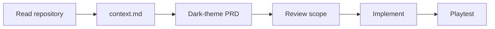
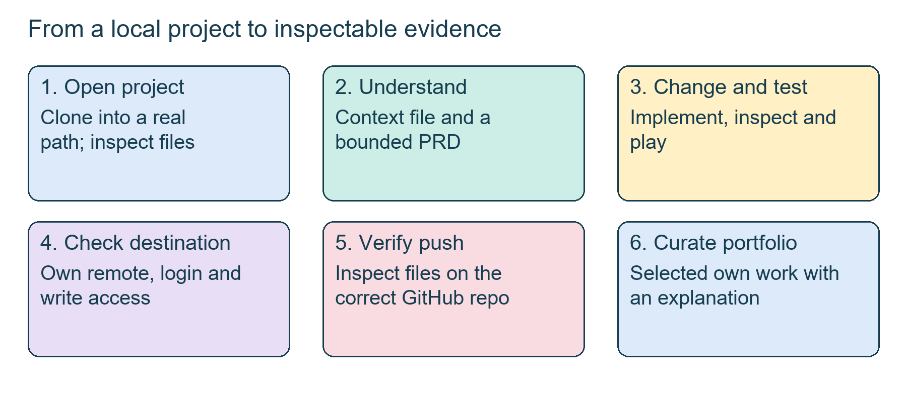
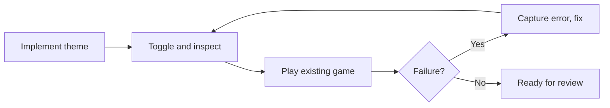
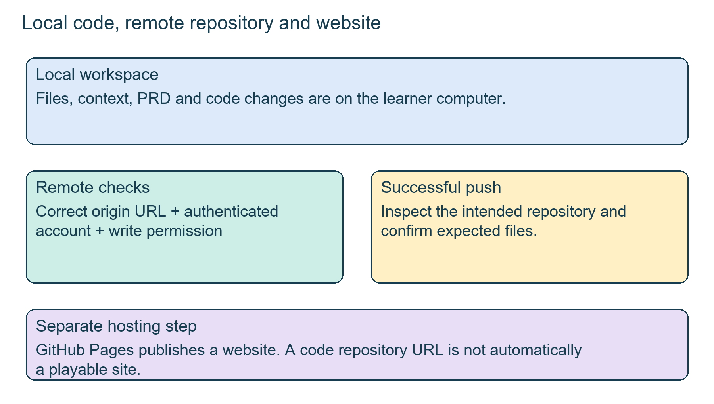
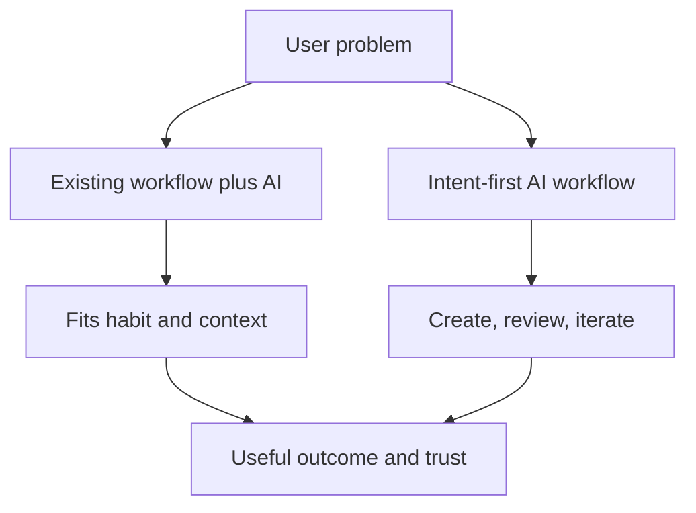
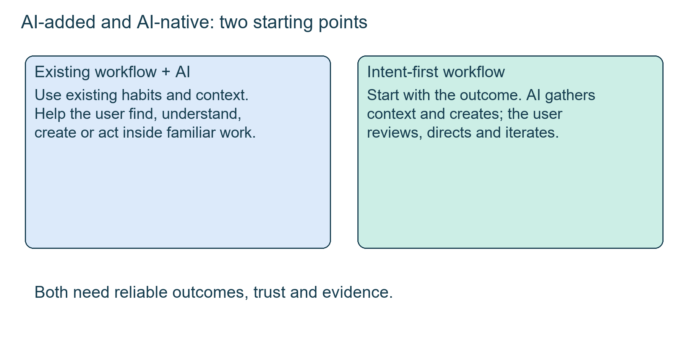

# Class 27: GitHub Copilot, and Slack AI vs Microsoft Copilot

12 Oct 2026 · Arun Nandewal · Portal title: "AI Product Teardown: Slack AI vs. Microsoft Copilot" (the live class was a hands-on VS Code and GitHub Copilot session; the Slack and Microsoft comparison is in the slides only)

## The class in one minute

- A repository (repo) is the project; a clone is your local copy. Open the actual project folder in VS Code before asking an agent to touch it.
- The live workflow: clone, write a context file, write a dark-theme PRD, implement, playtest, then push to your own repository.
- Copilot's Ask, Edit and Agent modes do different jobs. Chat that explains is not the same as an agent that changes files.
- A game working on your laptop does not prove the push worked, and code on GitHub is not a published website.
- A portfolio shows your own work with a README. The class deliberately left out private material and instructor content.

## Core ideas

### The workbench, the repo and the three modes

Visual Studio Code (VS Code) is a code editor that brings files, a terminal and tools into one window. An IDE (integrated development environment) is that kind of workspace. GitHub Copilot Chat is the assistant inside it. A first greeting that gets a reply only proves chat is available, not that file actions or Git are set up.

A repository holds a project's code, images and documents, and Git keeps its history. GitHub is the remote service where that history is stored and shared. Cloning copies a repo to your machine.

| Mode | Use | What to check |
|---|---|---|
| Ask | Explain code, answer questions | A text answer may change nothing |
| Edit | A specified change to chosen code or text | Does the change match the scope? |
| Agent | A multi-step goal using tools and files | Actions, permissions, files, test evidence |

In class, Copilot kept printing a clone command instead of running it. The fix was switching from Ask to Agent mode. Mode labels can vary by version; these are the class's labels.

**Remember:** match the mode to the action, then check what happened outside the chat reply.

### Context first, then a PRD, then code

The class played the existing memory game (a front-end page in HTML, CSS and JavaScript, opened straight in a browser, no server) before changing anything. That gave a baseline to judge later changes against.

Prompts went in one at a time. First, ask for a `context.md` explaining what the repo does (Markdown is plain text with light formatting, and "Open Preview" shows it formatted). Second, ask for a PRD for a dark theme that keeps current behaviour. Third, only after reviewing, ask for implementation. One learner got a reply saying the requirements were documented but the game was unchanged. That is not a failure: the PRD task finished and the build task had not been asked for yet.

*A generated document, a working local file and a successful push are three separate outcomes.*

**Remember:** context describes what exists, the PRD defines the change, and implementation creates it.

### Test it yourself, not just the agent's word

After the dark-theme build, learners opened the game, flipped the toggle and played. The agent also drove a browser to toggle themes; the instructor called this Playwright MCP. Extra context, not from class: Playwright is a browser-automation tool, and Playwright MCP is the server that lets an agent use it, so the spoken line that Playwright is "not automation" was inaccurate. Either way, a passing toggle check proves only that check. Cards, matching, restart and timer still need your eyes.

When something breaks, a specific report beats "it does not work". One learner said a word in a word game failed ("rabbit" was mentioned) and could not reproduce it live. The instructor's advice: take a screenshot when it happens and describe the exact case to the agent, then retest.

**Remember:** record what you did, what you expected and what actually happened.

### Pushing to your own remote

Everything so far lived on the learner's laptop. To share it, learners created a new GitHub repo (name, description, visibility), copied its URL and asked the agent to push there. Creating an empty repo uploads nothing; a push sends local commits to a remote.

Much of the class went on one failure. A clone still pointed at the instructor's repo (the "origin"), so pushes were denied even after sign-in, and GitHub offered a fork that the instructor declined. A Copilot chat login did not prove Git had valid credentials, and a GitHub device-login code had to be completed in the browser. The class mentioned `git push -u origin main`, which pushes the local main branch and sets tracking; it cannot fix a wrong origin or missing permission. The final working commands were not saved, so none are invented here.

*The upstream clone and your own repo are different addresses. A login does not make the wrong destination correct.*

**Remember:** read the remote named in the error message. A push command is not proof of a completed push.

### Portfolio and the second game

The class then asked the agent to understand the whole weekly-work folder, write a context file and README, and filter personal or private items before pushing to a separate portfolio repo. The agent found private conversations, personal information, datasets and class material, and the first push contained only scaffolding, not every assignment. The instructor's point: a portfolio shows what you made, not class notes or his slides.

Learners also reused the process for a second game. Suggested options included Tic-Tac-Toe, Simon Says, Whack-a-Mole, Snake and Connect Four; one learner chose Snake. Snake needed iteration (speed, controls), and generating a file did not mean it was tested or published.

**Remember:** a portfolio is proof of your work, not a backup of everything you downloaded.

### In the slides, not taught live: Slack AI vs Microsoft 365 Copilot, AI-added vs AI-native

This was in the slides but not taught live. It is the portal's actual topic, so know it for the exam.

AI-added means an existing product gains assistance. Examples in the deck: Slack AI, Microsoft 365 Copilot, Notion AI, Canva's AI features. AI-native means AI is the core and the workflow is redesigned around intent, context, iteration and human review. Examples named: ChatGPT, Perplexity, Claude, Cursor.

| Dimension | AI-added | AI-native |
|---|---|---|
| Starting point | Existing workflow | User intent |
| Distribution and trust | Existing base helps | Must be earned |
| Interface | Fits current UI, legacy limits | Can redesign, must prove reliability |
| Habit | Extends current habit | May need a new one |
| Risk | Bolted-on AI, feature parity | Adoption and trust |

The deck's Slack story: Slack already holds a "work graph" of people, conversations, channels, files and projects. Its four verbs are find, understand, create and act. The screenshot showed catching up after two days with 347 unread messages through decisions, blockers and sources. The Microsoft story: context across Word, Excel, PowerPoint, Outlook, Teams, OneDrive and SharePoint, such as preparing for a leadership meeting from emails, calendar and documents. The numbers and mock customer details in these illustrations are examples, not measured results, and the deck did not verify current plans or features.

*Improving an existing habit and redesigning around intent are both choices, and both still need reliable, reviewable results.*

**Remember:** ask what work becomes easier for the user, not just where to add an AI button.

## Worked example

Dark theme as a reviewable product change, as it happened in class:

1. Clone the memory game and open the right folder. Play it once to see what "working" looks like.
2. Ask for a context file. Read it and check it names the real game file.
3. Ask for a dark-theme PRD that preserves behaviour. Save and preview it.
4. Ask separately for implementation. Confirm the code changed.
5. Open the game, toggle both ways, play, and look for unreadable cards.
6. Create your own repo, give the agent that URL, sign in, push, then open GitHub and inspect the files.

**Applied to car loans:** picture a small change to a loan-calculator page, say a clearer EMI display for the dealer. The same order applies: look at the current page, write what must stay the same, make one bounded change, test the old flow (entering amount, tenure, rate) again, and only share a demo with made-up numbers, never real customer or company data.

## Frameworks to reuse

| Item | Blank question | Class answer |
|---|---|---|
| Active folder | Which project does the agent see? | The actual memory-game folder |
| Mode | Ask, Edit or Agent? | Agent for clone and build |
| Remote | Where will the push go? | Your own repo, not the source |
| Bug card | Action, expected, actual, evidence | Word fails; screenshot on recurrence |
| Portfolio | Own work in, private and class material out | README plus selected artifacts |

Strategy card to copy: user outcome · existing workflow and assets · what AI changes · added help or redesign · context source · user review step · trust and reliability risks · evidence.

## Self-test

1. What is the difference between clone, commit and push?
2. An assistant only explains how to run a Git command and does not run it. Which mode should you check first?
3. A PRD file has been saved. What does that prove, and what does it not prove?
4. A push is denied and the error names the instructor's repo, though you are signed in. What do you check?
5. Give two differences between an AI-added product and an AI-native one, with one example of each.

**Answers**

1. Clone copies a repo locally, commit records changes in history, push sends commits to a remote.
2. Ask mode. Agent mode carries out multi-step actions.
3. It proves the requirements are documented. It does not prove the code is implemented, tested or deployed.
4. The origin or destination address, which Git account is authenticated, and whether that account has write permission. Point it at your own repo.
5. For example: AI-added starts from an existing workflow and keeps its habits and legacy UI (Slack AI, Microsoft 365 Copilot); AI-native starts from user intent and can redesign the workflow but must earn trust and distribution (ChatGPT, Claude, Cursor).

## Homework from this class

Sameer's to do. These are not done for you.

- Finish the memory-game sequence: context file, dark-theme PRD, implementation, playtest, and a successful push to the correct repository.
- Repeat the process with another childhood game: pick one from the generated options, write a PRD, build it, test it, push the working version. Fix controls or speed when you see problems.
- Build a weekly portfolio of the work you created and update it over time. Curate what becomes public.
- Bring unresolved issues to the next session. No submission deadline or rubric was given.
- Optional deck practice (not required): memory-game variants, Pac-Man PRD, GitHub Pages and Spark exercises.
