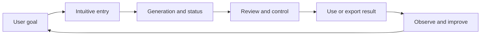
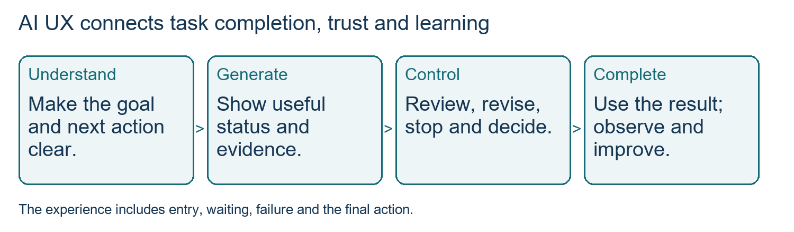
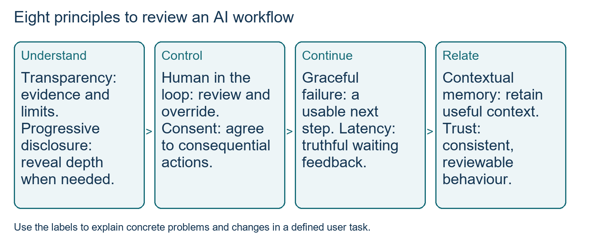
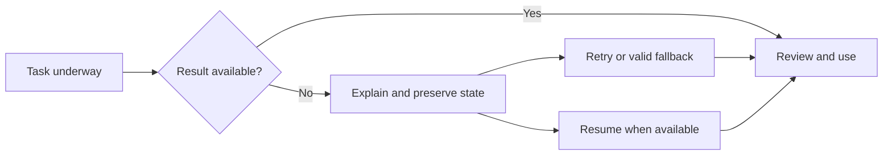
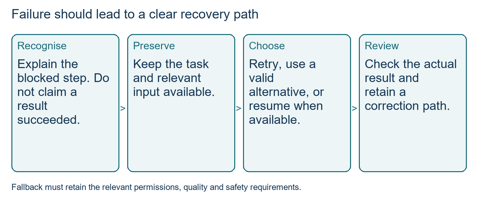
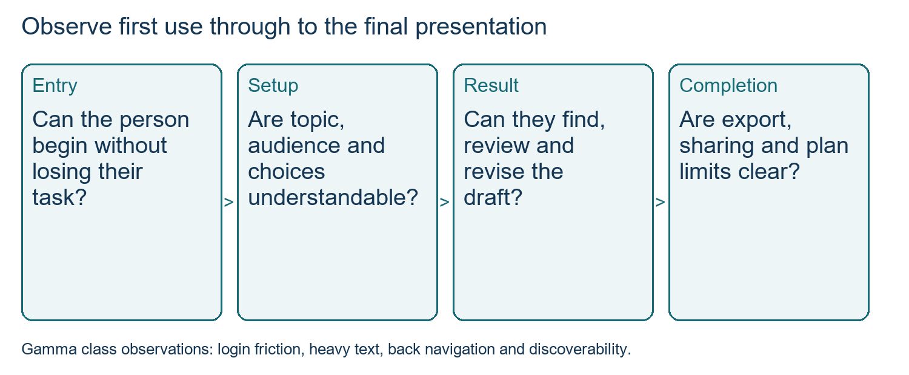

# Class 28: AI-driven UX and ethical AI interfaces

16 Oct 2026 · Arun Nandewal · Portal title: "AI-Driven UX Design & Ethical AI Interfaces"

## The class in one minute

- A strong AI model still needs a workflow people can understand, correct and control. Judge the experience from starting a task to using the result.
- AI output varies and takes time, so the interface must show real status, make correction easy, and let the user choose, undo and stop.
- The eight principles: transparency, human in the loop, progressive disclosure, graceful failure, latency management, permission and consent, contextual memory, trust through design.
- Intuitive means easy to work out; non-intrusive means it does not interrupt the task. A product can pass one and fail the other.
- In interviews, do not list prompts. Name a user, the point where the journey breaks, the evidence, and one outcome metric.

## Core ideas

### UI versus UX, and why it is a business problem

UI (user interface) is what you see and touch: colours, type, spacing, buttons, animations. UX (user experience) is how a person actually gets a task done, including understanding, effort, emotion and recovery. The class listed five UX dimensions: flow and navigation, emotions and trust (the user's mental model of what the product will do), speed of completing the task, onboarding and error recovery, and research and iteration.

The instructor tied UX to adoption with a funnel slide: 100% aware, 62% try it, 38% form a habit, 18% advocate. He also quoted roughly 44–45% abandoning after a poor first experience and a return of 100 dollars per dollar spent on UX, naming Forrester and NNG. The deck gave no study, sample or method behind these. Treat them as class claims, not benchmarks, and check the denominator before doing any arithmetic. The sound reasoning is qualitative: a bad first experience ends the journey before value appears.

*Design the whole task, keep the user in control, and learn from what you observe.*

**Remember:** tie UX to a defined journey and outcome, and never reuse a percentage without its base.

### Three ways AI changes the interface

First, output is probabilistic: the same request can give different answers. Users need a way to judge, correct and retry, but a "regenerate" button does not make the next answer right. Second, work takes time, so a truthful sense of progress matters. Third, conversation becomes the interface: people state intent instead of hunting for buttons. Even so, the class kept familiar controls. Coding tools show red and green changes with accept, reject and allow buttons so an AI action can be reviewed.

This is where "how AI changes interfaces" fits. Assistants can adapt what they show to the person's task and context, and can propose next actions or produce a view on request, as Napkin AI did when a text selection became an editable visual. The deck went further for devices: a proactive Maps that anticipates congestion or a rest stop, and an agent that notices a recurring gas-cylinder order and asks before placing the next one (the 28-day gap was an illustration). The class did not detail screens generated whole by AI; the logic it did teach is the same either way. Adaptation must stay inspectable and reversible, use data the user understands, and ask before consequential action.

**Remember:** variable output, waiting and intent-based input change the design problem, not the need for control.

### The eight principles

*Use all eight as review prompts for a workflow, then explain the highest-impact changes.*

| Principle | Plain meaning | Food-assistant example (study use) |
|---|---|---|
| Transparency | Show sources, limits and what the AI is doing | Show items and what is about to be submitted |
| Human in the loop | User can revise, override, stop | Edit the cart before ordering |
| Progressive disclosure | Essentials first, depth on request | Order summary first, coupon rules expandable |
| Graceful failure | Failed step explained, with a way forward | Keep the cart, explain the failed submit, offer retry |
| Latency management | Truthful status while waiting | Say the check is pending, not confirmed |
| Permission and consent | Ask before using data or acting | Ask before a paid order or refund request |
| Contextual memory | Remember what helps, under user control | Offer last order as editable context |
| Trust through design | Consistent, visible, reviewable | Same status, totals and correction paths every time |

Slide examples included Perplexity citations, editable Notion AI content, Copilot permission prompts and Claude's streamed answers; these are class illustrations, not verified for every version or plan. Do not mix up progressive disclosure (revealing detail gradually) with a progress percentage (latency management), which the lecture blurred in speech.

**Remember:** for each principle, name the user problem and the concrete behaviour, not just the label.

### Transparency, consent and ethics

The ethical thread runs through four of the eight principles. Transparency means evidence and limits are visible; a confidence percentage with no known basis is not trust. A readable list of steps or sources helps a user judge a result, but it should not be sold as a window into the model's private reasoning. Consent means asking before using data or taking a consequential action, and "non-intrusive" never means hiding that AI is involved or acting silently.

Two cautions came from the lecture. One is sycophancy, an AI agreeing with what the user wants to hear, so tone and personalisation must not replace truthfulness. The other is control over memory and context: say what is remembered, for how long, and let the user correct it. The deck's "mistakes" slide named cases such as hiding limitations, no error recovery and agentic actions without permission (an early AutoGPT example), as illustrations rather than independent research. Accessibility, including languages like Telugu, Tamil and Hindi and colour or hearing needs, was raised too, but WCAG was named without any detail.

**Remember:** useful help and user control belong together, and false precision or flattery is a design failure.

### Intuitive versus non-intrusive

An intuitive experience lets a first-time user work out the next step without hand-holding. A non-intrusive one supports the current task without needless interruptions, revealing depth gradually. A tool pushing dark-theme suggestions while you test your site is intrusive even if its buttons are clear. A login wall before any value hurts both. Necessary permissions are fine; the aim is to keep them understandable and low-disruption.

*Preserve work, explain the state and let the user choose a valid way forward.*

**Remember:** ask both "can the person understand this?" and "does this interrupt the task?".

## Worked example

Watching a first-time Gamma user. The student had never used it, and the instructor deliberately did not coach each click. The task was a deck on AI in product management in 2027. Observations: sign-up got in the way before any value (screen sharing was paused when a personal email appeared), setup had too much text, the back path was unclear, generated files were hard to find, and a theme control that already existed was not discovered. A missing feature, a hidden feature and a necessary permission step need different fixes. A debate on the 10-free-slides limit had no measured effect, so no optimum was claimed.

Proposed study redesign: short ordered setup, a back path that keeps input, easy-to-find files, depth shown when needed, and plan limits explained before the user expects a longer deck. Metric: completion of a defined first-use task, with a stated numerator and denominator. Guardrails: no lost inputs or accidental sharing. This is study synthesis, not a shipped change.

*A UX review includes entry, setup, limits, result discovery and completion.*

**Applied to car loans:** run the same review on a loan-application journey. Watch a first-time applicant: where do they stall at sign-up or document upload, what do they expect after "submit", and can a credit officer see why an AI recommended a decision and override it? Pick one metric, such as applications completed per eligible visitor, and add a guardrail for wrong or unconsented actions.

## Frameworks to reuse

Blank review card: user · task · starting state · expected result · actual steps · confusion or interruption · evidence · recovery · proposed change · outcome metric.

Decision line per principle: principle → observed problem → evidence → proposed behaviour → expected benefit → risk or guardrail → metric.

Paired test:

| Check | Question |
|---|---|
| Intuitive | Can a first-timer find the next meaningful action unaided? |
| Non-intrusive | Does help arrive without disrupting the current task? |
| Boundary | Is a needed permission still clear and understandable? |

Excel Copilot lesson: a user types in the side panel, then looks back at the selected columns expecting a change there. Make the separate result clearly located, named and comparable with the original, so the user can accept, revise or stop. Treat this as a design option to test, not a rule that no AI ever edits source data.

## Self-test

1. What is the difference between UI and UX? Name the five UX dimensions.
2. List the eight principles and explain progressive disclosure.
3. How does intuitive design differ from non-intrusive design?
4. Why does a user copying or downloading an AI answer not prove it was correct?
5. What should an AI product tell a user when a task hits a usage limit or fails?

**Answers**

1. UI is the visible surface; UX is the whole task experience. The five: flow and navigation, emotion and trust, task speed and efficiency, onboarding and error recovery, research and iteration.
2. Transparency, human in the loop, progressive disclosure, graceful failure, latency management, permission and consent, contextual memory, trust through design. Progressive disclosure reveals complexity only when needed.
3. Intuitive is about working out how to act; non-intrusive is about not interrupting the task. Clear controls can still appear at a bad moment.
4. A copy may be for checking or critique. Record the event, but judge answer quality separately.
5. What happened, what is saved, what to try next, what alternative is used, and a truthful reset or availability time, without inventing success or precision.

## Homework from this class

Sameer's to do. These are not done for you.

- NotebookLM: create an audio and video version of your resume, and look at the mind map as demonstrated.
- Napkin AI: make a visual of your career journey (or another image you can explain) and note what the interaction made easier.
- Gamma: create a presentation on AI in product management in 2027, covering skills and interviews, and share the link.
- Apply the eight UX principles to improve a favourite AI product, and explain your learning on LinkedIn.
- Keep weekly artifacts in GitHub and download local copies of course resources. Submit class feedback. No grading cutoff was given.
- Preparation: Jira and ChatGPT ready for the TA repeat session on PRDs, user stories and sprint planning.
