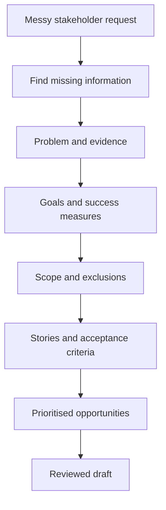
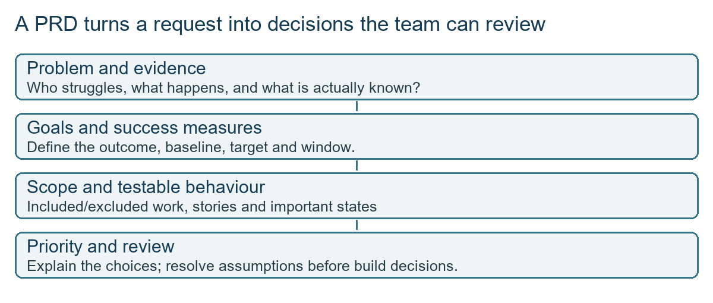
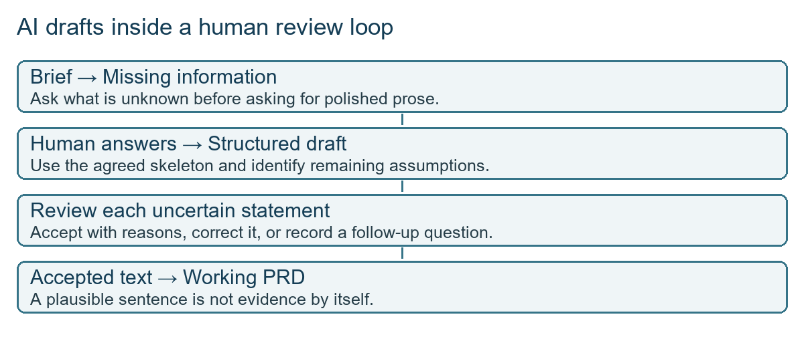
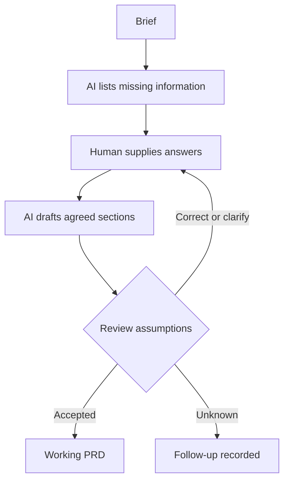
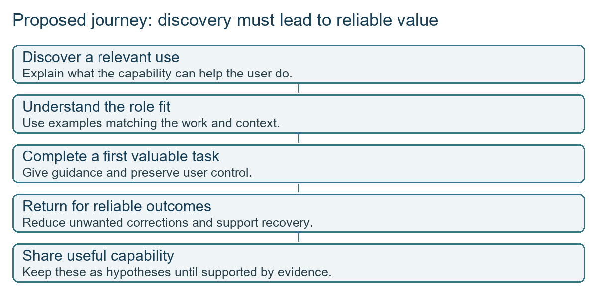

# Workshop: PRD writing with AI

27 Sep 2026 · Sunday workshop · No transcript exists, so this is built from the instructor's runsheet and a worked PRD document only

## The class in one minute

- A useful PRD (product requirements document) starts with a user problem, goals, a measurable success test and clear boundaries. A feature request is not yet a problem.
- A user story needs testable acceptance criteria covering the normal path, a blocked path and an already-done state.
- RICE compares ideas on reach, impact, confidence and effort. The Copilot table in the worked document is qualitative, not a calculated score sheet.
- Use AI to list the missing information first, then to draft from your answers with its guesses flagged as assumptions. The PM decides what stays.
- Review the draft against a fixed lens before calling it ready for engineering.

## Core ideas

A note on sources: the runsheet describes what was planned to be taught. It does not prove what happened live or what students said. The runsheet is titled "How Flipkart's PMs Write PRDs That Actually Ship", which does not make it an official Flipkart process.

### Structure before polished prose

The runsheet's four-part skeleton is problem, goals and metrics, scope, and exclusions. The demonstration starts with a weak problem statement, "we need a wishlist". That names a solution but not the user, the pain or the evidence. The stronger version names a segment (users with three or more items in the cart), a behaviour (23% abandon) and evidence (412 exit-survey responses pointing to a save-for-later need). These are teaching figures from the runsheet, not real Flipkart data.

A goal is the outcome in plain words. A success metric adds the measure, baseline, target and window: in the example, bring that segment from 23% to below 15% within 60 days of launch. A leading indicator (early use of the new feature) shows the mechanism is being tried; a lagging indicator (abandonment actually falling) shows the result. Scope in the example includes adding from the product page, viewing the list and moving an item to cart. It excludes shared lists, price-drop alerts and widgets. Exclusions earn their place by answering questions a stakeholder or engineer would otherwise ask.

*AI drafting sits inside a decision process. Formatting alone does not resolve uncertainty.*

**Remember:** name the user, the pain and the evidence before you name the feature.

### Stories and acceptance criteria

A user story reads "As a [user], I want [action], so that [benefit]". The weak wishlist story is too general. The better one is about a signed-in shopper on a product page who wants to find the item again without searching. Acceptance criteria use Given/When/Then: starting state, action, expected result. Three checks are the minimum in the example:

- Normal path: a signed-in shopper taps the icon, the item saves and the icon fills.
- Blocked path: a shopper who is not signed in is sent to login, with a defined rule for resuming the save.
- Already done: the item is already saved, the icon shows it, and the rule for another tap (remove, duplicate or nothing) is stated so engineers do not guess.

Depending on the product, network failure, unavailable items or retries may matter too. The runsheet's review exercise raises failed API calls and users mid-migration as other missing cases.

**Remember:** if an engineer must guess what a repeated tap does, the criteria are not finished.

### RICE and when a score is not the decision

RICE is Reach × Impact × Confidence ÷ Effort. In the planned sheet, reach is users affected per quarter, impact uses a 0.25, 0.5, 1, 2 or 3 scale, confidence is a percentage and effort is in person-months (work effort, not calendar time). The sheet sorts by score, but the PM must still say which inputs drove the top result and check MoSCoW-style constraints, since a necessary or strategic item can score low. Very different reach or effort estimates for the same item usually mean the item was misunderstood. Clarify scope before arguing about numbers. The actual backlog and scoring sheet are not in the folder, so no ranked result can be shown.

**Remember:** a sorted list is a starting point for a decision, not the decision.

### AI: gaps first, then draft, then review

This is the central method. Prompt one: paste the raw brief, say "do not write the PRD yet", and ask for the information needed for a proper problem statement, goal, metric and scope, separating what is known from what is missing. Then answer the questions as the stakeholder. Prompt two: draft only the agreed sections, make every remaining assumption explicit, do not invent evidence, baselines or targets, and keep unresolved decisions in a follow-up list. The PM accepts, corrects or follows up each assumption. Only accepted text goes into the working document.

The review lens has four parts: problem (user, evidence, baseline), goals and metrics (a number and a window), scope (exclusions, missing cases), and stories (normal, blocked, already-done). Output a fix list, where each item says the defect and a sentence that would resolve it, or names the decision still needed. "This is vague" is a weak note; "the target user is missing, specify the eligible shopper segment" is useful.

*An unanswered question stays visible until the responsible person decides.*

**Remember:** an assumption marker is a job for the PM, not permission to publish the guess.

### The worked Copilot PRD

The Word document is a concept PRD for an agentic Copilot (a system that plans and runs several steps toward an outcome), not a shipped product. Goals: more completed tasks across Microsoft apps and a higher task-success rate. Non-goals: a separate app, pushing users out of their workflow, and video creation. Weak spots to flag: the north star shifts between "adoption and use month over month" and "revenue or licences plus use", which are different units. Counter-measures include task drop rate, inactivation and user intervention rate, but "substantial" help is not defined, and a needed confirmation should not count as failure.

The persona (Aditi Sharma, a marketing manager in Bengaluru) and the journey maps (awareness, consideration, onboarding, retention, loyalty) come from AI-generated illustrations with no interviews behind them. Treat them as hypotheses. Three opportunities were chosen: "say what, not how" (describe the outcome), connector then browser then computer execution, and long-running work with saved state.

| Opportunity | Reach | Impact | Confidence | Effort | Priority |
|---|---|---|---|---|---|
| Say what, not how | Medium | High | Medium | Medium | P0 |
| Connector, browser, computer | High | High | High | Medium | P1 |
| Long-running work with state | Medium | Medium | High | High | P2 |

The second row looks at least as strong as the first on these labels, yet is ranked below it. There may be a strategic reason, but it is not written, so this is an author's call needing explanation, not a RICE result. Non-functional targets (45 seconds for simple tasks, three or four prompts per task, "little rework") lack definitions of what counts as simple or complete. The draft also asks for "chain of thought" in the log. A reviewable requirement is an action history with status and short explanations, not a promise to show hidden model reasoning.

*The stages show where the proposed value could break. Each needs evidence.*

**Remember:** a polished persona or priority table is still a hypothesis until evidence backs it.

## Worked example

Make the wishlist problem measurable. The baseline is 23% for the defined cart segment and the target is below 15%, a drop of more than eight percentage points. Eight divided by 23 is about 34.8%, so landing exactly on 15% would be about a 34.8% relative reduction. The 412 survey responses support the explanation of intent but are not automatically the denominator of the abandonment rate. A metric record names baseline, target, event, population, window and guardrail. If the wishlist is widely used but abandonment does not move, adoption alone has not proved the goal, which is why a leading and a lagging measure are paired.

**Applied to car loans:** swap in a new-car loan journey. Problem: applicants in a defined segment drop off at the document upload step, supported by whatever evidence you actually hold. Metric: share who finish the application within a window. Story: a signed-in applicant uploads salary slips; blocked path: login session expires mid-upload; already done: the document was uploaded earlier. Exclusions: co-applicants and top-up loans.

## Frameworks to reuse

| Section | Questions to fill |
|---|---|
| Problem | Who, what pain, what evidence, what current gap? |
| Goals and metrics | Outcome, baseline, target, window, guardrail |
| Scope | What behaviour is included? |
| Exclusions | Which adjacent requests are out of this delivery? |

| Story check | Template |
|---|---|
| Normal | Given [state], when [action], then [result] |
| Blocked | Given [blocked state], when [attempt], then [recovery] |
| Already done | Given [existing state], when [repeat action], then [defined result] |

Prompt pair to copy (adapted from the runsheet, not a class quotation). First: "Here is a stakeholder brief: [paste]. Do not write the PRD yet. List the missing information needed for a problem statement, goals, success metrics and scope. Separate facts supplied from unanswered questions." Second, after you answer: "Draft only the agreed sections. Make every remaining assumption explicit. Do not invent evidence, baselines or targets. Keep unresolved decisions in a separate follow-up list."

RICE columns: opportunity · reach with period · evidence · impact on the stated scale · confidence · effort in person-months · score · essential constraint · rationale.

## Self-test

1. What four areas does the runsheet's PRD skeleton cover?
2. Name the three state checks a sample story should cover.
3. What should the first AI prompt ask for?
4. Why can the Copilot priority table not be called a computed RICE result?
5. Why does a leading indicator not prove the business outcome improved?

**Answers**

1. Problem, goals and metrics, scope, and exclusions.
2. Normal path, blocked or not-signed-in path, and already-done state.
3. The missing information needed before drafting, with a plain "do not write the PRD yet".
4. It uses High and Medium labels with no numeric scales, reach period or effort values, and its order needs a rationale.
5. Early use shows the mechanism is being tried. Only the lagging measure, such as abandonment falling, shows the result.

## Homework from this class

No homework was set in this class. The runsheet's intended practice, if you want it, is yours to do: apply the gap-first prompts to a real brief you are allowed to use, write one story with the three state checks, run the review lens on your draft and share one concrete issue found.
