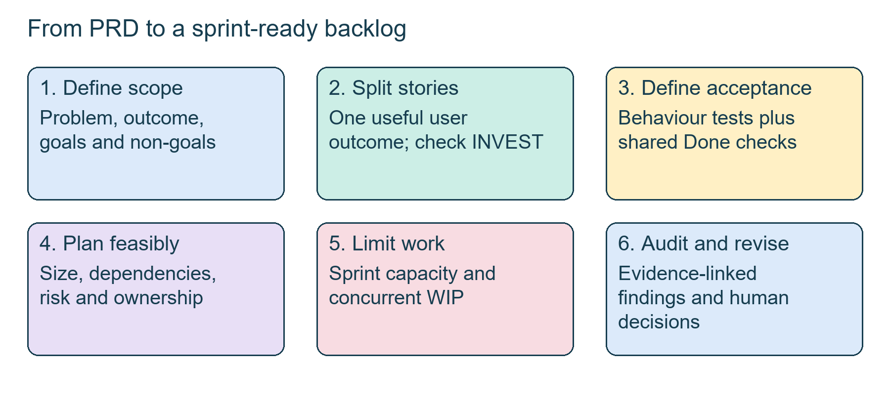
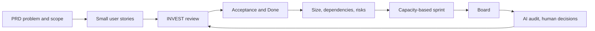
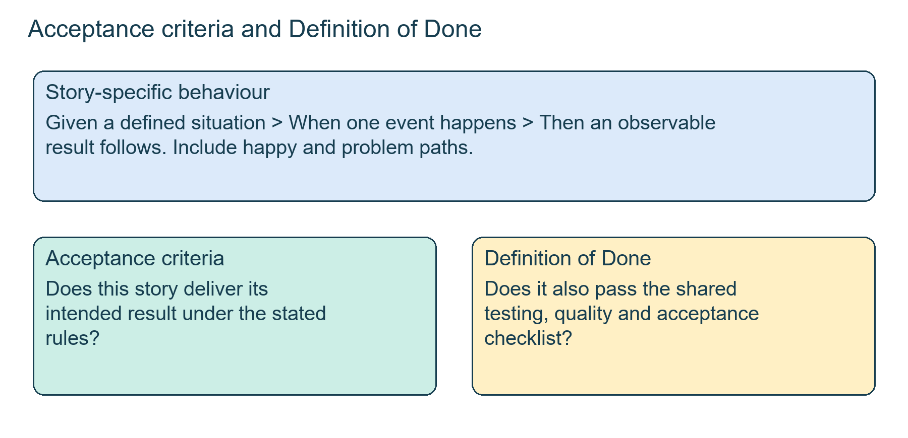
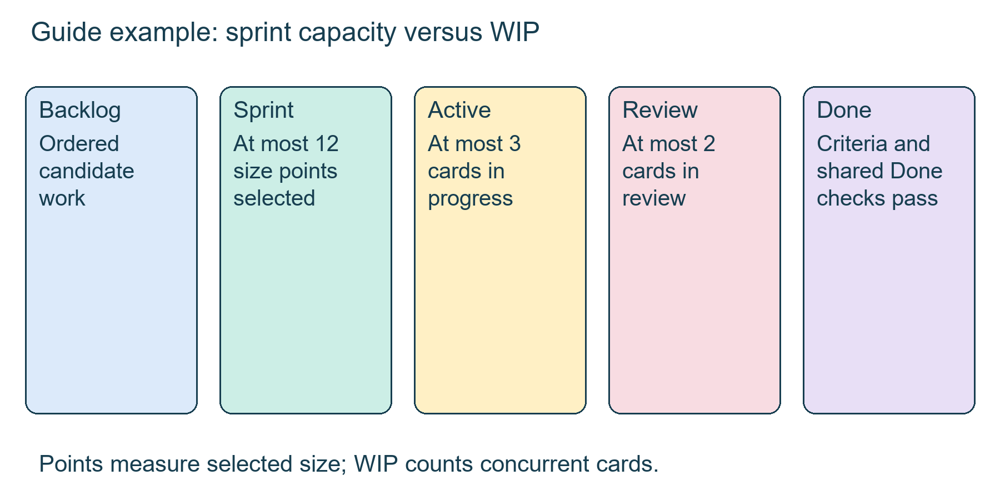
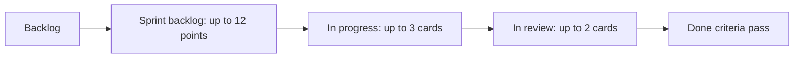
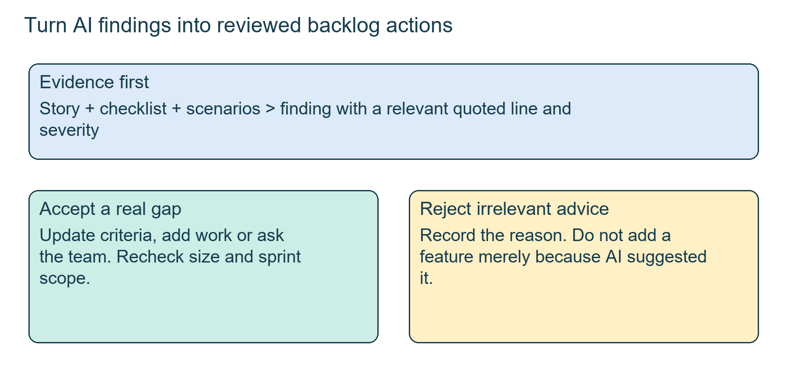

# Workshop: from PRD to sprint

4 Oct 2026 · Sunday workshop · No transcript exists, so this is built from two Word documents, two Excel workbooks and an eight-page session guide

## The class in one minute

- A PRD says what to build and why. A sprint-ready backlog turns it into small, valuable stories with acceptance checks, dependencies and owners.
- INVEST is the test for a story that is vague, too big or dependent. Given-When-Then makes expected behaviour visible, and a shared Definition of Done covers every story.
- The three sets of materials use different sizing methods and different story IDs. Never merge them into one baseline.
- Capacity (points you plan) and WIP (cards in flight) are separate limits.
- Use AI to critique and organise, then check its assumptions. Several schedules and scores in the files still need validating.

## Core ideas

The folder holds three planning examples. The working Copilot exercise (Word document and the Copilot sprint-plan workbook) uses data-analysis and Jira stories US1–US8. The Piyush sample workbook has a different Copilot story set, S1–S8, on an eight-week plan. The PDF guide uses a fictional quick-commerce "Smart Substitutions" feature, also S1–S8, and is not an official Zepto document.

### From PRD to small stories (INVEST)

The Copilot PRD states a goal of more completed tasks across Microsoft apps and a higher task-success rate, with three ranked opportunities (P0 say what, not how; P1 connector, then browser, then computer execution; P2 long-running work with state). Its table is "RICE-inspired" and qualitative, so do not turn it into a numeric ranking. Metrics include a counter-metric, a check that progress on the main number is not hiding harm (task drop rate, inactivity at 30 days, user intervention rate).

INVEST asks six questions of a story: Independent, Negotiable, Valuable, Estimable, Small, Testable. The exercise began with a too-broad story, a data analyst at Deloitte automating weekly tax-filing analysis. It was split into upload, processing and insights, and export. A bounded CSV or XLSX upload is easier to size than a pile of connectors (Excel, Sheets, Snowflake, Power BI). The final working set:

| ID | Story | Priority |
|---|---|---|
| US1 | Upload weekly dataset as CSV or XLSX | P0 |
| US2 | Identify nulls and unsupported characters | P0 |
| US3 | Generate concise key findings | P0 |
| US4 | Export analysis as XLSX | P0 |
| US5–US8 | Jira overdue issues via connector, website fallback, UI export, email summary | P1 |

A story in "As a [user], I want [action], so that [benefit]" format can still be too large or unclear. The format is not the test.

*Each stage carries the user need forward while adding detail for delivery and checking.*

**Remember:** keep story IDs tied to the file and version they came from.

### Acceptance criteria and Definition of Done

Acceptance criteria say what must be true for a story to be accepted. Gherkin is the Given/When/Then style: a starting situation, one event, an expected result. The guide also uses a short yes/no "done when" checklist. The working document first filed criteria under PQRSTU (Performance, Quality, Reliability, Security, Transparency, Usability), then corrected the mislabels. A "performance" row that only reported nulls by row number was really about detection, and a "quality" row rejecting data above one million rows was really a boundary rule. Even the corrected versions still say "agreed target" or "predefined sensitive patterns", so they are not yet ready for a pass or fail release decision.

The Definition of Done (DoD) is the shared checklist every story must pass: story criteria met, Android and iOS checked, analytics firing, no high-severity open bug, PM acceptance. These are the guide's examples for a team to agree, not a fixed list.

*Given-When-Then checks one behaviour. The Definition of Done checks the team's common conditions.*

**Remember:** a category label such as "performance" does not make a vague statement testable.

### Sizing: three schemes that must stay apart

The working Copilot exercise used the user's own estimates: S = one week, M = two, L = one month, XL = a quarter, with risk and impact each scored 1–5. The first workbook reads month as four weeks and quarter as twelve, and scores Impact ÷ (weeks × risk). For US2 (M, risk 3, impact 4) that is 4 ÷ (2 × 3) = 0.6667. The prompt explicitly told the assistant to keep these values and not replace them.

The PDF guide uses a different, relative scheme: Effort, Risk and Impact each scored 1–3 and added. A total of 3–4 is S (1 point), 5–6 is M (2), 7–8 is L (3), 9 is XL (5) and must be split before it enters a sprint. The guide's refund story scores 3+3+3 = 9, so it splits into starting the refund (2+3+3 = 8, L, 3 points) and showing refund status (1+1+2 = 4, S, 1 point). Guide points are not hours and not the Copilot week sizes. The Piyush sample has its own schedule with an assumed 12 October start and 39 work items across four two-week sprints, all "Not started"; its bracketed targets (90%, 95%, two seconds, fifteen minutes) are proposals awaiting sign-off.

**Remember:** an estimate, a derived score and a delivery commitment answer three different questions.

### Capacity, WIP and the board

The guide's board has five columns: Backlog, Sprint Backlog (capacity 12 points), In Progress (WIP 3), In Review (WIP 2) and Done. Capacity caps the points you select; WIP caps cards in flight. The sample Sprint 1 is S1 preference 2 + allergen rule 3 + eligibility 3 + fair charging 3 + same-brand 1 = 12 points, putting shopper safety and fair charging before comfort features (notification and rating wait). If three cards are in progress and an engineer is free, they do not pull a fourth. They help finish or unblock work already open.

*Twelve points caps the sprint. Three active cards and two review cards limit work in flight.*

**Remember:** a free person is not a reason to start more work.

### AI audit, and checking what the files say

The guide's audit prompt asks an assistant to act as a senior engineer reviewing one story, its checklist and its Gherkin. It must find unhandled edge cases, ambiguities, missing validation and hidden dependencies, quote the relevant story line for every finding, give a severity (High, Medium, Low), keep each to one sentence, and not rewrite the story or invent features. You then triage: is it real, and do you change the criteria, add a card, ask the team or ignore it? Useful gaps in the guide's case include several eligible replacements, price changing between checkout and packing, a closed payment method during refund, missing allergen tags, and what "same category" means. Generic security advice that does not point to the story gets rejected. A card from this process is labelled "From AI audit", which records where it came from, not that it is true.

Source problems to know about, because they are real:

- In the first workbook, US1's Total is 3 on the scoring sheet (3 ÷ (1 × 1)) but 1 in the copied backlog.
- Its six-week plan puts US7 (sized XL, twelve weeks) in week 4. The sizes and schedule are not reconciled.
- Its backlog leaves owners and sprints blank, and "Not Started" does not mean ready to release.
- The Piyush dashboard's story-status formulas match exact IDs, so shared prerequisites can be missed.

*A confident sentence becomes backlog work only after its relevance and impact are checked.*

**Remember:** the AI reviewer finds candidates for attention; the team decides the backlog.

## Worked example

The guide's price rule, step by step. FR3 says a replacement must be in the same category and priced within 10% of the original. FR4 says never charge more than the original. On an illustrative ₹120 item, 10% is ₹12, so a band read as plus or minus 10% is ₹108 to ₹132. The guide does not state the symmetric reading, so confirm it. Even if a ₹132 candidate qualifies, the shopper pays no more than ₹120, and a cheaper candidate is charged the lower price. If the only candidate has a different allergen tag (FR5), there is no replacement and the original is refunded.

Then plan: the 12-point Sprint 1 above covers preference, allergen safety, eligibility, fair charging and brand choice. Audit the selected stories with a quoted-line finding, decide whether to clarify the category rule or the refund-failure case, and update the plan if you accept it.

**Applied to car loans:** a "document upload" outcome from a new-car-loan PRD would split into upload, field check, credit officer review and decision letter. Each gets Given-When-Then criteria with a happy path and a problem path, such as an unreadable salary slip. Sprint selection puts the rule-checking safety stories first. Do not copy these into a plan without your team's own sizes.

## Frameworks to reuse

| Template | Fields |
|---|---|
| Story repair | As a [specific user], I want [one action], so that [observable benefit]. Then I, N, V, E, S, T each yes or no, issue, split |
| Acceptance | Given [state], When [one event], Then [testable result], plus a problem path and the shared DoD |
| Sizing (guide) | Effort + Risk + Impact, each 1–3; 3–4 S/1, 5–6 M/2, 7–8 L/3, 9 XL/5 split |
| Audit | Story and criteria · finding with quoted line · category · severity · real Y/N · action · size change |

Guide sizing formulas (row 2): `I2 = F2+G2+H2`, `J2 = IF(I2<=4,"S",IF(I2<=6,"M",IF(I2<=8,"L","XL")))`, `K2 = IF(J2="S",1,IF(J2="M",2,IF(J2="L",3,5)))`.

## Self-test

1. Expand INVEST and explain why the story format alone is not enough.
2. What is a Definition of Done, and how does it differ from a story's acceptance criteria?
3. Under the guide's sizing, what happens to a story that totals 9?
4. Name two conflicts to resolve in the first Copilot workbook.
5. Three cards are In Progress under a WIP limit of 3 and an engineer is free. What should they do?

**Answers**

1. Independent, Negotiable, Valuable, Estimable, Small, Testable. A well-formatted sentence can still bundle several outcomes or lack a pass or fail test.
2. The DoD is the shared completion checklist for every story. Acceptance criteria are specific to one story.
3. It is XL (5 points) and must be split before sprint selection.
4. US1's Total is 3 in Story Scoring but 1 in the backlog; the six-week plan is not reconciled with sizes such as XL at twelve weeks. Blank owners and undefined targets also need decisions.
5. Do not start a fourth card. Help finish or unblock existing work.

## Homework from this class

Sameer's to do. These are not done for you.

- Write about eight INVEST-reviewed stories covering the feature.
- Write criteria and Gherkin for at least five stories, including at least two problem paths, and a shared Definition of Done.
- Score Effort, Risk and Impact, calculate size and points, and leave no XL story unsplit.
- Build a five-column board within twelve points and the WIP limits.
- Run an AI audit: triage at least three findings, update two stories and add one accepted gap card labelled "From AI audit".

These outputs come from the PDF guide. No official deadline, rubric or learner submission is in the files, and the Piyush workbook's dates are assumptions, not deadlines.
