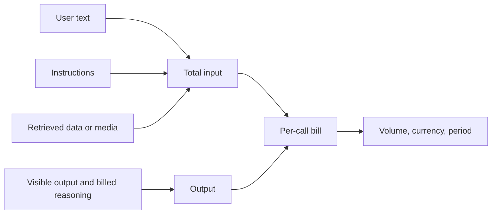
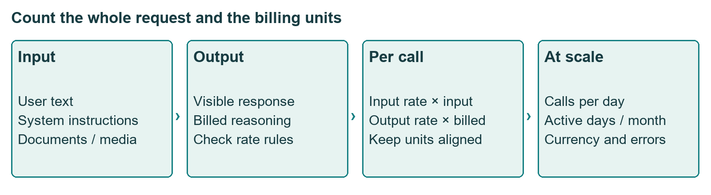
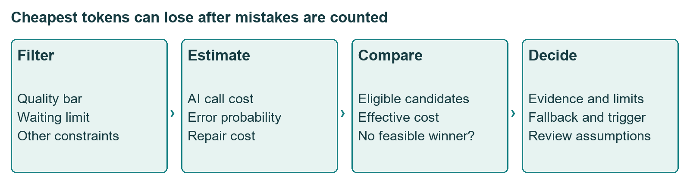
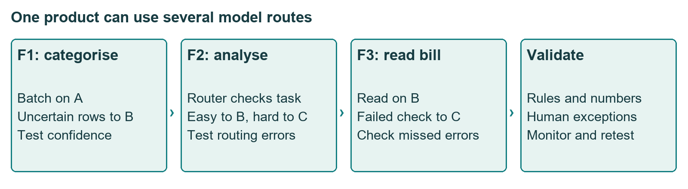
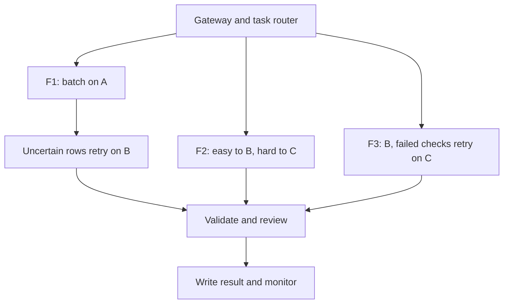

# Workshop: choosing and customising an LLM

17 Oct 2026 · Sunday workshop · No transcript exists, so this is built from a facilitator guide, a model-selection deck, a Word scratch file and a workbook; the cases (ZestCart, SheetMitra) are fictional classroom cases

## The class in one minute

- Start with the task and what it can tolerate: errors, waiting time, volume, data limits and budget. There is no universal best model.
- Count the whole request: the user's text, system instructions, supplied context, visible output and any separately billed reasoning.
- Time to first response and generation speed are different things. A capable model can still fail the user's waiting-time budget.
- Public benchmarks shortlist candidates. Your own test cases decide. A valid format, a correct answer and a helpful explanation are three separate qualities.
- Choose a route, not just a model: batch simple work, escalate hard cases, validate outputs and retest after every change.

## Core ideas

All prices, speeds, scores and accuracies below are illustrative classroom numbers from the files, not current provider data. The "Session 14" in the deck's filename does not make this the portal's Session 14.

### Customisation ladder: prompt, examples, RAG, fine-tune

The ZestCart guide uses a quick-commerce support assistant that must pick a label (DELAY, MISSING_ITEM, PAYMENT_REFUND, REPLACEMENT_ISSUE, APP_BUG, or MULTIPLE for several issues) and write a short friendly JSON reply under thirty words, without promising refund amounts or timing. Five rungs, from cheapest to heaviest:

| Rung | What changes | Use when |
|---|---|---|
| Plain prompt | A direct request | Quick tests |
| Instructions | Role, rules, format | You need steady tone or structure |
| Few-shot examples | A few input and output pairs in the prompt | Labels or style are inconsistent |
| RAG (retrieval-augmented generation) | Relevant current documents supplied with the request | Answers depend on changing facts or policy |
| Fine-tuning | Further training on consistent examples | A narrow repeated behaviour at volume justifies it |

The playground exercise runs three versions on six test messages: A is a direct request, B adds the instructions, C adds five examples. Score each reply 0 or 1 for category, valid JSON and tone, giving eighteen points per version. Start a fresh chat for each message so earlier answers do not leak. The five examples do not include MULTIPLE, and the sixth test needs it, which exposes a coverage gap. The guide says no real fine-tuning is done live; adding examples to a prompt is few-shot prompting, not tuning. Its decision aid: keep prompting if the examples version reaches at least 16 of 18 (a classroom threshold, not a production rule), use retrieval for changing facts, and revisit tuning when volume, hundreds of consistent examples and cost savings justify it.

**Remember:** fix the actual cause of failure. More training does not cure missing or changing information.

### The cost of a request

Cost per call = input tokens ÷ 1,000,000 × input rate + billed output tokens ÷ 1,000,000 × output rate. The SheetMitra case (a fictional Bengaluru startup, 5,000 paying users at ₹999 a month, ₹90 per dollar, 20 working days) shows how little of the bill the typed words can be. Feature F2, Ask-the-Sheet, has a 27-token question but 3,027 input tokens once instructions and sheet context are added, so over 99% of the input is not the user's text. The workbook also bills hidden "thinking" at the output rate, which is its own assumption, not a universal rule.

Worked line, F1 on model card A: 315 input tokens at $0.10 per million plus 10 output tokens at $0.40 per million is $0.0000355, or ₹0.003195 per row. At 200,000 rows a day that is ₹639 a day and ₹12,780 over 20 days, about ₹2.556 per paying user. Use unrounded values until the end. The Word scratch file mixes rounded and unrounded figures (it gets $7.20 a day, which is ₹648, not ₹639), so trust the workbook.

*Hidden context and the billing of reasoning can dominate a short request.*

**Remember:** the visible prompt can be a small part of the bill.

### Latency, batching and limits

Speed is output tokens per second. TTFT is time to first token. The warm-up: 2 seconds TTFT plus 800 tokens at 100 per second is 2 + 8 = 10 seconds. If a provider's TTFT already includes hidden reasoning, adding reasoning time again double-counts it. The workbook's F1 budget is one second per row: cards A and B pass, the frontier card C fails because its start delay is 1.5 seconds. Batching changes that: fifty rows at one row per call, with ten parallel calls, takes five waves. At twenty-five rows per call it takes two calls in one wave, and C passes that bulk job. Peak load is checked as calls per day × peak-hour share ÷ 60 against a rate limit (200,000 × 25% ÷ 60 is about 833 requests per minute against 1,000), though the workbook ignores shared limits and token caps. Passing a time budget says nothing about whether the answer is right.

**Remember:** name the interval you are measuring before comparing two latency numbers.

### Effective cost: cheap tokens can lose

Effective cost per task = AI cost + (1 − accuracy) × cost of fixing one error. Fixing a wrong F1 label is half a minute at ₹10 a minute, ₹5. For F1 on card B: ₹0.010755 + 4% × ₹5 = ₹0.210755. Card A, at an assumed 91%, comes to ₹0.453195. Choose the lowest effective cost among candidates that clear the quality bar and the time limit, and the sheet needs a "no eligible model" message rather than returning a false winner when none pass.

*Check the quality and time gate first, then pick the lowest effective cost.*

**Remember:** compare cost per useful completed task, not cost per token.

### Benchmarks and your own golden set

Benchmarks such as MMLU-Pro, GPQA Diamond, AIME, LiveCodeBench, IFBench and MMMU test different skills. The workbook weights them per feature (F1: 40% MMLU-Pro and 60% IFBench) and scores with SUMPRODUCT. Arena-style preference scores convert to an expected win rate of 1 ÷ (1 + 10^((rival − own)/400)); a 70-point lead gives about 59.94%. That is a preference probability, not accuracy. Read sample questions and scoring before trusting a leaderboard label.

A golden set is a reviewed collection of task inputs with expected results. Score three things separately: rule check (allowed label, valid JSON), reference correctness, and reference-free quality such as helpfulness. In the ten-row expense test, A produced nine valid labels but only seven correct ones. A strict text match marked a correct GST formula wrong because it was written differently, so equivalent answers need normalising. On bill extraction, model B got 13 of 15 fields (86.67%) but only 3 of 5 whole bills (60%), and the whole bill is what the user needs. Ten cases leave about 31.6% rough uncertainty by the workbook's 1/√n heuristic, so expand the set and run a beta.

**Remember:** score rules, correctness and usefulness separately, and show small-sample uncertainty.

### Routing

A gateway handles login, rate limits, masking and cost logging. A router then sends F1 rows in batches of twenty to the cheap model, retrying low-confidence ones (under 0.8) on card B; F2 questions are labelled easy or hard, easy to B and hard to C; F3 bills go to B, with a retry on C if totals do not add up. A validator checks labels, JSON and numbers before anything is written. The gains rest on assumed subset accuracies and retry shares, not measurements, and a totals check cannot catch a wrong date or vendor.

*Every branch needs its own evidence and validator.*

**Remember:** a route is only as good as the evidence for its branch choices, retries and validation.

## Worked example

F1 expense labelling, step by step. Tokens alone favour card A at ₹0.003195 a row. Add correction cost and B wins at ₹0.210755 against ₹0.453195. Card C is accurate (97% assumed) but fails the one-second limit, so it is not eligible. Then a batched, escalating route (twenty rows per request, 12% escalated to B) is assumed to cost ₹0.0019206 a row with 96.4% blended accuracy, but only if its easy-row 97% and hard-row 92% assumptions hold. Check those on real data before believing the saving. In the workbook's F1–F3 comparison the routed token cost is ₹300,266.28 a month against ₹1,071,198 for frontier-for-everything, about 72% lower; including correction costs the saving shrinks to about 22.85%.

**Applied to car loans:** treat extracting fields from a salary slip or RC copy like the bill job. Measure field accuracy and whole-document accuracy separately, because one wrong income figure ruins the file. Compare AI draft cost plus a credit officer's correction time across models, and only use confidence-based retries after testing them on your own documents. This is a thought experiment, not a class case.

## Frameworks to reuse

| Model decision field | Your answer |
|---|---|
| Job and success unit | |
| Volume (calls, users, period) | |
| Quality bar and acceptance | |
| First response and completion limits | |
| Cost: rates, context, reasoning, error repair | |
| Data and hosting limits | |
| Primary model, retry, fallback | |
| Golden set and uncertainty | |
| Numeric switch trigger | |

Memo outline: use case and volume · customisation choice · chosen model and fallback · cost, time and quality evidence · benchmarks used and their limits · own-task test before launch · switch trigger.

## Self-test

1. List three input-cost ingredients beyond the user's typed words.
2. A model has 2 seconds TTFT, produces 800 tokens at 100 tokens per second. How long does it take?
3. Does a valid JSON label prove the answer is right?
4. Why can an inexpensive model have a higher effective cost than a pricier one?
5. What separates few-shot prompting from fine-tuning?

**Answers**

1. System instructions, supplied documents or sheet context, retrieved context or media (and billed reasoning and retries under some rate models).
2. 2 + 800 ÷ 100 = 10 seconds under the source's timing convention.
3. No. Format validity and correctness are separate checks.
4. Its higher error rate multiplies the repair cost per task, which can outweigh the token saving.
5. Few-shot examples sit in the request. Fine-tuning updates the model through training, which the workshop does not perform.

## Homework from this class

Sameer's to do. These are not done for you.

The folder "Home work exercise" holds the assignment ("Exercise 7: ZestCart Capstone", a 60-minute guide dated 13 Oct 2026 and signed @Arun Nandewal) and a participant workbook. You pick one AI model for ZestCart's support assistant (500,000 messages a month) in the Ex7 ZestCart tab, in five parts:

- 7A (15 min): customisation ladder. Prompt, examples, RAG or fine-tune? Fill the missing rows and decide whether tuning is worth it.
- 7B (12 min): context window. Does everything fit, and what does pasting the whole handbook cost compared with RAG?
- 7C (15 min): where customer data may go, and whether self-hosting open-source pays off.
- 7D (10 min): which model passes all four gates (accuracy, reply time, context fit, privacy), with a fallback.
- 7E (8 min): write the one-page decision memo using numbers from 7A–7D, then run the "break it on purpose" what-if changes.

Check your answers against the Check lines in the guide, and compare your memo with the facilitator's version only after you finish. The workshop guide also lists practice outputs: three playground scores, ten training-style rows (all six labels, two held back for testing), a tune-or-not recommendation, a five-candidate comparison, benchmark reading cards and a one-page memo. No deadline was given.
